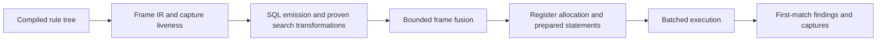

# SQL compiler work reduction

The measured compiler still spends hundreds of millions of VM steps on a small input.
This design changes the work that emission requests from SQLite.
The SQL engine uses one compiler configuration in production and diagnostic builds.
Filter fusion, shared search, and bounded frame fusion run automatically when their safety conditions hold.
There are no environment switches for old compiler implementations.
The losing first-candidate probe and alternate answer-difference implementation are removed.

## Execution pipeline



The frame IR records nodes, capture columns, operator order, utility calls, and three-valued behavior.
A frame row carries an input key, file, node, and only the captures that later operators need.
Three-valued clauses also carry an unknown flag and a withheld-capture mask.

The emitter writes set operations over those rows.
Frames normally use Rust column buffers behind SQLite virtual tables.
Indexed temporary B-trees hold relations that need ordered or grouped access.
The frame fusion pass removes safe intermediate relations before register allocation assigns reusable storage.

Each worker retains one SQLite session and its prepared statements across batches.
A batch runs in one transaction.
Native pattern and semantic terminals receive complete input sets through virtual tables.
Recursive utilities use demanded-key and answer tables with host-controlled loops.
They use no recursive CTEs.

## Why the remaining gap needs demand analysis

The issue is work amplification before SQLite executes the queries.
Nested searches can expand a small tree into millions of candidate pairs.
Capture-dependent utilities also distinguish environments that differ only in node occurrence.
Copies and repeated evaluation then multiply the cost of those intermediate rows.

The current transformations reduce frame-copy rows by 24 percent, but remove only four percent of VM steps on the real trace.
That trace still has 678,834 candidate rows and 156,872 capture-bearing demands.
Those counts do not change under the transformations.
The next design must restrict capture-dependent inputs before candidate and demand construction.

## Preserve the evaluation contract

Each operator returns at most one verdict per input row key.
First-match searches commit the first successful candidate's bindings.
Strict searches stop at an unknown candidate, while non-strict searches continue.
An unknown conjunction withholds later terms that mention unavailable captures.
Recursive dependencies include only the reads that native execution reaches.
A change must preserve recursion refusals, complete findings, captures, fixes, and suppression state.

## Deterministic filter fusion

Without fusion, a three-valued conjunction emits a term's output frame, then another frame to merge the accumulated verdict and withheld mask.
Kinds and plain regex predicates cannot return unknown or change captures.
For these terms, emit one filtered selection that carries the existing verdict and mask.
For the first term, reset that metadata to zero as the original operator contract requires.
Later terms preserve it.
No term moves ahead of a preceding term.

The first term's extra copy is also unnecessary when it cannot add a withheld mask.
Its operator output already contains the correct verdict, captures, and zero mask.
Reuse that frame when the term cannot withhold, has no bind bits, or is a deterministic leaf.
Keep the existing path for other terms.

The compiler applies this transformation when the term satisfies those conditions.
Unknown propagation and withheld-capture tests cover the transformation.

## Shared descendant search

The eager search builds every root/descendant pair, evaluates each candidate, and selects the first success afterwards.
The rejected first-candidate probe repeats the complete search after a failed probe.
Instead, evaluate an input-independent predicate once per distinct node and store its successful bindings.
Then each root performs an indexed range seek for its first eligible descendant.

The initial scope covers `has: end` with kinds, plain regex, and fresh-environment patterns, including conjunctions of those leaves.
A fresh pattern may bind captures, but cannot read the input environment.
The search can appear in a two-valued or three-valued clause because these accepted bodies never return unknown.
Reject bound patterns, arbitrary semantic terminals, nested relations, utilities, exclusions, and other operators.
All rejected shapes retain their original lowering.

For each input file, compute an enclosing interval from the input roots' minimum ID and maximum subtree end.
Construct one frame containing that interval's distinct nodes of the required kinds.
The interval can include gaps between roots.
Those extra nodes cannot affect results because the final lookup applies each root's exact subtree interval.
Evaluate the sub-rule over this domain in one batch.
Store successful `(file, node, capture columns)` rows in a temporary `WITHOUT ROWID` table keyed by `(file, node)`.

A search then selects:

```sql
SELECT node
FROM eligible
WHERE file = input.file
  AND node > input.node
  AND node <= root.last
ORDER BY node
LIMIT 1
```

Join that node's captures to the original input row.
Preserve every input capture that the sub-rule does not bind.
Return only one output row for each input key.

The ordinary frame virtual tables support equality lookups, rather than ordered range seeks.
Therefore this prototype requires a real SQLite B-tree for its successful-node relation.
A frame index declaration alone does not provide the required access path.
The B-tree contains at most one row per eligible node, rather than one per root/node pair.

For nested roots with immediate matches, the candidate domain and output grow linearly.
For a predicate with no matches, the domain still grows linearly and the empty successful set ends every search.
Late matches also avoid the eager root/node cross product.
Small, isolated roots can lose from domain setup.
The selected implementation accepts that setup cost and avoids the quadratic expansion for supported bodies.
The real corpus gains about four percent from the combined transformations.

The transformation preserves capture liveness and register lifetimes.
It introduces neither recursive CTEs nor per-row native matcher calls.

## Bounded frame fusion

The first filter fusion removes only deterministic leaves and initial metadata copies.
The broader pass runs over emitted statements before register allocation.
It substitutes a frame only when that frame has one insert and exactly one SQL consumer.
The consumer must be the next executable step.
Schema declarations and a clear of the new consumer frame may intervene.
Every other mutation, recursive check, and loop marker remains a barrier.

Frames that allocate row IDs remain materialized.
The root frame, indexed eligible-node relations, and native frame handles also remain materialized.
Grouping, sorting, and compound queries retain materialized indexes.
The query-plan gate caught repeated scans when the first prototype removed those indexes.
The pass counts references inside terminal descriptors, as well as ordinary SQL references.
Arbitrary join consumers retain their materialized inputs.
The allowed metadata projection rejoins only the original input by its row key.
It composes the producer and consumer's emptiness rules so empty-input skipping remains sound.

The substituted query uses named CTE columns to preserve the frame's schema.
Unary plus removes non-key column affinity without changing stored values.
This preserves comparisons that would otherwise change when a derived query inherits an integer or text affinity.

Each definition appears once.
A query can absorb at most four frames and must remain within 64 KiB of SQL text.
These limits prevent the repeated-reference expansion identified in the original SQL design.

A native terminal can fail, so its evaluation cannot move behind a later filter.
Only complete metadata projections can absorb such a producer.
A later filter still reads a materialized result.
Pure SQL producers can fold into more general consumers when no mutable-state barrier intervenes.
The prototype retains explicit input sets and materialized terminal CTEs.
Native callbacks still evaluate sets in batches.

The compiler always runs this bounded pass before register allocation.
Comparison and runtime-error regression tests accompany the native differential gate.

## Progressive search for the remaining operators

Capture-dependent and recursive bodies cannot use one global eligible-node set.
Their answer depends on their input captures, unknown state, or recursive answers.
A future frontier must carry the original input environment and the last visited position for each unresolved root.
It evaluates bounded candidate batches and advances only unresolved roots.
It must never restart from the first candidate after an unsuccessful batch.

Successful roots commit their first candidate's captures.
Strict unknown roots finish unknown.
Non-strict unknown roots remember that event and continue until success or exhaustion.
Dependencies from earlier batches remain reachable even after their candidate frames are cleared.
Recursive answer changes must reopen roots whose stopping decision depends on those answers.
This requires explicit frontier state and dependency tracking, rather than extending the existing probe flag.

## Compiler properties for demand narrowing

The next pass needs capture-use properties that distinguish unification, identity, source location, and semantic reads.
Existing read and bind sets identify required columns, but do not prove that two occurrences are interchangeable.
An unsupported use retains the exact capture key.

These properties belong in the operator IR before SQL emission.
The pass derives candidate restrictions from bound captures before a walk allocates its candidate frame.
Utility lowering then chooses lookup keys separately from the original bindings returned to callers.
Nullable captures retain a separate unbound mode.

Ordered effects also constrain these transformations.
A terminal failure cannot move behind a filter that hides it.
An unknown verdict can stop a strict search or withhold a later capture-dependent term.
Recursive reads must remain attached to the roots that reach them.
The compiler needs those proofs before it can share or defer the work.

This pass is a proposed extension.
The current implementation does not normalize capture-dependent utility keys or maintain progressive frontiers.

## Capture-aware demands and frame ownership

The real-corpus trace leaves candidate and capture-bearing demand counts unchanged.
Future lowering must prove capture-dependent restrictions before constructing those rows.
Bound-pattern selectors are one possible source of restrictions.
Any hash-based selector must preserve native structural unification, including non-leaf nodes and nullable captures.

A separate experiment can specialize keys for read-only bound captures.
A utility can use a captured leaf identifier only through pattern unification, yet its current key stores the identifier's occurrence ID.
After proving that usage, an interned `(kind, token text)` atom can identify equivalent lookup inputs.
The evaluator still needs a representative node.
The caller's original capture must survive in the returned environment.
An inherited capture cannot be replaced by another occurrence merely because their names agree.

The unbound case needs a separate key mode because the utility can bind a fresh node.
Identity-sensitive operations, exclusions, semantic reads, and unsupported uses must retain exact node keys.
This specialization requires capture-use analysis and separate lookup-key and returned-binding representations.
It is a design candidate, rather than an implemented or measured optimization.

Further copy reduction can use row-selection views over immutable capture buffers.
A view retains its backing data while source registers are cleared or reused.
Changed captures and metadata use new columns, while unchanged captures share storage.
Memory accounting must count retained backing buffers and selection vectors.
This avoids substituting evaluated expressions into later SQL and can preserve existing lookup indexes.
It requires a frame-store ownership change and is outside the current SQL-only fusion spike.

## Validation and remaining limits

Run complete-output comparisons against native on positive, negative, late-match, capture-dependent, recursive, and unknown fixtures.
Run the generated differential suite and saved replays against the single compiler configuration.
Reject a negative benchmark if planning skips SQL entirely.
The negative search fixture uses repeated-variable unification, which necessary pattern anchors cannot decide.
Inspect query plans for indexed range seeks and avoid whole-table inner scans.
Compare the 32-file tuning scan and all 138 manifest files with identical rules and source bytes.
Use separate traced and timed runs.
The shared-search B-tree has no separate byte budget, like the other temporary B-trees in this engine.
Its row count is bounded by eligible nodes in the batch, rather than root/node pairs.
An explicit temporary-storage budget remains future work.
Benchmark comparisons against older compiler versions use separate commit builds.
