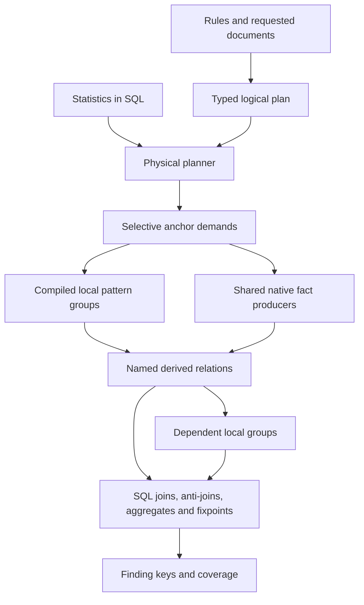

# Plan for shared structural execution

Status: implementation underway, 2026-10-26. See [the implementation journal](shared-structural-execution-journal.md).
The full async-family reference and generated SQL prototype pass their execution gates.
Generic grammar lowering and production cutover remain pending.
Baseline: `c6ff8110`, with the retained build-49 measurements.
Design integration reference: `Pulling-it-all-together` at `0b941fb4`.
Implementation branch: `jeremy/shared-structural-execution`, based on integration commit `85098ee3`.

The target compiler emits a graph of local pattern groups, shared facts, and relational operators.
The unit of execution is a producer or a compiled group over a bounded document batch.
The cohort interpreter remains a migration oracle. It is absent from the final production execution path.

## 1. Evidence and governing decisions

The current full workload submits 54.4 million roots and records 385.5 million chained control advances.
Removing 8.26 million owned semantic requests reduces instructions by only 0.48% against the adjacent control.
This experiment removes leaf transport without removing the composition that generates those requests.
These counters measure work. They do not provide exclusive CPU attribution.

Sources:

- [Measured suffix experiment](../benchmark/python-import-suffix-guard-spike.json).
- [Current qualification](../benchmark/sql-native-capture-cohort-rejected.json).
- [Transition journal](sql-matcher-fragment-transition.md).
- Sibling `docs/rule-engine-direction/findings-contract.md`, especially sections 3 and 7.
- Sibling decisions 0005, 0006, and 0007, plus `spec-transducer.md` section 0 and `spec.md` sections 9 and 21.
- Sibling `prior-work/ast-index-spike-design-index.md`, topics 5, 6, 7, and 10.
- Sibling lessons ledger, lessons 11, 12, 14, 16, and 17.

The findings contract and named-fact decision remain proposed in the sibling decision index.
This plan proposes their adoption as prerequisites for the replacement compiler.
The accepted anchor and neighborhood decisions already constrain the physical plan.
Later decisions take precedence over older examples that put every per-document analysis inside the transducer.

The prior work supports selective anchors, bounded tape reads, narrow facts, and explicit materialization boundaries.
It does not support a global node table, a generic SQL interpreter, or an unconditional scan for every rule.
The new design agrees with those conclusions. Its performance remains to be measured on this workload.

## 2. Required output semantics

The engine returns finding keys and coverage outcomes:

```text
finding(rule, code, path, line [, declared_column, declared_tag])
coverage(rule, document, Complete | Unknown(reason))
```

Order, duplicate witnesses, incidental captures, utility depth peaks, and memo replay charges do not define finding identity.
Explicit priorities remain rule semantics. The compiler lowers them to exclusions or priority relations.
The compiler preserves captures that affect a later condition or a declared output location.
It can omit captures used only for optional presentation.

One consolidation step maps report nodes to source locations, applies suppressions, removes duplicate keys, and computes additions and retractions.
It requests message or fix payloads only for findings that need them.
Native rehydration can supply a valid witness for those keys. It cannot decide whether the replacement engine found a match.
Its cost appears in the output phase and the end-to-end report.

For example, `has(foo($X)) AND has(bar($X))` requires a join on the declared equality of `$X`.
Two independent Boolean existence tests are incorrect.
The compiler retains every required export tuple until that join finishes.
An existence-only output can stop after one valid witness.

Finding-set equality alone does not prove that every legacy choice can become an unordered union.
A later condition can read a capture chosen by an earlier alternative.
Phase 0 records the intended semantics of those constructs and any required rule migration.
The compiler preserves an intended priority through explicit algebra. It does not infer permission to change finding keys from witness freedom.

An empty complete relation means false. An incomplete relation does not prove absence.
Anti-joins and universal conditions require complete coverage of their probe domain.
Legacy logical unknown remains distinct from resource exhaustion during migration.
Phase 0 defines its truth tables before an operator moves to set execution.

The first replacement publishes a domain only after its required producers finish successfully.
Failure produces `Unknown` for affected rule/document pairs and discards their provisional outputs.
Other documents in the batch can finish.
Cache hits, cache eviction, and thread scheduling must not change complete finding sets.

## 3. Target plan and scheduler



The graph is stratified. Facts and local exports can feed later facts or local groups.
An arbitrary cycle across SQL and native execution is a compile error.
A declared positive recursive component has one fixpoint owner.

The plan contains these records:

```text
RelationSpec {
  id, schema, key, functional_dependencies, partition,
  semantic_digest, inputs, completeness_domain, estimated_rows
}
Stage {
  id, input_relations, output_relations,
  physical_operator, scope_digest, memory_bound, reuse_count
}
ProgramGroup {
  grammar, exact_scope_digest, canonical_programs,
  shared_prefixes, labels, required_facts, export_schemas
}
Plan {
  stages, dependencies, SQL_statements, prepared_parameters,
  statistics_decisions, execution_budget, finding_projection
}
```

`physical_operator` selects a local program, native fact producer, relational query, or declared fixpoint.
It never selects an opaque `AstMatcher` remainder.
A program group runs across many documents. Many labels share one document traversal within that group.
The scheduler does not create a general continuation frame for each `all`, `any`, `not`, or utility return.

Local programs can contain bounded cursor state and branches.
The CPU reference executor and CPU JIT use the same set semantics and export schemas.
Metal uses the same contracts, with compact task arrays and declared resource bounds.
Moving the existing frame stack to Metal is outside this plan.

## 4. Initial relation schemas

These are target schemas, not claims about current table names.
Document and node columns use stable identities within a plan invocation.
Persistent cache keys also contain source, grammar, and producer identities.
Atoms use interned integer identities with exact value equality.

| Relation | Columns | Key and purpose |
| --- | --- | --- |
| `py.call` | `doc, call, callee` | `(doc, call)`; one structural call fact |
| `py.call_site` | `doc, report_node, call, ref_node` | `(doc, report_node)`; valid callee positions, including transparent parentheses |
| `py.exec_context` | `doc, node, owner, context_kind` | `(doc, node)`; nearest applicable execution boundary |
| `py.call_arg` | `doc, call, arg, ordinal, keyword_atom, spread_kind` | `(doc, call, arg)`; syntax facts independent of a rule signature |
| `py.binding_site` | `doc, binding, site, value_node, element_index` | Declared binding/site key; assignment and destructuring facts |
| `py.ref_resolution` | `doc, ref_node, reading_mode, binding, qualname_atom, status` | `(doc, ref_node, reading_mode)` within one semantic configuration |
| `wanted_symbol` | `label, symbol_atom, requirement` | Small literal policy relation, compiled once |
| `t_export_<schema>` | `group, label, doc, root, <typed exports>` | Distinct tuples under the declared schema |
| `t_match` | `group, label, doc, report_node` | Positive rule results before location consolidation |
| `t_outcome` | `producer, doc, domain, complete, reason` | Coverage for the exact demanded domain |

The resolver configuration includes language options, reading rules, and module inputs that affect the answer.
Ambiguity is explicit in `status` or in a separate multi-valued relation.
The compiler cannot assume that every analysis has one binding per reference.

`py.exec_context` respects function bodies, lambda bodies, class boundaries, defaults, and decorators.
It does not mean “any enclosing async function.”
`report_node` stays separate from `ref_node`, because normalization can change the source line.
Embedded and parsed documents retain their own identities and source maps.

Each fact has one owner for its semantic identity and covered domain.
Selective resolution can cover only a requested reference set.
The cache records that set, including completed negative results. A partial cache entry never implies document-wide completeness.
Reuse requires compatible inputs and domain containment, not only an equal document id.

## 5. Exact first conversion

The first family contains ASYNC210, ASYNC221, ASYNC222, and ASYNC230 in the shipped Python catalog.
It includes their argument and binding conditions, not only their direct-import branches.
The compiler recognizes generic algebra and producer contracts. It contains no checks for these rule ids.

The physical graph is:

```text
document scope + call anchors
  -> shared callee-position / execution-context program
  -> distinct callee references in relevant contexts
  -> one resolution batch for those references and semantic configurations
  -> join with wanted_symbol(label, symbol, requirement)
  -> demand argument or binding facts only for surviving branches
  -> compiled local checks + typed joins for mode/value conditions
  -> finding-key projection + complete-domain publication
```

The direct-import branch has this generated SQL shape:

```sql
WITH sites AS MATERIALIZED (
    SELECT doc, report_node, call, ref_node
    FROM local_call_sites
    WHERE demand = :call_context_demand
),
refs AS MATERIALIZED (
    SELECT DISTINCT doc, ref_node FROM sites
),
resolved AS MATERIALIZED (
    SELECT doc, ref_node, qualname_atom
    FROM resolve_refs
    WHERE demand = (
        SELECT ref_demand(doc, ref_node, :semantic_config) FROM refs
    )
)
SELECT DISTINCT w.label, s.doc, s.report_node
FROM resolved AS r
JOIN wanted_symbol AS w ON w.symbol_atom = r.qualname_atom
JOIN sites AS s ON s.doc = r.doc AND s.ref_node = r.ref_node
WHERE w.requirement = :direct_call_requirement;
```

This SQL defines the intended data dependencies. Phase 1 supplies executable DDL and parameters for the chosen bindings.
`local_call_sites` returns completed structural exports from one shared group.
`resolve_refs` returns completed resolution rows from one batch.
Neither virtual table emits interpreter instructions, search edges, or suspended frames.
Empty demand means no work. Missing required demand is an error, not permission for a full scan.
`wanted_symbol` contains only the active group's labels. Every label in that group has the same candidate scope.

`MATERIALIZED` protects a reused producer boundary in this example.
The plan must check `xFilter` counts and actual loops. The keyword alone does not prove one execution.
The physical join order can change with statistics, while these data dependencies remain fixed.

ASYNC221's spawn branch adds signature-based argument selection and a binding/value join for `os.P_WAIT`.
ASYNC230 adds receiver and binding-value exports for `Path(...).open()`.
Those branches consume generic facts and local exports. They cannot call the old matcher to finish the rule.

A useful work bound for the family is:

```text
anchor reads
+ local checks over selected calls and their bounded neighborhoods
+ distinct requested (document, reference, semantic configuration) resolutions
+ demanded argument and binding rows
+ necessary joins and output tuples
```

There is no factor for utility-stack depth or repeated evaluation of the same prefix by each rule.
Some rules intrinsically require many tuples. The plan records that output bound instead of promising universal linear execution.

## 6. Compiler transformations

| Source construct | Target |
| --- | --- |
| Local kind, field, text, pattern | One compact local program with selective anchors |
| Pure conjunction | Fused tests, ordered by cost and rejection rate |
| Disjunction | Shared prefix plus labelled alternatives; set union across independent exports |
| Negation | Local absence test or SQL anti-join against a complete domain |
| Capture-dependent composition | Typed export and equality join, with the declared comparison mode |
| Small non-recursive utility | Canonical inline expression |
| Shared local utility | Shared program region by digest |
| Shared relational utility | Named derived relation with one physical owner |
| Tree relation | Anchored posting access or bounded tape neighborhood |
| Count or ordinal | Local bounded reduction or grouped relation with explicit order requirements |
| Graph recursion | Positive or stratified fixpoint over typed edges and newly discovered tuples |
| Parse, binding, arguments, values | Batch producer plus dependent local programs or joins |

The compiler computes capture liveness, equality modes, dependencies, keys, and effects before physical planning.
It distinguishes existence outputs from exports that require all valid tuples.
Explicit priority becomes an exclusion relation, not accidental traversal order.
Unstratified negation or a dependency cycle requires a semantic design decision before catalog completion.
It never triggers a generic interpreter fallback.

Fusion requires identical candidate scopes, grammar, semantic configuration, and compatible output obligations.
Canonical program digests permit shared prefixes and deduplicated utilities.
Different scopes remain separate consumers, even when they reuse compatible immutable document facts.
The planner does not widen a selective scope to a union merely to create a larger batch.

## 7. Physical planning, storage, and SQL budget

The planner reads stored kind, value, edge, and fact statistics in one bounded lookup.
It records the statistic keys and decision intervals with the compiled plan.
It chooses anchors, traversal direction, join order, grouping, and materialization before execution.
It never recounts every batch in Rust or through runtime `count(*)` probes.
Missing statistics use a documented conservative plan and appear in the plan report.

The accepted anchor index remains mandatory. Construction cost has a separate report.
Unanchored inner plans read their scope's neighborhood. Anchored plans retain their selective postings.
The planner does not build an ancestor-pair table or decode every parent to answer a local relation.

Single-consumer local intermediates stream through typed buffers or inline SQL.
Reused or recursive derived relations have one narrow materialization and explicit indexes.
Rows contain integer identities and declared values. They do not contain full tapes, general capture maps, or JSON unions.
Materialized results survive all consumers in their scope, then release their resident storage.
Persistent facts use semantic digests and input generations, with explicit completeness records.

The frozen job retains the hard budget of 100 rule-execution SQL statements.
The budget includes rule-triggered fact materialization and recursive execution statements.
Preparation, diagnostics, and independent index construction remain separately reported.

```text
job statements = shared SQL producer stages
               + bounded consumer statement groups across resident partitions
               + explicit additional stages
               <= 100
```

The first family targets one consumer statement per resident partition.
Its native producers stream documents internally and share typed buffers.
For the broader catalog, a shared SQL fact stage spans the job rather than repeating once per file or rule.
A recursive CTE counts as one execution. An external loop that reissues SQL counts every execution.
The compiler rejects a plan whose declared stages exceed the budget before execution starts.
Runtime tracing checks the actual count, including hidden producer statements.

## 8. Implementation phases and exit gates

Phases are family-sized changes. Each phase includes compiler output, executable evidence, and a journal entry.
The sequence does not require user prompts between individual grammar conversions.

| Phase | Deliverable | Exit gate |
| --- | --- | --- |
| 0. Contract and inventory | Finding-set adapter; logical-unknown truth tables; semantic-difference ledger; utility/program census with producer attribution | All existing complete findings accounted for; no silent differences; frozen corpus, source, and binary identities |
| 1. Executable target | Typed contracts; independent reference implementation for the full async family; generated-shape prototype; scoped cost ledger | Correct aliases, boundaries, arguments, binding values, captures, and report lines; all four rules complete |
| 2. Generic compiler | Canonical local/algebra IR; fact extraction; shared groups; SQL composition for the complete family | Renamed utilities and captures use the same lowering; zero cohort-interpreter calls for the family; CPU improvement gate below |
| 3. Structural and capture families | All/any/not, bounded walks, stops, counts, ordinals, equality joins, and shared utility producers | B007/B023 and every catalog member of the converted forms pass; no hidden full-rule callbacks |
| 4. Recursive and semantic families | Typed fixpoints; parsed-document facts; binding/value/call dependencies; remaining catalog forms | Explicit catalog coverage reaches 100%; cycles and unknowns have defined behavior; no operational replay implementation |
| 5. Incremental and integration | Dependency invalidation; payload consolidation; complete job on the integration tree | Cold and warm execution, three edits, retraction, coverage, memory, and SQL-budget gates pass |
| 6. Cutover and backend completion | One production compiler; old scheduler removed from production; CPU/JIT and Metal behind the same contracts | Full workload gates pass; backend coverage is explicit; no silent CPU fallback from Metal |

Phase 1 includes an independent reference producer/query for the whole family.
It gives the generated compiler a concrete shape and cost target.
Renaming, scope changes, and added unrelated syntax prevent rule-specific shortcuts from passing admission.

Proposed Phase 2 go/no-go targets:

- At least 2x lower execution CPU than native for the complete family on the frozen workload.
- Generated execution CPU within 1.25x of the independent reference shape.
- Zero continuation advances in the old cohort interpreter for converted rules.
- One resolution evaluation per distinct demanded reference and semantic configuration within the producer scope.
- No repeated shared producer for another rule label in the same group.
- Doubling labels with identical predicates leaves producer input work unchanged, apart from output and demultiplexing.
- Unrelated nodes outside selected neighborhoods do not cause additional matcher visits.
- Zero resource unknowns on complete qualification fixtures.

These are proposed acceptance thresholds, not measured improvements.
If the reference shape fails, the design changes before the generic compiler expands to more families.

The full-job hard ceilings remain CPU ratio 1.30, median edit ratio 1.50, RSS 1.5 GiB, and 100 SQL executions.
The target is to outperform native. Passing the ratio ceiling alone does not establish the product's one-to-two-second audit target.
The shipped Python catalog and the sibling data-layer workloads have separate reports. Their timings are not interchangeable.

Each comparison reports construction, compile/prepare, execution, and complete end-to-end cost separately.
The existing whole-apply gate remains intact. A new execution-only report does not replace it.
The replacement must also pass the CPU ceiling on execution alone, so construction costs cannot hide a matching regression.
Whole-job comparisons alternate engines on the same inputs and configuration for at least three recorded samples.
CPU, wall time, and RSS are acceptance evidence. Instructions, visits, and dispatch counts explain the result.

## 9. Instrumentation that makes the shape reviewable

Each plan dump includes relation schemas, keys, dependencies, exact scopes, generated SQL, materialization owners, and statistics decisions.
Each stage reports input/output rows, distinct keys, node visits, bytes, CPU, wall time, cache coverage, and outcome counts.
Reports distinguish producer work from consumer work and distinguish total time from exclusive stage time.
Parallel stage times are not added as job wall time.

The profiler flags:

- Repeated `(producer digest, input identity, covered domain)` computation.
- A file or root entering several incompatible copies of the same candidate scan.
- A materialization with one consumer and no demonstrated execution-boundary need.
- A join whose actual multiplicity exceeds its declared key bound.
- A virtual table filtered once per row instead of once per batch.
- An opaque matcher callback or cohort continuation in a converted family.
- Missing coverage behind an anti-join, or cache-dependent complete findings.

Focused fixtures run during implementation. Full catalog and whole-job checks run at phase gates.
Another full run requires a changed implementation or a specific unresolved measurement question.

## 10. Integration, retirement, and completion

Implementation uses an owned branch based on the current integration tip.
The sibling worktree remains untouched. The plan records updated source revisions before the first implementation phase.
Existing producer contracts, tape/index access, typed demand handles, statistics, and qualification tools remain reusable.
The target module boundaries follow the sibling `engine/plan`, `engine/facts`, `engine/transducer`, `engine/vtab`, and `engine/compose` layout.
Until that relocation occurs, adapters use the corresponding existing modules. They do not establish another permanent compiler namespace.

The current production engine remains unchanged while the replacement qualifies in tests.
Test reports identify converted and uncovered families explicitly. A mixed migration benchmark cannot claim full replacement.
There is one production cutover after complete coverage and whole-job qualification.
There are no user-facing opt-in paths and no per-rule interpreter fallback after cutover.

The pure-SQL binding remains a separate backend contract with explicit coverage.
Its implementation uses specialized relational SQL. Missing coverage never recreates a program counter inside CTEs.
CPU and Metal are backend implementations of the same plan, not different rule languages.

Completion requires all of the following:

1. Every catalog grammar maps to explicit local programs, facts, and relational operators.
2. No production matching plan executes through `cohort::Bank`, `State::Util`, or an opaque whole-rule matcher.
3. Named facts have one physical owner, complete domain records, and dependency-based invalidation.
4. Finding sets and coverage pass the declared contract, with reviewed semantic differences recorded.
5. Full workload CPU, wall time, memory, and edit behavior meet the agreed phase gates.
6. SQL statements and native producer work satisfy their explicit budgets.
7. The journal records the final plan, source and corpus identities, generated SQL, and raw measurements.
