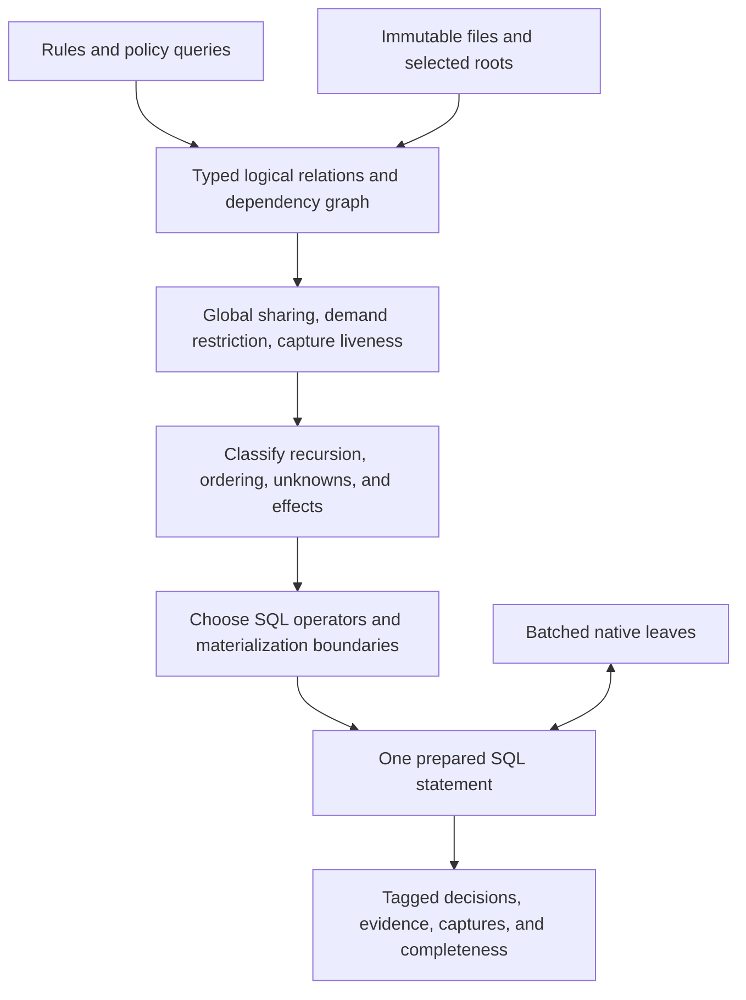

# Whole-call SQL compiler spikes

This report records the experiments before engine integration.
The [compiler journal](sql-set-composition-compiler-spike.md#production-integration-of-accepted-relational-spikes--2026-10-21) records their production adoption and complete-call measurements.

These experiments target one actual SQL execution across all selected files and rules in a Rerail call.
They run under Rust tests. They do not change the addon or add runtime switches.
The existing production compiler still uses its frame scheduler.
See [the SQL generation follow-up](sql-generation-shape-spikes.md) for newer shapes, profiling, few-statement execution, and compiled recursive CTEs.

## Decision

Build an immutable, typed relational compiler before allocating storage.
Keep relation references symbolic through rule matching and policy composition.
Select terminal demand sets and physical storage after global sharing and capture analysis.
Compile the resulting program to one SQLite statement, or a few bounded phases when backend limits justify them.

Native leaves can process their input sets in parallel within that execution.
Statement count must stay small relative to the complete workload, rather than growing with workers, files, or rules.

The data-layer provides useful examples of this architecture.
Concatenating the current emitted statements into CTEs is insufficient.
That approach retains work amplification and exceeds SQLite preparation limits on the real policy subset.



The final compiler needs one physical planning policy.
The test harness compares alternatives to select that policy.
Those alternatives are experiments, not user-facing execution modes.

## Executable experiments

Sources are under `native/src/code_rule_dsl/sql/spikes/whole_call/`.

| Area | Spike and result | Remaining boundary |
|---|---|---|
| Logical compiler | `direct.rs` lowers supported logical operators directly into shared relations. A test executes 603 rule consumers in one statement. | Captures, effects, and recursive units need direct lowering. |
| Migration | `adapter.rs` converts existing acyclic emission into immutable relation versions. | It explicitly rejects mutable demand instructions and host scheduling markers. |
| Global sharing | `graph.rs` interns relation bodies, schemas, and boundary contracts across rules. | Structural SQL identity is a migration technique. Use logical operator identity in the final compiler. |
| Output schemas | Results carry a clause tag, file, root, and capture payload. Large output unions use bounded groups. | Add the complete policy decision and evidence schema. |
| Capture inputs | Native pattern inputs publish only the key, file, node, and named read columns. | Typed exported text needs a complete native interface. |
| Integer keys | `integer_keys.rs` compares capture-bearing fact calls with composite text keys and integer demand IDs. Complete returned occurrences and unknowns agree. | The native environment decoder still uses scalar strings internally. |
| Terminal batching | `homogeneous.rs` compares distinct predicate batches with one heterogeneous native batch. Both use one SQL execution. | Select demand representation from cardinality and reuse. |
| Policy composition | `composition.rs` embeds the existing `select_when` expression over symbolic leaf relations. | Preserve lazy evaluation and fallible branches across arbitrary query trees. |
| Cross-file composition | `crossfile.rs` joins captured names across files, including Unicode and missing evidence. Budget and completeness results match native evaluation. | Implement arbitrary policy field projections and workspace integration. |
| Enumeration | `each.rs` enumerates a proved subtree witness shape and preserves distinct occurrences. | General exclusion-sensitive bodies need their own lowering. |
| Input snapshots | `inputs.rs` changes file versions on one connection and tests all, selected, duplicate, and empty roots. | Connect the complete workspace selector contract. |
| Positive recursion | `recursive.rs` compares a witness-propagation CTE and a tree interval join with native and scheduled SQL captures. | This does not establish equivalence for arbitrary recursive utilities. |
| General recursion | `recursive_machine.rs` compiles real operators into a continuation CTE. Fixtures cover captures, negation, counts, unknowns, and reached cycles. | Complete unsupported scope and leaf contracts, and replace expensive generic transitions with specialized relations. |
| SQLite limits | A minimal shared diamond reproduces the table-reference limit. Physical buffer experiments bound producer expansion. | Use a backend preparation budget in physical planning. |
| Execution contract | `run.rs` uses SQLite tracing to assert exactly one statement execution, including nested executions. | After integration, add this assertion to addon-level acceptance tests. |

The native aggregate only publishes typed rows into a buffer.
It does not execute SQL or interpret rule combinators.
Native terminal tables evaluate leaves in batches.
Rule composition remains SQL.

## What the data-layer contributes

The inspected data-layer checkout was at commit `fce4dc7208c0b892c11a549c8be43fc285580d6b`.
Its history includes the PR 2539 integration work.
The strongest examples are these files:

| Source | Apply to Rerail |
|---|---|
| [Dependent read CTE strategy](https://github.com/neralabs/nera-data-layer/blob/fce4dc7208c0b892c11a549c8be43fc285580d6b/impl/common/l2070_server_plan/strategies/dependent_read_cte.py) | Compile a read dependency graph in topological order. Publish typed references before compiling consumers. Return tagged results. |
| [Dependent read contracts](https://github.com/neralabs/nera-data-layer/blob/fce4dc7208c0b892c11a549c8be43fc285580d6b/impl/common/l2070_server_plan/strategies/dependent_read_contract.py) | Require relation columns and types. Reject missing contracts and dependency cycles explicitly. |
| [Symbolic reference compilation](https://github.com/neralabs/nera-data-layer/blob/fce4dc7208c0b892c11a549c8be43fc285580d6b/impl/common/l2070_server_plan/steps/_compile_server_ref.py) | Preserve SQL references instead of fetching intermediate values to plan later operations. |
| [Homogeneous CTE strategy](https://github.com/neralabs/nera-data-layer/blob/fce4dc7208c0b892c11a549c8be43fc285580d6b/impl/common/l2070_server_plan/strategies/homogeneous_cte.py) | Group compatible result shapes and dependency contexts. Check cardinality before combining outputs. |
| [JSON aggregation](https://github.com/neralabs/nera-data-layer/blob/fce4dc7208c0b892c11a549c8be43fc285580d6b/impl/common/l2070_server_plan/strategies/json_aggregation.py) | Normalize heterogeneous final outputs without copying every intermediate relation into JSON. |
| [Compilation contracts](https://github.com/neralabs/nera-data-layer/blob/fce4dc7208c0b892c11a549c8be43fc285580d6b/l2070_batching/compilation.py) | Make typed publication and dependency bindings part of the compiler interface. |
| [Scheduling effects](https://github.com/neralabs/nera-data-layer/blob/fce4dc7208c0b892c11a549c8be43fc285580d6b/l2070_batching/scheduling_effects.py) | Represent required boundaries and observable effects before selecting a physical strategy. |

The dependent-read strategy produces one SQL statement and applies directly.
Some other data-layer paths count one transport round trip while permitting multiple physical statements.
Those paths do not satisfy this experiment's execution contract.
PostgreSQL mutation CTEs also require a separate SQLite design.

## SQLite preparation is a compiler constraint

The migration adapter admits 55 of 141 Python clauses from the current 135-policy workload.
Its combined graph has 694 relations.
All three ordinary CTE materialization policies fail preparation with `too many references to "node": max 65535`.
`AS MATERIALIZED` does not prevent this failure.

SQLite copies and resolves CTE definitions before the execution materialization decision can help.
Repeated references in a shared dependency diamond therefore expand during preparation.
A small synthetic diamond reproduces the failure at depth 16.
The graph's estimated expansion count also saturates on the real subset.

One physical experiment replaces selected relation references with native buffer tables.
SQL producers populate those buffers through typed aggregates.
Consumers name the buffer, so preparation does not recursively expand its producer.
A recursive SQL schedule sequences this finite acyclic producer list inside the same statement.
This schedule does not implement recursive rule semantics.

The first buffer version used a chain of readiness CTEs.
It exceeded SQLite's expression depth on the corpus.
This is another reason to budget physical syntax depth as well as runtime work.

## Real policy subset results

The final buffer schedule executes all 55 admitted clauses across every selected file in one actual SQL execution.
Complete roots and captures match the existing SQL engine.
Unit tests also compare supported shapes with the native engine.
The corpus run uses the current 135-policy pack, not Tim's original 818-clause catalogue.
This remains a matching-kernel experiment without workspace policy selectors, rendering, or cross-file policy decisions.

| Files | Matches | Existing SQL CPU | New complete kernel CPU | New execution CPU | New preparation CPU | Published rows | Peak live rows | VM steps |
|---:|---:|---:|---:|---:|---:|---:|---:|---:|
| 32 | 26 | 1.108 s | 1.247 s | 1.199 s | 31.6 ms | 1,030,624 | 231,157 | 58,912,840 |
| 138 | 449 | 6.184 s | 6.815 s | 6.687 s | 34.5 ms | 5,496,676 | 1,227,285 | 314,001,606 |

The complete kernel column includes batch construction, connection setup, registration, preparation, execution, and output decoding.
Logical compilation and SQL rendering occur before that timer.
The existing SQL timer covers the first session run after session construction.
These are single measurements, sufficient to reject a large speedup claim.
Small latency differences need repeated runs.

Materializing all reachable relations is the best completed migration variant.
The reuse-only variant takes 2.417 seconds on 32 files and exceeds the execution guard on 138 files.
The boundary-only variant exceeds the guard on both workloads.
All ordinary CTE variants fail preparation.
These alternatives explain the physical planning constraints, but they are not production choices.

The new statement publishes 701 sets and 8.76 million cells on 32 files.
On 138 files, it publishes 46.66 million cells.
Clearing dead buffers reduces peak live rows by about 78 percent compared with retaining every publication.
It does not reduce total published rows or SQL work.
Some column vectors retain allocated capacity, so this counter does not establish an equivalent reduction in memory use.

One SQL statement alone therefore does not fix the frame compiler's work amplification.
The direct logical compiler and restricted demand sets address a different, necessary part of the problem.

## Terminal demand measurements

This benchmark uses 128 generated kind-and-regex rules with eight distinct predicates over 32 real data-layer files.
It is not the original 135-policy workload.
All variants return the same 76,064 matches.
Times below are CPU measurements from one process per variant group.
Small timing differences need repeated runs.

| Matching kernel | CPU | Actual SQL executions | Other work |
|---|---:|---:|---|
| Native matcher | 488 ms | 0 | Existing native rule evaluation |
| Existing SQL scheduler | 1,760 ms | Not traced here | 368 scheduled steps; this count is not a physical statement count |
| One SQL, batches by distinct predicate | 118 ms | 1 | Eight text terminal calls; 7.48 million VM steps |
| One SQL, heterogeneous terminal batch | 935 ms | 1 | One terminal call; 474,688 demand tuples; 82.03 million VM steps |

The heterogeneous batch publishes 1,898,752 cells and builds an automatic index with 479,440 rows.
The predicate batches publish no native demand buffers and build no automatic index.
Each query prepares in less than one millisecond on this run.

On 138 files, complete kernel CPU is 635 milliseconds for predicate batches and 5.941 seconds for the heterogeneous batch.
Native CPU is 2.514 seconds, and existing SQL CPU is 9.278 seconds.
All variants return the same 324,416 matches.
The heterogeneous representation constructs 2,502,744 distinct demands and executes 444.74 million VM steps.
The predicate representation executes 34.43 million VM steps.

The preferred shape for these compatible rules is:

```sql
WITH
roots(k,file,node) AS MATERIALIZED (
  -- Restricted candidate nodes across every selected file.
  SELECT file*4294967296+id,file,id FROM node WHERE kind = :identifier_kind
),
t0(k) AS MATERIALIZED (
  SELECT ek FROM text_match WHERE term=0 AND ek IN (SELECT k FROM roots)
),
t1(k) AS MATERIALIZED (
  SELECT ek FROM text_match WHERE term=1 AND ek IN (SELECT k FROM roots)
),
matches(term,k) AS (
  SELECT 0,k FROM t0 UNION ALL SELECT 1,k FROM t1
),
rule_plan(rule,term) AS (
  -- Metadata maps every compatible rule to its distinct predicate.
  SELECT CAST(key AS INTEGER),value FROM json_each(:rule_terms)
)
SELECT p.rule, m.k >> 32 AS file, m.k & 4294967295 AS node
FROM matches m JOIN rule_plan p ON p.term=m.term;
```

The executable benchmark uses eight leaf relations in this shape.
Each relation handles all files and every rule that shares its predicate.
Complex programs need additional typed dependencies and guarded demand relations inside the same statement.

Minimize distinct demanded work and intermediate width.
Include demand cardinality in the batching cost model.
A single statement can contain several set-based leaf reads without violating the whole-call contract.

## Recursion requires an explicit semantic contract

Of the 141 real clauses, 78 contain genuinely cyclic utilities.
All 78 clauses carry captures.
Of these clauses, 60 contain negation and 14 contain capture-dependent facts.
These counts describe entire clauses, not necessarily the operators inside each strongly connected component.
Another four clauses require `violation.each` enumeration.
The remaining refusals include acyclic memo utilities and semantic demand-frontier scheduling.

An insert-only recursive relation cannot preserve every native result.
An earlier successful candidate can replace a later selected capture.
A newly available recursive answer can also invalidate a negated result.
SQLite additionally rejects multiple direct recursive references within a recursive member.

Classify recursive components before choosing their lowering.
Use ordinary SQL for acyclic memo dependencies.
After proving equivalence, use tree intervals or positive closure.
Other components need ordered demands, replaceable answers, dependency invalidation, and the native cycle-refusal contract.
The original synthetic full-state SQL schedule demonstrates replacement, but it is not a general compiler solution.
The [follow-up compiler](sql-generation-shape-spikes.md#recursive-rule-compilation) now executes real recursive operators in SQL.
Its incomplete result is a demonstration status, not a replacement for native cycle-refusal semantics.

Do not move the native recursive interpreter behind a SQL function to satisfy the statement counter.
That would preserve the current architectural problem.

## Required logical contracts

Each relation needs columns and types, input scope, row identity, cardinality, ordering, and capture read/write sets.
It also needs unknown and withheld-capture behavior, completeness, observable errors, and recursive dependency information.
Sharing requires compatible contracts, not merely identical leaf text.

Keep occurrence identity separate from memo equivalence.
Equal capture text can share some terminal work, but returned captures must retain their original file and occurrence.
Preserve first-match order and three-valued withholding throughout composition.
Do not eagerly evaluate a fallible branch that native execution would leave unread.

Physical planning must consider fan-out, candidate cardinality, capture width, index access, preparation expansion, and buffer lifetime.
The buffer spike computes each buffer's last physical reader through inline dependencies and clears dead buffers inside the statement.
A depth-40 diamond test bounds live rows while preserving the final answer.
Native terminal input handles still live until the call ends.
The aggregate also boxes rows before copying them into typed columns.
Reuse compatible physical storage after its last reader, and measure allocated bytes separately from live rows.
Remove redundant publication and boxing costs before production adoption.

## Reproduction and acceptance

Run the focused tests:

```sh
cargo test --profile loop --features unbounded-work \
  --manifest-path native/Cargo.toml whole_call -- --nocapture
```

The ignored corpus tests read `RERAIL_WHOLE_CALL_CONFIG` and write `RERAIL_WHOLE_CALL_OUTPUT`.
Use a workload config with `corpus`, `capabilities`, `policies`, and relative `files`, as emitted by the existing profiling harness.
Run `whole_call_corpus` for admitted real clauses and `homogeneous_corpus` for the generated terminal benchmark.
Add `--ignored --nocapture` to run either experiment.
The macOS environment used here additionally requires its existing `JEMALLOC_OVERRIDE` shim.

The drivers save SQL, coverage refusals, timings, VM counters, publication counts, and parity results.
The final local artifacts are under `/tmp/rerail-whole-call-20261021/final-*`.
`final-manifest.json` records the frozen test binary, source hashes, base commit, and workload config hashes.
Completed plans must preserve complete roots and captures.
Rejected plans report their errors without silently invoking the old scheduler.
The execution guard stops excessive VM work or wall time.

Production adoption requires full workload coverage, complete policy parity, and addon-level tracing of one execution across all files and rules.
Measure preparation, execution, native terminal work, memory, and output decoding separately.
Compare the same policy set, corpus, file versions, limits, and parallelism.
The current whole-engine timings cannot be compared directly with these narrower matching-kernel measurements.

Validation passed: 180 SQL tests, test and production Clippy, script tests, import boundaries, Windows paths, and formatting.
The existing structure check still reports two misplaced benchmark fixtures and fixture reads in `sql/tests/policy_guards.rs`.
This work does not change those files.

## Implementation sequence

First, give the logical IR typed relation references for capture-bearing operators and policy queries.
Keep schemas, scopes, and effects explicit before allocating frames.
Use the SSA adapter as a differential migration aid.
The final compiler needs direct lowering of logical operators.

Next, restrict terminal demands before publishing captures.
Share eligible node sets, retain only read columns, and group compatible work by predicate.
If shared integer node sets provide the required input, avoid constructing a node-by-term relation.

Then, inline acyclic memo utilities as relational dependencies.
Classify cyclic utilities and implement only transformations that preserve their ordered demand semantics.
Keep unsupported components visible in coverage reports until their complete lowering exists.

Finally, choose physical materialization from preparation limits and measured access paths.
Reuse counts alone miss correlated rescans and lost indexes.
Release buffers after their last reader.
Require full policy parity and one traced statement before replacing the existing production compiler.
