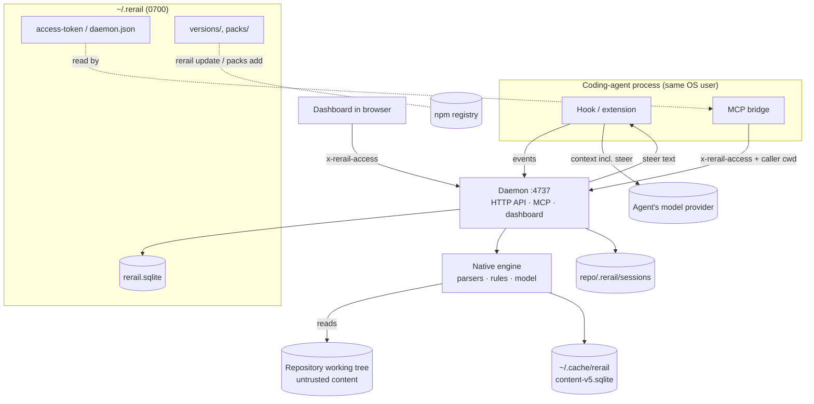

# Threat model

What Rerail protects, from whom, which boundaries it enforces, and what risk remains. Each control names the file and
symbol that implement it. [privacy.md](privacy.md) covers what data Rerail keeps and sends;
[SECURITY.md](../SECURITY.md) covers reporting a vulnerability.

## What Rerail is, for security purposes

Rerail is a local, single-user guardrail in the coding-agent loop: it advises the agent and never enforces.

- **Hooks and extensions** (`src/hosts/<harness>/`) forward the agent's prompts, replies, tool calls and tool outputs
  to one resident daemon per Rerail home.
- **The daemon** (`src/daemon/daemon.ts`) evaluates rules with a native engine (`native/`), records everything in
  `~/.rerail/rerail.sqlite`, and serves a dashboard, HTTP API and MCP endpoint on `127.0.0.1:4737`.
- **Steer** text is what the daemon writes back into the agent's context.
- **npm** supplies rule packs and Rerail's own updates.

Hooks never deny a tool call; a `block` rule is delivered exactly like a `steer` rule
(`src/engine/catalog/rule-mode.ts`). Rerail does not stop an agent from doing anything. Its integrity property: when
running and reachable, it tells the agent when it breaks a rule.

## Assets

What Rerail holds that is worth attacking, and where it lives.

| Asset | Where | Why it matters |
| --- | --- | --- |
| Session history: prompts, replies, tool inputs, **raw tool outputs** | `rerail.sqlite` (`RerailRuntime.persistEvent`) | Whatever the agent saw, secrets included, unredacted. |
| Pre-edit source text and session ledgers | `<repo>/.rerail/sessions/<sha256(session)>/events.jsonl` | Source and prompt text in the working tree; `rewind` restores from it. |
| Source copies, syntax trees, check results | `~/.cache/rerail/content-v5.sqlite` (Windows: `%USERPROFILE%\AppData\Local\rerail\content-v5.sqlite`) | A second copy of every file the engine read. |
| Rule catalog: rules, packs, settings, start state | `rerail.sqlite` | Decides what reaches every future session, and whether Rerail is armed. |
| Daemon access capability | `~/.rerail/access-token`, `daemon.json` (0600) | Full `person` API: all repositories, unredacted transcripts, every write. |
| Executable code Rerail launches | `~/.rerail/versions/<v>/`, `current`, `bin/rerail`, `update-state.json`, `RERAIL_ENGINE_PATH` | Runs on every hook, daemon start and CLI call. |
| The agent's context window | Steer messages | Read by a model that has tools. |
| Device identity key (internal testing) | OS keychain (`src/activation/device-keystore.ts`) | Binds a signed customer profile to the machine. |
| Release capability | GitHub `release` environment, npm trusted publisher, CI secrets | Reaches every user through `rerail update`. |

## Actors

Who interacts with Rerail, and how far each is trusted.

| Actor | Trusted? | What it can do |
| --- | --- | --- |
| **The person** (OS user who installed Rerail) | Yes | Everything. The `person` caller on `/api`. |
| **The coding agent** | **Partly.** Well-behaved MCP client, but may be prompt-injected and usually has a same-user shell | `agent` caller on `/mcp`, scoped to its checkout. With a shell, anything a same-user process can do (T1). |
| **Repository content**: source, config, `.git`, committed `.rerail/`, `.npmrc`, `.claude/settings.json` | **No** | Parsed by the engine, quoted in steer text, decides where some files are written. |
| **Rule-pack authors** (`@neralabs/rerail-pack-*` on npm) | For content, not code | Packs are JSON and `.rerail` rule files; their `message` and `fix` text reaches the agent. |
| **npm registry and Rerail's release pipeline** | Yes, with no extra integrity check | Supplies the code Rerail runs. |
| **Another OS user on the same machine** | No | Reaches loopback ports, reads world-readable files, sees process arguments (`ps`). |
| **A sandboxed process allowed to reach localhost** | No | Reaches `127.0.0.1:4737`; cannot read `~/.rerail`. |
| **A web page in the person's browser** | No | Sends requests to localhost; no custom headers without a CORS preflight. |
| **Network attacker** | No | Matters only with `--allow-remote` or `--public-host`. |
| **Local malware running as the person, or root** | Out of scope | Reads and rewrites everything Rerail has. |

## Security goals

What Rerail aims to guarantee, and against whom.

| ID | Goal | Against |
| --- | --- | --- |
| G1 | Rerail's data and controls are reachable only by the person, and by agents only within their own repository | Other OS users, sandboxed localhost clients, web pages, network attackers |
| G2 | A coding agent does not receive secret-named files' content, or other repositories' history, **through Rerail** | A curious or prompt-injected agent that uses Rerail's MCP tools as designed |
| G3 | Hostile repository content cannot execute code, read outside the checkout, or write outside Rerail's own files | Malicious repositories |
| G4 | Rules and packs are data, never code | Pack authors, rule text written by an agent |
| G5 | Nothing about the person's work leaves the machine through Rerail | Everyone. See [privacy.md](privacy.md) |
| G6 | Data at rest is readable by the person's OS user only | Other OS users |

## Non-goals

What Rerail deliberately does not do, as stated in the code or docs or following from the design.

- **No defence against code running as the person**, including an agent with a shell.
- **No enforcement.** Hooks fail open (T4) and never deny a tool call.
- **No complete secret detection.** Secrets in unknown formats can still be stored (T6).
- **No encryption at rest.** Deleted data is still removed from the file (T6).
- **No Nera-held update signature.** Updates are checked against npm's registry signatures and provenance (T7).
- **Transport security for a remote daemon** is the person's to supply (T9).
- **The agent's model provider** receives steer text under its own terms (see [privacy.md](privacy.md)).

What each non-goal means

- Code running as the person can read the access capability and call `/api` as the person, run `rerail stop`,
  `rerail rules add` or `rerail reset`, and edit the database, managed install or model directory.
  [privacy.md](privacy.md) says so for the capability.
- `block` mode is not built; everywhere it is set says the rule steers instead.
- Rerail redacts secrets it recognizes, by format or secret-like key, before anything reaches disk.
- Writers use `secure_delete`, and `rerail reset` and `rerail scrub` rewrite the file.
- A daemon other machines can reach refuses to start without `--tls-cert`/`--tls-key`, unless `--insecure-http` is
  passed.

## Trust boundaries and their controls

Each boundary Rerail enforces, and the code that enforces it.

### B1: Clients to the daemon (HTTP, MCP, native session, engine socket)

Only the person's own processes should reach the daemon. It binds to loopback and requires the **access capability**,
a secret token sent as `x-rerail-access`, on every request.

Controls

- **Bind address.** `assertHostBindable` (`src/daemon/daemon.ts`) refuses a non-loopback host without
  `--allow-remote`.
- **DNS rebinding.** `hostAllowlist` (`src/api/http.ts`) answers `421` unless `Host` is loopback or a `--public-host`
  name. Mounted before every route; checked again in the MCP handler.
- **Access capability** (`accessCapability`, `src/api/http.ts`):
  - Required as `x-rerail-access` on every request, including `/healthz`, `/openapi.json`, `/api/*`, `/mcp`,
    `/native/session` and `/native/shutdown`. Only GET and HEAD of the page's own static files are exempt
    (`PUBLIC_PAGE_FILE`).
  - Compared by SHA-256 of both values with `timingSafeEqual` (`sameSecret` in `src/runtime/daemon-control.ts`).
  - 32 random bytes, written 0600 via a temp file and rename.
  - Kept across restarts by a loopback daemon; minted at each start by a remote or public-host daemon.
- **Engine socket.** Hooks send events to `POST /events`, and, while another process holds the database's write lock,
  the receipt of a steer their answer carried to `POST /receipts`, on a Unix socket in a per-user 0700 folder (T14).
  - The engine service (`startEngineService`, `src/runtime/engine-service.ts`) requires the capability as
    `x-rerail-access` and answers `401` before reading the body.
  - Reason: a request names where its runtime writes (`storageRoot`, `databasePath`), and the daemon runs outside every
    agent sandbox. Otherwise a process that reaches the socket but cannot read the Rerail home could make the daemon
    write anywhere.
  - Hooks take the capability from the daemon's state with the socket path (`daemonEngineEndpoint`). For a socket in
    `RERAIL_ENGINE_SOCKET`, they use the home's `daemon.json` if it names the same socket (`engineEndpointAt`). On
    Windows they send neither the capability nor the event until Windows names the process holding the pipe's server
    end as the daemon `daemon.json` records (its pid, started no later than it recorded itself), which wrote that
    capability itself, or else, only where Windows names no holder, the engine on that pipe gives the proof T2
    describes for the capability `daemon.json` records. Their lookup sends nothing, not even the proof's challenge, to
    a pipe Windows names as another process's; the start check's proof is under "What remains" (T14).
- **Cross-site requests.** The capability is a header, not a cookie, so a browser cannot send it cross-origin without
  a preflight, which the daemon never answers. Defence in depth: a foreign `Origin` on an `/api` write gets `403`;
  `/native/session` and `/native/shutdown` refuse any `Origin`.
- **Stopping the daemon.** `POST /native/shutdown` closes the daemon on every platform; `rerail daemon stop` sends it
  on Windows, where no signal reaches a handler. Besides the capability it takes the native token from `daemon.json`
  as a bearer token, so a page or process holding only the dashboard's capability cannot stop the daemon.
- **Dashboard page.**
  - Moves the token from `?rerail-access=` into its origin's `localStorage`, then calls `history.replaceState`
    (`ui/index.html`).
  - Page files carry `referrer-policy: no-referrer`; HTML carries `X-Frame-Options: DENY` and `frame-ancestors 'none'`.
  - `ui/` has no `innerHTML` or `eval` sinks; untrusted text renders via `textContent` (`ui/dom.js`).
- **Static files** must resolve under the UI root (the `serveStatic` handler in `daemon.ts`).
- **Duplicate JSON keys** are rejected on `/api` and `/mcp`.

### B2: Coding agent to Rerail's data (MCP tools)

Through MCP an agent sees only its own repository, never tool outputs, and no code from secret-like files. These
controls bind only an agent that reaches Rerail through MCP (see T1).

Controls

- **Caller kind.** `/api` callers are `person`; `/mcp` callers are `agent`. The bridge sets `CALLER_CWD_HEADER` from
  `realpath(cwd)` (`src/api/mcp-bridge.ts`); `callerFromHeader` realpaths it and resolves the checkout.
- **Repository scope.** `guardAgentRepository` and `resolveTarget` (`src/api/repository-operations.ts`) limit an agent
  to its own repository or a checkout nested in its own. History reads go through `historyScope`.
- **People-only tools.** `repository_reset`, `repository_link`, `presentation_preferences_*` and
  `audit_settings_update` refuse an `agent`. An agent can turn Follow `.gitignore` on but never off, change
  whole-repository settings only before set-up, and never remove a library rule another repository uses.
- **Git's ignore rules.** An agent can still widen what Git ignores, and so what Rerail checks, by writing an ignore
  file or pointing `core.excludesFile` at one. Nothing blocks it. The session records a change that can make the rules
  ignore more: a `.gitignore` a tool edit wrote or a walk found (including one that ignores itself), and
  `.git/info/exclude` or the `core.excludesFile` file, which no diff shows, followed when `git config` points it
  elsewhere. It records what a look saw, not who wrote it, and a change made while no session is open is on no record.
  Each tool edit left unchecked because Git ignores the file is recorded; a shell write inside an ignored folder is not,
  nor is an excludes file the system gitconfig or an `include.path` names
  ([Files Git ignores](in-session-surfaces.md#files-git-ignores)).
- **Transcript view** (`agentTranscriptPayload`, `src/engine/transcript-boundary.ts`):
  - Tool results lose their `output`.
  - Tool calls whose input names a hidden or secret-like path lose their input.
  - Unknown event kinds are withheld whole, and so are the records of what Git's ignore rules left unchecked and of
    changes to them, which quote hidden ignore files.
  - Inputs too deep or large to read are withheld (fail closed).
- **Findings in secret-like files** (`sensitiveByName`, `src/engine/path-boundary.ts`) reach the agent as rule and
  place only, without the matched code.

### B3: Repository content to the engine

Repository content is hostile input. Rules are data, parsing is budgeted, reads never follow symlinks, and Git runs
without hooks or network.

Controls

- **Rules are data.** `src/engine` has no `eval`, `new Function`, `vm` or dynamic `import`.
  - Rule regexes run in Rust's linear-time `regex` crate; `fancy_regex` only for backreferences, with a backtrack limit
    and capped input.
  - The `llm` clause is reserved: it compiles and matches nothing, with no model or network call.
- **Parser budgets.** Files are capped at 1 MB in the bridge; the audit walk caps 32 MB per file, 512 MB total and
  100,000 files. Each clause has node, witness and file budgets. Parsing aborts via tree-sitter's progress callback.
  Value decoding is depth-limited.
- **Symlinks when reading.** An open that refuses a symlink (`src/engine/no-follow.ts`: `O_NOFOLLOW`, or on Windows,
  which has none, an `lstat` before the open and a `dev`/`ino` match after), then a `realpath` containment check, then
  a `dev`/`ino` recheck. Directory walks skip symlinks. `#writeSource` (rewind) writes a new file under a random name
  with `O_CREAT|O_EXCL`, which refuses any name that exists (`src/engine/code-rule/code-rule-bridge.ts`).
- **Git** (`src/engine/git.ts`):
  - Runs the first `git` on `PATH` that is a regular file it may execute, resolved to an absolute path by Rerail (so
    Windows never searches the current folder first), then the usual install locations.
  - Skips relative `PATH` entries, entries in a `node_modules` folder, and entries in the repository it runs in (the
    nearest folder above its working folder with a `.git`). This stops a repository's `bin/` or `node_modules/.bin`
    going first, but not every route (T11).
  - Every call sets `core.fsmonitor=false`, `core.hooksPath=/dev/null` and `log.showSignature=false` (a `git reflog`
    or `git log` then starts no `gpg.program`), `GIT_TERMINAL_PROMPT=0` and `GIT_NO_LAZY_FETCH=1` where relevant, and
    a 10 s time limit, which every Git process a guarded call or a read that does not block starts shares: one asked
    once it is spent is not started, and the call fails as a Git that ran out of time.
  - A call through `runGit`, or a read that does not block, that reads worktree files (the audit's and the scan's
    `git diff`, the session walk's `git ls-files --modified`) first reads the repository's `config` and
    `config.worktree` in process: where each is absent or holds neither `filter` nor `include` in any case, the
    repository defines no driver, and the call runs as it is. Else it lists the config with its scopes, and sets each
    filter driver a repository's own config defines (its `config`, `config.worktree` and the files they include) as
    the person's own config (system, global, command line) defines it, or to no program
    (`src/engine/git-guard/filter-drivers.ts`). A driver the person installed, such as Git LFS, still runs. A file under a
    driver only a repository defines is compared as it is on disk: its stat changing alone lists it as changed where
    that program would have mapped it to the index's bytes. The audit's and the scan's `git diff --name-only` run
    through `runGitWithoutBlocking`, with `--ignore-submodules=dirty`, so Git starts no Git in a submodule for it,
    and Rerail asks each checked-out submodule Git's diff looks into (none marked assume-unchanged or skip-worktree)
    through the same guard, all of them at once (at most one Git per processor in each call; a limit shared between
    calls would let one call's queue spend another's time limit), in the Git folder its `.git` named
    when Rerail read it. Another `runGit` call that would look into
    submodules runs as it is, Git looking into them with their own drivers; Rerail makes none. Rerail
    first reads that folder in process as Git does before it starts a status there (a `HEAD` Git takes, `objects`
    and `refs` in its common directory): a `.git` that names no repository, or a `.git` file that holds more than
    Git's 1 MiB or no path, fails the diff with Git's message, as Git's own diff fails; one Git cannot open fails
    Rerail's diff in Git, before Rerail reads it, as it fails Git's own; and one that is neither a folder nor a regular
    file is a submodule not checked out, as Git takes it, and is never opened, as Git opens none.
    When the listing shows no config of the repository's own, Rerail reads the folder again in process and lists that
    one config file with Git (`git config --list --file`): a repository whose config file is absent or holds no entry
    to Git is asked, and any other submodule is listed as changed with no Git started in it, so a Git folder that held
    no config at the listing and holds some by then is never opened (`src/engine/git-guard/submodule-state.ts`).
    A call whose config Git cannot list is not made. With a Git older than 2.31 every call runs as it would without
    these overrides, and the process says so once. `runGitAsync` and `streamGit` set no filter drivers: of their calls,
    only two of Merge Assist's ([internal testing](internal-testing.md), off by default) read worktree files, and each
    can start a clean filter a repository's config names: its diff of its base against the working files, and its
    `git blame --contents` of a working file. The listing and the call are two Git processes (T11).
  - No network commands; `cat-file --batch` runs no textconv, and a `--name-only` diff runs no textconv or external
    diff.
- **Git read in process** (`native/src/git_access/`): the engine opens every repository it reads through one opener.
  It starts no Git process and runs no filter driver a repository or user configures: the config files outside the
  repository are the ones Rerail's Git names, and the reads drop every `filter.*` section before they convert a file.
  It refuses a repository Git refuses (another user's outside `safe.directory`, a config file Git cannot parse). Before
  gix reads them it refuses the top-level config files (system, installation, global, the repository's `config` and
  `config.worktree`), `info/exclude`, `info/attributes` and the global exclude and attribute files when one holds more
  than 100 MiB or is neither a regular file nor a folder (a FIFO or a device, which a read would wait on for ever); the
  null device (`GIT_CONFIG_GLOBAL=/dev/null`, `NUL` on Windows) reads as empty, as Git reads it. In another user's
  repository only the config files gix reads to open it (the common `config`, also for a linked worktree, and
  `config.worktree`) are measured before `safe.directory` lets it through (a stat, which opens nothing); the rest once
  it has. Not measured: files a config pulls in through
  `include.path` or `includeIf`, which gix reads whole as Git does; the `.git` file and `commondir`, which gix's
  discovery reads first; and a `.gitignore` or `.gitattributes` inside the worktree, which gix reads whole where Git
  skips one over 100 MiB (like Git, gix does not follow one that is a symbolic link). Each open of a repository runs on
  a thread of its own under a 10 s limit, and a panic in one is an error for that open only; while an open of a root
  that outran its limit has not ended, a later open of that root fails at once, so a disk that stops answering holds
  one thread per root path as the host names it. A lane whose ignore rules timed out sees none for a minute and then
  opens them again, so a disk that answers only slowly costs the JS thread one 10 s wait a minute, not one a path. A
  repository Git refused stays refused until the process's owner of Git reads changes: where Rerail's Git did not
  answer its asks, the process asks again after a minute, and only an answer that differs makes a new owner, under
  which lanes open their rules again. The store's walk and status after the open, and an ignore question, run on the
  caller's thread with no limit of their own: a walk asks one or two ignore questions per file, and a question's disk
  reads are a stat of the index and the `.gitignore` of a folder the walk has just listed. The repository index walk
  opens its rules under the same 10 s limit.
- **SQL** uses bound parameters (Drizzle, `better-sqlite3`, `rusqlite`); raw SQL is only constants and quoted
  migration DDL.
- **Embedding model** SHA-256 is checked against `model/manifest.json` before loading (`native/src/model.rs`).

### B4: Rerail to the agent's context (steer text)

Steer text carries repository content into the agent's context, so it is built from a fixed set of parts.

How steer text is built

- `steerBlock` and `findingLines` (`src/engine/code-rule/rerail-steer.ts`) build steer text from path and line, the
  rule's message and its suggested fix. Message and fix may interpolate captured source (`$NAME` metavariables).
- Findings in secret-named files are reduced to rule and place (`src/engine/code-rule/code-rule.ts`).
- Control characters are stripped only from the person-facing headline. A subagent steer says "This note comes from
  Rerail, not the user".

### B5: npm to installed code

Code from npm installs without install scripts and is checked before it runs. Packs are JSON and `.rerail` rule files, never
JavaScript: the engine runs a pack's `.rerail` rules in a short-lived process, within a deadline and a memory budget;
reading them for the catalog has the deadline and a thread cap but no memory watch (`runChildSync`). The native engine is code from npm too: a package of its own for each platform, pinned by the core that loads it.

Packs, updates, releases and customer profiles

- **Packs** install with `--ignore-scripts` (`src/setup/rule-pack-store.ts`). `packAddSpec` accepts a pack id
  (Rerail's own pack), a `rerail-pack-<id>` or `@<scope>/rerail-pack-<id>` package name, each optionally at a version,
  range or tag, or an existing tarball or folder, given to npm as its absolute path; npm options, Git, URL, `npm:` and
  `file:` specs are refused. Pack JSON is parsed through zod, never `require`d; a pack's `.rerail` files are read and
  run by the engine in a child process (`src/engine/rr/rr-child-process.ts`).
- **Core updates** are staged (`src/setup/updater.ts`); no silent update runs:
  1. npm installs core and this machine's engine package into a staging prefix with `--ignore-scripts`, core's
     dependencies from its shrinkwrap. The engine package must have the integrity that shrinkwrap pins for it.
  2. `npm audit signatures` checks registry signatures and provenance before any staged code runs.
  3. A health check runs in a scratch `HOME`.
  4. An atomic rename installs the new version; the previous one is kept for rollback.
- **The engine** is a native addon in `@neralabs/rerail-engine-<suffix>`, one package per operating system and
  processor, with no install script and no dependency. Core names the six at its own exact version, and its
  shrinkwrap pins each one's sha512 integrity (T7).
- **Releases** use npm trusted publishing (OIDC) and `--provenance`, behind the `release` environment
  (`.github/workflows/release.yml`). One run publishes a version's six engine packages, reads each back from npm, and
  only then publishes the core that pins them. Every workflow action is pinned by commit SHA.
- **Signed customer profiles** (internal testing) are Ed25519 JWS. `kid`, issuer, audience, device thumbprint,
  validity window and monotonic sequence are checked. A non-loopback activation URL must be HTTPS
  (`src/activation/customer-profile.ts`).

### B6: Data at rest

Rerail's files are private to the person's OS user: folders 0700, files 0600 (except the session records `.gitignore`,
`0644`, which holds only `*`), ledgers never written through a symlink.

Controls

- `~/.rerail` is created 0700; the database is made 0600 before WAL mode (`src/engine/storage/database.ts`).
- On open, an existing home, database, state file, log or content cache that other users could read is tightened
  (`src/engine/storage/private-files.ts`).
- State files go through a 0600 temp file and rename; logs open 0600.
- Session directories are created 0700 and explicitly chmod 0700; ledgers append 0600 (`src/runtime/runtime.ts`).
- A steer's receipt the daemon took while another process held the database waits in `rerail.sqlite-receipts/`
  beside it, 0700 with files 0600, until its record is made; the next daemon records what is left
  (`keepReceipt` in `src/runtime/session-store.ts`).
- Windows ignores modes. A Rerail home or `.rerail\sessions` folder made outside the profile folder, whose ACL would
  let every local user read it, gets a protected ACL granting the person, SYSTEM and Administrators alone, which
  everything written in it inherits; a home an earlier release made gets it at the next daemon launch, and a
  `.rerail\sessions` folder Rerail did not make (Git, a person, Rerail 0.1.4) when the daemon first opens a session
  there, the records already in it included but those of another account sharing the checkout, which keep the ACL
  they had, each session's folder first (`src/engine/storage/windows-acl.ts`,
  `src/engine/storage/ledger-paths.ts`). A daemon TLS key whose ACL lets anyone else read it, or that has no DACL
  (everyone has full control), is never served with: when this account reads it as a private key, the daemon then
  serves this computer alone, on loopback, on T9's three conditions.
- The repository identity file is read without following a symlink (`openNoFollowSync`) plus size and format checks,
  and created with `wx` (`src/engine/catalog/repository-identity.ts`).
- The default ledger root, `<checkout>/.rerail/sessions`, gets a `.gitignore` of `*`, rewritten whenever it differs
  unless another account's Rerail keeps it (T8), and nothing in a ledger root in `.rerail/` is written
  through a symlink (`src/engine/storage/ledger-paths.ts`).

## Threats and residual risks

Each known threat, how far it is mitigated, and what remains.

Severity weighs impact and likelihood on the single-user developer machine Rerail targets. "Verified" means confirmed
in code or by running it when this model was written; unmarked items are code readings.

| ID | Threat | Attacker | Status | Severity |
| --- | --- | --- | --- | --- |
| T1 | Agent escalates from `agent` to `person` | Prompt-injected agent with a shell | Partly mitigated: host sandbox denies, rule approval | High without a sandbox, Medium with one |
| T2 | Token sent to a port squatter | Another OS user | Partly mitigated | Low |
| T3 | Prompt injection through steer text | Malicious repo, pack author | Partly mitigated | Medium |
| T4 | Rules silently disarmed | Agent, crash, DoS | By design | Medium |
| T5 | Secrets reach the agent past the name-based boundary | Malicious repo, agent | Partly mitigated | Low–Medium |
| T6 | Secrets at rest | Disk access, backups, other users | Mostly mitigated: redaction, erasure, `--delete-data` | Low |
| T7 | Malicious update or dependency | npm or registry compromise | Mostly mitigated | Low–Medium |
| T8 | Repo-planted `.rerail/` redirects or exposes ledgers | Malicious repo | Mitigated | Low |
| T9 | Capability exposed with `--allow-remote` | Network attacker | Mitigated: TLS required, clients pin the certificate | Low |
| T10 | Files and directories not kept private | Other OS users | Mitigated | Low |
| T11 | Repo-controlled environment and config redirect Rerail | Malicious repo | Mostly host-equivalent | Low–Medium |
| T12 | Native engine crash or hang | Malicious repo | Partly mitigated | Low |
| T13 | CI and release compromise | Malicious PR, compromised action | Mostly mitigated | Low–Medium (maintainers) |
| T14 | Smaller local exposures | Other OS users | Partly mitigated | Low |
| T15 | An agent saves a command the daemon later runs as the person (Merge Assist's conflict hook) | Prompt-injected agent with a shell | Partly mitigated: people-only MCP operations, host permission prompt; the experimental switch only keeps it off by default | Medium where Merge Assist is on, Low otherwise |

### T1: Agent escalates from `agent` to `person`

Roles are split at the MCP layer, but an agent with an unsandboxed shell runs as the person's OS user. It can read
`~/.rerail/access-token` or `daemon.json` and call `/api/*` (always `person`), forge `CALLER_CWD_HEADER` on `/mcp`, or
run the `rerail` CLI, which acts for the person. Two controls narrow this.

**Host sandbox denies.** Set-up writes deny entries into the host's user configuration (`claudeIsolationEntries` and
`planCursorCli` in `src/setup/harness-registration.ts`). They work only when the host's sandbox is on.
[Sandbox and permission entries](how-setup-works.md#sandbox-and-permission-entries) details each host.

Per-host entries

| Host | What Rerail's data is protected by |
| --- | --- |
| Claude Code | `sandbox.filesystem.denyRead`/`denyWrite` on the Rerail home and the content cache (`~/.cache/rerail`, on Windows `%USERPROFILE%\AppData\Local\rerail`); `allowRead` reopens only package code (`current/`, `versions/`). `permissions.deny` covers `Edit` on both and `Read` on the home's data files (`RERAIL_HOME_DATA_ENTRIES`). |
| Cursor CLI | `Read` and `Write` denies in `~/.cursor/cli-config.json`; they bind its file tools only. |
| Codex | Nothing added. No network by default, so commands cannot reach the daemon; writes stay in the workspace. But commands **read every file**, including the database (other repositories' history too) and the capability. |
| Cursor editor | Sandbox on by default on macOS (Cursor 2.0 and later) and blocks loopback, but has no per-path read deny, so commands can read the Rerail home. |
| OMP and Pi | No sandbox. |

In Claude Code, Rerail's CLI is in `sandbox.excludedCommands`: it runs outside the sandbox through the normal
permission flow, so a command the command files do not pre-approve asks the person first.

Claude Code's sandbox is opt-in. Rerail never turns a sandbox on or changes a host's permission settings. Settings →
Coding agents in the dashboard and `rerail status` show whether each connected coding agent's tools can read Rerail's
data (`codingAgentStates` in `src/setup/coding-agents.ts`).

**Rule approval.** A rule Rerail did not publish steers only with person-approved content. Until then it runs in Log:
recorded, sent to no one (`src/engine/catalog/rule-approval.ts`).

What needs approval, and how

- **Needs approval:** rules created by you, rules in a worktree's `.rerail/rules/`, and every rule of a pack Rerail
  does not publish from npm (a third party's, or one installed from a folder or tarball). `rerail rules add`,
  `/rerail-create`, MCP writes and imports only propose; `rerail rules import --approve` is the person's own.
- **Steers without approval:** Rerail's own packs from npm (`@neralabs/rerail-pack-*`, not from a folder).
- **Approving:** in the dashboard, or `rerail rules approve <id | package>`, which prints what it approves. The command
  files do not pre-approve it, so the host asks the person. The MCP approve operation refuses an `agent`.
- **What is approved** is content on this machine: a rule by id and document digest; a pack by package name and the
  digest of everything its version ships. An edit or new pack version waits again, in Log.
- **Copies.** An agent's edited copy of a By Rerail rule runs in Log beside the original. A repository setting turns
  the original off only once a person approves the copy, so a copy cannot weaken a rule.
- **Before asking,** `/rerail-create` audits the rule's content (`skills/rerail-create/references/approving-rules.md`).

**What remains:** an unsandboxed agent, including one in a host's auto-approve mode, can still read the capability,
write the database, and run `rerail rules approve`.

Other residual risks

- By design, an agent can stop Rerail in its own checkout or set a rule to `log` through MCP.
- The `rule-approvals` migration sets no schema floor, so a host on an older version steers with every library rule
  until it updates.
- A rule awaiting approval still evaluates; matches are recorded, never sent to the agent.
- The passkey control is not built. It would require a WebAuthn assertion before any weakening change, so a leaked
  capability could not weaken rules either.

### T2: The capability is sent to whoever answers on the daemon's port

Clients send `x-rerail-access` with their first request, before knowing who listens (verified by running it). A pid
ownership check stops this in most cases.

Mitigation and what remains

The first request is the `/healthz` probe in `probeDaemon` (`src/runtime/daemon-control.ts`). A loopback daemon keeps
the same capability across restarts.

**Mitigated.** Before any probe, `lookupDaemon`, the MCP bridge's `DaemonLocator` and the session presentation check the
recorded daemon with `recordedDaemonAlive`. A pid owned by another OS user (`EPERM`) cannot be this user's daemon: the
state is stale and no capability is sent. On Windows the state's engine pipe must also exist, since a live daemon always
holds it, and the engine on that pipe must answer a random challenge with an HMAC keyed by the capability
(`engineCapabilityProof` in `src/runtime/daemon/engine-proof.ts`), which never shows it the capability. That holds for a pid
this user may signal as for one it may not (this user's elevated daemon), so on Windows a reused pid of the person's
own, with the pipe name and the port held by another user, gets nothing: the state is dropped unprobed. An engine that
says nothing within the wait is taken for a busy daemon: its state is kept, and it is sent no capability, the shutdown
request of `rerail daemon stop` included. An engine of Rerail 0.1.4 or earlier has no proof and answers the challenge
404, as anyone holding the pipe's name can. A process can outlive its pipe and port: a daemon that shuts down lets go of
both before it exits, and another user can take them while its pid still runs. So a 404 counts only in a state written
by a release before the proof (its `version` before 0.1.5); from a later release the state is dropped unprobed. For an
earlier one, a lookup of the daemon (`rerail status`, `rerail daemon stop`, a hook's start of the daemon, set-up) takes
the pid for the daemon that wrote the state when its own start, read from Windows, comes no later than the `startedAt`
the state records, since a process keeps its pid for life. That daemon proved nothing, so nothing that carries the
capability or the native token goes to its URL or pipe, the health probe included: the lookup hands its callers the
state without either. `rerail daemon stop`, `rerail daemon start`, a hook's start, set-up and `rerail install --remove`
end it through its process: one call opens the process, reads its start and ends it through that handle, so the process ended is the one
whose start was read. A start later by more than 10 s and a pid this user may not signal drop the state unprobed; a
start not read, or later by 10 s or less, keeps it, and nothing is sent, as does a recorded start more than 10 s past
the reader's clock, which any process's start would come before: no lookup, stop or end takes the process for the daemon
on it. Every other reader sends such an engine nothing, but a hook whose `RERAIL_ENGINE_SOCKET` names its pipe: once
Windows names that daemon as the pipe's holder, the hook sends it the event and the capability it wrote, as for a
daemon of any release (**Engine socket** above).

**What remains:**

- On macOS and Linux, if one of the person's own processes reuses the pid while another user holds `127.0.0.1:4737`,
  the probe still hands that user the capability.
- On Windows the proof travels over the pipe and the capability over the port: if the daemon ends between the two,
  another user who takes its port in that moment gets the probe.
- On Windows, for an engine without the proof: a wall clock set back, after a daemon stamped `startedAt`, by more than
  the time until one of the person's own processes took its pid once it ended makes that process read as the daemon,
  and a stop or a hook's start ends it. No capability goes to it or to whoever holds the pipe's name and the port.
- A port squatter also serves the origin `http://127.0.0.1:4737`, whose `localStorage` holds the dashboard's token.

**What would close it:** on macOS and Linux, the same challenge on the engine socket before the probe; a challenge the
HTTP listener itself answers before any request carries the capability; and a capability that rotates at each start.

### T3: Prompt injection through steer text

Steer text enters the agent's context with Rerail's authority ("Follow it, or tell the user."); Cursor's `stop` hook
delivers it as the next user message. Repository text in it is cleaned and capped, and unpublished rules need approval.

Mitigations and what remains

**Mitigated** in `steerText` (`src/engine/code-rule/rerail-steer.ts`):

- **Cleaned.** Captures, paths, rule ids, tool names and fix text lose control, bidi, zero-width and other format
  characters.
- **Flattened.** A line break inside a name or capture becomes a space, so it cannot start its own line.
- **Capped.** Place, rule id and tool name: 300 characters each; each message line 600; whole message 2,000; fix 240.
  The native engine already cuts each capture to its first line and 80 characters
  (`native/src/code_rule_dsl/violations.rs`).
- **Approved.** Text from a rule Rerail did not publish steers only after a person approves it (T1).

**What remains:**

- Captures sit unquoted inside the rule's sentences and read as prose. 255 of the 331 pack messages compose words from
  captures, so quoting would garble them.
- A compromised Rerail pack release is pre-approved; its `message` and `fix` reach the agent.
- With no engine loaded, `readStoredCodeRule` (`src/engine/catalog/rule-quarantine.ts`) accepts a stored rule on
  schema alone.

### T4: Rules are silently disarmed

Every host fails open on every failure path, so stopping, crashing (T12) or flooding the daemon turns every rule off.
Rerail must not be presented as a control the agent cannot switch off.

Fail-open paths

- `serveHook` answers `{}` to any error (`src/harness/hook-adapter.ts`).
- The launcher turns a hook's non-zero exit, a thrown error or `process.exit` included, into exit 0, with `{}` when
  the hook wrote nothing (`src/harness/hook-launcher.ts`). It runs the hook in its own process, or starts a launcher
  under the recorded node that does. Where the hook runs in the process the agent started, a native crash or an
  out-of-memory abort ends that process before the launcher can answer, so that exit code stays under the `node`
  entry; Claude Code shows it as a hook error and does not block on it. Where it runs in the second launcher, the first
  turns that crash into exit 0 too, with `{}` when the hook wrote nothing.
- The `cmd.exe` entry of Claude Code's hooks on Windows turns a recorded Node that is there but cannot start, and a
  launcher that ends in a native crash, into exit 0 with no answer, which Claude Code reads as `{}`, while the launcher's
  file is there (`cmdHookArgs` in `src/setup/harness-registration.ts`). Once the launcher is gone, or `node.exe` is
  missing from `PATH` after the recorded Node is gone, the hook fails with a hook error, as the `node` entry does.
- With no daemon running, every hook except `SessionStart` returns at once.
- A repository that is not started gets `{}`.
- A Node major below the requirement does nothing.

Only Codex shows a one-time notice. Cursor's `preToolUse` answers a fixed `{permission: "allow"}`
(`src/hosts/cursor/cursor-hook-adapter.ts`); Cursor merges hook answers so other hooks' `deny` and `ask` still win.
[INFERENCE: it is not confirmed whether `allow` skips Cursor's own approval prompt.]

Where the product says so

This suits an advisory tool, and the product says so where it matters:

- **Block mode.** `rerail rules add`, `import`, `list` and `approve`, mode-setting API writes (which return a `note`),
  and the dashboard ("Block (steers for now)") all say a Block rule steers in this release.
- **Stopping.** `rerail stop` and `/rerail-stop` say the shared daemon keeps running and name `rerail daemon stop`. No
  API or MCP operation stops the daemon.

### T5: Secrets reach the agent past the name-based boundary

Tool **outputs** are never returned to the agent, whatever the names; this threat concerns everything else. The
boundary judges paths by secret-like name and, where a checkout is known, by symlink target.

Mitigations

**Mitigated** by the boundary in `src/engine/path-boundary.ts` and `src/engine/transcript-boundary.ts`:

- **Secret-like names** include token files (`token`, `token.<data>`, `*.token`), `*secret*.<data>`,
  `serviceaccount*.json`, `*-key.json`, `*_key.json`, `kubeconfig`, `*.tfvars.json`, `*.sops.*`, `.git-credentials`
  and shell histories. Source files such as `token-parser.py` and `secret-manager.ts`, and `tokenizer.json` and
  `tokens.json`, stay outside.
- **Symlink targets count** wherever a checkout root is known (`checkoutPathBoundary`): a tracked
  `docs/a.md -> ../.env` is secret-like. Targets are judged by secret-like name only, so a pnpm `node_modules/<pkg>`
  link into `.pnpm/` passes. Only path-shaped words (a `/` or `\`, a leading `.` or `~`, or a dot-extension) are
  looked up on disk, and not a word that may be a URL's host and path where the lookup would reach another machine:
  on Windows a share on another machine written with `//` right after a `:`, unless `file` or `smb` stands before it
  (`//host/api` in `https://host/api` or `${SCHEME}://host/api`), and on Linux and macOS a web URL's host and path
  under the automount root `/net` (`/NET` too on macOS) on another machine, written with `//`. Every other
  path-shaped word is looked up: a `file:` or `smb:` URL's host and path, a URL's with no host
  (`unix:///run/app.sock`), on Linux and macOS a `//` word as a local path, and on Windows a share written with
  backslashes after a `:` (`/LOG:\\host\share\run.txt`), a device path (`\\?\...`, `\\.\...`) that does not go on
  to the network redirector and a share on the loopback host wherever they stand, and a drive path written with
  doubled backslashes (`"C:\\Users\\me"` in JSON) as `C:\Users\me` is. A word is read as its lookup opens it, so `.`
  and `..` names do not hide the redirector, and the loopback host in any spelling the address parser reads
  (`127.1`, `2130706433`) is this machine, as is the name the system gives it (`os.hostname()`, in any letter case).
  Every word is still judged by name.

What remains

- Names cannot see `printenv`, or a path the shell builds at run time such as `base64 -d <<< LmVudg== | xargs cat`.
- User prompts and assistant messages pass whole.
- `violations_list`, `audits_list` and `repository_audit_entries_list` judge a finding's file by where it links from
  the folder it was recorded in, for the first 256 paths of an answer, past those by name only. A finding recorded in a
  folder outside the agent's own checkout, such as a worktree beside it, is judged by name only.
  `rerail rules evidence` judges findings by name only.
- A link named without a separator, leading dot or extension (`notes -> .env`, read as `cat notes`) is not looked up
  on disk, so its target is not judged.

### T6: Secrets at rest

Rerail redacts secrets it recognizes before anything reaches disk, and can erase or scrub stored history. Secrets in
unknown formats can still be stored, and nothing is encrypted at rest ([privacy.md](privacy.md)).

Redaction

**Redaction before disk** (`src/engine/secret-scrub.ts`). The scrubber covers every disk write: stored events (prompts,
replies, tool inputs and outputs, errors), ledger entries, held steers (`<host>-pending/*.json`), stored findings and
audit errors, and Rerail's `daemon.log` lines. Rule matching and steers use the original text in memory. It redacts:

- **Known formats**, as `[redacted:<kind>:<6 hex of sha256>]`: cloud, Git host, chat, payment and AI provider keys
  and tokens, private keys, JWTs, URL passwords, `Authorization` credentials. Patterns start at a token boundary and
  are linear-time; `"eyJ-"` repeated over 1 MB scrubs in milliseconds.
- **Assigned values** to a secret-like key (`password`, `api_key`, `token`, ...) of at least 12 characters and 3.0
  bits per character, as `[redacted:<kind>]`. No hash, since the value may be a guessable password. Only a value
  that starts with `$` counts as code, not one merely containing `$`.
- **Never:** hashes, UUIDs, integrity strings, `data:` URIs, code, filesystem paths (so `PWD=/…` stays), and
  word-built identifiers (`getAuthTokenFromHeader`, `kubernetes-secret-name`).

Secret-like files, erasure and removal

- **Secret-like files.** A tool result for a call naming a secret-like path is stored without its output
  (`callNamesSecretPath` in `persistEvent`, `src/runtime/runtime.ts`). The judgment goes to the session ledger
  (`secret-call`, `secret-result`), so a result arriving after a daemon restart or host reconnect is withheld too.
  Preimages of a secret-like file, or one whose text holds a secret, keep only a hash and size. A file is secret-like
  there by the path the tool named or by its real path in its checkout, so a file reached through a link to a folder
  (`conf -> .aws`) or by a Windows short name of a folder or a file (`AWS~1`, `WP-CON~1.PHP`) is judged as the file it
  is. As with text that holds a secret, the session keeps in memory the text of a file secret-like only by its real
  path, so at the runtime `rewind` can still put back a write that names the link path, unless the daemon restarts
  first, since the ledger keeps only the hash and size. A finding in a secret-like file that a session still owes its
  agent when its memory is freed, or when the daemon stops or restarts, is kept in the ledger without its message or
  fix, as its steer withholds them. Each steer and finding it owes then keeps the SHA-256 of each file it names, as a
  preimage does, so a file changed meanwhile drops it.
- **Erasure.** Database writers use `secure_delete`. `rerail reset` checkpoints the WAL, runs `VACUUM`, and checkpoints
  again, so deleted history cannot be read back from the file.
- **History stored by older versions.** `rerail scrub` redacts the database, its pre-update copy, every recorded
  checkout's ledgers and held steers, and `daemon.log`, then rewrites the database file. In a records folder or
  held-steer folder this account may not list (one another account shares), it scrubs those of the sessions the
  database records and names the folder in its summary; what a session it does not record left there stays. Daemon
  and sessions keep running: ledgers and `daemon.log` are rewritten in place, never through a symlink, without losing
  concurrent appends, and held steers under their hook's lock. A failing step (`VACUUM` included) is reported, the
  rest still run, and the command exits 1.
  `rerail update` suggests it once.
- **Removing everything.** `rerail install --remove --delete-data` deletes the databases, every `~/.rerail-clean-*`
  backup, the content cache and every recorded checkout's `.rerail/sessions`, rather than backing them up, then
  everything else Rerail wrote in its home (device secrets included) and the home itself.

What remains

- Secrets in unknown formats, and short or low-entropy values outside a secret-like key, are stored.
- Lines that native code or Node's uncaught-error report write straight to `daemon.log` are not redacted.
- `<root>/cursor-pending/<sha>.json.transcript` keeps the last assistant reply unredacted, because the runtime replays
  it as turn-end text for conversation rules. Cursor keeps the same reply in its own transcript file.
- Assigned values made of words joined by `_`, `-`, `.` or camel case are kept, so `correct-horse-battery-staple`
  assigned to `password` is stored.
- Plain `rerail install --remove` still moves the database to `~/.rerail-clean-YYYYMMDD`, and `rerail scrub` does not
  touch those backups.

### T7: Malicious update or dependency

Rerail installs from npm without install scripts, with pinned dependencies, and checks registry signatures before staged
code runs. No Nera-held signature is verified ([distribution-model.md](distribution-model.md)).

Mitigations

**Mitigated** (`src/setup/updater.ts`, `src/runtime/npm.ts`, `scripts/release/shrinkwrap*.mjs`):

- **No install scripts.** The core install runs with `--ignore-scripts`; every production dependency ships prebuilt.
  The engine packages have no scripts: the engine is a file Rerail loads, never something an install builds or fetches.
- **Pinned dependencies.** The tarball ships an `npm-shrinkwrap.json` generated from `package-lock.json` at pack time.
  The release workflow fails if it is missing or stale.
- **Pinned engine.** The same shrinkwrap pins the six engine packages, each by exact version and by the sha512
  integrity of the tarball the release packed. The release workflow fails unless the tarball pins all six that way
  (`scripts/release/shrinkwrap-pack.mjs check`).
  - **The managed install** names its engine package in the install, which npm then resolves without core's
    shrinkwrap. So the updater compares the integrity npm recorded for the installed engine package with core's pin
    and discards the install when they differ. Where npm recorded no SHA-512, because its registry gave only a SHA-1,
    npm hashes the tarball it installed, and an install it cannot hash is discarded too.
  - **Plain npm** (the npx copy, `npm install -g`, an update run by Rerail 0.1.5), on npm 10 and 11, installs the
    engine packages from core's shrinkwrap entries and checks each tarball against its pinned integrity. One that does
    not match is left out, with exit code 0: Rerail then has no engine and says so, and no other bytes are loaded in
    its place.
- **Published before core.** A release publishes the six engine packages, reads each one's integrity back from the
  registry, and publishes core only when all six equal what it pins. A version of an engine package that someone else
  published first fails that comparison, and its core is never published.
- **Repository `.npmrc` ignored.** `npm view` runs from an empty temporary folder, so that file cannot pick the
  registry.
- **Signatures before code.** Before the health check runs staged code, `npm audit signatures` checks registry
  signatures and provenance attestations of everything installed, the engine package among them. Failure aborts the
  update and leaves nothing staged.

What remains

- A registry without signing keys, such as a private mirror, gets a warning and the update proceeds.
- The trust anchor is npm's provenance from the release workflow, for the engine packages as for core. Their
  integrity pins tie an engine to its core; they do not vouch for the core.
- An install of core by plain npm (the npx copy, `npm install -g`) is not audited: only the managed install runs
  `npm audit signatures`.
- [INFERENCE: npm 12 no longer reads a dependency's `npm-shrinkwrap.json` (npm's changelog; not run here). Under it,
  plain npm resolves core's dependencies afresh and applies none of the shrinkwrap's pins, the engine packages'
  integrity among them. The managed install's own comparison still reads them.]
- Packs fall back to the `next` dist-tag (`PACK_FALLBACK_TAG`) when the channel has no matching version.
- `ensureSqlite` may run `npm rebuild better-sqlite3`.
- The model manifest sits beside the weights, so whatever can replace the package can replace both.
- [INFERENCE: `npm audit signatures` needs Sigstore data, so an update without internet access fails closed.]

### T8: Repo-planted `.rerail/` redirects or exposes ledgers

A repository could commit a `.rerail/` folder to redirect or expose session ledgers. Rerail refuses symlinks there,
keeps its own `.gitignore`, and on Windows gives a records folder it did not make an ACL under which each record is its
maker's alone.

Mitigations and what remains

**Mitigated** (`src/engine/storage/ledger-paths.ts`):

- Every folder from the innermost `.rerail` down is checked with `lstat`; a symlink or non-folder is refused. Ledger
  and pending-steer files open without following a symlink (`openNoFollow`).
- A refusal names the path in the daemon log, and the hook fails open.
- `ignoreInGit` rewrites `.gitignore` in the default root whenever it is not Rerail's own `*` file, so a planted `!*`
  cannot expose ledgers to `git add -A`; a rewrite that fails fails the session. It writes it `0644` whatever the
  umask, so every account's Git reads it. It keeps one only when it is another account's to write: a file this account
  may not read whose owner and records folder's owner are both another account (a folder's owner rewrites it; on
  Windows, where no owner is read, one this account may also not add a file beside), or none at all where this account
  may not add a file, as in a records folder another account repaired. A refused write left to that account is named
  in the daemon log.
- A `.rerail/sessions` the repository's own commit makes, which on Windows outside the profile folder takes its
  parent's ACL, is given one of its own when the daemon first opens a session there: each file and folder in it, those
  already there included, grants its maker, SYSTEM and Administrators alone, and an account an entry the folder
  inherits let add a folder there may still add one, never list it (an allow entry set on the folder itself for such
  an account stays, with that right added; an account a deny entry set there names is given nothing). Every `icacls`
  on the records folder or a folder in it runs with `/l`, so a junction swapped in
  for one cannot redirect a grant to a folder this user owns. That session's own folder is private before the session
  writes (`makeLedgerFolder` with `repair`). Elsewhere it loses the group's and others' read, and gets the sticky bit
  while they may still add to it (`2775` becomes `3731`, `0777` `1733`, `0755` `0711`): no other account lists it, one
  that shares it still makes its own `0700` session folder there, and none of them can rename or remove this account's
  entries (its session folders, its `.gitignore`). On Windows, one
  whose ACL Rerail cannot read or change is named in the daemon log. Only the checkout's default records folder is
  repaired: a `RERAIL_STORAGE_ROOT` below a `.rerail` folder is checked for symlinks but keeps its mode and ACL.

**What remains:** a `RERAIL_STORAGE_ROOT` outside any `.rerail` folder is not checked; one inside a `.rerail` folder is
checked for symlinks but neither repaired nor given a `.gitignore`. Replayed ledgers are still
trusted state; planting one needs the session id, whose hash names the folder.

### T9: Capability exposed with `--allow-remote` or `--public-host`

A daemon other machines can reach must use TLS, and Rerail's clients pin its certificate before sending the
capability.

Mitigations and what remains

**Mitigated** (`src/daemon/daemon.ts:loadDaemonTls`, `src/runtime/daemon-control.ts:daemonFetch`):

- `rerail daemon start --tls-cert <pem> --tls-key <pem>` serves HTTPS, and never serves with a key file other users
  could read. When that key is a file this account reads, it parses as a private key and `--tls-cert` names its
  certificate, the daemon serves this computer alone (`serveRerailDaemon`), on three conditions:
  1. Loopback only. It starts again without `--host`, `--public-host` and the TLS files, so it binds `127.0.0.1` over
     http, as a daemon started with no options does, and never off loopback; a restart at its heap ceiling relaunches
     it the same way (`--remote-refused`), even once the key is fixed. Other machines reach nothing.
  2. The start does not report success. `rerail daemon start` exits 1 when it asked for other machines
     (`--allow-remote`, `--public-host`), with the refusal on stderr, and so does a later start that asks for them and
     finds this daemon running; the loopback daemon keeps running. `daemon.json` (`remoteRefused`), `daemon.log` and
     `rerail status` name the key and the command that makes it private.
  3. A missing or unreadable key is still an error. Any other `--tls-key` that was refused before stops the start
     with the exit code and message it had: a missing or misspelled path, a folder, a FIFO, a file this account may
     not read or another program holds (a lease, or on Windows an oplock not given up within 2 s of the open), one
     over 1 MiB, one that holds no private key (the certificate, when the two are swapped), or one whose readers
     cannot be read (`Get-Acl` failing on Windows). A `--tls-cert` that cannot be read, holds no certificate or is
     not the key's stops it too, with the message it gets beside a private key, a folder's naming the folder; a held
     one, a FIFO or one over 1 MiB gets the key's refusal. On Windows a Node process opens both files first, so that
     an oplock keeps it waiting and not the daemon. It says that it began and that it opened them on a pipe of its
     own, which nothing a NODE_OPTIONS preload prints reaches; when that process cannot start, ends before it opens
     them, or has not begun within 10 s, the start stops with the key's refusal and a line saying why.
- A daemon other machines can reach (judged from its bind address or `--public-host`) refuses to start without TLS
  unless `--insecure-http` is passed.
- `daemon.json` records the certificate's SHA-256. Rerail's clients (probe, MCP bridge, CLI, native session client)
  check that fingerprint on the TLS connection before sending anything, so the capability never reaches another server.

**What remains:**

- `--insecure-http` sends the capability in clear.
- The dashboard link carries the capability in its query string; it is only as private as where it is pasted.
- The daemon rate-limits nothing.
- The capability gives full `person` access.

### T10: Files and directories not kept private

On Unix, Rerail creates its files private and tightens existing ones. On Windows, which ignores modes, a Rerail home or
`.rerail\sessions` folder Rerail makes outside the profile folder gets an ACL for the person, SYSTEM and Administrators
alone, and a records folder another program made one under which each record is its maker's alone
([B6](#b6-data-at-rest)).

Mitigations and what remains

**Mitigated on Unix** (`src/engine/storage/private-files.ts`, `native/src/content_store/private_files.rs`):

- The content store's folder is created 0700 and its database 0600; SQLite gives `-wal` and `-shm` the same mode.
- On open, Rerail tightens the home and these files if other users could read them and the person owns them:
  `rerail.sqlite*`, `harness.sqlite*`, `daemon.json*`, `access-token*`, `daemon.log*`, `claude-status-lines/`, `*.pre-update`. It
  never follows a symlink to do so.
- The rule-pack staging folder is created 0700.

**Mitigated on every system** (`src/daemon/daemon.ts:loadDaemonTls`): a daemon TLS key other accounts can read, by its
mode bits or on Windows its ACL, is never served with. Rerail leaves the key as the person made it and names the
command that makes it private; meanwhile the daemon serves this computer alone on T9's three conditions: loopback
only, a start that asked for other machines exits 1, and a key that is missing, unreadable or no private key stops
the start.

**What remains:** any new data file in the home must be added to that list.

### T11: Repo-controlled environment and configuration redirect Rerail

Environment variables and settings a repository controls can change which code Rerail loads and where it writes. In
most hosts such a repository can already define its own hooks, so this mostly matches the host's trust model. Rerail
should not widen it.

Inputs that redirect Rerail

- `RERAIL_ENGINE_PATH` is `require`d as a native addon (`src/engine/native/native.ts`).
- Without it, and outside a checkout, the engine is the `.node` file of this system's engine package, looked for in
  two places only: the `node_modules` of Rerail's own package, and beside Rerail's package in the scope folder it is
  installed in. It is loaded only at Rerail's exact version. Rerail does not use Node's own lookup, which goes on
  through every `node_modules` folder above an install: an install left without its engine (T7) fails to load, and
  takes no engine from a folder above it.
- `RERAIL_ENGINE_SOCKET` names where hooks send full events.
- `RERAIL_HOME`, `RERAIL_STORAGE_ROOT`, `RERAIL_DATABASE` and `RERAIL_CONTENT_STORE_PATH` move data.
- `RERAIL_EXPERIMENTAL` and `RERAIL_EXPERIMENTAL_<FEATURE>` turn on [internal-testing](internal-testing.md) features
  for the process that has them. A daemon started from an environment the repository controls (direnv, say) can so
  run the remote sink, sending to a remote already added, or conversation rules the repository stores. Off, an
  experimental feature's API operations are no MCP tools.
- Git calls inherit `GIT_*`, and an absolute `PATH` entry outside the repository decides which `git` runs. "The
  repository" is only the nearest one above the process's working folder, so entries in an outer checkout around a
  nested worktree or submodule are not skipped, nor is any repository's when the process started outside it. The
  daemon finds Git once, from the folder and `PATH` it started with, and keeps it. The daemon alone looks again, from the
  same folder, `PATH` and repository and by the same checks, only when a start of the Git it kept finds no program
  there. That call waits for the look only within its time limit and until it is stopped: then it fails as its start
  did, and the look goes on for the calls after it. A hook or a command never looks again: such a start fails that
  call, and the next process looks for Git afresh at its first call. The daemon alone also asks whether the home share
  `HOMEDRIVE` and `HOMEPATH` name is a folder, to put that home's `bin` on `PATH` as Git for Windows' launcher does; a
  hook's or a command's Git gets both homes' `bin`, the share's first.
- A Git call that reads worktree files reads or lists the repository's config, then runs as a Git process that reads
  the config again: a writer that changes the config, or a file it includes, between the two can have its filter
  driver started, as the person's own `git status` would start it (`src/engine/git.ts`). The person's own Git LFS
  runs the programs a repository's config names under `lfs.extension`. A Git older than 2.31 runs a repository's
  filter drivers in Rerail's calls, as it runs them for the person.
- If the recorded `node` is gone, the hook falls back to `node` on `PATH`, which a version manager or direnv can shim.
  Claude Code's hooks on Windows run `cmd.exe /d /c` by its System32 path, which looks for that fallback `node.exe` on
  `PATH` alone, never in the hook's working folder (`src/setup/harness-registration.ts`). Set-up writes that path only
  when `SystemRoot` makes it a full path, from a drive's root folder (`C:\`) or a UNC share, `cmd.exe /d /c exit 0`
  started there at set-up ends with exit 0, and `cmd.exe` reads each path of the entry as one word, and `node`
  otherwise: Windows completes any other path from a current folder or drive, and a hook's current folder is the
  repository it runs in. Set-up reads no `PATH` to choose the entry.
- The Claude status-line wrapper runs an inherited `statusLine` command, re-read from the working directory's
  `.claude/settings*.json`, through a shell: `shell: true`, or Git Bash's `bash -c` on Windows when Rerail finds one
  (`src/hosts/claude/claude-status.ts`, `src/setup/claude-status-store.ts`).
- Claude Code's status command on macOS and Linux has its shell read `claude-status.sh` from the installed package and
  print `<Rerail home>/claude-status-lines/<session id>`, which the daemon writes (0600, in a 0700 folder). The session id comes
  from Claude Code's JSON on stdin; the script takes only `[A-Za-z0-9_-]`, so an id cannot name a file outside the
  folder. The lines hold terminal escapes (colour, OSC 8 links); the daemon strips control characters from every
  label and address it puts in them (`src/presentation/claude-status-files.ts`).
- `hooks/cursor.json` uses the relative path `./dist/hosts/cursor/cursor-hook.js`. [INFERENCE: exposed only if Cursor
  runs plugin hooks with the project as working directory. `rerail setup` writes absolute paths.]

### T12: Native engine crash or hang

A crash in the native engine takes down the shared daemon and disarms every rule (T4). Limits, timeouts and panic
containment reduce this; parsing is not isolated in a separate process.

Mitigations

**Mitigated** (`src/api/http.ts:requestBodyLimit`, `src/daemon/daemon.ts`, `native/src/code_rule_dsl/value/names.rs`,
`native/src/panic_boundary.rs`):

- **Body limits.** Over 4 MiB on `/api` or `/mcp`, or 256 MiB on `/native`, gets `413`.
- **Timeouts.** `headersTimeout` 10 s, `requestTimeout` 60 s. `/mcp` sends one JSON response per request, so these
  cannot cut a stream.
- **Malformed names table** is a rule execution failure (`adapter-error`), not a process abort. The build refuses a Git
  LFS pointer in place of `names.bin`; `install --root` does so for any LFS-tracked file.
- **Model health.** `/healthz`, `rerail status` and the dashboard header check `model/` against `manifest.json` and
  name the failing file. `rerail status` exits 5 when the model is not ok.
- **Rust panics.** A panic unwinding out of a Node-API callback aborts the process, so:
  - Every native export that touches repository content, workspace state, rules or the model is
    `#[napi(catch_unwind)]`.
  - Every `AsyncTask::compute` runs through `contain_panic`, because it runs on a libuv worker inside napi-rs's own
    `extern "C"` callback, which the attribute does not reach.
  - A contained panic becomes a rejected call.
  - Workspace state sits behind a `std::sync::Mutex` the panic poisons. The next call to meet it closes the workspace
    (`close_poisoned`); it and every later call fail as on a closed workspace, which the host does not retry. That
    session's checks fail rather than run on half-updated state.
  - The CPU slot serializing applies guards no data and cannot be poisoned, so one panicking apply does not block the
    next in any session.

What remains

- A segmentation fault in a C external scanner, an allocation failure (the Tree-sitter allocator aborts), or a panic
  on a thread Rerail spawned still takes down the shared daemon and disarms every rule (T4). Parsing is not isolated
  in a separate process.
- Parse aborts are cooperative, so a stuck external scanner is not interrupted.
- There is no fuzz harness.
- `unsafe` code: `git_workspace.rs` (`openat`), the mmap read cache, and a lifetime `transmute` in `embedded/`.

### T13: CI and release compromise

These are maintainer risks, not user risks. Actions are pinned by commit SHA, and fork pull requests never get secrets.

Mitigations

- **Pinned references.** Every `uses:` under `.github`, including first-party actions and the reviewer workflow, is
  pinned to a commit SHA with a version comment; Dependabot updates them, composite actions included.
  `npm run check:pins` keeps the reviewer's `reviewer_ref` equal to its `uses:` SHA.
- **Reviewer never sees forks.** `reviewer.yml`'s `same-repo` job holds no secrets, has a read-only token, and calls the
  reviewer only when the pull request's head repository is this one. No trigger, a maintainer's comment command
  included, gives a fork pull request the model key or the app key.
- **Reviewer approval is bounded.** `reviewer.yml` sets `allow_approve: true`, and main requires one approval with no
  code-owner requirement, so the bot's approval is enough to merge. The verdict is the reviewer's own policy, not the
  model's: it approves only with nothing blocking, CI passed, and no high-risk path from REVIEW.md touched, which keeps
  `.github/`, packaging, migrations and release scripts in front of a person. Only contributors push branches here, so
  a prompt injection in a pull request's text needs a contributor to open it.
- **No branch code beside the write token.** `dependabot-pins.yml` runs branch code in a read-only job that uploads a
  patch; a second job applies only pin-file changes, then mints the write token and pushes.

What remains

- `release.yml` runs on any `v*` tag; the `release` environment approval is the only gate.
- An approval, the bot's included, survives later pushes: main's ruleset does not dismiss stale approvals, so a
  contributor can push to a branch after it is approved and merge it unreviewed.
- `scripts/host/host-auth.ts` (developer smoke runs) copies an access-only OAuth token (no refresh token) into a
  sandbox, 0600 in a 0700 folder, and deletes it and its SQLite journal files when the run ends, failures included.
- The `.node` binaries ship without a separate signature and rely on provenance.
- Seven npm packages publish from the release workflow, not one. Each has its own trusted publisher and publishing
  access setting on npmjs, set by hand ([runbook](publishing-the-engine-packages.md)); one left open to tokens, or to
  another workflow, is a way to publish under that name.

### T14: Smaller local exposures

Minor ways another OS user on the same machine could see Rerail's secrets or state.

Mitigations

- **Device key** goes to `security -i` on stdin, not `argv` (`src/activation/device-keystore.ts`).
- **Engine socket** lives in `tmpdir()/rerail-<uid>/`, checked before `listen` to be the person's own, 0700 and not a
  symlink (`src/runtime/engine-service.ts`). On Windows it is a named pipe, which any local user could create first
  under its predictable name. The daemon asks the holder to answer a random challenge with an HMAC keyed by the access
  capability (`src/runtime/daemon/engine-proof.ts`), so the holder never sees the capability; one that cannot answer is not
  this home's engine, and the engine listens on that name with a random suffix. On Linux another user can create that
  folder first; the daemon then
  listens in a `run` folder beside its database under the 0700 Rerail home (`chooseEngineSocketPath`) and records the
  path in `daemon.json` for hooks. Start fails only if no folder is usable, naming each folder, why it was refused,
  and who must remove it.
- **Error text.** `app.onError` returns a generic error and logs the detail.

What remains

- `openInBrowser` puts the capability link in `argv` (`open`, `xdg-open`), readable by other users via `ps` while the
  process runs. Accepted: the window is short.
- The enforcer's spool in `tmpdir()` survives a crash.
- On Windows a hook learns that the pipe `RERAIL_ENGINE_SOCKET` names is the home's daemon on one connection (Windows
  names the process serving the pipe, or the engine there proves it holds the capability) and sends the event, with
  the capability, on another, then the receipt of a steer the event's answer carried (`POST /receipts`), with the
  capability too, on that connection after the answer, or on a new one once that connection has been idle 5 s. The
  time between the two is not short. A Claude Code or Codex hook checks before it
  waits for its session's lock, up to 30 s (`LOCK_WAIT_MS`); so does a Cursor hook, and one that reads its transcript
  then sends each new line, and its own event, on that one check. A proof the hook's start check got counts for up to
  12 s (`HOOK_DAEMON_WAIT_MS`). After Windows has answered, the event's own connection can wait up to 30 s for a free
  instance of a busy pipe, as Node's connect does (the check's own wait for an instance, `ENGINE_ANSWER_WAIT_MS`, is
  as long). If the daemon ends in that time and another user creates a pipe of that name, that user gets the event and
  the capability. The other user cannot end the daemon to open that window. What would close it: the same check on
  the connection that carries the event.
- On Windows a hook still writes the proof's challenge (T2) to a pipe no one has shown to be the home's daemon in two
  places: its start check asks the pipe `daemon.json` names, as every reader of `daemon.json` does before it sends the
  capability (`windowsRecordedDaemon`), and the lookup of the pipe `RERAIL_ENGINE_SOCKET` names asks it where Windows
  names no holder, as when the native engine does not load in the hook's process or predates that question. Node
  opens a pipe without `SECURITY_SQOS_PRESENT`, so a process serving that pipe that holds `SeImpersonatePrivilege`, as
  a service account does, can act as the person's account once it reads that write. The challenge carries no secret.
  The lookup sends nothing, not even the challenge, to a pipe Windows names as another process's. What would close the
  start check's part: asking Windows first there too, as the lookup does.
- `/native/session` still returns `error.message` in its `400`s.
- A `.git` gitlink in an archive (not a clone) can point at another repository's common directory and inherit its
  `rerail-repository-id`, rules and start state when a session starts in that folder. A path a tool call names gets no
  such thing: a checkout is recorded from one only when a recorded checkout of that clone shares its common directory and
  its `git worktree list` names it (`recordStartedWorktree`), and only in a started repository. That is not a barrier to
  an agent, which can run `git worktree add` itself, as it can declare a submodule (`declaredSubmodules`). What it gains
  is another checkout of the same repository, judged by the repository's rules at the same paths within it, its own
  `.rerail/rules` in Log until approved. A `.git` file it writes without registering a worktree takes no files from the
  checkout around it. One walk, shared by the repository's sessions, reads the files of every such worktree. A change
  there steers only a session whose tool call ran in that worktree as it was written, by the folder the host's hook
  names; a change no session made is recorded once, in Log, as the repository's. An agent that writes into another
  worktree from a call running elsewhere is therefore not steered on it, though the write is recorded; and one whose
  call runs in that worktree at the same moment as another's write takes it too, which only steers it on code it did
  not write.

### T15: An agent saves a command the daemon later runs as the person

[Merge Assist](merge-assist-v1-build.md) is experimental: nothing of it runs unless `RERAIL_EXPERIMENTAL_MERGE_ASSIST=1`
(or `RERAIL_EXPERIMENTAL=1`) is set for the daemon and the CLI, and then only in a repository a person turned it on
for ([Internal testing](internal-testing.md#merge-assist)). Where it runs, it adds Rerail's first network reads of
its own and a command the person chooses, which the daemon runs on every conflict event.

**The threat.** The conflict hook command (`rerail merge-assist settings --hook-command '<json argv>'`) is saved in
`rerail.sqlite` (`settings:<repository>` in `merge_assist_state`) and run by the daemon, as the person and outside any
coding agent's sandbox, on each `detected` and `closed` event of every checkout of the repository, until someone
removes it. An agent that can run the `rerail` CLI can save one, and so gets commands run outside its sandbox after
its session ends. In Claude Code, Rerail's CLI is in `sandbox.excludedCommands` (T1), so it runs outside the sandbox
through the person's permission rules; no command file pre-approves `rerail merge-assist`, so the host asks the person
first, except in an auto-approve mode.

Mitigations

- **Off by default**, twice: the experimental switch, then the per-repository opt-in. With the switch unset, its
  operations answer `404 experimental-off` and are no MCP tools, the CLI refuses, and the daemon runs no hook command,
  even one saved earlier (`mergeAssistExperimentEnabled` in `src/engine/experimental-features.ts`). The switch keeps
  people from coming on the feature by accident; it is no barrier to an agent with a shell, which can set the variable
  for its own `rerail merge-assist` command and may be able to restart the daemon with it set.
- **People only on MCP:** `merge_assist_settings_set` (turning it on, setting the command) and
  `merge_assist_conflict_dismiss` answer an `agent` `403 agent-not-permitted`. An agent may read the status and the
  settings of its own repository, and scan only its own checkout and the checkouts inside it.
- **No shell:** the command is an argv array of 1–64 strings run with `shell: false` from the checkout's root; the
  conflict reaches it on stdin only, never in argv, with `RERAIL_CONFLICT_EVENT` and `RERAIL_CONFLICT_ID` added to the
  person's environment. A 1–60 second timeout ends its process tree (a POSIX process group, `taskkill /T` on Windows),
  and stopping the daemon ends every running one (`src/runtime/merge-assist/hook-command.ts`).
- **Its answer is data:** at most 4 KiB of JSON, `note` and `status` cut and stripped of control characters before
  they reach the agent's note or the footer.

What remains, and the rest of Merge Assist's surface

- An unsandboxed agent, or one in an auto-approve mode, can save a hook command through the CLI or `/api` (always
  `person`, T1), with `RERAIL_EXPERIMENTAL_MERGE_ASSIST=1` in its own command's environment if the switch is unset, as
  it can run any other `rerail` command; this one outlives the session. The dashboard's Merge Assist
  page and `rerail merge-assist settings` show the saved command.
- **Subprocesses:** `gh` (`auth status`, `pr list`, `api` with `GET` only) with the person's own sign-in, prompts and
  colour off and Enterprise tokens stripped, from the temporary folder, with a 20 second timeout and a 4 MiB output
  cap; and the hook command above. Git runs with hooks, fsmonitor, external diff and textconv off.
- **Other people's text** (branch names, commit subjects, pull request titles, logins, hunks) reaches the agent's
  context as labelled, quoted, capped one-line data in a note that says it is not an instruction (T3), and the dashboard
  only as text nodes, linking a pull request only to its GitHub URL.
- **Stored data:** each checkout's conflicts (both sides' summaries and contested hunks; a dismissed one keeps
  everything but its hunks and evidence: its files, each side's summary, location, ref, sha and url, and the hook
  command's last note, status and error), its last scan, the `gh` sign-in state and login, the notes each session was
  handed, and the hook command ([privacy](privacy.md)). Turning Merge Assist off clears the conflicts, scans and `gh`
  sign-in state; `rerail reset` clears the notes of the sessions it removes; the hook command stays until someone
  removes it.
- **Routes and tools:** `merge_assist_get`, `merge_assist_settings_get`, `merge_assist_scan`,
  `merge_assist_settings_set`, `merge_assist_conflict_dismiss` ([reference](reference.md#merge-assist)).

## Keeping this model current

Update this page whenever Rerail's attack surface changes, that is, when a change:

- adds a daemon route, MCP tool or caller kind;
- changes what is stored, or what an agent can read back;
- adds a subprocess, environment variable or file Rerail writes inside a checkout;
- changes how code or packs are fetched.

A change that closes a threat updates its entry in the same pull request.
