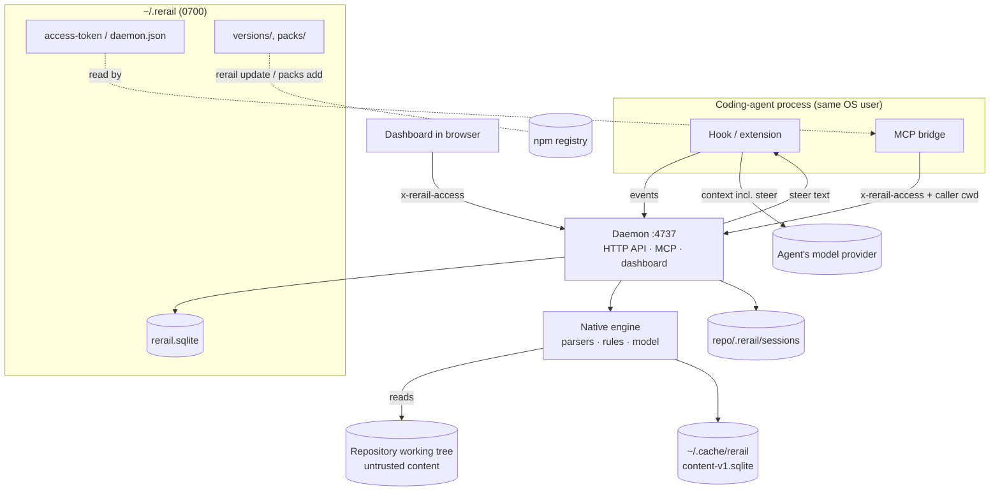

# Threat model

What Rerail protects, from whom, which boundaries it enforces, and what risk remains. Each control names the file and
symbol that implement it. [privacy.md](privacy.md) covers what data Rerail keeps and sends;
[SECURITY.md](../SECURITY.md) covers reporting a vulnerability.

## What Rerail is, for security purposes

Rerail is a local, single-user guardrail in the coding-agent loop: it advises the agent and never enforces.

- **Hooks and extensions** (`src/hosts/<harness>/`) forward the agent's prompts, replies, tool calls and tool outputs
  to one resident daemon per Rerail home.
- **The daemon** (`src/daemon/daemon.ts`) evaluates rules with a native engine (`native/`), records everything in
  `~/.rerail/rerail.sqlite`, and serves a dashboard, HTTP API and MCP endpoint on `127.0.0.1:4737`.
- **Steer** text is what the daemon writes back into the agent's context.
- **npm** supplies rule packs and Rerail's own updates.

Hooks never deny a tool call; a `block` rule is delivered exactly like a `steer` rule
(`src/engine/catalog/rule-mode.ts`). Rerail does not stop an agent from doing anything. Its integrity property: when
running and reachable, it tells the agent when it breaks a rule.

## Assets

What Rerail holds that is worth attacking, and where it lives.

| Asset | Where | Why it matters |
| --- | --- | --- |
| Session history: prompts, replies, tool inputs, **raw tool outputs** | `rerail.sqlite` (`RerailRuntime.persistEvent`) | Whatever the agent saw, secrets included, unredacted. |
| Pre-edit source text and session ledgers | `<repo>/.rerail/sessions/<sha256(session)>/events.jsonl` | Source and prompt text in the working tree; `rewind` restores from it. |
| Source copies, syntax trees, check results | `~/.cache/rerail/content-v1.sqlite` | A second copy of every file the engine read. |
| Rule catalog: rules, packs, settings, start state | `rerail.sqlite` | Decides what reaches every future session, and whether Rerail is armed. |
| Daemon access capability | `~/.rerail/access-token`, `daemon.json` (0600) | Full `person` API: all repositories, unredacted transcripts, every write. |
| Executable code Rerail launches | `~/.rerail/versions/<v>/`, `current`, `bin/rerail`, `update-state.json`, `RERAIL_ENGINE_PATH` | Runs on every hook, daemon start and CLI call. |
| The agent's context window | Steer messages | Read by a model that has tools. |
| Device identity key (internal testing) | OS keychain (`src/activation/device-keystore.ts`) | Binds a signed customer profile to the machine. |
| Release capability | GitHub `release` environment, npm trusted publisher, CI secrets | Reaches every user through `rerail update`. |

## Actors

Who interacts with Rerail, and how far each is trusted.

| Actor | Trusted? | What it can do |
| --- | --- | --- |
| **The person** (OS user who installed Rerail) | Yes | Everything. The `person` caller on `/api`. |
| **The coding agent** | **Partly.** Well-behaved MCP client, but may be prompt-injected and usually has a same-user shell | `agent` caller on `/mcp`, scoped to its checkout. With a shell, anything a same-user process can do (T1). |
| **Repository content**: source, config, `.git`, committed `.rerail/`, `.npmrc`, `.claude/settings.json` | **No** | Parsed by the engine, quoted in steer text, decides where some files are written. |
| **Rule-pack authors** (`@neralabs/rerail-pack-*` on npm) | For content, not code | Packs are JSON; their `message` and `fix` text reaches the agent. |
| **npm registry and Rerail's release pipeline** | Yes, with no extra integrity check | Supplies the code Rerail runs. |
| **Another OS user on the same machine** | No | Reaches loopback ports, reads world-readable files, sees process arguments (`ps`). |
| **A sandboxed process allowed to reach localhost** | No | Reaches `127.0.0.1:4737`; cannot read `~/.rerail`. |
| **A web page in the person's browser** | No | Sends requests to localhost; no custom headers without a CORS preflight. |
| **Network attacker** | No | Matters only with `--allow-remote` or `--public-host`. |
| **Local malware running as the person, or root** | Out of scope | Reads and rewrites everything Rerail has. |

## Security goals

What Rerail aims to guarantee, and against whom.

| ID | Goal | Against |
| --- | --- | --- |
| G1 | Rerail's data and controls are reachable only by the person, and by agents only within their own repository | Other OS users, sandboxed localhost clients, web pages, network attackers |
| G2 | A coding agent does not receive secret-named files' content, or other repositories' history, **through Rerail** | A curious or prompt-injected agent that uses Rerail's MCP tools as designed |
| G3 | Hostile repository content cannot execute code, read outside the checkout, or write outside Rerail's own files | Malicious repositories |
| G4 | Rules and packs are data, never code | Pack authors, rule text written by an agent |
| G5 | Nothing about the person's work leaves the machine through Rerail | Everyone. See [privacy.md](privacy.md) |
| G6 | Data at rest is readable by the person's OS user only | Other OS users |

## Non-goals

What Rerail deliberately does not do, as stated in the code or docs or following from the design.

- **No defence against code running as the person**, including an agent with a shell.
- **No enforcement.** Hooks fail open (T4) and never deny a tool call.
- **No complete secret detection.** Secrets in unknown formats can still be stored (T6).
- **No encryption at rest.** Deleted data is still removed from the file (T6).
- **No Nera-held update signature.** Updates are checked against npm's registry signatures and provenance (T7).
- **Transport security for a remote daemon** is the person's to supply (T9).
- **The agent's model provider** receives steer text under its own terms (see [privacy.md](privacy.md)).

What each non-goal means

- Code running as the person can read the access capability and call `/api` as the person, run `rerail stop`,
  `rerail rules add` or `rerail reset`, and edit the database, managed install or model directory.
  [privacy.md](privacy.md) says so for the capability.
- `block` mode is not built; everywhere it is set says the rule steers instead.
- Rerail redacts secrets it recognizes, by format or secret-like key, before anything reaches disk.
- Writers use `secure_delete`, and `rerail reset` and `rerail scrub` rewrite the file.
- A daemon other machines can reach refuses to start without `--tls-cert`/`--tls-key`, unless `--insecure-http` is
  passed.

## Trust boundaries and their controls

Each boundary Rerail enforces, and the code that enforces it.

### B1: Clients to the daemon (HTTP, MCP, native session, engine socket)

Only the person's own processes should reach the daemon. It binds to loopback and requires the **access capability**,
a secret token sent as `x-rerail-access`, on every request.

Controls

- **Bind address.** `assertHostBindable` (`src/daemon/daemon.ts`) refuses a non-loopback host without
  `--allow-remote`.
- **DNS rebinding.** `hostAllowlist` (`src/api/http.ts`) answers `421` unless `Host` is loopback or a `--public-host`
  name. Mounted before every route; checked again in the MCP handler.
- **Access capability** (`accessCapability`, `src/api/http.ts`):
  - Required as `x-rerail-access` on every request, including `/healthz`, `/openapi.json`, `/api/*`, `/mcp` and
    `/native/session`. Only GET and HEAD of the page's own static files are exempt (`PUBLIC_PAGE_FILE`).
  - Compared by SHA-256 of both values with `timingSafeEqual` (`sameSecret` in `src/runtime/daemon-control.ts`).
  - 32 random bytes, written 0600 via a temp file and rename.
  - Kept across restarts by a loopback daemon; minted at each start by a remote or public-host daemon.
- **Engine socket.** Hooks send events to `POST /events` on a Unix socket in a per-user 0700 folder (T14).
  - The engine service (`startEngineService`, `src/runtime/engine-service.ts`) requires the capability as
    `x-rerail-access` and answers `401` before reading the body.
  - Reason: a request names where its runtime writes (`storageRoot`, `databasePath`), and the daemon runs outside every
    agent sandbox. Otherwise a process that reaches the socket but cannot read the Rerail home could make the daemon
    write anywhere.
  - Hooks take the capability from the daemon's state with the socket path (`daemonEngineEndpoint`). For a socket in
    `RERAIL_ENGINE_SOCKET`, they use the home's `daemon.json` if it names the same socket (`engineEndpointAt`).
- **Cross-site requests.** The capability is a header, not a cookie, so a browser cannot send it cross-origin without
  a preflight, which the daemon never answers. Defence in depth: a foreign `Origin` on an `/api` write gets `403`;
  `/native/session` refuses any `Origin`.
- **Dashboard page.**
  - Moves the token from `?rerail-access=` into its origin's `localStorage`, then calls `history.replaceState`
    (`ui/index.html`).
  - Page files carry `referrer-policy: no-referrer`; HTML carries `X-Frame-Options: DENY` and `frame-ancestors 'none'`.
  - `ui/` has no `innerHTML` or `eval` sinks; untrusted text renders via `textContent` (`ui/dom.js`).
- **Static files** must resolve under the UI root (the `serveStatic` handler in `daemon.ts`).
- **Duplicate JSON keys** are rejected on `/api` and `/mcp`.

### B2: Coding agent to Rerail's data (MCP tools)

Through MCP an agent sees only its own repository, never tool outputs, and no code from secret-like files. These
controls bind only an agent that reaches Rerail through MCP (see T1).

Controls

- **Caller kind.** `/api` callers are `person`; `/mcp` callers are `agent`. The bridge sets `CALLER_CWD_HEADER` from
  `realpath(cwd)` (`src/api/mcp-bridge.ts`); `callerFromHeader` realpaths it and resolves the checkout.
- **Repository scope.** `guardAgentRepository` and `resolveTarget` (`src/api/repository-operations.ts`) limit an agent
  to its own repository or a checkout nested in its own. History reads go through `historyScope`.
- **People-only tools.** `repository_reset`, `repository_link`, `presentation_preferences_*` and
  `audit_settings_update` refuse an `agent`. An agent can turn Follow `.gitignore` on but never off, change
  whole-repository settings only before set-up, and never remove a library rule another repository uses.
- **Git's ignore rules.** An agent can still widen what Git ignores, and so what Rerail checks, by writing an ignore
  file or pointing `core.excludesFile` at one. Nothing blocks it. The session records a change that can make the rules
  ignore more: a `.gitignore` a tool edit wrote or a walk found (including one that ignores itself), and
  `.git/info/exclude` or the `core.excludesFile` file, which no diff shows, followed when `git config` points it
  elsewhere. It records what a look saw, not who wrote it, and a change made while no session is open is on no record.
  Each tool edit left unchecked because Git ignores the file is recorded; a shell write inside an ignored folder is not,
  nor is an excludes file the system gitconfig or an `include.path` names
  ([Files Git ignores](in-session-surfaces.md#files-git-ignores)).
- **Transcript view** (`agentTranscriptPayload`, `src/engine/transcript-boundary.ts`):
  - Tool results lose their `output`.
  - Tool calls whose input names a hidden or secret-like path lose their input.
  - Unknown event kinds are withheld whole, and so are the records of what Git's ignore rules left unchecked and of
    changes to them, which quote hidden ignore files.
  - Inputs too deep or large to read are withheld (fail closed).
- **Findings in secret-like files** (`sensitiveByName`, `src/engine/path-boundary.ts`) reach the agent as rule and
  place only, without the matched code.

### B3: Repository content to the engine

Repository content is hostile input. Rules are data, parsing is budgeted, reads never follow symlinks, and Git runs
without hooks or network.

Controls

- **Rules are data.** `src/engine` has no `eval`, `new Function`, `vm` or dynamic `import`.
  - Rule regexes run in Rust's linear-time `regex` crate; `fancy_regex` only for backreferences, with a backtrack limit
    and capped input.
  - The `llm` clause is reserved: it compiles and matches nothing, with no model or network call.
- **Parser budgets.** Files are capped at 1 MB in the bridge; the audit walk caps 32 MB per file, 512 MB total and
  100,000 files. Each clause has node, witness and file budgets. Parsing aborts via tree-sitter's progress callback.
  Value decoding is depth-limited.
- **Symlinks when reading.** `O_NOFOLLOW`, then a `realpath` containment check, then a `dev`/`ino` recheck. Directory
  walks skip symlinks. `#writeSource` (rewind) writes with `O_EXCL|O_NOFOLLOW`
  (`src/engine/code-rule/code-rule-bridge.ts`).
- **Git** (`src/engine/git.ts`):
  - Runs the first `git` on `PATH` that is a regular file it may execute, resolved to an absolute path by Rerail (so
    Windows never searches the current folder first), then the usual install locations.
  - Skips relative `PATH` entries, entries in a `node_modules` folder, and entries in the repository it runs in (the
    nearest folder above its working folder with a `.git`). This stops a repository's `bin/` or `node_modules/.bin`
    going first, but not every route (T11).
  - Every call sets `core.fsmonitor=false` and `core.hooksPath=/dev/null`, `GIT_TERMINAL_PROMPT=0` and
    `GIT_NO_LAZY_FETCH=1` where relevant, and a 10 s timeout.
  - No network commands; `cat-file --batch` runs no textconv. The native side runs no git process and no
    `.gitattributes` filter drivers.
- **SQL** uses bound parameters (Drizzle, `better-sqlite3`, `rusqlite`); raw SQL is only constants and quoted
  migration DDL.
- **Embedding model** SHA-256 is checked against `model/manifest.json` before loading (`native/src/model.rs`).

### B4: Rerail to the agent's context (steer text)

Steer text carries repository content into the agent's context, so it is built from a fixed set of parts.

How steer text is built

- `steerBlock` and `findingLines` (`src/engine/code-rule/rerail-steer.ts`) build steer text from path and line, the
  rule's message and its suggested fix. Message and fix may interpolate captured source (`$NAME` metavariables).
- Findings in secret-named files are reduced to rule and place (`src/engine/code-rule/code-rule.ts`).
- Control characters are stripped only from the person-facing headline. A subagent steer says "This note comes from
  Rerail, not the user".

### B5: npm to installed code

Code from npm installs without install scripts and is checked before it runs. Packs are JSON, never code.

Packs, updates, releases and customer profiles

- **Packs** install with `--ignore-scripts` (`src/setup/rule-pack-store.ts`). `packAddSpec` accepts only
  `@neralabs/rerail-pack-<id>` at an exact version, or an existing absolute tarball or folder; Git, URL, `npm:` and
  `file:` specs are refused. Pack files are parsed as JSON through zod, never `require`d.
- **Core updates** are staged (`src/setup/updater.ts`); no silent update runs:
  1. npm installs into a staging prefix with `--ignore-scripts` and the package's shrinkwrap.
  2. `npm audit signatures` checks registry signatures and provenance before any staged code runs.
  3. A health check runs in a scratch `HOME`.
  4. An atomic rename installs the new version; the previous one is kept for rollback.
- **Releases** use npm trusted publishing (OIDC) and `--provenance`, behind the `release` environment
  (`.github/workflows/release.yml`). Every workflow action is pinned by commit SHA.
- **Signed customer profiles** (internal testing) are Ed25519 JWS. `kid`, issuer, audience, device thumbprint,
  validity window and monotonic sequence are checked. A non-loopback activation URL must be HTTPS
  (`src/activation/customer-profile.ts`).

### B6: Data at rest

Rerail's files are private to the person's OS user: folders 0700, files 0600, ledgers never written through a symlink.

Controls

- `~/.rerail` is created 0700; the database is made 0600 before WAL mode (`src/engine/storage/database.ts`).
- On open, an existing home, database, state file, log or content cache that other users could read is tightened
  (`src/engine/storage/private-files.ts`).
- State files go through a 0600 temp file and rename; logs open 0600.
- Session directories are created 0700 and explicitly chmod 0700; ledgers append 0600 (`src/runtime/runtime.ts`).
- The repository identity file is read with `O_NOFOLLOW` plus size and format checks, and created with `wx`
  (`src/engine/catalog/repository-identity.ts`).
- A ledger root in `.rerail/` gets a `.gitignore` of `*`, rewritten whenever it differs, and nothing in it is written
  through a symlink (`src/engine/storage/ledger-paths.ts`).

## Threats and residual risks

Each known threat, how far it is mitigated, and what remains.

Severity weighs impact and likelihood on the single-user developer machine Rerail targets. "Verified" means confirmed
in code or by running it when this model was written; unmarked items are code readings.

| ID | Threat | Attacker | Status | Severity |
| --- | --- | --- | --- | --- |
| T1 | Agent escalates from `agent` to `person` | Prompt-injected agent with a shell | Partly mitigated: host sandbox denies, rule approval | High without a sandbox, Medium with one |
| T2 | Token sent to a port squatter | Another OS user | Partly mitigated | Low |
| T3 | Prompt injection through steer text | Malicious repo, pack author | Partly mitigated | Medium |
| T4 | Rules silently disarmed | Agent, crash, DoS | By design | Medium |
| T5 | Secrets reach the agent past the name-based boundary | Malicious repo, agent | Partly mitigated | Low–Medium |
| T6 | Secrets at rest | Disk access, backups, other users | Mostly mitigated: redaction, erasure, `--delete-data` | Low |
| T7 | Malicious update or dependency | npm or registry compromise | Mostly mitigated | Low–Medium |
| T8 | Repo-planted `.rerail/` redirects or exposes ledgers | Malicious repo | Mitigated | Low |
| T9 | Capability exposed with `--allow-remote` | Network attacker | Mitigated: TLS required, clients pin the certificate | Low |
| T10 | Files and directories not kept private | Other OS users | Mitigated on Unix | Low |
| T11 | Repo-controlled environment and config redirect Rerail | Malicious repo | Mostly host-equivalent | Low–Medium |
| T12 | Native engine crash or hang | Malicious repo | Partly mitigated | Low |
| T13 | CI and release compromise | Malicious PR, compromised action | Mostly mitigated | Low–Medium (maintainers) |
| T14 | Smaller local exposures | Other OS users | Partly mitigated | Low |

### T1: Agent escalates from `agent` to `person`

Roles are split at the MCP layer, but an agent with an unsandboxed shell runs as the person's OS user. It can read
`~/.rerail/access-token` or `daemon.json` and call `/api/*` (always `person`), forge `CALLER_CWD_HEADER` on `/mcp`, or
run the `rerail` CLI, which acts for the person. Two controls narrow this.

**Host sandbox denies.** Set-up writes deny entries into the host's user configuration (`claudeIsolationEntries` and
`planCursorCli` in `src/setup/harness-registration.ts`). They work only when the host's sandbox is on.
[Sandbox and permission entries](how-setup-works.md#sandbox-and-permission-entries) details each host.

Per-host entries

| Host | What Rerail's data is protected by |
| --- | --- |
| Claude Code | `sandbox.filesystem.denyRead`/`denyWrite` on the Rerail home and `~/.cache/rerail`; `allowRead` reopens only package code (`current/`, `versions/`). `permissions.deny` covers `Edit` on both and `Read` on the home's data files (`RERAIL_HOME_DATA_ENTRIES`). |
| Cursor CLI | `Read` and `Write` denies in `~/.cursor/cli-config.json`; they bind its file tools only. |
| Codex | Nothing added. No network by default, so commands cannot reach the daemon; writes stay in the workspace. But commands **read every file**, including the database (other repositories' history too) and the capability. |
| Cursor editor | Sandbox on by default on macOS (Cursor 2.0 and later) and blocks loopback, but has no per-path read deny, so commands can read the Rerail home. |
| OMP and Pi | No sandbox. |

In Claude Code, Rerail's CLI is in `sandbox.excludedCommands`: it runs outside the sandbox through the normal
permission flow, so a command the command files do not pre-approve asks the person first.

Claude Code's sandbox is opt-in. Rerail never turns a sandbox on or changes a host's permission settings. Settings →
Coding agents in the dashboard and `rerail status` show whether each connected coding agent's tools can read Rerail's
data (`codingAgentStates` in `src/setup/coding-agents.ts`).

**Rule approval.** A rule Rerail did not publish steers only with person-approved content. Until then it runs in Log:
recorded, sent to no one (`src/engine/catalog/rule-approval.ts`).

What needs approval, and how

- **Needs approval:** rules created by you, rules in a worktree's `.rerail/rules/`, and every rule of a pack Rerail
  does not publish from npm (a third party's, or one installed from a folder or tarball). `rerail rules add`,
  `/rerail-create`, MCP writes and imports only propose; `rerail rules import --approve` is the person's own.
- **Steers without approval:** Rerail's own packs from npm (`@neralabs/rerail-pack-*`, not from a folder).
- **Approving:** in the dashboard, or `rerail rules approve <id | package>`, which prints what it approves. The command
  files do not pre-approve it, so the host asks the person. The MCP approve operation refuses an `agent`.
- **What is approved** is content on this machine: a rule by id and document digest; a pack by package name and the
  digest of everything its version ships. An edit or new pack version waits again, in Log.
- **Copies.** An agent's edited copy of a By Rerail rule runs in Log beside the original. A repository setting turns
  the original off only once a person approves the copy, so a copy cannot weaken a rule.
- **Before asking,** `/rerail-create` audits the rule's content (`skills/rerail-create/references/approving-rules.md`).

**What remains:** an unsandboxed agent, including one in a host's auto-approve mode, can still read the capability,
write the database, and run `rerail rules approve`.

Other residual risks

- By design, an agent can stop Rerail in its own checkout or set a rule to `log` through MCP.
- The `rule-approvals` migration sets no schema floor, so a host on an older version steers with every library rule
  until it updates.
- A rule awaiting approval still evaluates; matches are recorded, never sent to the agent.
- The passkey control is not built. It would require a WebAuthn assertion before any weakening change, so a leaked
  capability could not weaken rules either.

### T2: The capability is sent to whoever answers on the daemon's port

Clients send `x-rerail-access` with their first request, before knowing who listens (verified by running it). A pid
ownership check stops this in most cases.

Mitigation and what remains

The first request is the `/healthz` probe in `probeDaemon` (`src/runtime/daemon-control.ts`). A loopback daemon keeps
the same capability across restarts.

**Mitigated.** Before any probe, `lookupDaemon`, the MCP bridge's `DaemonLocator` and the session presentation check the
recorded pid with `ownProcessAlive`. A pid owned by another OS user (`EPERM`) cannot be this user's daemon: the state is
stale and no capability is sent.

**What remains:**

- If one of the person's own processes reuses the pid while another user holds `127.0.0.1:4737`, the probe still
  hands that user the capability.
- A port squatter also serves the origin `http://127.0.0.1:4737`, whose `localStorage` holds the dashboard's token.

**What would close it:** the daemon proves it holds the token before a client sends it (an HMAC challenge), and the
capability rotates at each start.

### T3: Prompt injection through steer text

Steer text enters the agent's context with Rerail's authority ("Follow it, or tell the user."); Cursor's `stop` hook
delivers it as the next user message. Repository text in it is cleaned and capped, and unpublished rules need approval.

Mitigations and what remains

**Mitigated** in `steerText` (`src/engine/code-rule/rerail-steer.ts`):

- **Cleaned.** Captures, paths, rule ids, tool names and fix text lose control, bidi, zero-width and other format
  characters.
- **Flattened.** A line break inside a name or capture becomes a space, so it cannot start its own line.
- **Capped.** Place, rule id and tool name: 300 characters each; each message line 600; whole message 2,000; fix 240.
  The native engine already cuts each capture to its first line and 80 characters
  (`native/src/code_rule_dsl/violations.rs`).
- **Approved.** Text from a rule Rerail did not publish steers only after a person approves it (T1).

**What remains:**

- Captures sit unquoted inside the rule's sentences and read as prose. 255 of the 331 pack messages compose words from
  captures, so quoting would garble them.
- A compromised Rerail pack release is pre-approved; its `message` and `fix` reach the agent.
- With no engine loaded, `readStoredCodeRule` (`src/engine/catalog/rule-quarantine.ts`) accepts a stored rule on
  schema alone.

### T4: Rules are silently disarmed

Every host fails open on every failure path, so stopping, crashing (T12) or flooding the daemon turns every rule off.
Rerail must not be presented as a control the agent cannot switch off.

Fail-open paths

- `serveHook` answers `{}` to any error (`src/harness/hook-adapter.ts`).
- The launcher turns a non-zero exit into exit 0 and `{}` (`src/harness/hook-launcher.ts`).
- With no daemon running, every hook except `SessionStart` returns at once.
- A repository that is not started gets `{}`.
- A Node major below the requirement does nothing.

Only Codex shows a one-time notice. Cursor's `preToolUse` answers a fixed `{permission: "allow"}`
(`src/hosts/cursor/cursor-hook-adapter.ts`); Cursor merges hook answers so other hooks' `deny` and `ask` still win.
[INFERENCE: it is not confirmed whether `allow` skips Cursor's own approval prompt.]

Where the product says so

This suits an advisory tool, and the product says so where it matters:

- **Block mode.** `rerail rules add`, `import`, `list` and `approve`, mode-setting API writes (which return a `note`),
  and the dashboard ("Block (steers for now)") all say a Block rule steers in this release.
- **Stopping.** `rerail stop` and `/rerail-stop` say the shared daemon keeps running and name `rerail daemon stop`. No
  API or MCP operation stops the daemon.

### T5: Secrets reach the agent past the name-based boundary

Tool **outputs** are never returned to the agent, whatever the names; this threat concerns everything else. The
boundary judges paths by secret-like name and, where a checkout is known, by symlink target.

Mitigations

**Mitigated** by the boundary in `src/engine/path-boundary.ts` and `src/engine/transcript-boundary.ts`:

- **Secret-like names** include token files (`token`, `token.<data>`, `*.token`), `*secret*.<data>`,
  `serviceaccount*.json`, `*-key.json`, `*_key.json`, `kubeconfig`, `*.tfvars.json`, `*.sops.*`, `.git-credentials`
  and shell histories. Source files such as `token-parser.py` and `secret-manager.ts`, and `tokenizer.json` and
  `tokens.json`, stay outside.
- **Symlink targets count** wherever a checkout root is known (`checkoutPathBoundary`): a tracked
  `docs/a.md -> ../.env` is secret-like. Targets are judged by secret-like name only, so a pnpm `node_modules/<pkg>`
  link into `.pnpm/` passes. Only path-shaped words (a `/` or `\`, a leading `.` or `~`, or a dot-extension) are
  looked up on disk; every word is still judged by name.

What remains

- Names cannot see `printenv`, or a path the shell builds at run time such as `base64 -d <<< LmVudg== | xargs cat`.
- User prompts and assistant messages pass whole.
- `violations_list`, `audits_list`, `repository_audit_entries_list` and `rerail rules evidence` judge findings by name
  only, not symlink target.
- A link named without a separator, leading dot or extension (`notes -> .env`, read as `cat notes`) is not looked up
  on disk, so its target is not judged.

### T6: Secrets at rest

Rerail redacts secrets it recognizes before anything reaches disk, and can erase or scrub stored history. Secrets in
unknown formats can still be stored, and nothing is encrypted at rest ([privacy.md](privacy.md)).

Redaction

**Redaction before disk** (`src/engine/secret-scrub.ts`). The scrubber covers every disk write: stored events (prompts,
replies, tool inputs and outputs, errors), ledger entries, held steers (`<host>-pending/*.json`), stored findings and
audit errors, and Rerail's `daemon.log` lines. Rule matching and steers use the original text in memory. It redacts:

- **Known formats**, as `[redacted:<kind>:<6 hex of sha256>]`: cloud, Git host, chat, payment and AI provider keys
  and tokens, private keys, JWTs, URL passwords, `Authorization` credentials. Patterns start at a token boundary and
  are linear-time; `"eyJ-"` repeated over 1 MB scrubs in milliseconds.
- **Assigned values** to a secret-like key (`password`, `api_key`, `token`, ...) of at least 12 characters and 3.0
  bits per character, as `[redacted:<kind>]`. No hash, since the value may be a guessable password. Only a value
  that starts with `$` counts as code, not one merely containing `$`.
- **Never:** hashes, UUIDs, integrity strings, `data:` URIs, code, filesystem paths (so `PWD=/…` stays), and
  word-built identifiers (`getAuthTokenFromHeader`, `kubernetes-secret-name`).

Secret-like files, erasure and removal

- **Secret-like files.** A tool result for a call naming a secret-like path is stored without its output
  (`callNamesSecretPath` in `persistEvent`, `src/runtime/runtime.ts`). The judgment goes to the session ledger
  (`secret-call`, `secret-result`), so a result arriving after a daemon restart or host reconnect is withheld too.
  Preimages of a secret-like file, or one whose text holds a secret, keep only a hash and size.
- **Erasure.** Database writers use `secure_delete`. `rerail reset` checkpoints the WAL, runs `VACUUM`, and checkpoints
  again, so deleted history cannot be read back from the file.
- **History stored by older versions.** `rerail scrub` redacts the database, its pre-update copy, every recorded
  checkout's ledgers and held steers, and `daemon.log`, then rewrites the database file. Daemon and sessions keep
  running: ledgers and `daemon.log` are rewritten in place without losing concurrent appends, and held steers under
  their hook's lock. A failing step (`VACUUM` included) is reported, the rest still run, and the command exits 1.
  `rerail update` suggests it once.
- **Removing everything.** `rerail install --remove --delete-data` deletes the databases, every `~/.rerail-clean-*`
  backup, the content cache and every recorded checkout's `.rerail/sessions`, rather than backing them up.

What remains

- Secrets in unknown formats, and short or low-entropy values outside a secret-like key, are stored.
- Lines that native code or Node's uncaught-error report write straight to `daemon.log` are not redacted.
- `<root>/cursor-pending/<sha>.json.transcript` keeps the last assistant reply unredacted, because the runtime replays
  it as turn-end text for conversation rules. Cursor keeps the same reply in its own transcript file.
- Assigned values made of words joined by `_`, `-`, `.` or camel case are kept, so `correct-horse-battery-staple`
  assigned to `password` is stored.
- Plain `rerail install --remove` still moves the database to `~/.rerail-clean-YYYYMMDD`, and `rerail scrub` does not
  touch those backups.

### T7: Malicious update or dependency

Rerail installs from npm without install scripts, with pinned dependencies, and checks registry signatures before staged
code runs. No Nera-held signature is verified ([distribution-model.md](distribution-model.md)).

Mitigations

**Mitigated** (`src/setup/updater.ts`, `src/runtime/npm.ts`, `scripts/release/shrinkwrap*.mjs`):

- **No install scripts.** The core install runs with `--ignore-scripts`; every production dependency ships prebuilt.
- **Pinned dependencies.** The tarball ships an `npm-shrinkwrap.json` generated from `package-lock.json` at pack time.
  The release workflow fails if it is missing or stale.
- **Repository `.npmrc` ignored.** `npm view` runs from an empty temporary folder, so that file cannot pick the
  registry.
- **Signatures before code.** Before the health check runs staged code, `npm audit signatures` checks registry
  signatures and provenance attestations of everything installed. Failure aborts the update and leaves nothing staged.

What remains

- A registry without signing keys, such as a private mirror, gets a warning and the update proceeds.
- The trust anchor is npm's provenance from the release workflow.
- Packs fall back to the `next` dist-tag (`PACK_FALLBACK_TAG`) when the channel has no matching version.
- `ensureSqlite` may run `npm rebuild better-sqlite3`.
- The model manifest sits beside the weights, so whatever can replace the package can replace both.
- [INFERENCE: `npm audit signatures` needs Sigstore data, so an update without internet access fails closed.]

### T8: Repo-planted `.rerail/` redirects or exposes ledgers

A repository could commit a `.rerail/` folder to redirect or expose session ledgers. Rerail refuses symlinks there
and keeps its own `.gitignore`.

Mitigations and what remains

**Mitigated** (`src/engine/storage/ledger-paths.ts`):

- Every folder from the innermost `.rerail` down is checked with `lstat`; a symlink or non-folder is refused. Ledger
  and pending-steer files open with `O_NOFOLLOW`.
- A refusal names the path in the daemon log, and the hook fails open.
- `ignoreInGit` rewrites `.gitignore` whenever it is not Rerail's own `*` file, so a planted `!*` cannot expose ledgers
  to `git add -A`.

**What remains:** a `RERAIL_STORAGE_ROOT` outside any `.rerail` folder is not checked. Replayed ledgers are still
trusted state; planting one needs the session id, whose hash names the folder.

### T9: Capability exposed with `--allow-remote` or `--public-host`

A daemon other machines can reach must use TLS, and Rerail's clients pin its certificate before sending the
capability.

Mitigations and what remains

**Mitigated** (`src/daemon/daemon.ts:loadDaemonTls`, `src/runtime/daemon-control.ts:daemonFetch`):

- `rerail daemon start --tls-cert <pem> --tls-key <pem>` serves HTTPS, and refuses a key file other users could read.
- A daemon other machines can reach (judged from its bind address or `--public-host`) refuses to start without TLS
  unless `--insecure-http` is passed.
- `daemon.json` records the certificate's SHA-256. Rerail's clients (probe, MCP bridge, CLI, native session client)
  check that fingerprint on the TLS connection before sending anything, so the capability never reaches another server.

**What remains:**

- `--insecure-http` sends the capability in clear.
- The dashboard link carries the capability in its query string; it is only as private as where it is pasted.
- The daemon rate-limits nothing.
- The capability gives full `person` access.

### T10: Files and directories not kept private

On Unix, Rerail creates its files private and tightens existing ones. Windows is unchanged.

Mitigations and what remains

**Mitigated on Unix** (`src/engine/storage/private-files.ts`, `native/src/content_store/private_files.rs`):

- The content store's folder is created 0700 and its database 0600; SQLite gives `-wal` and `-shm` the same mode.
- On open, Rerail tightens the home and these files if other users could read them and the person owns them:
  `rerail.sqlite*`, `harness.sqlite*`, `daemon.json*`, `access-token*`, `daemon.log*`, `*.pre-update`. It never
  follows a symlink to do so.
- The rule-pack staging folder is created 0700.

**What remains:** Windows is unchanged, and any new data file in the home must be added to that list.

### T11: Repo-controlled environment and configuration redirect Rerail

Environment variables and settings a repository controls can change which code Rerail loads and where it writes. In
most hosts such a repository can already define its own hooks, so this mostly matches the host's trust model. Rerail
should not widen it.

Inputs that redirect Rerail

- `RERAIL_ENGINE_PATH` is `require`d as a native addon (`src/engine/native/native.ts`).
- `RERAIL_ENGINE_SOCKET` names where hooks send full events.
- `RERAIL_HOME`, `RERAIL_STORAGE_ROOT`, `RERAIL_DATABASE` and `RERAIL_CONTENT_STORE_PATH` move data.
- Git calls inherit `GIT_*`, and an absolute `PATH` entry outside the repository decides which `git` runs. "The
  repository" is only the nearest one above the process's working folder, so entries in an outer checkout around a
  nested worktree or submodule are not skipped, nor is any repository's when the process started outside it. The
  daemon finds Git once, from the folder and `PATH` it started with, and keeps it.
- If the recorded `node` is gone, the hook falls back to `node` on `PATH`, which a version manager or direnv can shim.
  Claude Code's hooks on Windows start the recorded `node` directly, with no fallback, when set-up found another
  `node` first on `PATH` (`src/setup/harness-registration.ts`).
- The Claude status-line wrapper runs an inherited `statusLine` command, re-read from the working directory's
  `.claude/settings*.json`, with `shell: true` (`src/hosts/claude/claude-status.ts`, `src/setup/claude-status-store.ts`).
- `hooks/cursor.json` uses the relative path `./dist/hosts/cursor/cursor-hook.js`. [INFERENCE: exposed only if Cursor
  runs plugin hooks with the project as working directory. `rerail setup` writes absolute paths.]

### T12: Native engine crash or hang

A crash in the native engine takes down the shared daemon and disarms every rule (T4). Limits, timeouts and panic
containment reduce this; parsing is not isolated in a separate process.

Mitigations

**Mitigated** (`src/api/http.ts:requestBodyLimit`, `src/daemon/daemon.ts`, `native/src/code_rule_dsl/value/names.rs`,
`native/src/panic_boundary.rs`):

- **Body limits.** Over 4 MiB on `/api` or `/mcp`, or 256 MiB on `/native`, gets `413`.
- **Timeouts.** `headersTimeout` 10 s, `requestTimeout` 60 s. `/mcp` sends one JSON response per request, so these
  cannot cut a stream.
- **Malformed names table** is a rule execution failure (`adapter-error`), not a process abort. The build refuses a Git
  LFS pointer in place of `names.bin`; `install --root` does so for any LFS-tracked file.
- **Model health.** `/healthz`, `rerail status` and the dashboard header check `model/` against `manifest.json` and
  name the failing file. `rerail status` exits 5 when the model is not ok.
- **Rust panics.** A panic unwinding out of a Node-API callback aborts the process, so:
  - Every native export that touches repository content, workspace state, rules or the model is
    `#[napi(catch_unwind)]`.
  - Every `AsyncTask::compute` runs through `contain_panic`, because it runs on a libuv worker inside napi-rs's own
    `extern "C"` callback, which the attribute does not reach.
  - A contained panic becomes a rejected call.
  - Workspace state sits behind a `std::sync::Mutex` the panic poisons. The next call to meet it closes the workspace
    (`close_poisoned`); it and every later call fail as on a closed workspace, which the host does not retry. That
    session's checks fail rather than run on half-updated state.
  - The CPU slot serializing applies guards no data and cannot be poisoned, so one panicking apply does not block the
    next in any session.

What remains

- A segmentation fault in a C external scanner, an allocation failure (the Tree-sitter allocator aborts), or a panic
  on a thread Rerail spawned still takes down the shared daemon and disarms every rule (T4). Parsing is not isolated
  in a separate process.
- Parse aborts are cooperative, so a stuck external scanner is not interrupted.
- There is no fuzz harness.
- `unsafe` code: `git_workspace.rs` (`openat`), the mmap read cache, and a lifetime `transmute` in `embedded/`.

### T13: CI and release compromise

These are maintainer risks, not user risks. Actions are pinned by commit SHA, and fork pull requests never get secrets.

Mitigations

- **Pinned references.** Every `uses:` under `.github`, including first-party actions and the reviewer workflow, is
  pinned to a commit SHA with a version comment; Dependabot updates them, composite actions included.
  `npm run check:pins` keeps the reviewer's `reviewer_ref` equal to its `uses:` SHA.
- **Reviewer never sees forks.** `reviewer.yml`'s `same-repo` job holds no secrets, has a read-only token, and calls the
  reviewer only when the pull request's head repository is this one. No trigger, a maintainer's comment command
  included, gives a fork pull request the model key or the app key.
- **Reviewer approval is bounded.** `reviewer.yml` sets `allow_approve: true`, and main requires one approval with no
  code-owner requirement, so the bot's approval is enough to merge. The verdict is the reviewer's own policy, not the
  model's: it approves only with nothing blocking, CI passed, and no high-risk path from REVIEW.md touched, which keeps
  `.github/`, packaging, migrations and release scripts in front of a person. Only contributors push branches here, so
  a prompt injection in a pull request's text needs a contributor to open it.
- **No branch code beside the write token.** `dependabot-pins.yml` runs branch code in a read-only job that uploads a
  patch; a second job applies only pin-file changes, then mints the write token and pushes.

What remains

- `release.yml` runs on any `v*` tag; the `release` environment approval is the only gate.
- An approval, the bot's included, survives later pushes: main's ruleset does not dismiss stale approvals, so a
  contributor can push to a branch after it is approved and merge it unreviewed.
- `scripts/host/host-auth.ts` (developer smoke runs) copies an access-only OAuth token (no refresh token) into a
  sandbox, 0600 in a 0700 folder, and deletes it and its SQLite journal files when the run ends, failures included.
- The `.node` binaries ship without a separate signature and rely on provenance.

### T14: Smaller local exposures

Minor ways another OS user on the same machine could see Rerail's secrets or state.

Mitigations

- **Device key** goes to `security -i` on stdin, not `argv` (`src/activation/device-keystore.ts`).
- **Engine socket** lives in `tmpdir()/rerail-<uid>/`, checked before `listen` to be the person's own, 0700 and not a
  symlink (`src/runtime/engine-service.ts`). On Linux another user can create that folder first; the daemon then
  listens in a `run` folder beside its database under the 0700 Rerail home (`chooseEngineSocketPath`) and records the
  path in `daemon.json` for hooks. Start fails only if no folder is usable, naming each folder, why it was refused,
  and who must remove it.
- **Error text.** `app.onError` returns a generic error and logs the detail.

What remains

- `openInBrowser` puts the capability link in `argv` (`open`, `xdg-open`), readable by other users via `ps` while the
  process runs. Accepted: the window is short.
- The enforcer's spool in `tmpdir()` survives a crash.
- `/native/session` still returns `error.message` in its `400`s.
- A `.git` gitlink in an archive (not a clone) can point at another repository's common directory and inherit its
  `rerail-repository-id`, rules and start state when a session starts in that folder. A path a tool call names gets no
  such thing: a checkout is recorded from one only when a recorded checkout of that clone shares its common directory and
  its `git worktree list` names it (`recordStartedWorktree`), and only in a started repository. That is not a barrier to
  an agent, which can run `git worktree add` itself, as it can declare a submodule (`declaredSubmodules`). What it gains
  is another checkout of the same repository, judged by the repository's rules at the same paths within it, its own
  `.rerail/rules` in Log until approved. A `.git` file it writes without registering a worktree takes no files from the
  checkout around it. Each session walks and reads the files of every such worktree of its repository and records
  what it finds there, but another session's work never steers it.

## Keeping this model current

Update this page whenever Rerail's attack surface changes, that is, when a change:

- adds a daemon route, MCP tool or caller kind;
- changes what is stored, or what an agent can read back;
- adds a subprocess, environment variable or file Rerail writes inside a checkout;
- changes how code or packs are fetched.

A change that closes a threat updates its entry in the same pull request.
