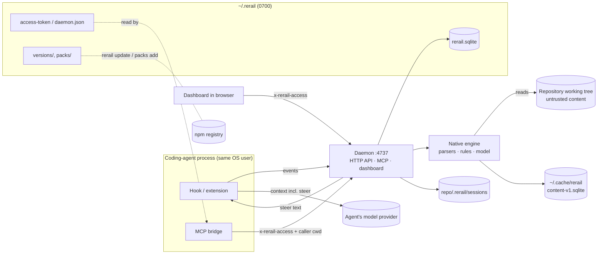

# Threat model

This page is Rerail's threat model. It defines what Rerail protects, who it protects it from, which boundaries it
enforces and which it does not, and the risks that remain. It describes the code in this repository. Each control names
the file and symbol that implement it. [privacy.md](privacy.md) says what data Rerail keeps and sends, and
[SECURITY.md](../SECURITY.md) says how to report a vulnerability.

## What Rerail is, for security purposes

Rerail is a local, single-user program that runs inside the coding-agent loop:

- Hooks and extensions (`src/hosts/<harness>/`) receive the agent's prompts, replies, tool calls and tool outputs.
  They forward them to one resident daemon per Rerail home.
- The daemon (`src/daemon/daemon.ts`) evaluates rules with a native engine (`native/`) and records everything in
  `~/.rerail/rerail.sqlite`. It serves a dashboard, an HTTP API and an MCP endpoint on `127.0.0.1:4737`.
- It writes **steer** text back into the agent's context.
- It installs rule packs and its own updates from npm.

Rerail is a guardrail that advises the agent. It does not enforce. Hooks never deny a tool call, and a `block` rule is
delivered exactly like a `steer` rule (`src/engine/catalog/rule-mode.ts`). Nothing in this model should be read as
"Rerail stops an agent from doing X". The integrity property Rerail offers is narrower: when it is running and
reachable, the agent is told when it breaks a rule.

## Assets

| Asset | Where | Why it matters |
| --- | --- | --- |
| Session history: prompts, replies, tool inputs and **raw tool outputs** | `rerail.sqlite` (`RerailRuntime.persistEvent`) | Holds whatever the agent saw, including secrets it read. It is stored unredacted. |
| Pre-edit source text and session ledgers | `<repo>/.rerail/sessions/<sha256(session)>/events.jsonl` | Holds source and prompt text inside the working tree. `rewind` restores files from it. |
| Source copies, syntax trees and check results | `~/.cache/rerail/content-v1.sqlite` | A second copy of every file the engine read. |
| Rule catalog: rules, packs, settings, start state | `rerail.sqlite` | It decides what text reaches every future agent session, and whether Rerail is armed. |
| Daemon access capability | `~/.rerail/access-token`, `daemon.json` (0600) | Holding it gives the full `person` API: all repositories, unredacted transcripts, every write. |
| Executable code Rerail launches | `~/.rerail/versions/<v>/`, `current`, `bin/rerail`, `update-state.json`, `RERAIL_ENGINE_PATH` | Runs on every hook, daemon start and CLI call. |
| The agent's context window | Steer messages | Text written there is read by a model that has tools. |
| Device identity key (internal testing) | OS keychain (`src/activation/device-keystore.ts`) | It binds a signed customer profile to the machine. |
| Release capability | GitHub `release` environment, npm trusted publisher, CI secrets | It reaches every user through `rerail update`. |

## Actors

| Actor | Trusted? | What it can do |
| --- | --- | --- |
| **The person** (OS user who installed Rerail) | Yes | Everything. The `person` caller on `/api`. |
| **The coding agent** | **Partly.** It is a well-behaved MCP client, but it may be prompt-injected and usually has a shell as the same OS user | `agent` caller on `/mcp`, scoped to its own checkout. With a shell it has everything a same-user process has (see T1). |
| **Repository content**: source, config, `.git`, committed `.rerail/`, `.npmrc`, `.claude/settings.json` | **No** | It is parsed by the engine, quoted in steer text, and decides where some files are written. |
| **Rule-pack authors** (`@neralabs/rerail-pack-*` on npm) | Trusted for content, not for code | Packs are JSON data. Their `message` and `fix` text reaches the agent. |
| **npm registry and Rerail's release pipeline** | Trusted. No integrity check is added on top of npm | It supplies the code Rerail runs. |
| **Another OS user on the same machine** | No | Can reach loopback ports, read world-readable files and see process arguments (`ps`). |
| **A sandboxed process allowed to reach localhost** | No | Can reach `127.0.0.1:4737`, but cannot read `~/.rerail`. |
| **A web page in the person's browser** | No | Can send requests to localhost. It cannot set custom headers without a CORS preflight. |
| **Network attacker** | No | Matters only with `--allow-remote` or `--public-host`. |
| **Local malware running as the person, or root** | Out of scope | It can read and rewrite everything Rerail has. |

## Security goals

| ID | Goal | Against |
| --- | --- | --- |
| G1 | Rerail's data and controls are reachable only by the person, and by agents only within their own repository | Other OS users, sandboxed localhost clients, web pages, network attackers |
| G2 | A coding agent does not receive secret-named files' content, or other repositories' history, **through Rerail** | A curious or prompt-injected agent that uses Rerail's MCP tools as designed |
| G3 | Hostile repository content cannot execute code, read outside the checkout, or write outside Rerail's own files | Malicious repositories |
| G4 | Rules and packs are data, never code | Pack authors, rule text written by an agent |
| G5 | Nothing about the person's work leaves the machine through Rerail | Everyone. See [privacy.md](privacy.md) |
| G6 | Data at rest is readable by the person's OS user only | Other OS users |

## Non-goals

These are stated in the code or docs, or follow from the design:

- **No defence against code running as the person.** This includes an agent with a shell. Such a process can read the
  access capability, and with it call `/api` as the person. It can run `rerail stop`, `rerail rules add` or
  `rerail reset` directly, and it can edit the database, the managed install or the model directory.
  [privacy.md](privacy.md) says so for the capability.
- **No enforcement.** Hooks fail open (T4) and never deny a tool call. `block` mode is not built.
- **No content-based secret detection.** The data boundary judges path names only (T5).
- **No encryption at rest, and no secure deletion.** `rerail reset` deletes rows. It does not `VACUUM`, and the
  rows' pages stay recoverable in the file.
- **No Nera-held update signature.** Updates are checked against npm's registry signatures and provenance (T7).
- **No transport security for a remote daemon.** `--allow-remote` serves plain HTTP (T9).
- The agent's model provider receives steer text under its own terms (see [privacy.md](privacy.md)).

## Trust boundaries and their controls

### B1: Clients to the daemon (HTTP, MCP, native session)

- **Bind address.** `assertHostBindable` (`src/daemon/daemon.ts`) refuses a non-loopback host without
  `--allow-remote`.
- **DNS rebinding.** `hostAllowlist` (`src/api/http.ts`) answers `421` to any request whose `Host` is not loopback
  or a `--public-host` name. It is mounted before every route, and checked again inside the MCP handler.
- **Access capability.** `accessCapability` (`src/api/http.ts`):
  - Every request needs `x-rerail-access`. This covers `/healthz`, `/openapi.json`, `/api/*`, `/mcp` and
    `/native/session`.
  - The exemptions are an allowlist: GET and HEAD for the page's own static files (`PUBLIC_PAGE_FILE`).
  - The comparison hashes both values with SHA-256 and uses `timingSafeEqual` (`sameSecret`).
  - The token is 32 random bytes. It is written 0600 through a temp file and a rename.
  - A loopback daemon persists the token across restarts. A remote or public-host daemon mints a new one at each start.
- **Cross-site requests.** The capability travels in a header, not a cookie, so a browser cannot attach it to a
  cross-origin request without a preflight, and the daemon never answers one. A foreign `Origin` on an `/api` write
  gets `403`, as defence in depth. `/native/session` refuses any `Origin`.
- **The dashboard page.**
  - It moves the token from `?rerail-access=` into its origin's `localStorage` and calls `history.replaceState`
    (`ui/index.html`).
  - Page files are sent with `referrer-policy: no-referrer`.
  - HTML is sent with `X-Frame-Options: DENY` and `frame-ancestors 'none'`.
  - `ui/` has no `innerHTML` or `eval` sinks. Untrusted text is rendered with `textContent` (`ui/dom.js`).
- **Static files.** Paths are resolved and must stay under the UI root (the `serveStatic` handler in `daemon.ts`).
- **Duplicate JSON keys** are rejected on `/api` and `/mcp`.

### B2: Coding agent to Rerail's data (MCP tools)

- **Caller kind.** Every `/api` caller is `person`. Every `/mcp` caller is `agent`, and its checkout comes from the
  `CALLER_CWD_HEADER` that the bridge sets from `realpath(cwd)` (`src/api/mcp-bridge.ts`). `callerFromHeader`
  realpaths that value and resolves it to a checkout.
- **Repository scope.** `guardAgentRepository` and `resolveTarget` (`src/api/repository-operations.ts`) limit an agent
  to its own repository, or to a checkout nested inside its own checkout. History reads are scoped through
  `historyScope`.
- **People-only tools.** `repository_reset`, `repository_link`, `presentation_preferences_*` and
  `audit_settings_update` refuse an `agent` caller. An agent can turn Follow `.gitignore` on, never off. It can change
  whole-repository settings only before the repository is set up. It cannot remove a library rule another repository
  uses.
- **Transcript view.** `agentTranscriptPayload` (`src/engine/transcript-boundary.ts`) shapes what an agent reads:
  - A tool result is returned without its `output`.
  - A tool call whose input names a hidden or secret-like path is returned without its input.
  - An unknown event kind is withheld whole.
  - An input too deep or too large to read is withheld (fail closed).
- **Findings in secret-like files.** A finding in a file that `sensitiveByName` (`src/engine/path-boundary.ts`) flags
  reaches the agent by rule and place only, without the matched code.

This boundary holds only for an agent that reaches Rerail through MCP. See T1.

### B3: Repository content to the engine

- **Rules are data.** There is no `eval`, `new Function`, `vm` or dynamic `import` in `src/engine`.
  - Rule regexes run in Rust's linear-time `regex` crate.
  - `fancy_regex` is used only for backreferences, with a backtrack limit and capped input.
  - The `llm` clause is reserved: it compiles and matches nothing, with no model or network call.
- **Parser budgets.**
  - Files are capped at 1 MB in the bridge, and at 32 MB per file, 512 MB in total and 100,000 files in the audit walk.
  - Each clause has node, witness and file budgets.
  - Parsing aborts through tree-sitter's progress callback.
  - Value decoding is depth-limited.
- **Symlinks on the read side.** Reads use `O_NOFOLLOW`, then a `realpath` containment check, then a `dev`/`ino`
  recheck. Directory walks skip symlinks. `#writeSource` (rewind) writes with `O_EXCL|O_NOFOLLOW`
  (`src/engine/code-rule/code-rule-bridge.ts`).
- **Git.** `src/engine/git.ts`:
  - It calls git by a fixed absolute path and never looks it up on `PATH`.
  - Every call sets `core.fsmonitor=false` and `core.hooksPath=/dev/null`, with `GIT_TERMINAL_PROMPT=0` and
    `GIT_NO_LAZY_FETCH=1` where relevant, and a 10 s timeout.
  - It uses no network commands. `cat-file --batch` does not run textconv.
  - The native side runs no git process, and it does not run `.gitattributes` filter drivers.
- **SQL.** Queries use bound parameters (Drizzle, `better-sqlite3`, `rusqlite`). The only raw SQL is constants and
  quoted migration DDL.
- **Embedding model.** Its SHA-256 is checked against `model/manifest.json` before it loads (`native/src/model.rs`).

### B4: Rerail to the agent's context (steer text)

- Steer text is built by `steerBlock` and `findingLines` (`src/engine/code-rule/rerail-steer.ts`): path and line,
  the rule's message, and its suggested fix. The message and fix may interpolate captured source (`$NAME`
  metavariables).
- Findings in secret-named files are reduced to rule and place (`src/engine/code-rule/code-rule.ts`).
- Control characters are stripped only from the person-facing headline. A subagent steer says "This note comes from
  Rerail, not the user".

### B5: npm to installed code

- **Packs.** They are installed with `--ignore-scripts` (`src/setup/rule-pack-store.ts`).
  - `packAddSpec` accepts only `@neralabs/rerail-pack-<id>` with an exact version, or an existing absolute tarball or
    folder. Git, URL, `npm:` and `file:` specs are refused.
  - Pack files are read as JSON through zod and never `require`d.
- **Core updates.** They are staged (`src/setup/updater.ts`):
  - npm installs the new version into a staging prefix, with `--ignore-scripts` and the package's shrinkwrap.
  - `npm audit signatures` checks registry signatures and provenance before any staged code runs.
  - A health check runs in a scratch `HOME`.
  - The new version is put in place with an atomic rename, and the previous one is kept for rollback.
  - No silent update runs.
- **Releases.** They are published with npm trusted publishing (OIDC) and `--provenance`, behind the `release`
  environment (`.github/workflows/release.yml`). Every workflow action is pinned by commit SHA.
- **Signed customer profiles** (internal testing). They are Ed25519 JWS:
  - `kid`, issuer, audience, device thumbprint, validity window and monotonic sequence are all checked.
  - HTTPS is required for a non-loopback activation URL (`src/activation/customer-profile.ts`).

### B6: Data at rest

- `~/.rerail` is created 0700. The database is made 0600 before WAL mode is enabled (`src/engine/storage/database.ts`).
  An existing home, database, state file or log that other users could read is tightened when Rerail opens it, and so
  is the content cache (`src/engine/storage/private-files.ts`).
- State files are written through a 0600 temp file and a rename.
- Logs are opened 0600.
- Session directories are created 0700 and explicitly chmod 0700. Ledgers are appended 0600 (`src/runtime/runtime.ts`).
- The repository identity file is read with `O_NOFOLLOW` and size and format checks, and created with `wx`
  (`src/engine/catalog/repository-identity.ts`).
- A ledger root inside `.rerail/` gets a `.gitignore` of `*`, rewritten whenever it differs, and no part of it is
  written through a symlink (`src/engine/storage/ledger-paths.ts`).

## Threats and residual risks

Severity reflects impact and likelihood for the single-user developer machine Rerail targets. "Verified" means the
behaviour was confirmed in code, or by running it, while this model was written. Unmarked items are code readings.

| ID | Threat | Attacker | Status | Severity |
| --- | --- | --- | --- | --- |
| T1 | Agent escalates from `agent` to `person` | Prompt-injected agent with a shell | Partly mitigated: host sandbox denies, rule approval | High without a sandbox, Medium with one |
| T2 | Token sent to a port squatter | Another OS user | Partly mitigated | Low |
| T3 | Prompt injection through steer text | Malicious repo, pack author | Partly mitigated | Medium |
| T4 | Rules silently disarmed | Agent, crash, DoS | By design | Medium |
| T5 | Secrets reach the agent past the name-based boundary | Malicious repo, agent | Partly mitigated | Low–Medium |
| T6 | Secrets at rest, unredacted | Disk access, backups, other users | Partly mitigated | Low–Medium |
| T7 | Malicious update or dependency | npm or registry compromise | Mostly mitigated | Low–Medium |
| T8 | Repo-planted `.rerail/` redirects or exposes ledgers | Malicious repo | Mitigated | Low |
| T9 | Capability exposed with `--allow-remote` | Network attacker | Opt-in | Medium |
| T10 | Files and directories not kept private | Other OS users | Mitigated on Unix | Low |
| T11 | Repo-controlled environment and config redirect Rerail | Malicious repo | Mostly host-equivalent | Low–Medium |
| T12 | Native engine crash or hang | Malicious repo | Partly mitigated | Low |
| T13 | CI and release compromise | Malicious PR, compromised action | Mostly mitigated | Low–Medium (maintainers) |
| T14 | Smaller local exposures | Other OS users | Partly mitigated | Low |

### T1: Agent escalates from `agent` to `person`

The agent and person roles are separated at the MCP layer. An agent with an unsandboxed shell runs as the person's OS
user, so it can do any of the following:

- Read `~/.rerail/access-token` or `daemon.json`, then call `/api/*`, where every caller is `person`.
- Forge `CALLER_CWD_HEADER` on `/mcp`.
- Run the `rerail` CLI, which acts for the person.

Two controls now narrow this.

**Host sandbox denies.** Set-up writes deny entries into the host's user configuration (`claudeIsolationEntries` and
`planCursorCli` in `src/setup/harness-registration.ts`):

- **Claude Code.**
  - `sandbox.filesystem.denyRead` and `denyWrite` cover the Rerail home and `~/.cache/rerail`.
  - `allowRead` reopens only the package code (`current/`, `versions/`).
  - `permissions.deny` covers `Edit` for both folders and `Read` for the home's data files (`RERAIL_HOME_DATA_ENTRIES`).
  - Rerail's own CLI is listed in `sandbox.excludedCommands`. It runs outside the sandbox through the normal permission
    flow, so a command the command files do not pre-approve asks the person first.
- **Cursor CLI.** `Read` and `Write` denies go into `~/.cursor/cli-config.json`.
- **Codex.** Nothing is added. Its default sandbox already has no network and writes only inside the workspace.
- **Cursor editor, OMP and Pi.** They have no setting for this.

These entries take effect only when the host's sandbox is on, and Claude Code's is opt-in.
[installation.md](installation.md) says, for each host, what is isolated and what is not.

**Rule approval.** A rule runs only with content a person approved (`src/engine/catalog/rule-approval.ts`):

- **What needs approval.** `rerail rules add`, `/rerail-create`, an MCP write and an import only propose a rule.
- **How a person approves.** In the dashboard, or with `rerail rules approve <id>`, which prints the content it
  approves. The command files do not pre-approve it, so the host asks the person. The MCP approve operation refuses an
  `agent` caller.
- **Edits.** An edit keeps the last approved content running, so editing cannot switch a rule off.
- **What runs without approval.** Rules of `@neralabs/rerail-pack-*` installed from the registry. A pack added from a
  folder or tarball waits for approval.
- **Checked on every read.** Each read recomputes the approved content's hash, so a database row that merely claims
  approval approves nothing.
- **Before asking.** `/rerail-create` audits a rule's content before it asks the person to approve it
  (`skills/rerail-create/SKILL.md`).

**What remains:**

- **An unsandboxed agent can still escalate.** This includes an agent in a host's auto-approve mode. It can read the
  capability, write the database, and run `rerail rules approve`.
- **Some weakening is allowed by design.** Within MCP, an agent can stop Rerail in its own checkout or set a rule to
  `log`.
- **Older versions bypass approval.** The `rule-approvals` migration sets no schema floor. A host still on an older
  version runs each library rule's latest content until it updates.
- **The passkey control is not built.** Its design would require a WebAuthn assertion before any weakening change, so
  that a leaked capability could not weaken rules either.

### T2: The capability is sent to whoever answers on the daemon's port

Clients send `x-rerail-access` on their first request, the `/healthz` probe in `probeDaemon`
(`src/runtime/daemon-control.ts`), before they know who is listening. This was verified by running it. A loopback
daemon keeps the same capability across restarts.

**Mitigated.** Before any probe, `lookupDaemon`, the MCP bridge's `DaemonLocator` and the session presentation check the
recorded pid with `ownProcessAlive`. A pid that another OS user runs (`EPERM`) cannot be this user's daemon: the state
counts as stale, and no capability is sent.

**What remains:**

- **A pid reused by the person's own process.** If one of the person's own processes reuses the pid while another user
  holds `127.0.0.1:4737`, the probe still hands that user the capability.
- **The dashboard origin.** A squatter on the port also serves the origin `http://127.0.0.1:4737`, whose `localStorage`
  holds the token the real dashboard left.

**What would close it:** have the daemon prove it holds the token before a client sends it (a challenge with HMAC), and
rotate the capability at each start.

### T3: Prompt injection through steer text

Steer text is written into the agent's context with Rerail's authority: "Follow it, or tell the user." Cursor's `stop`
hook delivers it as the next user message.

**Mitigated** in `src/engine/code-rule/rerail-steer.ts` (`steerText`):

- **Text from the repository is cleaned.** Captures, paths, rule ids, tool names and fix text lose their control
  characters and their bidi, zero-width and other format characters.
- **Line breaks are flattened.** A line break inside a name or capture becomes a space, so it cannot start a line of
  its own.
- **Every part is capped.** The place, rule id and tool name get 300 characters each, each message line 600, the whole
  message 2,000 and the fix 240. The native engine already cuts each capture to its first line and 80 characters
  (`native/src/code_rule_dsl/violations.rs`).
- **Rule text needs approval.** Text from a rule that is not Nera-shipped runs only once a person has approved it (T1).

**What remains:**

- **Captures still read as prose.** They sit inside the rule's own sentences and are not quoted as data. 255 of the
  331 pack messages compose words from captures, so quoting them would garble the messages.
- **A compromised Nera pack release is pre-approved.** Its `message` and `fix` reach the agent.
- **Schema-only validation.** With no engine loaded, `readStoredCodeRule` (`src/engine/catalog/rule-quarantine.ts`)
  accepts a stored rule on schema alone.

### T4: Rules are silently disarmed

Every failure path in every host fails open:

- `serveHook` answers `{}` to any error (`src/harness/hook-adapter.ts`).
- The launcher turns a non-zero exit into exit 0 and `{}` (`src/harness/hook-launcher.ts`).
- When no daemon is running, every hook except `SessionStart` returns at once.
- A repository that is not started gets `{}`.
- A Node major below the requirement does nothing.

As a result, stopping, crashing (T12) or flooding the daemon turns every rule off, and only Codex shows a one-time
notice. Cursor's `preToolUse` answers a fixed `{permission: "allow"}` (`src/hosts/cursor/cursor-hook-adapter.ts`).
Cursor merges hook answers so that `deny` and `ask` from other hooks still win. [INFERENCE: it is not confirmed whether
`allow` skips Cursor's own approval prompt.]

This is consistent with Rerail being advisory. It means Rerail must not be presented as a control the agent cannot
switch off.

### T5: Secrets reach the agent past the name-based boundary

Tool **outputs** are never returned to the agent, and that holds regardless of names.

**Mitigated.** The boundary itself (`src/engine/path-boundary.ts`, `src/engine/transcript-boundary.ts`) was extended
in two ways:

- **More names are secret-like.**
  - Token files: `token`, `token.<data>`, `*.token`.
  - `*secret*.<data>`.
  - `serviceaccount*.json`, `*-key.json` and `*_key.json`.
  - `kubeconfig`, `*.tfvars.json` and `*.sops.*`.
  - `.git-credentials` and shell histories.
  - Source files such as `token-parser.py` and `secret-manager.ts` stay outside the list, and so do `tokenizer.json`
    and `tokens.json`.
- **Symlink targets count** wherever a checkout root is known (`checkoutPathBoundary`). A tracked
  `docs/a.md -> ../.env` is secret-like. A link target is judged by secret-like name only, so a pnpm
  `node_modules/<pkg>` link into `.pnpm/` still passes.

**What remains:**

- **What the names cannot see.** `printenv`, and a path the shell builds at run time such as
  `base64 -d <<< LmVudg== | xargs cat`.
- **Conversation text.** User prompts and assistant messages pass whole.
- **Name-only judging.** `violations_list`, `audits_list`, `repository_audit_entries_list` and `rerail rules evidence`
  still judge findings by name only, not by symlink target.

### T6: Secrets at rest, unredacted

**Mitigated:**

- **Tool output.** `persistEvent` (`src/runtime/runtime.ts`) stores a tool result without its `output` when the call
  names a secret-like path (`callNamesSecretPath`). It stores a withheld marker and the byte length instead. The
  sample written to the in-repo ledger is emptied the same way.
- **Pre-edit text.** Preimage capture (`code-rule-bridge.ts`) keeps only a hash and length for a secret-like file.
  `rewind` refuses such a file rather than deleting it.

**What remains:**

- **Outputs of other files.** Outputs from hidden but not secret-like files (`.github/...`) are stored, and so is any
  secret in a file whose name does not look secret.
- **The content cache.** It holds copies of every source file the engine read.
- **`rerail reset`.** It keeps open sessions, ledgers, the cache and the log, and leaves deleted pages in the file.
- **The backup.** `rerail install --remove` moves the database to `~/.rerail-clean-YYYYMMDD`, which is never deleted.
- **No encryption.** Nothing is encrypted at rest ([privacy.md](privacy.md)).

### T7: Malicious update or dependency

**Mitigated** (`src/setup/updater.ts`, `src/runtime/npm.ts`, `scripts/release/shrinkwrap*.mjs`):

- **No install scripts.** The core install runs with `--ignore-scripts`. Every production dependency ships prebuilt and
  needs none.
- **Pinned dependencies.** The tarball ships an `npm-shrinkwrap.json`, generated from `package-lock.json` at pack time.
  The release workflow fails if it is missing or stale.
- **The repository's `.npmrc` is ignored.** `npm view` runs from an empty temporary folder, so that file cannot choose
  the registry.
- **Signatures are checked before anything runs.** Before the health check runs staged code, `npm audit signatures`
  checks the registry signatures and provenance attestations of everything installed. A failure aborts the update and
  leaves nothing staged.

**What remains:**

- **Registries without signing keys.** A registry that publishes none, such as a private mirror, gets a warning, and
  the update goes on.
- **No Nera signing key.** Nothing verifies a Nera-held update signature ([distribution-model.md](distribution-model.md)).
  The trust anchor is npm's provenance from the release workflow.
- **Pack fallback.** Packs fall back to the `next` dist-tag (`PACK_FALLBACK_TAG`) when the channel has no matching
  version.
- **The SQLite rebuild.** `ensureSqlite` may run `npm rebuild better-sqlite3`.
- **The model manifest.** It sits beside the weights, so anything that can replace the package can replace both.
- **No network.** [INFERENCE: `npm audit signatures` needs Sigstore data, so an update without internet access fails
  closed.]

### T8: Repo-planted `.rerail/` redirects or exposes ledgers

**Mitigated** (`src/engine/storage/ledger-paths.ts`):

- **No writing through symlinks.** Every folder from the innermost `.rerail` down is checked with `lstat`, and a
  symlink or non-folder is refused. Ledger and pending-steer files open with `O_NOFOLLOW`.
- **Refusal is visible and fails open.** A refusal names the path in the daemon log, and the hook fails open.
- **Rerail's own `.gitignore`.** `ignoreInGit` rewrites `.gitignore` whenever it is not Rerail's own `*` file, so a
  planted `!*` no longer exposes ledgers to `git add -A`.

**What remains:**

- **Custom storage roots.** A `RERAIL_STORAGE_ROOT` outside any `.rerail` folder is not checked.
- **Replayed ledgers.** They are still trusted state. Planting one needs the session id, whose hash names the folder.

### T9: Capability exposed with `--allow-remote` or `--public-host`

- The daemon serves plain HTTP with no rate limit, so the capability crosses the network in clear on every request.
- The dashboard link carries it in the query string.
- Holding it gives full `person` access: approving rules, and writing steer text for every session.

This applies only when the person opts in.

### T10: Files and directories not kept private

**Mitigated on Unix** (`src/engine/storage/private-files.ts`, `native/src/content_store/private_files.rs`):

- **New files are private.** The content store's folder is created 0700 and its database 0600, and SQLite gives
  `-wal` and `-shm` the same mode.
- **Existing files are tightened.** On open, Rerail tightens the home and these files when other users could read them
  and the person owns them: `rerail.sqlite*`, `harness.sqlite*`, `daemon.json*`, `access-token*`, `daemon.log*` and
  `*.pre-update`. It never follows a symlink to do so.
- **Pack staging.** The rule-pack staging folder is created 0700.

**What remains:** Windows is unchanged, and a new data file in the home must be added to that list.

### T11: Repo-controlled environment and configuration redirect Rerail

- `RERAIL_ENGINE_PATH` is `require`d as a native addon (`src/engine/native/native.ts`).
- `RERAIL_ENGINE_SOCKET` names where hooks send full events.
- `RERAIL_HOME`, `RERAIL_STORAGE_ROOT`, `RERAIL_DATABASE` and `RERAIL_CONTENT_STORE_PATH` move data.
- Git calls inherit `GIT_*` from the environment.
- If the recorded `node` is gone, the hook falls back to `node` on `PATH`, which a version manager or direnv can shim.
- The Claude status-line wrapper runs an inherited `statusLine` command, re-read from the working directory's
  `.claude/settings*.json`, with `shell: true` (`src/hosts/claude/claude-status.ts`, `src/setup/claude-status-store.ts`).
- `hooks/cursor.json` uses the relative path `./dist/hosts/cursor/cursor-hook.js`. [INFERENCE: this is exposed only if
  Cursor runs plugin hooks with the project as the working directory. `rerail setup` writes absolute paths.]

A repository that can set the agent's environment or settings can, in most hosts, already define its own hooks. These
items therefore mostly match the host's own trust model rather than going beyond it. Rerail should not widen them.

### T12: Native engine crash or hang

**Mitigated** (`src/api/http.ts:requestBodyLimit`, `src/daemon/daemon.ts`):

- **Body limits.** A body over 4 MiB on `/api` or `/mcp`, or over 256 MiB on `/native`, gets `413`.
- **Timeouts.** `headersTimeout` is 10 s and `requestTimeout` 60 s. `/mcp` sends one JSON response per request, so
  these cannot cut a stream.

**What remains:**

- **Panics.** No production entry point calls `catch_unwind`, so a panic on a background thread can take down the
  shared daemon and disarm every rule (T4).
- **Cooperative aborts.** Parse aborts are cooperative, so a stuck external scanner is not interrupted.
- **No fuzzing.** There is no fuzz harness.
- **`unsafe` code.** `git_workspace.rs` (`openat`), the mmap read cache, and a lifetime `transmute` in `embedded/`.

### T13: CI and release compromise

These are risks for maintainers, not users.

**Mitigated:**

- **Pinned references.** Every `uses:` reference under `.github`, first-party actions and the reviewer workflow
  included, is pinned to a commit SHA with a version comment. Dependabot keeps them current, composite actions
  included. `npm run check:pins` keeps the reviewer's `reviewer_ref` equal to its `uses:` SHA.
- **The reviewer cannot approve.** `reviewer.yml` sets `allow_approve: false`. The called workflow keeps both keys
  from fork pull requests under `pull_request_target`.
- **No branch code beside the write token.** `dependabot-pins.yml` runs branch code in a read-only job that uploads a
  patch. A second job applies only pin-file changes, then mints the write token and pushes.

**What remains:**

- **Tag pushes.** `release.yml` runs on any `v*` tag, and the `release` environment approval is the only gate.
- **Maintainer-run reviews of fork PRs.** An `issue_comment` review command from a maintainer on a fork pull request
  gives the model step the Bedrock key. That step has no shell or network tools.
- **Unsigned native binaries.** The `.node` binaries are shipped without a separate signature and rely on provenance.

### T14: Smaller local exposures

**Mitigated:**

- **The device key.** It goes to `security -i` on stdin, no longer in `argv` (`src/activation/device-keystore.ts`).
- **The engine socket.** It lives in a per-user folder, `tmpdir()/rerail-<uid>/`, that is checked to be the person's
  own, 0700 and not a symlink before `listen` (`src/runtime/engine-service.ts`). On Linux, another user who creates
  that folder first makes the daemon refuse to start. That is a denial of service, not an exposure.
- **Error text.** `app.onError` returns a generic error and logs the detail.

**What remains:**

- **The dashboard link.** `openInBrowser` puts the capability link in `argv` (`open`, `xdg-open`), where other users
  can read it with `ps` while the process runs. This is accepted: the window is short.
- **Crash leftovers.** The enforcer's spool, in `tmpdir()`, survives a crash.
- **Native session errors.** `/native/session` still returns `error.message` in its `400`s.
- **Identity spoofing.** A `.git` gitlink in an archive (not a clone) can point at another repository's common
  directory and inherit its `rerail-repository-id`, its rules and its start state.

## Keeping this model current

Update this page when a change does any of the following:

- Adds a daemon route, MCP tool or caller kind.
- Changes what is stored, or what an agent can read back.
- Adds a subprocess, environment variable or file Rerail writes inside a checkout.
- Changes how code or packs are fetched.

A change that closes a threat updates its entry in the same pull request.
