# Rerail's timers: where the software waits on a clock, and what we do about it

Status: a design proposal, discussed in its issue before any code lands. Read from the code of Rerail 0.1.5 (commit
9cad73564); every file and line below is at that version, and every figure is read from that code unless its row says
it was measured.

Rerail 0.1.5 has 383 places where time passing decides something, and in the product a clock, not a fact, fires 68 of
its 93 changes of state. 171 can go (86 so that a person waits less or learns sooner, 85 with no change a person
notices), 4 are already being removed, 15 need one run to settle, and 193 stay, each documented with the harm its
removal would do. We remove them in 71 changes ranked by what a person gets back, the product before the tests: the
worst, a hook that waits 12 s on a daemon that does not answer (60.2 s on Windows when every pipe is taken) and loses
its event, drops to about 0.2 s for every hook after the first, with the event kept; 6 changes are being built today.

| Every timer site | The product's changes of state | The longest waits, today and after |
|---|---|---|
| 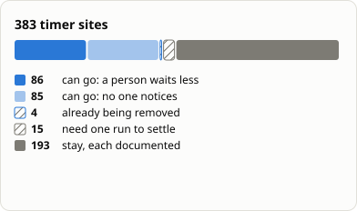 | 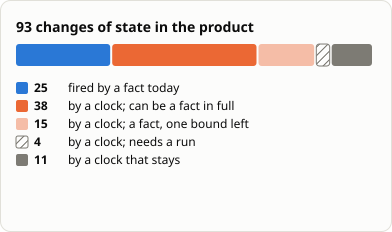 | ![The longest waits a person has today beside what they become: AG402: A Stop whose hook has given up stops waiting and ...: 30 s today, no clock after; AG11: A hook stops waiting once the daemon has left an ...: 12 s today, about 0.2 s after; CG1: Store writes wait for the writer ahead of them, not a ...: 10 s today, one batch after; BG01: Shell command results and turn ends read the ...: 10 s today, no clock after; AG14: The session-start note and steer links come in the ...: 4 s today, no clock after](images/timers/first-waits.svg) |

Left: every timer site, judged one by one. Middle: the product's changes of state; a clock fires 68 of 93, and 38 of
those can be fired by a fact in full. Right: the longest wait a person meets where each change being built today
works, and what it becomes.

Contents: [The map of the software](#the-map-of-the-software) · [The state maps](#the-state-maps) · [A hook's path, today and once the first groups are in](#a-hooks-path-today-and-once-the-first-groups-are-in) · [The ten categories of use](#the-ten-categories-of-use) · [What stays, and why](#what-stays-and-why) · [The plan](#the-plan) · [What is not known yet](#what-is-not-known-yet) · [How it was made](#how-it-was-made) · [Every timer that stays](timers-kept.md)

## The map of the software

Every part of Rerail that runs, and every link between two parts. An arrow points from the part that waits to the part
it waits on. A clock mark and a number count the timers: on a part, those on the links it starts; on a link, those
placed on it.

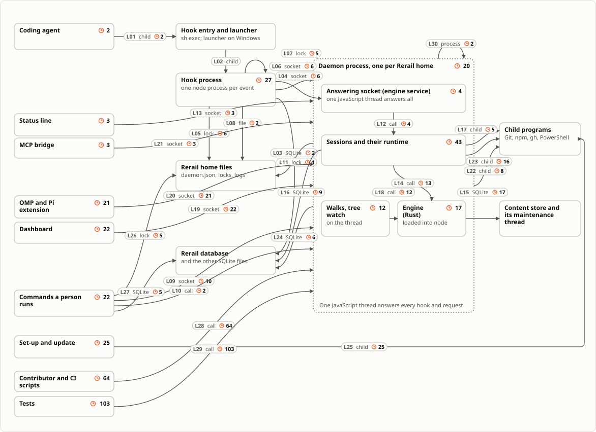

20 parts and 30 links. The daemon's box holds what runs in its process; its one JavaScript thread answers every hook,
the dashboard and the API, so anything that holds it holds them all. The most clocks sit on L29 (103), L28 (64), L25
(25), L19 (22).

### The parts

| Part | What it is | Where at 0.1.5 | Clocks it holds |
|---|---|---|---|
| Coding agent | Claude Code, Codex, Cursor (hooks) and OMP, Pi (extensions in the agent's own process). Not Rerail's code; it starts every hook and waits for its answer. | hooks/claude.json:3-11, hooks/codex.json, hooks/cursor.json | 2 |
| Hook entry | The command the agent runs for each event: on macOS and Linux `sh -c 'if [ -x "$0" ]; then exec "$0" "$1"; fi; exec node "$1"'` (exec, so node replaces sh); on Windows PowerShell for Codex and Cursor, and for Claude Code the hook launcher, a small node script that runs the hook under the recorded node, in its own process or as a child. | src/setup/harness-registration.ts:379, :532-590; src/harness/hook-launcher.ts:43-73 | 0 |
| Hook process | One node process per event: reads the event on stdin, checks whether Rerail is on in the folder, finds the daemon (starting one when none runs), takes the session's lock, sends the event to the engine socket and prints the answer. | src/hosts/claude/claude-hook.ts:17-27; src/harness/hook-host.ts:65-226; src/harness/hook-adapter.ts:255-420 | 27 |
| OMP and Pi extension | Runs inside the agent: attaches a native session to the daemon, holds a tool call while its check runs (25 s budget), polls for background steers every 100 ms, renews a 60 s lease by every request. | src/hosts/omp/extension.ts; src/hosts/pi/\*; src/harness/native-session-client.ts; src/harness/contained-hook.ts:8-19 | 21 |
| MCP bridge | A process the agent starts for Rerail's MCP tools: reads daemon.json, proves the daemon on Windows, relays each JSON-RPC call to the daemon's HTTP API. | src/api/mcp-bridge.ts:99-135 | 3 |
| Status line | Claude Code runs it at each refresh: reads the checkout's state from the daemon, or the database read-only when no daemon answers. | src/hosts/claude/claude-status.ts:16-177 | 3 |
| Daemon process | One node process per Rerail home. Its single JavaScript thread answers every hook, the HTTP API, the dashboard and native sessions. Holds the home daemon lock and, for the installed build, the machine's main-instance lock; writes daemon.json once it listens; restarts itself near its heap ceiling. | src/daemon/daemon.ts:540-612, :1226-1400; src/daemon/heap-ceiling.ts; src/daemon/daemon-exit.ts | 20 |
| Engine service (the answering socket) | An HTTP server on a Unix socket or a Windows named pipe inside the daemon. Takes POST /events, routes each event to its checkout's runtime through a per-session queue, answers with the deliveries (blocks, steers). Sweeps quiet sessions every 60 s, retires a checkout's runtime 15 min after its last session. | src/runtime/engine-service.ts:291-404, :647-746 | 4 |
| Sessions and their runtime | A RerailRuntime per checkout holds its sessions: records each event in the database, opens the session's code rules, checks edits, walks the session's checkout after shell commands, waits for checks at a turn's end, runs Merge Assist. | src/runtime/runtime.ts:975-1060, :1216-1219, :1600-1880, :2424 | 43 |
| Walks and the tree watch | The session walk reads the checkout after a shell command (10 s cap). The worktree walk reads a repository's other worktrees once for all sessions, paced at 5 s, with a full walk every 10 min, fed by the engine's tree watch (inotify, FSEvents, ReadDirectoryChangesW with oplocks). | src/engine/code-rule/code-rule-bridge.ts:1621; src/engine/code-rule/worktree-walks.ts:437-485; src/engine/code-rule/worktree-notices.ts:183-185; native/src/tree_watch/ | 12 |
| Engine (Rust, loaded into node) | Code-rule evaluation, one at a time per daemon (a second is refused with WORKSPACE_BUSY), a 5 ms inline budget on the JavaScript thread, the module graph, the tree watch thread, the main-instance and home file locks (try-only), the Windows detached spawn. | native/src/code_rule_dsl/workspace/api.rs:51, :870-892; native/src/main_instance.rs:35-57; native/src/process.rs:307-330 | 17 |
| Content store and its maintenance thread | One SQLite file per machine for the installed build (a checkout's own for a dev build). Every writer is a thread of the main daemon. A maintenance thread wakes every 30 s: renews workspace leases, collects when over capacity, builds search indexes for up to 1 s. | native/src/content_store/connection.rs:17-24, :151-393; native/src/code_rule_dsl/workspace/storage.rs:25-152; native/src/content_store/reclamation.rs:107-140 | 0 |
| Rerail database and the other SQLite files | rerail.sqlite (sessions, events, audits, rules, start rows) opened by the daemon on its main thread with a 5 s busy timeout, read-only by hooks and the status line, written by commands (reset, scrub, set-up). Also the set-up stores, the remote outbox and the provenance move's worker thread. | src/engine/storage/database.ts:44-60; src/engine/storage/sqlite-wal.ts:16-17; src/engine/storage/rule-provenance-move.ts | 0 |
| Rerail home files | daemon.json (the daemon's address and capability), daemon.lock and its holder record, the start lock and the autostart claim under locks/, the port and access token files, daemon.log, the hook failure log, the session lock files under the storage root. | src/runtime/daemon-control.ts:288-308, :669-830; src/engine/native/home-daemon-lock.ts; src/engine/native/file-lock.ts | 0 |
| Commands a person runs | rerail start, stop, status, session, scan, daemon start and stop, setup, install, update, uninstall, scrub, reset, support-bundle. Each runs as its own node process and talks to the daemon over HTTP, to the database directly, and to npm, Git, gh and PowerShell as children. | src/cli/cli.ts:574-1000; src/setup/updater.ts; src/setup/packs-lock.ts; src/cli/setup-cli.ts | 22 |
| Set-up and update | rerail setup, install, update and uninstall: register the hooks in each coding agent's settings and check them by running one, install rule packs with npm under the packs lock, write the set-up stores (SQLite) and the shell PATH; update stops the daemon, installs the new version and starts it. | src/setup/harness-registration.ts; src/setup/registered-hooks.ts:76; src/setup/packs-lock.ts:11; src/setup/updater.ts:56-61, :395-557, :826; src/setup/shell-path.ts:319 | 25 |
| Dashboard | A page in the browser served by the daemon. Polls each resource every 5 s with If-None-Match, backs off to 30 s while the daemon is unreachable, pauses while the tab is hidden. | ui/poll.js:1-8, :273, :655-731; ui/frame/topbar.js:20-22; ui/app.js:22, :97 | 22 |
| Child programs | Git (10 s limit per call), npm (3 min per query, 20 min per install), gh (20 s per run), the person's own conflict hook (10 s by default), PowerShell, icacls, whoami, scutil, the Orca CLI. | src/engine/git.ts:339, :828, :880; src/runtime/npm.ts:40-236; src/runtime/merge-assist/github.ts:16-281 | 0 |
| Contributor and CI scripts | Dev daemon scripts (just rerail-dev, rerail --restore, rerail-smoke), the cloud test matrix and its guests, release and upstream scripts. Not shipped to users. | scripts/dev/; scripts/host/; scripts/release/; scripts/upstream/ | 64 |
| Tests | vitest suites (test/, integration/, e2e/, benchmark/) and the engine's cargo tests. | vitest.config.ts:18; test/; native/src/\*\*/tests.rs | 103 |

### The links: what crosses each, and who waits on whom

| Link | Who waits on whom | Kind | What crosses it | Who waits | Clocks |
|---|---|---|---|---|---|
| L01 | Coding agent on Hook entry | child | a child process per event: the event as JSON on stdin, the answer on stdout | the agent waits for the hook's exit; on Windows a hook whose parent was killed ends itself by a 1 s check | 2: A125 A809 |
| L02 | Hook entry on Hook process | child | exec on macOS and Linux (one process); a child process on Windows (PowerShell, cmd.exe or the launcher's spawnSync) | the entry waits for the hook's exit | 0:  |
| L03 | Hook process on Rerail database and the other SQLite files | SQLite | a read-only SQLite open per hook (the checkout's start rows); two writable opens per delivered steer (its receipt) | the hook waits on SQLite's lock (5 s busy timeout per open) | 2: A133 A134 |
| L04 | Hook process on Daemon process | socket | HTTP reads of the daemon's API (start state, dashboard address, checkout scope, rule count), 2 s each | the hook waits for each answer up to 2 s | 6: A103 A131 A132 B001 B044 B003 |
| L05 | Hook process on Rerail home files | lock | daemon.json read, the start lock and autostart claim (files under locks/), a detached `rerail daemon start` when none runs | the hook polls the lock every 50 ms up to 15 s, a record every 100 ms up to 15 s | 6: A105 A107 A108 A110 B005 B006 |
| L06 | Hook process on Engine service (the answering socket) | socket | a Unix socket or named pipe: the capability proof (Windows), then POST /events; the answer carries blocks and steers | the hook waits for the daemon: 2 s probe, then the rest of 12 s from its arrival, then 30 s of socket silence on the request | 6: A101 A102 A104 A115 A116 A222 |
| L07 | Hook process on Hook process | lock | the session's lock file, shared by parallel hooks of one session | a waiter polls every 10 ms up to 30 s; a holder silent 10 s is taken over; the holder touches the file every 1 s | 5: A120 A121 A122 A123 A124 |
| L08 | Hook process on Rerail home files | file | the hook failure log (one line per lost event) | nobody; a rename retried for 2 s on Windows | 2: A126 A127 |
| L09 | Commands a person runs on Daemon process | socket | HTTP probes (/healthz, 2 s), POST /native/shutdown (Windows, 2 s), signals; scan requests and reads | the command waits for the answer, then for the daemon's exit by a 100 ms poll | 10: A106 A111 A112 A113 B002 B032 B033 B034 B035 B626 |
| L10 | Commands a person runs on Daemon process | call | the launch: a detached spawn, then daemon.json and /healthz read every 100 ms; on Windows the exit code read every 100 ms | the launcher waits up to 15 s for ready | 2: A109 C26 |
| L11 | Daemon process on Rerail home files | lock | daemon.json written once it listens and checked every 1 s; the home daemon lock (1 s wait at start); the main-instance lock | a second daemon polls the home lock every 50 ms for 1 s | 4: A204 B007 B008 C27 |
| L12 | Engine service (the answering socket) on Sessions and their runtime | call | in-process calls through a per-session queue (one event at a time per session); a 60 s sweep of quiet sessions; a 15 min timer per idle checkout runtime; 1 s looks for stalled requests at close | each event waits for the events of its session ahead of it | 4: A117 A118 A119 A406 |
| L13 | Status line on Daemon process | socket | an HTTP read of the presentation (2 s), else the database read-only | Claude Code waits for the status command up to its 2 s | 3: A128 A129 A130 |
| L14 | Sessions and their runtime on Engine (Rust, loaded into node) | call | napi calls: apply an edit, evaluate, open a workspace; inline on the JavaScript thread up to 5 ms, else on a pool thread; one evaluation at a time, a second refused and retried | a check waits for the evaluation ahead (retries 2 to 25 ms apart); the answer waits for checks up to 1 s (hooks) or 10 s (OMP, Pi) | 13: C17 C18 C19 B207 B208 B209 B210 B211 A401 A402 A403 A404 A405 |
| L15 | Engine (Rust, loaded into node) on Content store and its maintenance thread | SQLite | SQLite write transactions from the apply's publication, the attach's batches, lease renewals and collection; reads through a 32 MiB cache | a writer polls SQLite's lock 1 to 100 ms apart, 250 ms per attempt, up to 10 s; then the store is skipped for 30 s | 17: C01 C02 C03 C04 C05 C06 C07 C08 C09 C10 C11 C12 C13 C14 C15 C16 C28 |
| L16 | Sessions and their runtime on Rerail database and the other SQLite files | SQLite | SQLite writes on the daemon's one JavaScript thread (events, sessions, steers, audits); the provenance move's worker thread | a write waits up to 5 s for another process's transaction, holding every hook behind it; a 250 ms poll of scan requests and settings | 9: A408 B212 B213 B214 B215 B216 B217 B218 B219 |
| L17 | Sessions and their runtime on Child programs | child | Git as child processes (10 s each; the end read by a 1 s tick; 500 ms for output held open) | the session waits for Git's exit | 5: B040 B041 B042 B201 B223 |
| L18 | Walks and the tree watch on Engine (Rust, loaded into node) | call | the tree watch thread's notices, taken by a 250 ms poll; walks paced 5 s apart; a full walk every 10 min; the Windows watch reopened 200 ms after a rename | nobody waits on the background walks; the session walk holds a shell command's result and a turn end up to 10 s | 12: B200 B202 B203 B204 B205 B206 C20 C21 C22 C23 C24 C25 |
| L19 | Dashboard on Daemon process | socket | HTTP conditional GETs every 5 s; setting writes (30 s limit); keep-alive connections (5 s idle) | the page waits for the next poll to show a change | 22: B400 B401 B402 B403 B404 B405 B406 B407 B408 B409 B410 B411 B412 B413 B414 B415 B416 B417 B226 A201 A202 A203 |
| L20 | OMP and Pi extension on Daemon process | socket | HTTP to /native/\*: attach, events with deferred replies (answered by 10 s), a poll every 100 ms, a 60 s lease renewed by each request, close | the extension holds a tool call up to 25 s; a request waits up to 30 s, an operation up to 120 s | 21: A210 A211 A212 A213 A214 A215 A216 A217 A218 A219 A220 A221 A801 A802 A803 A804 A805 A806 A807 A808 B004 |
| L21 | MCP bridge on Daemon process | socket | the agent's MCP calls on stdio, relayed as HTTP; a 2 s proof on Windows and a 2 s /healthz on the first call | the agent's tool call waits for the relay up to 30 s | 3: A223 A224 A225 |
| L22 | Daemon process on Child programs | child | child processes the daemon starts: the TLS key reader, icacls, PowerShell, whoami, scutil, the Orca CLI | the daemon's start waits for each child's answer | 8: A205 A206 A207 A114 A619 B220 B221 B222 |
| L23 | Sessions and their runtime on Child programs | child | Merge Assist in the daemon: gh, Git and the person's conflict hook as children; a 5 min gh cache; a 30 s window between passes | an edit's result waits up to 1 s for the pass's note | 16: A601 A602 A603 A604 A605 A606 A607 A608 A609 A610 A611 A612 A407 A226 B224 B225 |
| L24 | Daemon process on Rerail database and the other SQLite files | SQLite | the remote sink (an experiment): its outbox SQLite file, the Rerail database read-only, HTTPS to a remote | nobody waits; a 10 s tick, backoff up to 5 min | 6: A613 A614 A615 A616 A617 A618 |
| L25 | Set-up and update on Child programs | child | set-up, update, install, uninstall: npm and the registry, the packs folder lock, PowerShell, the registered hooks, the set-up stores (SQLite) | the person waits at the command; each child has a limit | 25: A620 A621 A622 A623 B009 B010 B011 B012 B013 B017 B018 B019 B020 B021 B022 B023 B024 B025 B026 B027 B028 B030 B031 A409 A410 |
| L26 | Commands a person runs on Rerail home files | lock | renames and removals of files another program may hold open (Windows): replaceFile, removeWithRetry, the clock-sample folder | the caller retries 50 ms to 1 s apart, up to 2 to 10 s | 5: B014 B015 B016 B043 B045 |
| L27 | Commands a person runs on Rerail database and the other SQLite files | SQLite | rerail scrub, reset, project and uninstall writing or reading the database beside a running daemon | the command waits on SQLite's lock (5 to 10 s) | 5: B029 B036 B037 B038 B039 |
| L30 | Daemon process on Daemon process | process | the restart at the heap ceiling: the heap read every 30 s, then a relaunch with the same arguments | hooks wait through the new daemon's start | 2: A208 A209 |
| L28 | Contributor and CI scripts on Daemon process | call | dev and CI scripts: a dev daemon's start, probe and stop; a local registry; cloud test machines; release and upstream network calls | the contributor or CI job waits | 64: A810 A811 A812 A813 A814 A815 A816 A817 A818 A819 A820 A821 A822 A823 A824 A825 A826 A827 A828 A829 A830 A831 A832 A833 A834 A835 A836 A837 A838 A839 A840 A841 A842 A843 A844 A845 A846 A847 B600 B601 B602 B603 B604 B605 B606 B607 B608 B609 B610 B611 B612 B613 B614 B615 B616 B617 B618 B619 B620 B621 B622 B623 B624 B625 |
| L29 | Tests on Daemon process | call | tests drive the product and wait for it, with limits that fail a hang | the suite waits | 103: C40 C41 C42 C43 C44 C45 C46 C47 C48 C49 C50 C51 C52 C53 C54 C55 C56 C57 C58 D1 D2 D3 D4 D5 D6 D7 D8 D9 D10 D11 D12 D13 D14 D15 D16 D17 D18 D19 D20 D21 D22 D23 D24 D25 D26 D27 D28 D29 D30 D31 D32 D33 D34 D35 D36 D37 D38 D39 D40 D41 D42 D43 D44 D45 D46 D47 D48 D49 D50 D51 D52 D53 D54 D55 D56 D57 D58 D59 D60 D61 D62 D63 D64 D65 D66 D67 D68 D69 D70 D71 D72 D73 D74 D75 D76 D77 D78 D79 D80 D81 D82 D83 D84 |

## The state maps

Each machine of the software, drawn as its states (the columns) and every change between them (one arrow per row). A
blue solid arrow is fired by a fact: an event, a command, an exit. An orange dashed arrow with a clock mark is fired
by a clock; it carries its change id, the clock's values and the timers there, and a mark for what it becomes: a fact
in full, a fact with one bound left for a party that may never answer, a clock that stays, or a run needed to decide.
The table under each drawing says what each timer guards and what replaces it.

> **How to read the ids.** A timer id names one site in the code: A for the hooks, the daemon and their scripts; B for
> the commands, set-up, the dashboard and the engine's TypeScript side; C for the engine in Rust; D for the tests. A
> group of timers removed together by one change carries the same letter with G (AG11, BG01, CG1, DG1). A change of
> state has an id from its machine: CK a checkout, DM the daemon, SE a session, HE a hook event, ST the content store,
> DB the Rerail database, CM a command, DA the dashboard and status displays, CI a contributor or CI run, TS a test.
> Pull requests are named by their number.

### A checkout

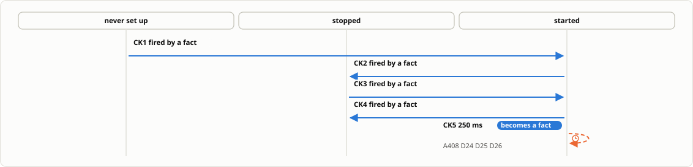

A checkout: 3 states, 5 changes, 1 fired by a clock today; of those, 1 becomes a fact.

| Change | From, to | What fires it today | Timers and what each guards | The fact that could fire it | Becomes | Removed by |
|---|---|---|---|---|---|---|
| fact CK1 | never set up to started | `rerail start` or `rerail setup` in the checkout writes its start rows `src/runtime/repository-start.ts:256-270; src/cli/cli.ts:710-716` | none | already a fact | a fact today | - |
| fact CK2 | started to stopped | `rerail stop` writes started = false for the checkout or the whole repository `src/runtime/repository-start.ts:227-252; src/cli/cli.ts:716` | none | already a fact | a fact today | - |
| fact CK3 | stopped to started | `rerail start` writes started = true `src/runtime/repository-start.ts:227-252` | none | already a fact | a fact today | - |
| fact CK4 | started to stopped | the daemon's sessions learn a stop: each event reads the start rows before it records anything `src/runtime/runtime.ts:971-983` | none | already a fact | a fact today | - |
| clock CK5 | started to started | a scan request or a setting written through the daemon's API reaches the session at the runtime's next 250 ms poll `src/runtime/runtime.ts:954` | **A408** 250 ms: guards a scan request or a settings change committed by another database connection: `rerail scan --session`, `rerail settings`, the dashboard and audit_requests_create, all written by the daemon's API (src/api/operations.ts:498) **D24** 600 ms: guards each session's first read after it opens **D25** 1,500 ms: guards nothing: it proves no idle session is read **D26** 600 ms: guards the first tick before queuing | The API handler that wrote it runs in the same process: it can tell the session at once. | becomes a fact | **AG403** (later) |

### The daemon

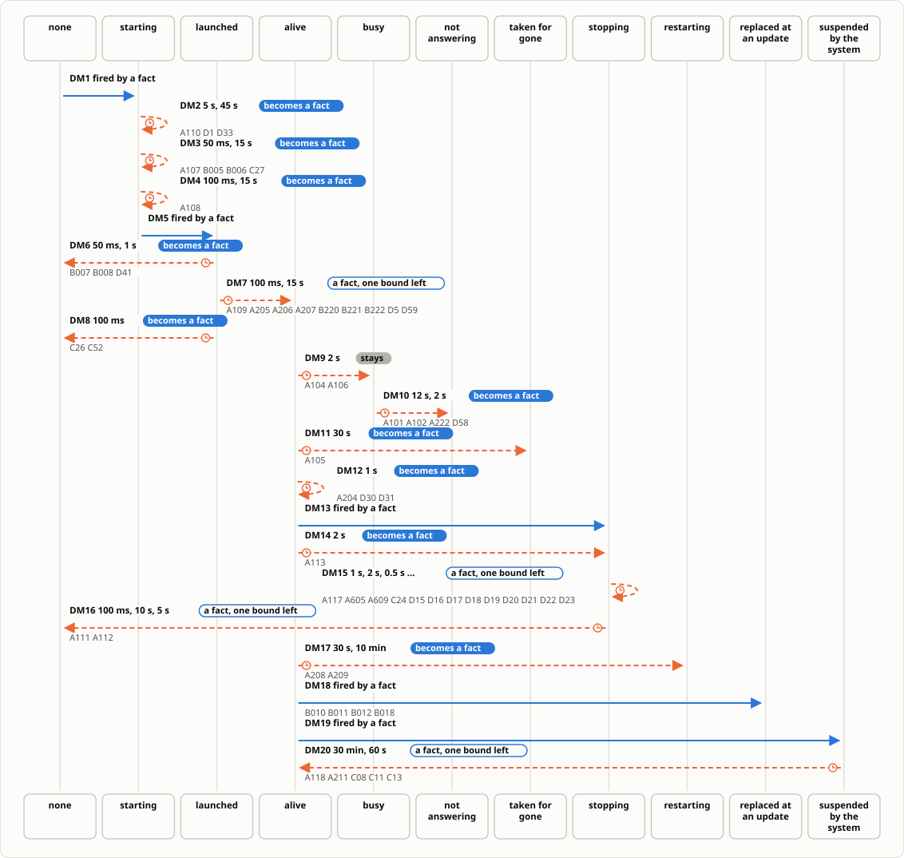

The daemon: 11 states, 20 changes, 15 fired by a clock today; of those, 10 becomes a fact, 4 a fact, one bound left, 1
stays.

| Change | From, to | What fires it today | Timers and what each guards | The fact that could fire it | Becomes | Removed by |
|---|---|---|---|---|---|---|
| fact DM1 | none to starting | a hook finds no daemon and starts `rerail daemon start` detached; or a person runs it `src/harness/hook-host.ts:190-199; src/runtime/daemon-control.ts:1299-1325, :837-850` | none | already a fact | a fact today | - |
| clock DM2 | starting to starting | the autostart claim: a file with a 5 s lease, renewed each second for at most 45 s; a claim not renewed is taken for abandoned `src/runtime/daemon-control.ts:295-304, :1184-1290` | **A110** 5 s, 1 s, 45 s: guards one autostart launch per Rerail home: other hooks that find the daemon down leave the start to the launcher that holds the claim **D1** 7,000 ms: guards a launcher's start claim to age past its 5 s lease **D33** 1,500 ms: guards the claim to be renewed again a second later | An OS lock the launcher holds for its life: the system frees it however the launcher ends. | becomes a fact | change not yet open: the start claim held by an OS lock |
| clock DM3 | starting to starting | waiting for the start lock: the lock file is tried every 50 ms for up to 15 s `src/runtime/daemon-control.ts:288, :721-728; src/engine/native/file-lock.ts:34, :171, :230; native/src/main_instance.rs:35-57` | **A107** 15 s, 50 ms: guards another start to let go of the home's start lock (an OS lock, freed when its holder ends) **B005** 50 ms: guards another process letting go of a Rerail home lock: the start lock (src/runtime/daemon-control.ts:723, up to 15 s), the packs lock (5 min), the profile lock (src/activation/customer-profile.ts:253, 5 s) **B006** 50 ms: guards another process's folder lock (the update lock where the engine does not load) **C27** 50 ms, 1 s: guards one process at a time starts the daemon, updates the home, changes packs or activates a profile | A blocking OS lock wait (flock without LOCK_NB; LockFileEx without LOCKFILE_FAIL_IMMEDIATELY), served in arrival order. | becomes a fact | **CG8** (next), **BG14** (next), **AG16** (next) |
| clock DM4 | starting to starting | the home lock says a daemon holds the home but daemon.json is missing: polled every 100 ms for up to 15 s, then an error `src/runtime/daemon-control.ts:808-830` | **A108** 15 s, 100 ms: guards a daemon that holds the home's lock to write its daemon.json again | The home lock's holder record names the daemon: act on it, or watch the home folder for daemon.json. | becomes a fact | **AG13** (next) |
| fact DM5 | starting to launched | the launcher spawns the daemon after the SQLite binding check (no limit on that check) `src/runtime/daemon-control.ts:748-763, :1132-1150` | none | already a fact | a fact today | - |
| clock DM6 | launched to none | a second daemon for the same home tries the home lock every 50 ms for 1 s, then stops `src/daemon/daemon.ts:1226-1232; src/engine/native/home-daemon-lock.ts:24-25, :143` | **B007** 1 s: guards a daemon that restarted at its heap ceiling to exit, so the next daemon can take the home lock **B008** 50 ms: guards the home lock to be free during the 1 s wait **D41** 200 ms: guards a lock held for an instant | The predecessor's exit (its process handle) and a blocking wait on the home lock. | becomes a fact | **BG14** (next), **CG8** (next) |
| clock DM7 | launched to alive | the daemon listens and writes daemon.json; the launcher sees it by reading daemon.json and /healthz every 100 ms, up to 15 s `src/daemon/daemon.ts:604-612, :636-645; src/runtime/daemon-control.ts:1152-1183` | **A109** 15 s, 100 ms: guards the launched daemon to write daemon.json naming its pid and answer its probe **A205** CHILD_START_WAIT_MS 10_000 at ...: guards the Node child that opens the TLS key and certificate on Windows to say on its own pipe (fd 3) that it began its opens. **A206** CHILD_OPEN_WAIT_MS 2_000 at ...: guards the child's opens of the key and the certificate, which another program's oplock can hold on Windows. **A207** CHILD_END_WAIT_MS 1_000 at ...: guards the ended child to exit, so nothing it started outlives the start. **B220** 10 s: guards whoami.exe printing this user's SID **B221** 30 s: guards icacls.exe giving a folder an owner-only ACL **B222** 30 s: guards Windows PowerShell starting and printing a file's SDDL (Get-Acl) **D5** 17,000 ms: guards a daemon slow to come up, past a start's 15 s wait **D59** 60,000 ms, 10 s: guards the Node process that opens the key to start | A ready line the daemon writes on a pipe the launcher passed it once it listens; the pipe's end is its exit. | a fact, one bound left | **AG16** (next), **BG13** (next) |
| clock DM8 | launched to none | the daemon died at start: on Windows the launcher reads its exit code every 100 ms `native/src/process.rs:307-330; src/runtime/daemon-control.ts:1078-1093, :1158-1162` | **C26** 0 ms, 100 ms: guards tells a starter on Windows whether the daemon it launched has exited, by the handle it kept **C52** 20 ms, 10 s: guards waits for a detached child's exit code | A wait registered on the kept process handle (RegisterWaitForSingleObject); a pidfd or kqueue NOTE_EXIT elsewhere. | becomes a fact | **CG7** (next) |
| clock DM9 | alive to busy | the event loop is held by work (an audit, a collection, a long write); no code marks it: a client sees it only as a probe unanswered within 2 s `src/runtime/daemon-control.ts:308, :465-478, :626-660; src/runtime/engine-proof.ts:63, :89` | **A104** 2 s, 30 s: guards the engine's answer to the capability proof on Windows, before any read of the daemon **A106** 2 s: guards the daemon's /healthz answer, to tell running from alive-but-not-answering | None for the first wait: nothing tells a daemon that answers in 3 s from one that never will. | stays | - |
| clock DM10 | busy to not answering | a hook gives up 12 s after it arrived (2 s probe, then a second probe with the rest) and loses its event `src/runtime/daemon-control.ts:1002-1023; src/harness/hook-host.ts:92, :197` | **A101** 12 s, 2 s, 10 s: guards a daemon whose pid lives but which does not answer its health probe, in the hope it answers in time to take this event **A102** 12 s, 2 s: guards a busy daemon to answer its health probe as the pid daemon.json records **A222** 2 s, 10 s: guards a busy daemon to answer its health probe as itself before the event goes to its engine socket. **D58** 12 s: guards a hook to give up on a daemon that does not answer | An earlier event the daemon has left untaken: every hook after the first of a silence can answer at once and journal its event. | becomes a fact | **AG11** (being built) |
| clock DM11 | alive to taken for gone | on Windows a proof that waited out Node's 30 s pipe connect reads 'gone', and the lookup deletes the live daemon's daemon.json `src/runtime/daemon-control.ts:669-702` | **A105** 30 s: guards telling a gone daemon's record from a live one's | The home daemon lock (homeDaemonRuns): a daemon that holds it is alive. | becomes a fact | **#677**, **AG13** (next) |
| clock DM12 | alive to alive | the daemon checks every 1 s that daemon.json still holds its record and writes it back `src/daemon/daemon.ts:51, :636-671` | **A204** RECORD_CHECK_MS 1_000 at ...: guards daemon.json being removed or replaced while this daemon holds the Rerail home, to write it back; and the home being moved or removed, to stop writing it. **D30** 1,000 ms: guards nothing: it proves the close does not finish while a write of daemon.json is held **D31** 200 ms: guards nothing: the record check asks no more | A watch on the home folder. | becomes a fact | **AG25** (later) |
| fact DM13 | alive to stopping | SIGTERM or SIGINT (macOS, Linux); POST /native/shutdown on Windows `src/daemon/daemon.ts:353, :1391-1393; src/runtime/daemon-control.ts:1367-1370` | none | already a fact | a fact today | - |
| clock DM14 | alive to stopping | on Windows a stop request not answered in 2 s turns into a kill, cutting the requests in flight `src/runtime/daemon-control.ts:1350-1364` | **A113** 2 s: guards the daemon to accept its shutdown request on Windows; past it, SIGTERM, which on Windows ends the process at once | The request's answer, given a clean shutdown its time; the exit itself by the process handle. | becomes a fact | **AG18** (next) |
| clock DM15 | stopping to stopping | the close drains: looks for stalled requests every 1 s, waits 2 s for a Merge Assist pass, 0.5 s for hook commands, up to 5 s for the Windows watch's cancelled reads `src/runtime/engine-service.ts:446-460, :704-724; src/runtime/merge-assist/service.ts:574; src/runtime/merge-assist/hook-command.ts:147; native/src/tree_watch/windows.rs:763-781` | **A117** 1 s: guards a request still arriving while the service closes, cut once it sends nothing between two looks **A605** 2 s: guards bounds the wait at stop for hook handlers and passes still running, so a pass waiting on gh or Git cannot hold the stop **A609** 500 ms: guards hook commands still running at stop to end on SIGTERM before SIGKILL **C24** 5 s: guards at close the thread waits for the cancelled reads of closed handles, so no buffer is freed under the kernel **D15** 1,500 ms: guards the close's look 1 s in to pass while the end runs **D16** 1,500 ms: guards the close's look 1 s in to pass while two hooks wait **D17** 2,500 ms: guards two looks for stalled requests to find nothing since the answer **D18** 300 ms: guards the close to have begun before the body is sent **D19** 2,700 ms: guards the close to reach 3 s, two looks after the body **D20** 1,500 ms: guards the look 1 s in to pass with a pipelined request stalled **D21** 1,200 ms: guards one more look before the hook reads the rest of a 600 KB answer **D22** 1,300 ms: guards 0.7 s, then a busy check phase held to 1.3 s, past the look due at 1 s **D23** 1 s, 1,950 ms, 5 s: guards the moment the close cut a connection | Each wait already ends on its event; the clocks bound a party that never answers. Merge Assist's stop can wait for the hook commands only. | a fact, one bound left | **AG62** (next) |
| clock DM16 | stopping to none | `rerail daemon stop` sees the exit by a 100 ms poll; at 10 s it sends SIGKILL and waits 5 s more `src/runtime/daemon-control.ts:305-307, :1372-1402` | **A111** 10 s: guards the daemon to finish its requests and exit after SIGTERM or the shutdown request, before it is killed **A112** 100 ms, 5 s: guards the daemon's process to be gone | The exit by the process handle (pidfd, kqueue NOTE_EXIT, WaitForSingleObject); the kill at 10 s stays for a daemon that ignores its stop. | a fact, one bound left | **AG18** (next) |
| clock DM17 | alive to restarting | the heap is read every 30 s; past 80% of its limit, and not within 10 min of start, the daemon relaunches itself `src/daemon/heap-ceiling.ts:5-7, :46-53; src/daemon/daemon.ts:1394-1399` | **A208** HEAP_CHECK_INTERVAL_MS 30_000 at ...: guards the daemon's heap to stay past 80% of its limit after a full collection, to restart before it runs out. **A209** 10 min: guards decides whether a heap past the ceiling means the limit is too low for the daemon's work (no restart; the watch ends) or that it is running out (restart). | Node's 'gc' performance entry after each full collection. | becomes a fact | **AG23** (later) |
| fact DM18 | alive to replaced at an update | `rerail update` stops the daemon, installs and starts the new version; limits fire only when a step hangs `src/setup/updater.ts:395, :434, :514, :557` | **B010** 15 s: guards the new version's rerail state and rerail start in a scratch repository during update validation **B011** 15 s: guards the new version's event stream to answer a session start and exit **B012** 2 min: guards the staged engine to load in a child and report healthy **B018** 5 s: guards a killed health-check child to exit before its scratch folder is removed | already a fact | a fact today | - |
| fact DM19 | alive to suspended by the system | the machine sleeps; no Rerail code runs and none marks it `(no code)` | none | already a fact | a fact today | - |
| clock DM20 | suspended by the system to alive | at resume every age measured on the wall clock (Date.now, SystemTime) counts the sleep as quiet time: a session whose last event is over 30 min old closes at the next 60 s sweep and its next tool call waits for the reopen; a native session reads expired until its host's next request, and a sweep that comes first closes it; content-store leases read expired until the next renewal `src/runtime/engine-service.ts:314, :349-372; src/daemon/native-session-server.ts:209, :515-523; native/src/content_store/mod.rs:70-85` | **A118** 30 min, 24 h, 60 s: guards sessions whose end never came (an agent killed, a SessionEnd hook past Claude Code's 1.5 s) keep their walk copy, history and evaluator **A211** NATIVE_SESSION_LEASE_MS 60_000 at ...: guards an OMP or Pi host to send anything for its native session; one silent for 60 s is taken for gone, its session ended (session-end recorded) and its runtime disposed. **C08** 120 s: guards a workspace whose process ended without closing is taken for dead 120 s after its last renewal, so collection reclaims its overlay rows **C11** lease_until &lt; now: guards marks workspaces whose lease ran out dead (state 2) and deletes their overlay rows **C13** whole seconds since the epoch: guards the time leases compare against | No age at all: an owner's end as the fact (the agent's exit, the host's connection, the workspace's process). The systems' resume notices (logind PrepareForSleep, NSWorkspaceDidWakeNotification, WM_POWERBROADCAST) would only patch the ages. | a fact, one bound left | **AG17** (next), **CG3** (next) |

### A session

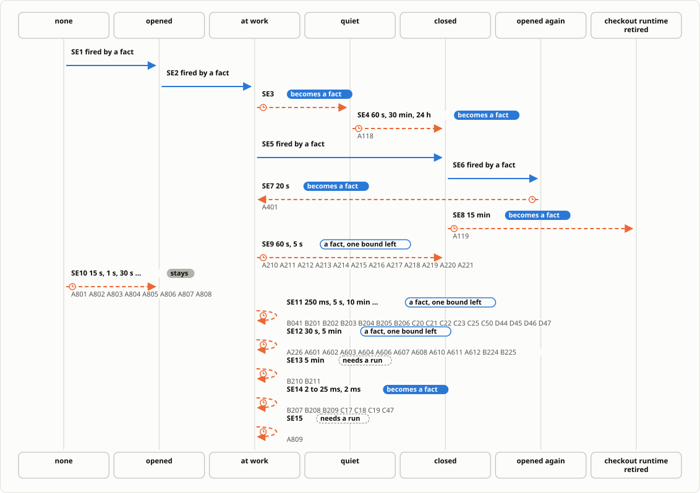

A session: 7 states, 15 changes, 11 fired by a clock today; of those, 5 becomes a fact, 3 a fact, one bound left, 1
stays, 2 needs a run.

| Change | From, to | What fires it today | Timers and what each guards | The fact that could fire it | Becomes | Removed by |
|---|---|---|---|---|---|---|
| fact SE1 | none to opened | a session-start event: the runtime records the session and starts opening its code rules `src/runtime/runtime.ts:1002, :1600-1640, :2424-2430` | none | already a fact | a fact today | - |
| fact SE2 | opened to at work | the session's rules have opened; before that its boundaries go on without code rules `src/runtime/runtime.ts:1011, :1641-1648` | none | already a fact | a fact today | - |
| clock SE3 | at work to quiet | no event arrives; the session's quiet time is counted from its last event (a clock read, no code fires) `src/runtime/engine-service.ts:314` | none | The agent's process end tells a session that is over from one that is paused. | becomes a fact | **AG17** (next) |
| clock SE4 | quiet to closed | a sweep every 60 s closes a session quiet 30 min (24 h when it still owes its agent something) `src/runtime/engine-service.ts:54-65, :349-372, :731; src/runtime/runtime.ts:1844-1853` | **A118** 30 min, 24 h, 60 s: guards sessions whose end never came (an agent killed, a SessionEnd hook past Claude Code's 1.5 s) keep their walk copy, history and evaluator | The agent's process end, or its session-end event; a session paused by a person stays open. | becomes a fact | **AG17** (next) |
| fact SE5 | at work to closed | a session-end event `src/runtime/runtime.ts:983, :1028; src/runtime/engine-service.ts:320-323` | none | already a fact | a fact today | - |
| fact SE6 | closed to opened again | the next event of a closed session opens it again from its ledger `src/runtime/runtime.ts:1006, :1640` | none | already a fact | a fact today | - |
| clock SE7 | opened again to at work | each code-rule boundary of a reopened session waits for its rules to open, up to 20 s, and every later one waits again while they stay closed `src/runtime/runtime.ts:134-140, :1216-1219` | **A401** 20 s: guards a reopened Claude Code, Codex or Cursor session's evaluator to open (its checkout indexed, its rules compiled) before a tool call, its result or the Stop goes on | The rules' open itself, waited for only by a call that can write, and only once. | becomes a fact | **AG401** (next) |
| clock SE8 | closed to checkout runtime retired | a checkout's runtime is disposed 15 min after its last session left `src/runtime/engine-service.ts:204, :386-404` | **A119** 15 min: guards a checkout's runtime (its walk and compiled rules) with no session, kept so a session started soon after finds it warm | Memory, not time: retire when the daemon needs the room. | becomes a fact | **AG17** (next) |
| clock SE9 | at work to closed | an OMP or Pi session whose host sent nothing for 60 s is closed by a sweep every 5 s `src/daemon/native-session-server.ts:190-196, :209, :515-523` | **A210** NATIVE_SESSION_SWEEP_INTERVAL_MS ...: guards native sessions whose lease ended, to close them (A211). **A211** NATIVE_SESSION_LEASE_MS 60_000 at ...: guards an OMP or Pi host to send anything for its native session; one silent for 60 s is taken for gone, its session ended (session-end recorded) and its runtime disposed. **A212** DEFERRED_REPLY_TTL_MS 60_000 at ...: guards the client to collect a finished deferred answer by its ticket; one not collected in 60 s is forgotten. **A213** NATIVE_REPLY_WITHIN_MS 10_000 at ...: guards a deferred operation, queued behind the session's earlier ones, to finish; past 10 s the daemon answers with its ticket and the client asks again at once. **A214** POLL_INTERVAL_MS 100 at ...: guards steers that finished after their event's answer (background audits) to be fetched from the daemon; each poll also renews the session's lease (A211) and finds an outage. **A215** 100 ms, 400 ms: guards a daemon that failed a request to answer a probe again. **A216** 10 s: guards the next attempt to rebuild the session (createNativeSession, which finds or starts the daemon) after one failed. **A217** RECORD_BACKOFF_MS 1_000 ...: guards the daemon to take the record of dropped events after it failed to (store busy or locked, or a transport fault). **A218** CLOSE_RECORD_WAIT_MS 5_000 at ...: guards the daemon to take the record of the session's dropped events before the close request goes. **A219** REQUEST_TIMEOUT_MS 30_000 at ...: guards the daemon's answer to one request (the ingest of a tool call or result, a poll, initialize, close, a ticket's await-reply). **A220** 30 s: guards a live daemon to finish an operation it keeps answering with tickets. **A221** 30 s, 120 s: guards the daemon's answer to a close the code calls best effort ('a daemon that cannot answer holds nothing the host needs released', :267), which the OMP host awaits when it retires a runtime (src/hosts/omp/extension.ts:189; createNativeSession awaits it at :184 before the new runtime takes over). | No event tells the daemon a host died today; a held poll (answered when a steer is ready) would be a connection whose close is the host's end. | a fact, one bound left | **AG24** (later), **AG22** (next), **AG27** (later), **AG26** (later) |
| clock SE10 | none to opened | OMP and Pi attach a session through a `rerail state` child (15 s) and retry an attach 1 s to 30 s apart; a tool call is held up to 25 s `src/hosts/omp/extension.ts:61-105, :241, :338, :479; src/hosts/pi/pi-fix-tool.ts:14-221; src/harness/contained-hook.ts:8-19` | **A801** 000 ms: guards Rerail's side of an OMP or Pi hook: the daemon taking a tool call (it reads the files' before-images), checking a tool result so its steer rides the result, or handing over the end-of-run steers (OMP session_stop, Pi agent_before_settle). **A802** 000 ms: guards `rerail state` run as a Node child to learn whether Rerail is started in the folder, on OMP (Bun) when no daemon answered. **A803** 000 ms: guards `rerail state --set-up` as a Node child, for the session-start note's rule state, on OMP with a configured database. **A804** 000 ms: guards a failed attach (the daemon could not start or answer, the state check failed) to be tried again in the background. **A805** 500 ms: guards the repository's indexing to last long enough to be worth showing as `indexing` in OMP's footer. **A806** one event-loop turn (setImmediate ...: guards OMP to queue the person's steer-line aside before the tool result goes back. **A807** 000 ms, 10 min: guards the child `pi` that fixes one rule violation for the experimental subagent steer (rerail_fix). **A808** 000 ms: guards a child sent SIGTERM (abort or timeout) to exit before it gets SIGKILL. | The child's exit and the host's own events already end each wait; the limits bound a child or daemon that hangs. | stays | - |
| clock SE11 | at work to at work | other worktrees' changes reach the session: notices taken by a 250 ms poll, walks 5 s apart, a full walk every 10 min, a refused watch retried after 10 min; the Windows watch reopens 200 ms after a rename `src/engine/code-rule/worktree-walks.ts:437, :457, :485; src/engine/code-rule/worktree-notices.ts:183-185; native/src/tree_watch/windows.rs:76-90, :252-276, :695-741` | **B041** 1 s: guards the read's time limit, looked at once a second **B201** 1 s: guards a Git listing asked again for a checkout whose first listing ran past Git's 10 s limit, before its turn passes to the next such listing **B202** 5 s: guards the gap after one walk of a repository's other worktrees before the next walk that answers the same session's asks **B203** 10 min: guards a write in a watched worktree that no change notice tells of: through a hard link, a memory map, a file another program holds open on Windows, or a notice the system lost without saying so **B204** 250 ms: guards change notices the engine's watch thread queued for the other worktrees (TreeWatch.take) **B205** 10 min: guards a worktree the engine could not watch (a network or WSL path, past Linux's inotify watch budget, Windows with no oplock) before the watch is tried again **B206** 5 s: guards a worktree whose watch ended (it or a folder above it was renamed, moved or deleted) to settle before it is watched again **C20** 200 ms: guards after a rename or deletion of a watched folder or one above it breaks the handle's oplock, the handle closes at once and the path is opened again 200 ms later **C21** 20 ms: guards a reopen waits until the closed handle's cancelled operations have completed **C22** 60 s: guards a folder renamed over and over is read whole instead of chased **C23** 20 ms: guards after a break to none, the acknowledgment and the new oplock are asked again when they cannot go at once (the last acknowledgment in flight, or the oplock not granted during another holder's break) **C25** INFINITE, or the next renewal or ...: guards the watch thread sleeps until a completion, a host call or the next due renewal or reopen **C50** 500 ms: guards asserts no notice comes for a change outside the watch **D44** 1,000 ms: guards nothing: no walk while every session is idle **D45** 3,350 ms, 3,700 ms: guards the gap and reread schedule of two sessions **D46** fullWalkMs 300 and 600 waited ...: guards a reread when a period passed **D47** 1,000 ms: guards the engine's notices of changed files to arrive before the walks | The watch thread can call the daemon when a notice arrives (a napi thread-safe function); a refused watch can retry on the cause that refused it; Windows completions already arrive on the port. | a fact, one bound left | **BG16** (later), **BG17** (later), **CG6** (later) |
| clock SE12 | at work to at work | Merge Assist's conflict check for an edit: run, skipped inside 30 s of the last, or late; gh's readiness read again after 5 min `src/runtime/merge-assist/service.ts:124-132, :288, :311, :377, :518, :574; src/runtime/merge-assist/conflict-hook.ts:69, :134; src/engine/merge-assist/model.ts:63; src/engine/merge-assist/overlap.ts:24` | **A226** 1 to 60 s: guards the person's conflict hook command to end. **A601** 5 min, 1 min: guards decides when a status read runs `gh auth status` and `gh api user` again instead of reusing the stored sign-in **A602** 10 min: guards a scan mark left by a process that hung, or whose pid the OS has given to another process **A603** 30 s: guards limits how often an agent's edits start a detection pass (many Git processes per pass; the pull request listing is reused for 5 minutes) **A604** 5 min: guards decides when detection after an edit lists open pull requests again (`gh auth status`, `gh api user`, `gh pr list`) **A606** 1 s: guards how long a new conflict's agent note is held for the person's hook command to answer `detected`, so its note and status join the first note **A607** 10 s: guards a person's hook command that never exits **A608** 2 s: guards a timed-out command's process group to end on SIGTERM before SIGKILL, and its pipes to close before they are destroyed **A610** 20 s: guards a gh run that does not answer (a stalled network or proxy) **A611** 2 s: guards a timed-out or over-long gh to exit on SIGTERM before its tree is ended **A612** 14 days: guards leaves out a branch last committed over 14 days ago (work left behind) unless it has an open pull request **B224** 10 s, 1 to 60 s: guards the person's conflict hook command to exit with its JSON **B225** 60 s: guards git diff and git ls-files over a branch's changes, for conflict detection | Status reads show gh's sign-in as last read; the end of the running pass could start the skipped one (to settle by a run). | a fact, one bound left | **AG61** (next), **AG63** (later) |
| clock SE13 | at work to at work | a repository scan (the session start's audit, or a scan request) runs in chunks and is cut at 5 min `src/engine/code-rule/code-rule-enforcer.ts:76, :1486, :1670` | **B210** 5 min: guards a repository scan's native index, chunk by chunk, timed from its start including the time it yields to the session's edit checks **B211** 5 min: guards a scan's JavaScript walk of listed paths or of a folder the native index does not take, file by file | The scan's own file and byte budgets (100,000 files, 512 MiB) already bound it; whether the 5 min cut adds anything needs a timing run. | needs a run | **BG31** (needs a run first) |
| clock SE14 | at work to at work | an evaluation finds the engine busy with another one: refused with WORKSPACE_BUSY and retried 2 to 25 ms apart; an idle wait polls every 2 ms `native/src/code_rule_dsl/workspace/api.rs:870-892; src/engine/code-rule/code-rule-enforcer.ts:1515-1527, :1656, :1987-1996` | **B207** 2 ms, 25 ms: guards the engine's one evaluation turn for the whole process (cpu_slot, native/src/code_rule_dsl/workspace/api.rs:877), held by another apply or by any session's repository index chunk **B208** 2 ms, 25 ms: guards the engine's one evaluation turn, for a repository scan's next index chunk **B209** 2 ms: guards the session's own edit checks (#busy, #pending) to drain before a scan's next index chunk, batch or final apply **C17** 2 ms, 25 ms: guards one apply or index chunk at a time across all of the process's workspaces **C18** 5 ms: guards an inline evaluation runs on the daemon's JavaScript thread; past 5 ms it stops and the caller runs the same apply on a pool thread **C19** 2 s: guards a file modified under 2 s before it is read is not cached: a rewrite in the same timestamp tick (2 s on FAT) would keep its stamp **C47** 1 ms, 10 s: guards retries a busy evaluation turn as the host does | A first-come queue in the engine: the holder's release hands the turn to the next task. | becomes a fact | **CG2** (being built), **BG03** (being built) |
| clock SE15 | at work to at work | the demo of /rerail-show-me: the agent reads the demo file twice and expects the rule loaded by then `src/harness/rerail-commands.ts:248` | **A809** two reads of the demo file by the ...: guards the steer for the demo write, which needs the daemon to have the demo rule live for this checkout and its code rules open before it checks the write. | The rule's load and the indexing's end, both known to the daemon (to settle by a run). | needs a run | - |

### A hook event

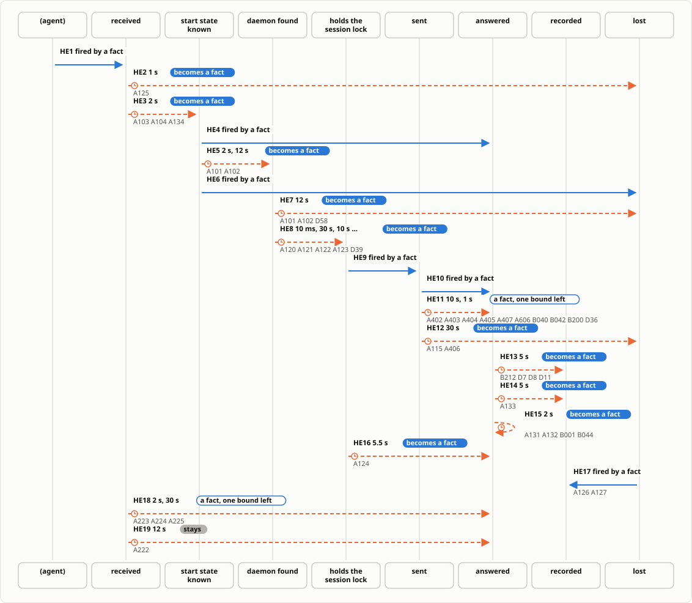

A hook event: 8 states, 19 changes, 13 fired by a clock today; of those, 10 becomes a fact, 2 a fact, one bound left,
1 stays.

| Change | From, to | What fires it today | Timers and what each guards | The fact that could fire it | Becomes | Removed by |
|---|---|---|---|---|---|---|
| fact HE1 | (agent) to received | the agent runs the hook command with the event on stdin `hooks/claude.json:3-11; src/setup/harness-registration.ts:379, :532-590; src/harness/hook-launcher.ts:43-73` | none | already a fact | a fact today | - |
| clock HE2 | received to lost | on Windows a hook whose parent (cmd.exe, PowerShell, the launcher) was killed by its agent ends itself, seen by a 1 s check `src/harness/parent-watch.ts:15, :36-46` | **A125** 1 s: guards the coding agent's process (the hook's parent) to be gone, so a hook it gave up on ends and frees its session lock | A wait on the parent's process handle. | becomes a fact | - |
| clock HE3 | received to start state known | the hook asks the daemon whether Rerail is on in the folder (2 s; on Windows after a 2 s proof), then reads the database itself `src/harness/hook-host.ts:65-71; src/presentation/session-presentation.ts:79, :167, :432; src/runtime/repository-start.ts:160-162` | **A103** 2 s: guards the daemon's answer to GET /api/presentation: whether Rerail is on in the hook's folder **A104** 2 s, 30 s: guards the engine's answer to the capability proof on Windows, before any read of the daemon **A134** 10 s, 5 s: guards Git to place the hook's folder, and the database's start rows | The checkout's start rows in the database, read-only (or the kept answer of the last start or stop). | becomes a fact | **AG12** (next), **#674** |
| fact HE4 | start state known to answered | Rerail is not on in the folder: the hook answers {} `src/hosts/claude/claude-hook.ts:20` | none | already a fact | a fact today | - |
| clock HE5 | start state known to daemon found | the hook reads daemon.json and probes the daemon (2 s), then probes again with what is left of 12 s from its arrival `src/harness/hook-host.ts:189, :216-226; src/runtime/daemon-control.ts:992-1023` | **A101** 12 s, 2 s, 10 s: guards a daemon whose pid lives but which does not answer its health probe, in the hope it answers in time to take this event **A102** 12 s, 2 s: guards a busy daemon to answer its health probe as the pid daemon.json records | An earlier event the daemon left untaken: a later hook journals its event and answers at once. | becomes a fact | **AG11** (being built) |
| fact HE6 | start state known to lost | no daemon runs: the hook logs the lost event and starts one `src/harness/hook-host.ts:190-199` | none | already a fact | a fact today | - |
| clock HE7 | daemon found to lost | the daemon stayed silent past the hook's 12 s: the event is logged as lost `src/harness/hook-host.ts:92, :197; src/runtime/daemon-control.ts:1002-1004` | **A101** 12 s, 2 s, 10 s: guards a daemon whose pid lives but which does not answer its health probe, in the hope it answers in time to take this event **A102** 12 s, 2 s: guards a busy daemon to answer its health probe as the pid daemon.json records **D58** 12 s: guards a hook to give up on a daemon that does not answer | As HE5. | becomes a fact | **AG11** (being built) |
| clock HE8 | daemon found to holds the session lock | parallel hooks of one session take a lock file: retried every 10 ms up to 30 s, taken over from a holder silent 10 s; the holder touches it every 1 s `src/harness/hook-adapter.ts:255-258, :304, :316-346, :392` | **A120** 1 s: guards showing a waiter that the session lock's holder still runs **A121** 10 s: guards a session lock whose holder hung, or whose pid Windows gave to another process **A122** 10 ms: guards another hook of the same session to let go of the session lock **A123** 30 s: guards the session lock, past which the hook gives up and its event is lost **D39** 600 ms, 20 ms: guards a waiter to look many times while the holder still beats | An OS lock on the lock file: the system frees it when the holder ends; a waiter blocks on it in a worker thread. | becomes a fact | **AG15** (next) |
| fact HE9 | holds the session lock to sent | the hook posts the event to the engine socket `src/harness/hook-host.ts:207; src/runtime/engine-service.ts:748-789` | none | already a fact | a fact today | - |
| fact HE10 | sent to answered | the daemon answers with the event's deliveries `src/runtime/engine-service.ts:686-690` | none | already a fact | a fact today | - |
| clock HE11 | sent to answered | the answer waits for bounded work: the session walk after a shell command (10 s cap), edit checks (1 s for hooks, 10 s for OMP and Pi), Merge Assist's note (1 s), each Git call (10 s) `src/engine/code-rule/code-rule-bridge.ts:1621; src/runtime/runtime.ts:123-132, :222, :1049-1060, :1089, :1265, :2176; src/runtime/merge-assist/conflict-hook.ts:134` | **A402** 1 s: guards the session's edit checks, so a steer from the call's own edit rides its PostToolUse answer **A403** 10 s: guards the session's edit checks, so a steer from the call's own edit rides the OMP or Pi tool result **A404** 10 s: guards the session's edit checks at an OMP or Pi turn end, after the source walk **A405** 10 s: guards the session's edit checks before the steers and the missed-steer digest of an OMP or Pi agent's run are answered (yieldDeliveries) **A407** 1 s: guards Merge Assist's detection after an edit (a `gh` pull listing, Git conflict checks) and the person's hook command releasing its notes, so the note and the person's line ride the edit's result **A606** 1 s: guards how long a new conflict's agent note is held for the person's hook command to answer `detected`, so its note and status join the first note **B040** 10 s: guards every Git process Rerail runs to finish **B042** 500 ms: guards Git's output to close after a Git this read ended has exited **B200** 10 s: guards the walk of the session folder (Git reads of each checkout, then an lstat of every file and a read of each changed one) that a shell command's result and a turn end wait for before they answer **D36** 1,300 ms: guards the rollback's audit to run past the hook's 1 s cap on the edit's check | Each wait ends on its work; the session walk can read only the paths the engine's change notices name. | a fact, one bound left | **BG01** (being built) |
| clock HE12 | sent to lost | the hook gives up after 30 s of socket silence; the daemon goes on, holds the session's queue, and records the Stop's steers as delivered `src/runtime/engine-service.ts:785; src/runtime/runtime.ts:1049` | **A115** 30 s: guards the daemon's answer to the hook's event: the findings and steers for this tool call **A406** 30 s: guards every edit check of the session at a Claude Code, Codex or Cursor Stop, including checks an earlier event gave up on, so the Stop carries the turn's steers | The request's close in the daemon (an AbortSignal tied to it): a Stop whose hook left collects no steers and frees the queue. | becomes a fact | **AG402** (being built), **AG11** (being built) |
| clock HE13 | answered to recorded | the daemon writes the event on its JavaScript thread; another process's transaction makes it wait up to 5 s per statement `src/engine/storage/database.ts:44` | **B212** 5 s: guards another connection's write lock: SQLite's busy handler sleeps and tries again (1 to 100 ms apart) until the holder commits or 5 s pass **D7** 12,000 ms: guards the move to wait past the 5 s every Rerail connection waits for the write lock **D8** 1,500 ms: guards a batch to be in its retries on the held lock before the daemon stops **D11** 1,500 ms: guards an older Rerail's audit to land inside the move's wait window | A writer thread for records, and long writes routed through the daemon, so the answering thread never waits on SQLite. | becomes a fact | **BG04** (next) |
| clock HE14 | answered to recorded | a delivered steer's receipt is written by the hook itself: two SQLite opens, 5 s busy timeout each `src/harness/hook-host.ts:35-58` | **A133** 5,000 ms: guards the database's write lock, held by the daemon or another writer, to record a delivered steer's receipt | The daemon records the receipt it already knows it sent. | becomes a fact | **AG19** (next) |
| clock HE15 | answered to answered | a session start reads the dashboard address, checkout scope and rule count (2 s each), and each delivered steer one more read `src/presentation/session-presentation.ts:254-312, :574` | **A131** 2 s: guards the dashboard's address and the session's rule count for the session-start note, after the event's own answer **A132** 2 s: guards the dashboard address to link a steer's rules and a conflict **B001** 2 s: guards a second request to the daemon (GET /api/repository) only to build the dashboard link of a steer or a session-start note **B044** 2 s: guards a presentation read (GET /api/presentation) only to learn whether the checkout is set up and how many rules are on, for the session-start note | The daemon knows them when it answers the event: put them in the answer. | becomes a fact | **AG14** (being built), **BG02** (being built) |
| clock HE16 | holds the session lock to answered | on Windows the lock file's removal is retried for up to 5.5 s while a scanner holds it `src/harness/hook-adapter.ts:364-372` | **A124** 100 ms: guards a scanner that holds the lock file this hook made a moment ago, refusing its removal | An OS lock needs no removal. | becomes a fact | **AG15** (next) |
| fact HE17 | lost to recorded | the lost event is written to the hook failure log (a rename retried 2 s on Windows; read back over 24 h) `src/harness/hook-failures.ts:61-70` | **A126** 2 s, 50 ms: guards a scanner or reader holding the failure log while it is rotated at 256 KB **A127** 24 h: guards which hook failures rerail status reports | already a fact | a fact today | - |
| clock HE18 | received to answered | an MCP tool call: a 2 s proof (Windows) and a 2 s /healthz on the first call, then up to 30 s for the relay `src/api/mcp-bridge.ts:99-135` | **A223** 000 ms: guards the daemon's answer to one MCP request relayed from a coding agent. **A224** PROBE_TIMEOUT_MS 2_000 ...: guards on Windows, the daemon's engine to prove over its pipe that it holds the recorded capability, before each MCP request is sent; on macOS and Linux only a signal check runs, with no clock. **A225** PROBE_TIMEOUT_MS 2_000 ...: guards the daemon's /healthz to answer with the recorded pid before the first MCP request goes to it. | One deadline per call from its arrival, each wait ending on its answer. | a fact, one bound left | **AG21** (next) |
| clock HE19 | received to answered | an event streamed by a host without hooks waits for the daemon up to 12 s `src/harness/event-stream.ts:130` | **A222** 2 s, 10 s: guards a busy daemon to answer its health probe as itself before the event goes to its engine socket. | The probe's answer already ends it; the clock bounds an event loop that never runs again. | stays | - |

### The content store

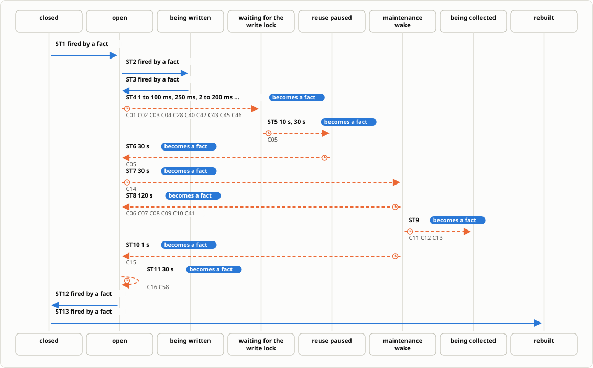

The content store: 8 states, 13 changes, 8 fired by a clock today; of those, 8 becomes a fact.

| Change | From, to | What fires it today | Timers and what each guards | The fact that could fire it | Becomes | Removed by |
|---|---|---|---|---|---|---|
| fact ST1 | closed to open | the first workspace attach opens the store and starts its maintenance thread `native/src/code_rule_dsl/workspace/storage.rs:31-60, :70-104; native/src/content_store/mod.rs:545-552` | none | already a fact | a fact today | - |
| fact ST2 | open to being written | a writer takes the write lock (an apply's publication, an attach's batch, a renewal, a collection) `native/src/content_store/connection.rs:353-393` | none | already a fact | a fact today | - |
| fact ST3 | being written to open | the writer commits `native/src/content_store/connection.rs:353-393` | none | already a fact | a fact today | - |
| clock ST4 | open to waiting for the write lock | a writer finds the lock held: polls SQLite 1 to 100 ms apart, 250 ms per attempt, backs off 2 to 200 ms, up to 10 s in all `native/src/content_store/connection.rs:17-24, :151-229` | **C01** 10 s: guards a store write gives up (StoreError::Busy) once it has waited 10 s in all on other writers **C02** 2 ms, 200 ms: guards writers that found the same holder do not retry in step **C03** 250 ms: guards one attempt's wait inside SQLite for the write lock, so a cancelled write notices between attempts **C04** 100 ms: guards waits for the write lock the way SQLite's busy timeout does, and counts the time **C28** 250 ms, 10 s: guards a writer in another process: only a checkout's own store, shared by its dev daemon and a CLI scan or rule draft, or a test's held connection **C40** 3 s: guards a blocker connection holds the write lock past one busy timeout **C42** 3 s: guards a snapshot publication waits out a writer held longer than one busy timeout **C43** 2 ms: guards two stores on one file race to write the same source **C45** 10 ms, 30 s: guards tests reach C01 and C03 fast **C46** 1 to 3 s: guards tests of the busy window and unpublished files | The holder's commit, in the same process: a first-come gate per store file hands the lock to the next writer. | becomes a fact | **CG1** (being built) |
| clock ST5 | waiting for the write lock to reuse paused | 10 s passed: the apply answers without publishing and every apply skips the store for 30 s `native/src/code_rule_dsl/workspace/mod.rs:89, :163-203` | **C05** 30 s: guards after one write waited out the 10 s deadline, later applies make no store write for 30 s, so a scan's batches do not each wait 10 s | With writes queued first-come, no write waits out a deadline and no pause is needed. | becomes a fact | **CG1** (being built) |
| clock ST6 | reuse paused to open | the 30 s window passed; the next apply tries the store again `native/src/code_rule_dsl/workspace/mod.rs:174-185` | **C05** 30 s: guards after one write waited out the 10 s deadline, later applies make no store write for 30 s, so a scan's batches do not each wait 10 s | As ST5. | becomes a fact | **CG1** (being built) |
| clock ST7 | open to maintenance wake | the maintenance thread wakes every 30 s, idle or not `native/src/code_rule_dsl/workspace/storage.rs:78` | **C14** 30 s: guards renews leases, collects when the store is over its capacity, builds the search indexes of stored tapes that have none | Wake it (unpark) from the writes that create work. | becomes a fact | **CG4** (later) |
| clock ST8 | maintenance wake to open | it renews every workspace's 120 s lease (one attempt), as every publishing apply also does `native/src/code_rule_dsl/workspace/storage.rs:89-97, :343; native/src/code_rule_dsl/workspace/persisted.rs:845-856` | **C06** 250 ms: guards the maintenance thread's lease renewal tries once and leaves it to the next wake **C07** 0 ms: guards closing a workspace on the host's thread never blocks; overlay rows a busy store kept are left for collection after the lease (C08) runs out **C08** 120 s: guards a workspace whose process ended without closing is taken for dead 120 s after its last renewal, so collection reclaims its overlay rows **C09** 120 s, 30 s: guards keeps live workspaces' leases ahead of collection **C10** 120 s: guards keeps the lease ahead of collection while the workspace is busy **C41** 2 s: guards a lease renewal tried once meets a held store | The owner's end: only the process holding the main-instance lock opens the store, so at open every other row is dead; a shared store gets one OS lock file per owner. | becomes a fact | **CG3** (next) |
| clock ST9 | maintenance wake to being collected | when capacity is not Normal it collects; workspaces whose lease expired are marked dead and their rows deleted `native/src/code_rule_dsl/workspace/storage.rs:97-101; native/src/content_store/reclamation.rs:21-56, :107-140; native/src/content_store/mod.rs:70-85` | **C11** lease_until &lt; now: guards marks workspaces whose lease ran out dead (state 2) and deletes their overlay rows **C12** lease_until given by the caller: guards a pinned source or tape survives collection until its lease ends **C13** whole seconds since the epoch: guards the time leases compare against | A write that moves capacity out of Normal wakes the collection; dead owners by their lock. | becomes a fact | **CG3** (next), **CG4** (later) |
| clock ST10 | maintenance wake to open | it builds missing search indexes for at most 1 s `native/src/code_rule_dsl/workspace/storage.rs:140-152` | **C15** 1 s: guards a wake's search-index work stops after about a second | The publication that stored tapes without an index wakes the thread, which works until its backlog is empty. | becomes a fact | **CG4** (later) |
| clock ST11 | open to open | a decompressed cache entry is dropped after 30 s `native/src/content_store/mod.rs:66; native/src/content_store/read_cache.rs:154, :261` | **C16** 30 s: guards decompressed sources and tapes leave memory 30 s after their last use **C58** 1 s, 30 s: guards tests of C16 | The byte cap and the workspace's eviction and close already free it. | becomes a fact | **CG4** (later) |
| fact ST12 | open to closed | the last holder lets go (the daemon stops, the last workspace closes) `native/src/code_rule_dsl/workspace/storage.rs:20-60` | none | already a fact | a fact today | - |
| fact ST13 | closed to rebuilt | a release raises the schema floor: the store gets a new file name and is filled again from sources `native/src/content_store/schema.rs:10-31` | none | already a fact | a fact today | - |

### The Rerail database

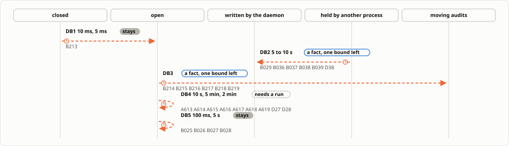

The Rerail database: 5 states, 5 changes, 5 fired by a clock today; of those, 2 stays, 2 a fact, one bound left, 1
needs a run.

| Change | From, to | What fires it today | Timers and what each guards | The fact that could fire it | Becomes | Removed by |
|---|---|---|---|---|---|---|
| clock DB1 | closed to open | the first writable open switches the file to WAL, retried up to 100 times (10 ms plus 5 ms per try) when two openers race `src/engine/storage/sqlite-wal.ts:16-17; src/engine/storage/database.ts:60` | **B213** 10 ms, 5 ms, 26 s ...: guards the exclusive lock SQLite needs to switch a file from the rollback journal to WAL | None across processes; once per file. | stays | - |
| clock DB2 | held by another process to written by the daemon | rerail reset, scrub, uninstall or an upgrade's migration holds the lock; commands and the daemon wait 5 to 10 s each `src/cli/scrub-cli.ts:337-356, :501; src/cli/project-cli.ts:39; src/cli/setup-cli.ts:255` | **B029** 5 s: guards a writer of rerail.sqlite while uninstall reads the recorded checkouts **B036** 50 ms: guards a line being appended to a session ledger to end before the rewrite reads the file again **B037** 50 ms: guards as B036, while making room **B038** 10 s: guards the daemon's write transaction on rerail.sqlite to end **B039** 5 s: guards a moment where a WAL reader must wait (recovery) during the pre-update snapshot (VACUUM INTO) **D38** 100 ms: guards the scrub to reach the pending file's lock | With every long write going through the daemon, one process owns the writes; scrub waits for a ledger line by an append lock. | a fact, one bound left | **BG04** (next), **BG24** (later) |
| clock DB3 | open to moving audits | after an upgrade the daemon's worker moves audit rule provenance in paced batches, after a 7-day window `src/engine/storage/rule-provenance-move.ts:209, :256, :318, :394, :474, :620` | **B214** 0 ms: guards nothing inside SQLite: the move's connection reports another connection's lock at once **B215** 150 ms: guards a pause before each batch of the rule provenance move, and between tries, with no limit, while another connection holds the write lock **B216** 100 ms: guards how long one batch of the move holds the write lock: each batch takes as many audits as fit in 100 ms at the last batch's pace **B217** 150 ms, 5 s: guards another connection's read to end so the checkpoint after the move can empty the WAL (36 MB for 4,000 audits) **B218** 7 days: guards a Rerail older than the provenance step to stop using the file: the move starts once no audit that names no stored copy has begun for a week **B219** 1 h: guards the end of the older-Rerail window (B218), with the file and the clock read again at least once an hour | The pacing is what lets other writers in; the WAL truncate retry can go to journal_size_limit. | a fact, one bound left | **BG22** (later) |
| clock DB4 | open to open | the remote sink (an experiment) syncs every 10 s, backs off up to 5 min, holds a 2 min lock lease `src/runtime/remote-outbox.ts:42-45, :121, :415, :443, :526, :683, :916; src/runtime/remote-config.ts:244` | **A613** 5 s: guards another process's write lock on the outbox (the daemon's sync, `rerail remote push`, a headless scan queuing its report) **A614** 5 s: guards a lock on the Rerail database while the outbox reads it (in WAL mode a reader waits only while a checkpoint resets the log or the log is recovered) **A615** 30 s: guards a remote that takes a batch and never answers **A616** 2 s, 5 min: guards a remote that failed (5xx, timeout, network error, repeated refusals) to be tried again **A617** 2 min: guards a sender lock left by a process that died in the middle of a sync **A618** 10 s: guards new records to send and backoffs that have run out **A619** 2 s: guards scutil not answering **D27** 300 ms, 100 ms: guards nothing: it proves no request goes out while no remote is added **D28** 600 ms: guards nothing: no request while the feature is off | Events and audits the daemon records could start a sync (to settle by a run). | needs a run | **AG64** (later) |
| clock DB5 | open to open | the set-up stores (status line and settings entries) wait 100 ms on a read and 5 s on a write `src/setup/claude-status-store.ts:51, :123; src/setup/settings-entries-store.ts:58, :74` | **B025** 100 ms: guards a writer of the status-line record database (set-up only) to end its transaction **B026** 5 s: guards another set-up writing the same record **B027** 100 ms: guards a set-up writing the settings-entries record **B028** 5 s: guards another set-up writing the same record | None across processes; the waits are below notice or rare. | stays | - |

### A command a person runs

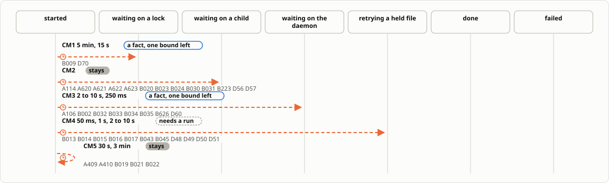

A command a person runs: 7 states, 5 changes, 5 fired by a clock today; of those, 2 a fact, one bound left, 2 stays, 1
needs a run.

| Change | From, to | What fires it today | Timers and what each guards | The fact that could fire it | Becomes | Removed by |
|---|---|---|---|---|---|---|
| clock CM1 | started to waiting on a lock | the packs lock (5 min), the start lock (15 s), polled `src/setup/packs-lock.ts:11; src/engine/native/file-lock.ts:171` | **B009** 5 min: guards another set-up or rerail packs add/remove to finish its npm installs in the shared packs prefix **D70** 20 ms: guards a race window widened on purpose | A blocking OS lock wait; the holder named at once. | a fact, one bound left | **BG14** (next) |
| clock CM2 | started to waiting on a child | npm, the registry, PowerShell, the registered hooks, the Orca CLI, scutil: each with its limit and a kill grace `src/runtime/npm.ts:40-236; src/setup/updater.ts:56-61; src/setup/rule-pack-store.ts:46, :275; src/setup/registered-hooks.ts:76; src/setup/shell-path.ts:319; src/runtime/daemon-control.ts:1459, :1500; src/engine/catalog/repository-registry.ts:534` | **A114** 10 s: guards Orca's CLI to open a dashboard tab before the desktop browser takes over **A620** 3 min, 20 min, 60 s: guards an npm that stalls, as against a registry or proxy that stops answering between requests **A621** 5 s: guards a timed-out command to exit on SIGTERM before SIGKILL **A622** 2 to 10 s, 10 s, 60 s: guards a dropped connection to the registry to come back **A623** --fetch-timeout=30000 (npm.ts:236): ...: guards a registry that accepts the request and never answers **B020** 20 min: guards npm install of the new version **B023** 30 s: guards Claude Code's registered SessionStart hook, run once in an empty folder, to answer **B024** 30 s: guards PowerShell to read or change the user PATH at install **B030** 1 h: guards a pack fetch's staging folder left by a run that never finished **B031** 60 s: guards the registry to say which pack versions a tag holds **B223** 10 s: guards git worktree list, to tell whether Git still lists a recorded checkout **D56** timeoutMs 500, then KILL_GRACE_MS 5,000: guards a command that ignores SIGTERM to be killed **D57** timeoutMs 200 and 1,000 (line 168): guards the product's command limit | The child's exit already ends each wait; the limits bound a child that hangs. | stays | **BG20** (later), **BG21** (later) |
| clock CM3 | started to waiting on the daemon | status, session, scan --wait and support-bundle read the daemon with 2 to 10 s limits; scan --wait polls every 250 ms `src/runtime/daemon-control.ts:308, :471; src/cli/cli.ts:651; src/cli/audit-cli.ts:115-146; src/cli/support-bundle.ts:78` | **A106** 2 s: guards the daemon's /healthz answer, to tell running from alive-but-not-answering **B002** 2 s: guards the rules page URL, asked of a daemon that has just failed to answer the presentation read **B032** 250 ms: guards a scan request to leave queued or running **B033** 10 s: guards the scan to end **B034** 10 s: guards the daemon's answer to rerail scan and rerail settings requests **B035** 10 s, 2 s: guards a daemon that is alive but missed the first health probe **B626** 12 s, 2 s, 10 s: guards tells the coding agent that `rerail support-bundle` can wait for a busy daemon, and to read the file its waiting message names if stopped **D60** delayMs per test: guards a daemon slower than the bundle's probe | A held request answered when the scan ends; one read where two were made. | a fact, one bound left | **BG06** (next), **BG15** (next) |
| clock CM4 | started to retrying a held file | on Windows a rename or removal of a file another program holds is retried 50 ms to 1 s apart, 2 to 10 s in all `src/setup/updater.ts:826; src/engine/file-replace.ts:44, :129, :271; src/cli/setup-cli.ts:192; src/engine/native/file-lock.ts:235; src/engine/code-rule/code-rule-bridge.ts:608` | **B013** 10 s, 50 ms: guards Windows to release the staged install folder (an antivirus scan of the new native modules, handles of children that just exited) **B014** 2 s, 50 ms: guards Windows to stop refusing a rename while another process holds either file (a reader of daemon.json, an editor, antivirus, the indexer) **B015** 50 ms, 2 s: guards as B014, for synchronous callers **B016** 100 ms, 1 s, 5.5 s: guards a file inside a folder being removed to be let go (Windows refuses to delete a held file; elsewhere a folder still written in) **B017** 10 s, 50 ms: guards Windows to release rerail.sqlite and its sidecars after the daemon stops, so uninstall can move them to the backup **B043** 5.5 s: guards Windows to release the staged folder lock's owner file **B045** 5.5 s: guards Windows to let go of the temporary folder made to sample the file system's clock **D48** 5.5 s, 6.5 s: guards removeWithRetry to give up on a file this process holds open **D49** 1,000 ms: guards the folder to be let go of during the retries **D50** 5.5 s, 15.5 s: guards the test helper to give up on a file held open **D51** 300 ms: guards a holder that lets go late | POSIX-semantics rename and delete where the holder shares delete access; none for a holder that does not (to settle by a Windows run). | needs a run | **BG30** (needs a run first) |
| clock CM5 | started to started | progress lines: a tick each second on a terminal, a warning when npm or the registry is silent for 30 s to 3 min `src/runtime/progress.ts:44, :73, :78; src/setup/updater.ts:56-61` | **A409** 1 s, 30 s: guards nothing: it redraws a running step's elapsed time, or prints a still-running line, so a person can tell a slow step from a hung one **A410** 30 s: guards nothing: it prints once that a step has run long enough to look stuck, with what to check **B019** 3 min: guards nothing: prints a hint when npm's download has run 3 min **B021** 30 s: guards nothing: prints a hint when a registry query has run 30 s **B022** 60 s: guards nothing: prints a hint when validation has run 60 s | The time itself is what is shown. | stays | - |

### The dashboard and the status displays

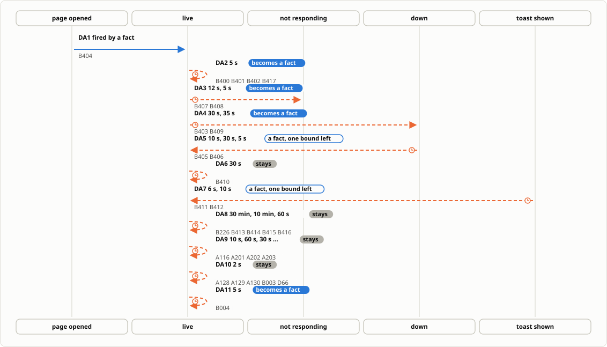

The dashboard and the status displays: 5 states, 11 changes, 10 fired by a clock today; of those, 4 becomes a fact, 2
a fact, one bound left, 4 stays.

| Change | From, to | What fires it today | Timers and what each guards | The fact that could fire it | Becomes | Removed by |
|---|---|---|---|---|---|---|
| fact DA1 | page opened to live | the first poll answers `ui/poll.js:655-657` | **B404** 5 s: guards the second poll after the page opens, before the Merge Assist sidebar item and its count are read at all | already a fact | a fact today | - |
| clock DA2 | live to live | a change shows at the next 5 s poll on every view `ui/poll.js:655-657, :731, :618` | **B400** 5 s: guards the next look at the daemon's data while the tab shows: repositories, health, the repository's context, its rules, the installed packs and what the open view needs **B401** 5 s: guards new transcript events and the head of the session selected on Sessions **B402** 5 s: guards Merge Assist's status for the checkout: conflicts, scan state, branch and base **B417** 5 s: guards a failed session title lookup to be tried again | A change stream from the daemon, held while the tab shows. | becomes a fact | **BG05** (next) |
| clock DA3 | live to not responding | no answer for 12 s, read by a 5 s status tick `ui/frame/topbar.js:22; ui/app.js:22, :97` | **B407** 5 s: guards a re-render of the status pill so 'Updated 3 min ago' and the turn to 'Daemon not responding' move without a poll **B408** 12 s: guards two missed polls before the pill stops saying Live and says 'Updated N min ago' | The stream's state and the failure's kind. | becomes a fact | **BG05** (next) |
| clock DA4 | live to down | 30 s after the last answer (35 s with the tick); a conflict count kept 30 s `ui/frame/topbar.js:20; ui/poll.js:273` | **B403** 30 s: guards the age after which the sidebar's count of open Merge Assist conflicts is read again on pages other than Merge Assist **B409** 30 s: guards time after the last good poll before amber 'Reconnecting…' turns into red 'Daemon not responding' with what to do | A refused connection says down at once; a closed stream says the daemon stopped. | becomes a fact | **BG07** (next), **BG05** (next) |
| clock DA5 | down to live | retried 10 s doubling to 30 s, then every 5 s `ui/poll.js:708, :731` | **B405** 10 s, 30 s: guards the daemon answering again after a failed poll **B406** 5 s: guards a daemon that is not running to come back | None while the daemon is down; the steady pace keeps the wait short. | a fact, one bound left | **BG09** (next) |
| clock DA6 | live to live | a setting write waits up to 30 s for the daemon's answer `ui/settings-writes.js:27` | **B410** 30 s: guards the daemon's answer to one PUT /api/repository/settings; the writes clicked after it for the same repository wait on it | The answer; the limit bounds a daemon that accepted and never answered. | stays | - |
| clock DA7 | toast shown to live | a toast goes after 6 s (10 s for Undo) `ui/shell.js:67` | **B411** 6 s: guards a success toast to be read before it hides **B412** 10 s: guards the person to use Undo after deleting a rule (ui/rule-remove.js:41) or Open pack (ui/shell.js:213) before the toast hides | The person's next action ends an action toast. | a fact, one bound left | **BG18** (next) |
| clock DA8 | live to live | a session with no event for 30 min shows as ended; ranges step every 10 min; pack recommendations cached 60 s; the conflict hook limit form `ui/first-open.js:104; ui/sessions-model.js:9; ui/state.js:169; src/engine/catalog/rule-packs.ts:477; ui/merge-model.js:99` | **B226** 60 s: guards a rescan of a checkout's files for rule pack recommendations **B413** 30 min: guards silence after which an open session in Overview's Recent sessions reads 'no end recorded' instead of 'in progress' **B414** 30 min: guards the same silence, for the open sessions in the Sessions view **B415** 10 min: guards the start of the 7 and 30 day ranges, moved in 10 minute steps so the poll URL and its ETag stay the same between polls **B416** 10 s, 60 s: guards the person's own Merge Assist hook command, which the daemon stops after this time | None today for an agent that quit without its end event. | stays | **BG19** (later) |
| clock DA9 | live to live | the daemon's HTTP server and engine socket cut a client that never finishes its request (10 s headers, 60 s body, 30 s engine) and idle keep-alive connections after 5 s `src/daemon/daemon.ts:71, :416; src/runtime/engine-service.ts:729` | **A116** 30 s: guards a client to finish sending its request **A201** 000 ms, 30 s, 10 to 40 s: guards a client that opened a connection to the daemon's HTTP server to send its whole request headers. **A202** 000 ms, 30 s: guards a client to finish sending its whole request, body included (a native initialize carries the session's branch, up to 256 MiB). **A203** 5 s: guards a kept-alive connection that carries no request to be closed. | None: these bound a client that never sends. | stays | - |
| clock DA10 | live to live | the status line reads the daemon (2 s) or the database; the command itself and its input are bounded at 2 s `src/hosts/claude/claude-status.ts:32, :55, :141-177; src/presentation/session-presentation.ts:167` | **A128** 2 s: guards the person's own previous status-line command, run under Rerail's **A129** 2 s: guards Claude Code to end the status line's input **A130** 2 s: guards the daemon's presentation of the session: its counts and state **B003** 2 s: guards the daemon's HTTP answer to a passive read (status line, footer, /rerail, rules page link) **D66** 100 ms: guards a status command to end | None: no presentation file or push channel exists to read instead. | stays | - |
| clock DA11 | live to live | the OMP and Pi footer refreshes every 5 s `src/presentation/omp-presentation.ts:112` | **B004** 5 s: guards a change in the session's footer (counts, steers, presence) between two reads | The footer refreshes after each event's answer. | becomes a fact | **BG08** (next) |

### A contributor or CI run

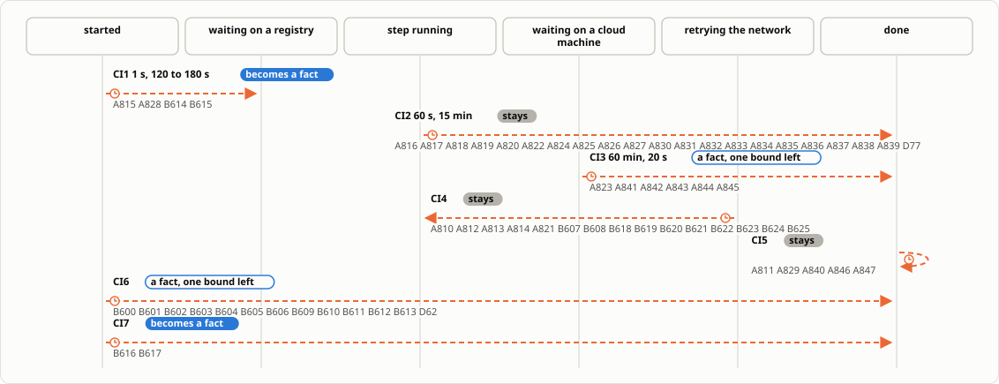

A contributor or CI run: 6 states, 7 changes, 7 fired by a clock today; of those, 2 becomes a fact, 3 stays, 2 a fact,
one bound left.

| Change | From, to | What fires it today | Timers and what each guards | The fact that could fire it | Becomes | Removed by |
|---|---|---|---|---|---|---|
| clock CI1 | started to waiting on a registry | the local registry (Verdaccio) is pinged every 1 s up to 120 to 180 s `scripts/host/azure/guest.sh:195; scripts/host/windows-host.ps1:89; scripts/dev/rerail-smoke.sh:129-132` | **A815** up to 180 pings one second apart, ...: guards Verdaccio, started in the background through npx, to answer /-/ping. **A828** up to 180 pings one second apart, ...: guards Verdaccio, started through `npm exec` with Start-Process, to answer /-/ping. **B614** 1 s: guards the throwaway Verdaccio registry to answer /-/ping **B615** 120 s: guards Verdaccio, started through `npx --yes verdaccio@6`, to answer at all | Its process's end or its listening line. | becomes a fact | **AG801** (later), **BG27** (later) |
| clock CI2 | step running to done | each step, hook, stop and agent run is bounded (60 s to 15 min) with a kill grace `scripts/host/azure/guest.sh:253-389; scripts/host/azure/guest.ps1:88, :222; scripts/host/windows-host.ps1:48-53; scripts/host/host-harness.ts:77-450; scripts/host/host-smoke.ts:227, :426; scripts/host/host-lifecycle.ts:212-393; scripts/host/install-omp-host.mjs:109` | **A816** 15 min: guards `npx @neralabs/rerail setup --json` to install and print its first step. **A817** 15 min: guards each set-up answer run through the installed launcher. **A818** timeout 60, ...: guards each agent's SessionStart hook, run the way that agent spawns it. **A819** timeout 60, ...: guards `rerail daemon stop` to return. **A820** timeout 60, ...: guards the final `rerail daemon stop` before the results are written. **A822** 45 min: guards the signed-in test run to end before Task Scheduler stops it. **A824** WaitForExit(60000), ...: guards `rerail daemon stop` to return on Windows. **A825** TimeoutMinutes = 15, ...: guards each captured set-up run (npx setup, then each answer) to exit. **A826** 000 ms: guards the set-up run's stdout to close after the process exited. **A827** 000 ms: guards the set-up run's stderr to close after the process exited. **A830** 000 ms: guards a short harness probe process to end. **A831** 000 ms: guards a timed-out process group sent SIGTERM to end before it gets SIGKILL. **A832** 000 ms: guards the sandboxed credential import (host-auth.ts) to finish. **A833** stream_idle_timeout_ms = 60000 in ...: guards a stalled Azure OpenAI response stream, which Codex then retries. **A834** 000 ms: guards a live coding agent run in print mode to end. **A835** 100 ms: guards the forbidden call reaching api/route.py while the agent runs. **A836** 000 ms: guards a real OMP or Pi run in print mode to end. **A837** 000 ms: guards OMP or Pi to handle SIGTERM and write its session_shutdown record before SIGKILL. **A838** 000 ms: guards nothing waits; a pass mark on the time from the host's spawn to Rerail's session-start row. **A839** AbortSignal.timeout(180 000) over ...: guards the pinned OMP binary to download from GitHub. **D77** 300 ms: guards a polling watcher (scripts/host/host-smoke.ts, VIOLATION_POLL_MS) to see a brief write | The exit already ends each; the limits bound a stalled provider or a hang the step looks for. | stays | - |
| clock CI3 | waiting on a cloud machine to done | a Windows guest's test run is found ended by a 60 min deadline and 20 s polls of Azure `scripts/host/azure/matrix.mjs:190-263; scripts/host/azure/guest.ps1:93` | **A823** 15 s: guards Run Command to see the provisioning script exit and report Succeeded before the virtual machine restarts. **A841** 600 s: guards the guest script on the virtual machine to end. **A842** 60 min: guards Run Command to reach a final state. **A843** 000 ms: guards Run Command's final state. **A844** 60 min: guards the signed-in test run on a Windows VM to upload results.json after the restart. **A845** 000 ms: guards results.json to appear in the run's container. | The scheduled task's own end, read by a second run command. | a fact, one bound left | **AG802** (later) |
| clock CI4 | retrying the network to step running | a network call that failed is tried again after a pause `scripts/host/azure/bootstrap.sh:112; scripts/host/azure/guest.sh:22, :27, :69; scripts/host/azure/guest.ps1:33; scripts/release/dist-tags-check.mjs:26; scripts/pack-data/runtimes/php/build.sh:63; scripts/upstream/; scripts/deps/sync-pins.mjs:115; scripts/dev/rerail-setup.mjs:17, :169` | **A810** 50 s: guards a new service principal to reach every replica of the directory so the Contributor role assignment succeeds. **A812** 1 s, 31 s: guards a blob upload of results or logs that failed on a passing fault. **A813** 25 s: guards a download (Node, the bundle) that failed in a new VM's first minutes on the network. **A814** apt-get -o DPkg::Lock::Timeout=600, ...: guards unattended-upgrades to release the dpkg lock on a VM's first boot. **A821** 20 s, 50 s: guards a download (Node, Git for Windows, the bundle) that failed in a new VM's first minutes on the network. **B607** 10 s: guards the npm registry to answer `npm view @neralabs/rerail@<tag> version`, and `npm whoami` after an auth or not-found failure **B608** 20 s: guards each npm child the installer's access check runs (view, config get twice, whoami) to end **B618** 15 s, 105 s: guards npm's dist-tags to show the version a release job just published **B619** 60 s: guards a package registry's answer for a tool-pack's latest release **B620** 60 s: guards GitHub's or a registry's answer while bumping a pin **B621** 60 s: guards a registry's answer for the latest release when no --version is given **B622** 60 s: guards GitHub's tree and raw-file answers for the upstream watch **B623** 60 s: guards each registry's answer in `npm run upstream:releases` **B624** 30 s: guards GitHub's release answer for the OMP host's asset digests in `npm run deps:sync` **B625** 1 s: guards php.net's source tarball download to succeed after a transient error | None: a remote server's passing fault has no event. | stays | - |
| clock CI5 | done to done | cloud results and machines kept for a window, then removed `scripts/host/azure/bootstrap.sh:55; scripts/host/azure/matrix.mjs:89, :487, :497; scripts/host/host-auth.ts:77` | **A811** daysAfterModificationGreaterThan 7, ...: guards run bundles, results and logs to be deleted a week after their last write. **A829** 000 ms: guards guards against a borrowed access token expiring in the middle of a live run. **A840** 3 h: guards guards the blob URLs handed to VMs from staying usable after the run. **A846** --older-than-hours, default 3, ...: guards guards a live run's VMs from being swept. **A847** 3 h: guards keeps a run's bundle for re-runs of its failed jobs. | None: a retention window answers a person's question. | stays | - |
| clock CI6 | started to done | a dev daemon is started, probed and stopped by polls, graces and probe limits `scripts/dev/rerail-dev.mjs:185-565; scripts/dev/rerail-restore.mjs:282-374` | **B600** 200 ms, 30 s: guards this checkout's dev daemon to answer /healthz as its own on the reserved port, after `rerail daemon start --dev --port N` already returned 0 **B601** 2 s: guards a /healthz answer whose content stopDevCheckout (:319) and clearTarget (:502) never read **B602** 2 s: guards a /healthz answer in `just rerail-status` (:582) and in refuseTakenPort (:517), which names whatever holds the reserved port **B603** 100 ms: guards the dev daemon's process to end after SIGTERM (:304) and after SIGKILL (:307) **B604** 10 s: guards the dev daemon's clean shutdown after SIGTERM before SIGKILL **B605** 50 ms: guards another `just rerail-setup` or `just rerail-dev` of any checkout to remove the registry lock folder **B606** 15 s: guards a live holder of the dev-checkout registry lock **B609** 30 s: guards the installed launcher's `rerail daemon stop` to end before the database is replaced **B610** 120 s: guards the installed launcher's `rerail daemon start` to end after the restore **B611** 10 s: guards the daemon recorded in daemon.json to end after SIGTERM, on the path with no launcher or a failed launcher stop **B612** 100 ms: guards the daemon's process to end after SIGTERM, on the pid fallback path **B613** 5 s: guards a second /healthz answer from the daemon `rerail daemon start` (:374) just reported as running **D62** 50 ms: guards a fake daemon's state file | `rerail daemon start` already waits for readiness; `rerail daemon stop` already waits for the exit. | a fact, one bound left | **BG11** (later), **BG12** (later), **BG23** (later), **BG26** (later) |
| clock CI7 | started to done | the docs site's copy label and the guidance review's save `scripts/build/docs-site.mjs:831; scripts/review/guidance-review.html:330` | **B616** 1.6 s: guards nothing: it puts a code block's Copy button label back after it showed Copied or Selected on the published documentation site **B617** 600 ms: guards the maintainer to stop typing a comment or case note before it is saved to .rerail/guidance-review/decisions.json | pointerleave and blur; change and pagehide. | becomes a fact | **BG28** (later), **BG29** (later) |

### A test

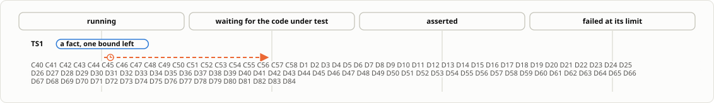

A test: 4 states, 1 changes, 1 fired by a clock today; of those, 1 a fact, one bound left.

| Change | From, to | What fires it today | Timers and what each guards | The fact that could fire it | Becomes | Removed by |
|---|---|---|---|---|---|---|
| clock TS1 | running to waiting for the code under test | a test sleeps, polls or holds a resource for a fixed time; its limit fails a hang `test/; integration/; e2e/; benchmark/; native/src/**/tests.rs; vitest.config.ts:18` | **C40** 3 s: guards a blocker connection holds the write lock past one busy timeout **C41** 2 s: guards a lease renewal tried once meets a held store **C42** 3 s: guards a snapshot publication waits out a writer held longer than one busy timeout **C43** 2 ms: guards two stores on one file race to write the same source **C44** 150 ms, 100 ms: guards a read is not blocked by a writer **C45** 10 ms, 30 s: guards tests reach C01 and C03 fast **C46** 1 to 3 s: guards tests of the busy window and unpublished files **C47** 1 ms, 10 s: guards retries a busy evaluation turn as the host does **C48** 10 s: guards a test fails instead of hanging when a phase never signals **C49** 20 ms, 20 s: guards waits for an OS notice to reach the notices **C50** 500 ms: guards asserts no notice comes for a change outside the watch **C51** 5 s: guards an oplock break reaches the test **C52** 20 ms, 10 s: guards waits for a detached child's exit code **C53** 250 ms: guards reading a FIFO as a source must not block **C54** 1 ms: guards nested phase timers charge only the innermost phase **C55** 3,600 s, 600 s, 2 ms: guards a work budget runs out at the same poll however long it takes; tests of the inline budget **C56** 50 ms: guards passes the status-change time's granularity so a rewrite gets a new ctime **C57** 2 s: guards a pathological input stays fast **C58** 1 s, 30 s: guards tests of C16 **D1** 7,000 ms: guards a launcher's start claim to age past its 5 s lease **D2** 2,500 ms: guards stray daemons to exit after the last start ended **D3** 3,000 ms: guards the daemon to notice its home was moved and exit **D4** 8,000 ms: guards a daemon whose event loop is held, as a long check holds a busy one **D5** 17,000 ms: guards a daemon slow to come up, past a start's 15 s wait **D6** 20 ms, 10 s, 90 s: guards a condition on processes and files **D7** 12,000 ms: guards the move to wait past the 5 s every Rerail connection waits for the write lock **D8** 1,500 ms: guards a batch to be in its retries on the held lock before the daemon stops **D9** 3,000 ms: guards a slow checkpoint on the daemon's thread **D10** 200 ms, 45 s: guards the move to finish **D11** 1,500 ms: guards an older Rerail's audit to land inside the move's wait window **D12** 150 ms, 50 ms: guards a stop to arrive while a pause is in flight **D13** 20 ms: guards the reader's hold to show between tries **D14** 10 ms: guards nothing: it measures event-loop stalls **D15** 1,500 ms: guards the close's look 1 s in to pass while the end runs **D16** 1,500 ms: guards the close's look 1 s in to pass while two hooks wait **D17** 2,500 ms: guards two looks for stalled requests to find nothing since the answer **D18** 300 ms: guards the close to have begun before the body is sent **D19** 2,700 ms: guards the close to reach 3 s, two looks after the body **D20** 1,500 ms: guards the look 1 s in to pass with a pipelined request stalled **D21** 1,200 ms: guards one more look before the hook reads the rest of a 600 KB answer **D22** 1,300 ms: guards 0.7 s, then a busy check phase held to 1.3 s, past the look due at 1 s **D23** 1 s, 1,950 ms, 5 s: guards the moment the close cut a connection **D24** 600 ms: guards each session's first read after it opens **D25** 1,500 ms: guards nothing: it proves no idle session is read **D26** 600 ms: guards the first tick before queuing **D27** 300 ms, 100 ms: guards nothing: it proves no request goes out while no remote is added **D28** 600 ms: guards nothing: no request while the feature is off **D29** 50 ms, 15 s: guards a request to reach the sink **D30** 1,000 ms: guards nothing: it proves the close does not finish while a write of daemon.json is held **D31** 200 ms: guards nothing: the record check asks no more **D32** 100 ms: guards nothing: no daemon.json is written after the close **D33** 1,500 ms: guards the claim to be renewed again a second later **D34** 10 ms: guards the hook process to print ready **D35** 20 ms: guards a zombie child to be reaped **D36** 1,300 ms: guards the rollback's audit to run past the hook's 1 s cap on the edit's check **D37** 500 ms: guards time for the prompt's hook to run, were the session's lock free **D38** 100 ms: guards the scrub to reach the pending file's lock **D39** 600 ms, 20 ms: guards a waiter to look many times while the holder still beats **D40** 20 ms, 5 ms: guards nothing: an imported module starts no watch **D41** 200 ms: guards a lock held for an instant **D42** 500 ms: guards nothing: no notice comes for an unwatched root **D43** 20 ms, 10 s: guards a notice naming a file **D44** 1,000 ms: guards nothing: no walk while every session is idle **D45** 3,350 ms, 3,700 ms: guards the gap and reread schedule of two sessions **D46** fullWalkMs 300 and 600 waited ...: guards a reread when a period passed **D47** 1,000 ms: guards the engine's notices of changed files to arrive before the walks **D48** 5.5 s, 6.5 s: guards removeWithRetry to give up on a file this process holds open **D49** 1,000 ms: guards the folder to be let go of during the retries **D50** 5.5 s, 15.5 s: guards the test helper to give up on a file held open **D51** 300 ms: guards a holder that lets go late **D52** 100 ms, 5.5 s: guards another program to let go of a file in a test's folder **D53** 100 ms: guards another program to let go of a file in the run folder **D54** 60 s, 10 min, 1 day: guards telling a live run's temp folder from an ended run's **D55** 25 ms, 2 s: guards a daemon a test file left running to end **D56** timeoutMs 500, then KILL_GRACE_MS 5,000: guards a command that ignores SIGTERM to be killed **D57** timeoutMs 200 and 1,000 (line 168): guards the product's command limit **D58** 12 s: guards a hook to give up on a daemon that does not answer **D59** 60,000 ms, 10 s: guards the Node process that opens the key to start **D60** delayMs per test: guards a daemon slower than the bundle's probe **D61** 4,000 ms: guards a daemon slow while it walks a large checkout **D62** 50 ms: guards a fake daemon's state file **D63** 50 ms: guards a marker file **D64** 50 ms: guards a holder to start, a folder to appear, a pid to end **D65** 100 ms: guards a console probe to end on Windows **D66** 100 ms: guards a status command to end **D67** 50 ms, 5 s: guards a grandchild to be gone **D68** 10 ms: guards garbage collection's sweeping to finish (also session-samples.test.ts:23, session-store-memory.test.ts:18) **D69** 50 ms: guards a slow Git listing **D70** 20 ms: guards a race window widened on purpose **D71** 1 ms: guards appends that interleave with the scrub **D72** 10 ms: guards keys that come after the event loop's turns, as a person's do **D73** 500 ms: guards a stall after Git exited **D74** 10 ms: guards a fake child's exit and close **D75** holdMs: guards a racer inside the lock **D76** 10 ms: guards the enforcer's snapshot to settle **D77** 300 ms: guards a polling watcher (scripts/host/host-smoke.ts, VIOLATION_POLL_MS) to see a brief write **D78** 1,000 ms, 60 s: guards late events to be recorded **D79** 10 ms: guards a frame from the host, or its exit **D80** 100 ms, 90 s: guards a seeded daemon to answer /healthz **D81** 250 ms, 100 ms: guards the load the benchmark applies **D82** 5 s, 30 s, 60 s ...: guards a hung test **D83** 50 ms, 5 to 100 ms, 1 s ...: guards a condition **D84** 3 to 20 s: guards a hang, so the failure can name what was still waiting | The fact the code under test produces (a promise, an exit, a counted pass, a recorded wait); an injected clock where the product's clock is the subject. | a fact, one bound left | **DG1** (tests, last), **DG2** (tests, last), **DG3** (tests, last), **DG4** (tests, last), **DG5** (tests, last), **DG6** (tests, last), **DG7** (tests, last), **DG8** (tests, last), **DG9** (tests, last), **DG10** (tests, last), **CG9** (tests, last) |

## A hook's path, today and once the first groups are in

Every tool call runs two hooks. Between the agent's call and the hook's answer the hook can wait at each step below;
with a daemon that answers, no clock fires. With a daemon that does not answer, the clocks are the whole wait. In the
drawing an orange dashed bar is a wait on a clock today, a grey bar a bound that stays, and a blue bar the hook's own
work with no clock.

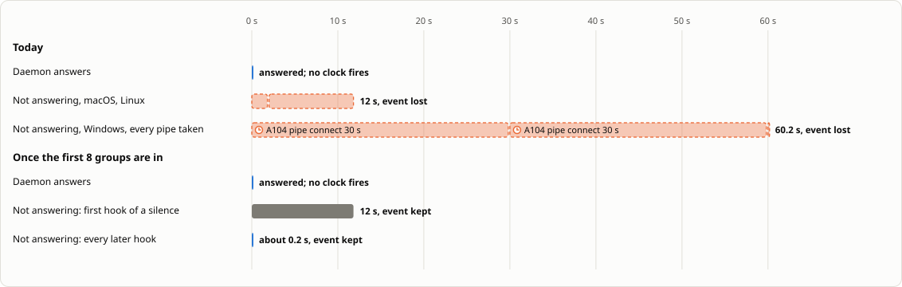

Seconds from the hook's start, on one scale. Today a hook beside a daemon that does not answer waits out its clocks
and loses its event. Once the plan's first 8 groups are in (AG11, BG01, CG1, CG2, AG402, AG12, AG401, AG14), only the
first hook of a silence keeps one bound, and it keeps its event; every later hook answers at once. On Windows the
full-pipe case also needs #677, open today.

| Change | Where the hook is | The wait today | Timers | What replaces it | Removed by |
|---|---|---|---|---|---|
| HE3 | received to start state known | the hook asks the daemon whether Rerail is on in the folder (2 s; on Windows after a 2 s proof), then reads the database itself | A103 A104 A134 | The checkout's start rows in the database, read-only (or the kept answer of the last start or stop). | **AG12** (next), **#674** |
| HE5 | start state known to daemon found | the hook reads daemon.json and probes the daemon (2 s), then probes again with what is left of 12 s from its arrival | A101 A102 | An earlier event the daemon left untaken: a later hook journals its event and answers at once. | **AG11** (being built) |
| HE7 | daemon found to lost | the daemon stayed silent past the hook's 12 s: the event is logged as lost | A101 A102 D58 | As HE5. | **AG11** (being built) |
| HE8 | daemon found to holds the session lock | parallel hooks of one session take a lock file: retried every 10 ms up to 30 s, taken over from a holder silent 10 s; the holder touches it every 1 s | A120 A121 A122 A123 D39 | An OS lock on the lock file: the system frees it when the holder ends; a waiter blocks on it in a worker thread. | **AG15** (next) |
| HE16 | holds the session lock to answered | on Windows the lock file's removal is retried for up to 5.5 s while a scanner holds it | A124 | An OS lock needs no removal. | **AG15** (next) |
| HE11 | sent to answered | the answer waits for bounded work: the session walk after a shell command (10 s cap), edit checks (1 s for hooks, 10 s for OMP and Pi), Merge Assist's note (1 s), each Git call (10 s) | A402 A403 A404 A405 A407 A606 B040 B042 B200 D36 | Each wait ends on its work; the session walk can read only the paths the engine's change notices name. | **BG01** (being built) |
| HE12 | sent to lost | the hook gives up after 30 s of socket silence; the daemon goes on, holds the session's queue, and records the Stop's steers as delivered | A115 A406 | The request's close in the daemon (an AbortSignal tied to it): a Stop whose hook left collects no steers and frees the queue. | **AG402** (being built), **AG11** (being built) |
| HE13 | answered to recorded | the daemon writes the event on its JavaScript thread; another process's transaction makes it wait up to 5 s per statement | B212 D7 D8 D11 | A writer thread for records, and long writes routed through the daemon, so the answering thread never waits on SQLite. | **BG04** (next) |
| HE15 | answered to answered | a session start reads the dashboard address, checkout scope and rule count (2 s each), and each delivered steer one more read | A131 A132 B001 B044 | The daemon knows them when it answers the event: put them in the answer. | **AG14** (being built), **BG02** (being built) |
| HE14 | answered to recorded | a delivered steer's receipt is written by the hook itself: two SQLite opens, 5 s busy timeout each | A133 | The daemon records the receipt it already knows it sent. | **AG19** (next) |

## The ten categories of use

Every timer site falls in one of ten patterns. Each pattern has one practice that replaces the clock with a fact on
Linux, macOS and Windows, and the plan removes each pattern's sites by groups.

### A wait for another process to come up or go away

**The pattern, one real case.** `src/runtime/daemon-control.ts:1152-1168 (readyDaemon), START_TIMEOUT_MS 15 s,
POLL_INTERVAL_MS 100 ms`: 15 s limit, 100 ms poll, constants. It guards the launched daemon to write daemon.json
naming its pid and answer its probe. Who waits: SessionStart hook when no daemon runs; person at rerail daemon start,
set-up, update, every daemon launch.

**Wrong states and waits today.** A start that is still going is reported failed ('did not become ready within 15s')
while the daemon comes up anyway on a slow machine; a dead daemon or registry is noticed only at the next poll, or at
the limit; a restart at the heap ceiling waits a fixed 1 s for its predecessor and leaves no daemon when that one
takes longer. Worst: 15 s and a false failure at `rerail daemon start` on a slow machine (A109); up to 179 s per CI
run whose local registry never started (A815, A828); about 45 min per Windows CI machine whose test run died (A844).

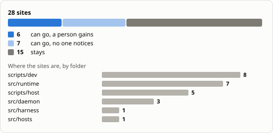

28 sites in this category: 13 can go, 15 stay.

**The practice that replaces it.** Wait on the process itself. Coming up: the child writes one ready line on a pipe
its parent passed it, once it listens; the parent reads that line or the pipe's end (its exit), whichever comes first.
Going away: the process handle. Linux: pidfd_open and poll (kernel 5.3 and later), or waitpid for one's own child.
macOS: kqueue with EVFILT_PROC and NOTE_EXIT. Windows: WaitForSingleObject, or RegisterWaitForSingleObject on the
handle the spawn kept, so no thread blocks. In Node: the 'exit' event of a child it started. A kill grace stays,
because nothing says in advance whether a process will obey SIGTERM.

**How we remove it in Rerail:**

- **CG8** (next): The engine's file lock can wait for its release, and home locks wait on it instead of a 50 ms poll and a 1 s guess
- **AG16** (next): A daemon launch waits for the daemon's ready signal, not for a clock
- **AG18** (next): A Windows stop gives a busy daemon its clean shutdown
- **AG801** (later): The local registry wait ends when Verdaccio answers or its process ends
- **AG802** (later): The matrix learns that a Windows test run ended from its scheduled task, not from the 60 minute deadline
- **BG11** (later): Dev and restore scripts trust `rerail daemon start`'s exit instead of probing again
- **BG26** (later): Dev scripts stop a daemon through rerail daemon stop (one stop path)
- **BG27** (later): rerail-smoke waits on Verdaccio's listening line instead of a 1 s ping loop

**What is left after.** 15 sites stay. The kill graces (2 to 10 s after a polite stop, for a process that ignores it),
the TLS key reader's waits at start, and CI limits on a guest that never reports.

### A wait for a lock

**The pattern, one real case.** `native/src/content_store/connection.rs:17 (used 100-106, 121-171; OperationDeadline
78-97)`: 10 s per operation (all writes of one apply, attach or completion share it). It guards a store write gives up
(StoreError::Busy) once it has waited 10 s in all on other writers. Who waits: a coding agent's tool call through a
hook: call, result and turn-end wait for the code-rule apply (runtime.ts:209, 1011), and the apply publishes to the
store before it answers (workspace/api.rs:1040-1180); also the store attach at a session's first check
(api.rs:777-830), each publishing apply that meets another writer: in-process writers outside the evaluation turn are
the Git snapshot publication of every workspace attach, the maintenance wake every 30 s, and completion tasks; on a
checkout's own store, a second process.

**Wrong states and waits today.** A newcomer can take a just-released lock before an older waiter; a checked edit
behind a background writer of the content store waits for the writer's whole run, not one batch, because every gap
goes to the writer that polls fastest; a record write on the thread that answers hooks waits on another process's
transaction and holds every hook behind it. Worst: Up to 10 s per checked edit while another writer keeps the content
store (C01; measured 1.7 to 3.4 s behind batch runs of 20 to 200 ms, against 8.8 to 104.8 ms with a first-come
handoff); 5 s per record write, stacking to the hook's 12 s, while reset, scrub or an upgrade holds the database
(B212); 15 s on the start lock (A107).

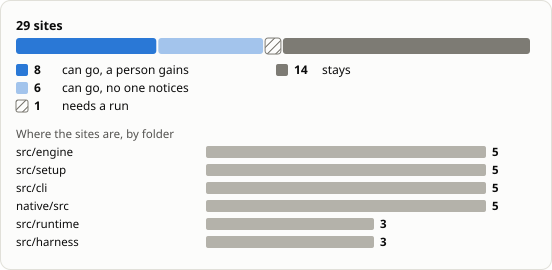

29 sites in this category: 14 can go, 14 stay.

**The practice that replaces it.** In one process: a first-come queue (a mutex and condition variable that hands the
lock to the next waiter), so a waiter parks until the holder's commit and is served in arrival order. Across
processes: an OS lock the system frees when its holder ends. Linux and macOS: flock with LOCK_EX and without LOCK_NB,
in a worker thread (or open file description locks). Windows: LockFileEx without LOCKFILE_FAIL_IMMEDIATELY on an
overlapped handle; CancelIoEx ends a wait the caller gave up. For SQLite across processes there is no release event:
keep the busy timeout, but take the waiting off the thread that answers hooks (a writer thread) and route long writes
through the one process that owns the file.

**How we remove it in Rerail:**

- **CG1** (being built): Store writes wait for the writer ahead of them, not a clock
- **BG04** (next): No database lock wait on the thread that answers hooks: record writes on a writer thread, Rerail's long writes through the daemon
- **AG15** (next): A session's lock is an OS lock: no beat, no silence clock, no polling, no removal
- **CG8** (next): The engine's file lock can wait for its release, and home locks wait on it instead of a 50 ms poll and a 1 s guess
- **AG16** (next): A daemon launch waits for the daemon's ready signal, not for a clock
- **AG19** (next): A steered hook hands its receipt to the daemon instead of opening the database twice
- **BG24** (later): rerail scrub waits for a ledger line being appended by an append lock, not 50 ms naps
- **BG23** (later): Dev-checkout registry lock: watch the lock folder instead of a 50 ms poll
- **CG5** (needs a run first): Writers in other processes block on SQLite's lock

**What is left after.** 14 sites stay. SQLite's busy timeouts on files several processes write (set-up stores, scrub,
project, uninstall, the remote outbox), the provenance move's own pacing, apt's lock wait in CI, and the session
lock's 30 s limit for a holder that is alive but hung.

### A poll for a file, a record or a change

**The pattern, one real case.** `src/runtime/daemon-control.ts:820-828 (lookupHomeDaemon), START_TIMEOUT_MS 15 s
(:288), POLL_INTERVAL_MS 100 ms (:307)`: 15 s limit, 100 ms poll, constants. It guards a daemon that holds the home's
lock to write its daemon.json again. Who waits: SessionStart hooks (startDaemonForPackage :855-872), the autostart
launcher, person at rerail daemon start and stop, every start and stop while daemon.json is missing and a daemon holds
the home.

**Wrong states and waits today.** Every change reaches the dashboard up to 5 s late; a request for a scan reaches its
session up to 250 ms late; a CLI scan with --wait prints 'running' at 10 s for a scan that ends later; a daemon that
is alive but has not written daemon.json is polled for 15 s, then reported as a problem. Worst: 15 s of 100 ms polls
for a record a silent daemon cannot write, then a failed session start (A108); every dashboard view up to 5 s behind
(B400); about 5,800 requests and 2,200 handler runs an hour per idle dashboard tab, and 1,440 Git processes an hour
per open Merge Assist page.

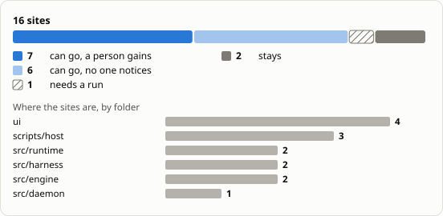

16 sites in this category: 13 can go, 2 stay.

**The practice that replaces it.** When the writer is in the same process, tell the reader directly (a callback, an
in-process queue, a promise that settles on the write). Across processes, block on the source: a held request answered
when the result exists (a long poll), a stream the server writes to (server-sent events or a chunked response for the
dashboard), a file watch (inotify on Linux, FSEvents on macOS, ReadDirectoryChangesW on Windows) for a file another
process writes, and a napi thread-safe function so the engine's watch thread can wake the daemon. A file watch can
fail (network file systems, Linux's watch budget): keep one read when the watch cannot start, never a periodic one
beside it.

**How we remove it in Rerail:**

- **CG2** (being built): Evaluations queue for the engine in arrival order instead of being refused, and the TypeScript retry pauses and 2 ms idle poll go
- **AG13** (next): A live daemon's record is never removed, and start and stop act on the home lock's holder
- **BG05** (next): The dashboard follows a change stream from the daemon instead of polling every 5 s
- **BG08** (next): The OMP and Pi footer refreshes after each event answer instead of every 5 s
- **AG24** (later): A native session's poll is answered when a steer is ready
- **BG10** (next): Read the Merge Assist count as soon as the first poll lands
- **BG15** (next): rerail scan --wait gets the result when the scan ends; writes are not aborted after 10 s
- **BG16** (later): The engine's watch tells the daemon when a notice arrives instead of a 250 ms poll
- **AG403** (later): A scan or setting written through the daemon's API reaches the session at once
- **AG25** (later): The daemon puts its record back when the home folder says it changed

**What is left after.** 2 sites stay. Azure's run-command and blob polls in CI (the cloud machines admit no connection
and give no completion event).

### A limit on a request or a child process

**The pattern, one real case.** `src/runtime/daemon-control.ts:1002-1004 (deadline set at src/harness/hook-host.ts:93,
src/hosts/codex/codex-hook.ts:30, src/hosts/cursor/cursor-hook.ts:22)`: HOOK_DAEMON_WAIT_MS 12 s = PROBE_TIMEOUT_MS 2
s (daemon-control.ts:308) + BUSY_DAEMON_WAIT_MS 10 s (:1002), constants. It guards a daemon whose pid lives but which
does not answer its health probe, in the hope it answers in time to take this event. Who waits: agent-hook (Claude
Code, Codex, Cursor), every hook in a started checkout, every hook while the daemon is busy or silent.

**Wrong states and waits today.** A busy daemon is taken for a dead one: a hook gives up at 12 s and loses its event,
an MCP call says 'daemon is not running' at 2 s, a Windows lookup deletes the live daemon's record. Limits on one
answer add up past the caller's own: a reopened session's command result can wait 20 s for rules, 10 s for the walk
and 1 s for checks, past the hook's 30 s. A Stop whose hook gave up keeps the session's queue and its steers are
recorded as delivered to no one. Worst: 12 s per hook, about 24 s per tool call, while the daemon is silent, and the
events lost; on Windows with a full engine pipe 60.2 s per hook and 75 s per session start (A101, A102, A104; on 16
November two silences of 10 and 13 minutes cost 298 hooks a p50 of 5.7 s and a p95 of 20.7 s). Up to 10 s at every
shell command result and turn end in a large checkout (B200). 20 s per event after a session reopens (A401). 30 s at
the next prompt after a Stop whose hook gave up (A406, A115).

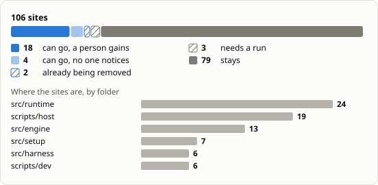

106 sites in this category: 22 can go, 79 stay.

**The practice that replaces it.** Let the answer end the wait, and keep a limit only for a party that may never
answer (a hung child, a stalled network, an event loop that never runs again). Then: one deadline per request from its
arrival, shared by every step under it; a fact that tells 'not reading' from 'slow' where one exists (an event the
daemon left untaken); the request's close turned into an AbortSignal in the daemon, so work for a client that left
stops and keeps its results for the next event; and reads the caller already has answered from what it holds (the
start rows on disk, the notes in the event's own answer). On every system the same: Node's AbortSignal, a socket's
'close', a child's 'exit'.

**How we remove it in Rerail:**

- **AG11** (being built): A hook stops waiting once the daemon has left an earlier event untaken
- **BG01** (being built): Shell command results and turn ends read the session folder by its change notices, not a whole walk under a 10 s cap
- **AG402** (being built): A Stop whose hook has given up stops waiting and keeps its steers for the next event
- **AG401** (next): A reopened session holds a tool call for its rules only when the call can write, and only once
- **AG14** (being built): The session-start note and steer links come in the event's own answer
- **AG21** (next): An MCP tool call waits for a busy daemon under one bound instead of calling it not running
- **BG06** (next): rerail session asks a daemon that did not answer only once
- **AG18** (next): A Windows stop gives a busy daemon its clean shutdown
- **AG22** (next): A native session's close carries its record of dropped events
- **BG13** (next): Read the user SID and a file's SDDL through the engine instead of whoami and PowerShell
- **BG15** (next): rerail scan --wait gets the result when the scan ends; writes are not aborted after 10 s
- **AG62** (next): Merge Assist's stop waits for the hook commands only, and a pass that ends after it writes nothing
- **BG21** (later): pruneCheckouts has no production caller and repeats Git's default limit
- **BG25** (later): A Git read's time limit is one timer at the limit, not a 1 s tick
- **BG12** (later): Stopping a dev daemon reads daemon.json and the pid, not /healthz
- **BG31** (needs a run first): Measure whether the five-minute scan budget cuts anything the file and byte budgets do not

**What is left after.** 79 sites stay. The first wait of a silence (a hook cannot tell a daemon that answers in 3 s
from one that never will), limits on children (Git, npm, gh, PowerShell, the person's own hook command), limits on the
network and the cloud, the daemon's HTTP limits on clients that never send, the caps on how long an answer waits for
checks (late findings come with the next event), and the 5 ms inline budget that decides where an evaluation runs.

### A retry with a pause

**The pattern, one real case.** `native/src/content_store/connection.rs:19-20, 151-161, 227-234`: 2 ms doubling to 200
ms, jittered to half..all. It guards writers that found the same holder do not retry in step. Who waits: as C01, each
write attempt that found the store busy after its 250 ms in SQLite.

**Wrong states and waits today.** A check refused because the engine is busy can lose its turn to another session's
scan at every chunk; a store that was busy once is skipped for 30 s, so results stay unpublished; a lock file a
scanner holds costs 5.5 s per release; the dashboard learns a daemon is back up to 30 s late. Worst: 5.5 s per
session-lock release on Windows while a scanner holds the file (A124); a check waiting behind a whole scan, up to the
hook's 1 s cap and to 12 s at a turn end (C17, B207); 30 s with no repository reuse after a busy store (C05); 30 s
before the dashboard notices a restarted daemon (B405).

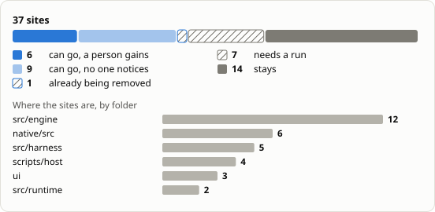

37 sites in this category: 15 can go, 14 stay.

**The practice that replaces it.** Wait for the fact that can change the answer, not for time. A busy resource in the
same process: queue for it instead of refusing (the holder's release hands it on). A file held on Windows:
POSIX-semantics rename and delete (FILE_RENAME_FLAG_POSIX_SEMANTICS, FILE_DISPOSITION_POSIX_SEMANTICS, Windows 10 1607
and later) succeed against holders that share delete access, which libuv's readers do; the Restart Manager (RmGetList)
names a holder that does not. Linux and macOS need neither: a rename over an open file succeeds. A refused watch:
retry when the cause clears (a watch freed, a file system mounted). A remote server: jittered backoff stays, since a
passing fault has no event.

**How we remove it in Rerail:**

- **CG1** (being built): Store writes wait for the writer ahead of them, not a clock
- **CG2** (being built): Evaluations queue for the engine in arrival order instead of being refused, and the TypeScript retry pauses and 2 ms idle poll go
- **AG15** (next): A session's lock is an OS lock: no beat, no silence clock, no polling, no removal
- **BG05** (next): The dashboard follows a change stream from the daemon instead of polling every 5 s
- **BG09** (next): Retry an unreachable daemon at the steady pace, not doubling to 30 s
- **CG6** (later): Windows tree watch acts on completions it already receives
- **BG17** (later): Retry a refused or ended worktree watch on the fact that could change the answer
- **AG27** (later): A refused connection sends a native session to its rebuild at once
- **BG22** (later): Rule provenance move pacing after an upgrade (kept), with the WAL truncate retry replaced by journal_size_limit
- **BG30** (needs a run first): Windows renames and removals held by another program: measure, then use POSIX semantics where they remove the wait

**What is left after.** 14 sites stay. Network retries (npm's single retry, CI's curl and Azure retries, the release
dist-tags check), the one-time WAL switch, the provenance move's lock retakes, the Windows watch's 200 ms reopen after
a rename, and the record backoff of a native session.

### A lease or an age that declares something dead or stale

**The pattern, one real case.** `src/runtime/engine-service.ts:54 (IDLE_SESSION_MS 30 min), :63 (OWING_SESSION_IDLE_MS
24 h), :65 and :731 (IDLE_SWEEP_MS 60 s, setInterval)`: 30 min idle, 24 h when the session owes its agent something,
swept every 60 s, constants. It guards sessions whose end never came (an agent killed, a SessionEnd hook past Claude
Code's 1.5 s) keep their walk copy, history and evaluator. Who waits: daemon-background (memory); the agent's next
event after 30 min reopens the session and waits for its rules (REOPENED_RULES_WAIT_MS in runtime.ts), every session
that goes quiet 30 min; sweep every minute.

**Wrong states and waits today.** A running workspace can be marked dead when four renewals in a row meet a busy
store; a session paused by its person is closed after 30 min and its next tool call waits for the reopen; a crashed
lock holder blocks its session's hooks 10 s; a reused process id keeps a scan mark or a remote lock alive; the
dashboard shows a stopped daemon as live for 35 s and a crashed session in progress for 30 min. After the machine
sleeps, every age read on the wall clock counts the sleep as quiet time. Worst: About 12 s of rule compile at the
first tool call after a 30 min break on a Windows laptop (A118, A401); 35 s of a false 'live' on the dashboard after a
daemon stopped (B409); 10 s behind a crashed session-lock holder (A121); one write transaction more on every published
check, on the hook's path (C10).

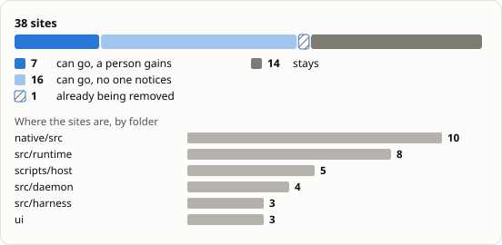

38 sites in this category: 23 can go, 14 stay.

**The practice that replaces it.** Make the owner's end the fact. Hold an OS lock for the owner's life (flock,
LockFileEx): the system frees it however the owner ends, and a successful try-lock by anyone else means the owner is
gone. Tie a session to a connection that lives as long as its host (a held poll, a socket), whose close is the host's
end. Watch the agent's process (pidfd, kqueue NOTE_EXIT, a process handle) and pair a stored pid with its start time
against reuse. For a cache, drop the entry when its source changes (a version number or a change notice) rather than
at an age. Keep an age only where the question is a person's (how long to keep results, when a session with no end
event counts as abandoned).

**How we remove it in Rerail:**

- **AG17** (next): A session closes when its agent ends, and a checkout's runtime retires on memory, not on a clock
- **AG15** (next): A session's lock is an OS lock: no beat, no silence clock, no polling, no removal
- **BG05** (next): The dashboard follows a change stream from the daemon instead of polling every 5 s
- **CG3** (next): Workspace rows end with their process, not a lease
- **BG07** (next): The status pill says the daemon is down when nothing answered, not 30 s later
- **AG61** (next): A Merge Assist status read shows gh's sign-in as last read and starts no gh
- **CG4** (later): Store maintenance runs when a write gives it work
- **AG26** (later): A session's unclaimed answers end with the session
- **AG63** (later): A scan mark holds while the very process that claimed it runs
- **AG64** (later): The remote sender's lock holds while the process that took it runs
- **BG20** (later): Pack staging folders are swept by their owner's liveness, not a 1 h age

**What is left after.** 14 sites stay. The native session's 60 s lease (a host that dies sends nothing and its
requests are not tied to the session), the HTTP keep-alive age, the heap ceiling's 10 min grace, Merge Assist's 5 min
gh cache and 14-day branch age, retention windows in CI, the provenance move's 7-day window, the dashboard's 30 min
'in progress' rule, and the 2 s settled-file age in the module graph.

### A periodic sweep

**The pattern, one real case.** `src/runtime/engine-service.ts:432, :446-460 (cutStalledRequests, setInterval 1 s
during close)`: STALLED_REQUEST_MS 1 s, constant. It guards a request still arriving while the service closes, cut
once it sends nothing between two looks. Who waits: person at rerail daemon stop (the stop waits for the close), every
stop with a connection mid-request.

**Wrong states and waits today.** An idle daemon wakes for nothing (the store's maintenance 120 times an hour, the
heap check every 30 s); a heap past its ceiling restarts up to 30 s late, through the collection pauses in between;
search indexes appear up to 30 s after their tapes. Worst: Up to 30 s between the heap passing its ceiling and the
restart (A208); up to 30 s before a stored tape gets its search index (C14).

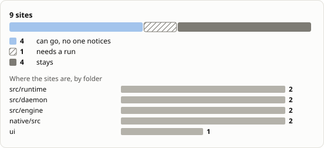

9 sites in this category: 4 can go, 4 stay.

**The practice that replaces it.** Wake on the write that makes the work: unpark the thread (a condition variable or
Thread::unpark) from the publication or the capacity change, and let it work until its backlog is empty. For the heap,
Node's PerformanceObserver 'gc' entries after a full collection. A sweep stays only where nothing else can say an
owner is gone (the native session lease) or where the sweep is the check itself (a close's look for a stalled
request).

**How we remove it in Rerail:**

- **BG05** (next): The dashboard follows a change stream from the daemon instead of polling every 5 s
- **AG23** (later): The heap ceiling is read after each full garbage collection
- **CG4** (later): Store maintenance runs when a write gives it work

**What is left after.** 4 sites stay. The native session sweep (5 s), the close's 1 s look for stalled requests, the
10 min full walk of other worktrees (writes no notice reports), the provenance move's hourly check of its window, the
remote sink's tick until a run settles it, and the dashboard's status tick until the change stream lands.

### A debounce, batch or pacing window

**The pattern, one real case.** `src/runtime/merge-assist/service.ts:518`: CONFLICT_DETECT_INTERVAL_MS 30 s
(service.ts:130), per checkout, per process; a throttle on the first edit: the edit that opens the window runs a pass,
the others inside it run none. It guards limits how often an agent's edits start a detection pass (many Git processes
per pass; the pull request listing is reused for 5 minutes). Who waits: agent-hook (the edit's result; with a hook
command set it waits up to 1 s for a pass that runs, runtime.ts:222, 2176), every edit result in a checkout with Merge
Assist on.

**Wrong states and waits today.** Merge Assist skips a conflict check inside 30 s of the last one and nothing runs it
later, so an overlap from a burst's last edits can stay untold for the session. Worst: An overlap left untold for the
rest of a session (A603, to settle by a run).

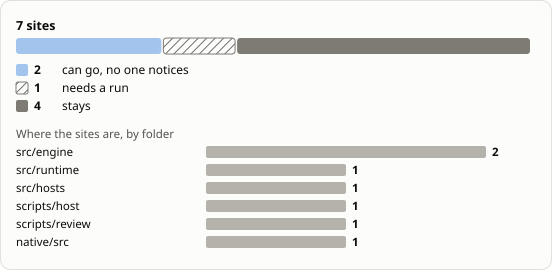

7 sites in this category: 2 can go, 4 stay.

**The practice that replaces it.** Count work instead of time: run one more pass when the running one ends if
something arrived meanwhile, so passes never overlap and none is skipped; batch until the queue is empty. Keep a
window only where its length is the product: a pacing that gives other work its turn, a rate limit against a loop with
no end event.

**How we remove it in Rerail:**

- **AG802** (later): The matrix learns that a Windows test run ended from its scheduled task, not from the 60 minute deadline
- **BG28** (later): Guidance review saves on change and pagehide instead of a 600 ms debounce

**What is left after.** 4 sites stay. The 5 s pacing between walks of other worktrees, the provenance move's 100 ms
batch window, the Windows watch's 8 reopens per 60 s, and OMP's one event-loop turn before an aside.

### A clock that only changes what is shown

**The pattern, one real case.** `ui/shell.js:67`: 10 s. It guards the person to use Undo after deleting a rule
(ui/rule-remove.js:41) or Open pack (ui/shell.js:213) before the toast hides. Who waits: dashboard, rare.

**Wrong states and waits today.** Undo of a removed rule disappears after 10 s. Worst: Undo gone 10 s after a rule was
removed (B412).

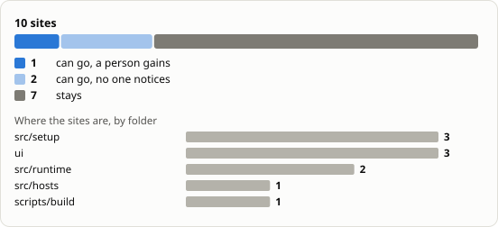

10 sites in this category: 3 can go, 7 stay.

**The practice that replaces it.** End a display on the person's next action (a click, a navigation, pointerleave,
blur, pagehide) where the display waits for them; keep the clock where time is the content (a progress tick, a stall
warning).

**How we remove it in Rerail:**

- **BG18** (next): Keep an action toast (Undo, Open pack) until the person's next action
- **BG29** (later): Docs site Copy button label ends on pointerleave and blur

**What is left after.** 7 sites stay. Progress ticks and stall warnings, success toasts, the 10 min step of the
dashboard's ranges.

### A test's own wait

**The pattern, one real case.** `test/runtime/daemon-control/daemon-home.test.ts:171`: 2,500 ms, 4 tests. It guards
stray daemons to exit after the last start ended. Who waits: a contributor running the tests, and CI, every run of the
unit suite (npm test), Linux, macOS and Windows.

**Wrong states and waits today.** Eleven absence checks prove that nothing happens by waiting 20 ms to 1.5 s: on a
slow machine the code under test may not run once in that window, and the test passes without testing. Tests wait out
the product's own limits (a 15 s start, a 5 s claim lease, a 12 s hook give-up). Worst: About 150 s of fixed waits per
Linux unit-suite run, 80 s of which can go, plus 13 s per Windows run; daemon-home.test.ts alone holds 55 s, 33 s of
which can go; one test holds SQLite's write lock 12 s (D7).

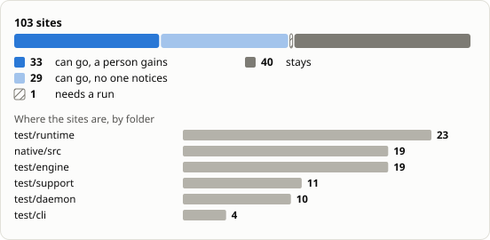

103 sites in this category: 62 can go, 40 stay.

**The practice that replaces it.** Wait for the fact the code under test produces: a promise, an exit file, a counted
pass of a loop, the moment the second party is waiting, a recorded sleep in place of a real one. Where the product's
clock is the subject, inject the clock and scheduler and advance them. Keep a limit only to turn a hang into a failure
with a message.

**How we remove it in Rerail:**

- **CG1** (being built): Store writes wait for the writer ahead of them, not a clock
- **CG2** (being built): Evaluations queue for the engine in arrival order instead of being refused, and the TypeScript retry pauses and 2 ms idle poll go
- **CG3** (next): Workspace rows end with their process, not a lease
- **AG16** (next): A daemon launch waits for the daemon's ready signal, not for a clock
- **CG4** (later): Store maintenance runs when a write gives it work
- **DG1** (tests, last): The daemon-home tests end their holds and settles on facts, not on 2.5 s and 8 s clocks
- **DG2** (tests, last): The rule provenance move tests release the write lock when the move met it, and drive the older-audit window with the clock the move already takes
- **DG3** (tests, last): The engine service close checks its looks by count: the test drives the close's look timer
- **DG4** (tests, last): The Windows removal tests record their waits instead of sitting through 5.5 s budgets
- **DG5** (tests, last): Worktree walk tests run the walk schedule on a clock the test drives
- **DG6** (tests, last): Daemon absence checks count passes, not milliseconds
- **DG7** (tests, last): runCommand takes its kill grace from the caller, and the test passes 200 ms
- **DG8** (tests, last): Hook and lock race tests wait until the second party is waiting
- **CG9** (tests, last): Engine tests wait on events, not sleeps
- **DG9** (tests, last): Small polls wait on events (LOW)
- **DG10** (tests, last): Test run folders: a held lock says a run still runs (REMOVE-NEUTRAL)

**What is left after.** 40 sites stay. Per-test limits and the 225 polls on a condition (each ends on its condition),
stimuli whose length is the subject (a slow child, a paced writer, a held lock), and waits on processes that are not
the test's children.

## What stays, and why

193 timers stay. For each, no fact can decide what the clock decides, or using one would cost the software or a person
more than the clock does. Most never cost a healthy run anything: they end on the answer they wait for, and the clock
only bounds a party that never answers.

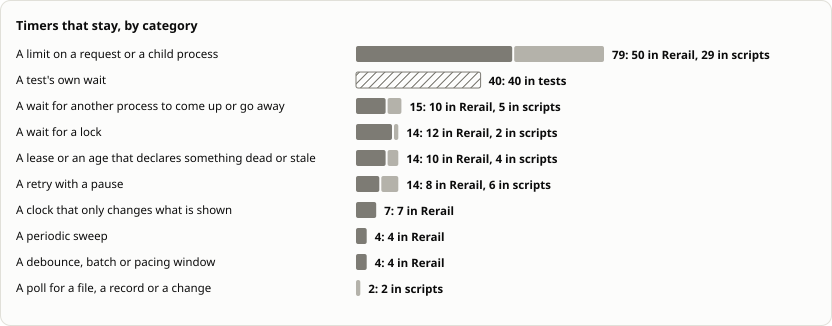

Timers that stay, per category and where they are. 79 are limits on a request or a child process, the largest group;
40 are tests' own limits that fail a hang.

Below, each category's reason and its most important kept timers, those in Rerail itself first. The full list, with
every timer's place, value, guard, harm and what would let it go later, is [every timer that stays](timers-kept.md).

### A wait for another process to come up or go away: 15 stay

\*\*Why the values are what they are, unless a row says otherwise:\*\* A kill grace is long enough for a clean
shutdown to finish its writes and short beside the person's wait; a start wait is longer than a healthy start on a
loaded machine.

\*\*What would let them go later, unless a row says otherwise:\*\* Nothing lets a kill grace go: no system says in
advance whether a process will obey SIGTERM. Windows has no SIGTERM, so a stop request with an answer (AG18) is the
better fact there.

| Timer | Where, value | What it guards | The harm if it goes, and what was looked for | Why that value |
|---|---|---|---|---|
| A111 | `src/runtime/daemon-control.ts:305 (STOP_TIMEOUT_MS 10 s), :1394-1402 (stopFoundDaemon)` 10 s, constant | the daemon to finish its requests and exit after SIGTERM or the shutdown request, before it is killed | A stop must end. Looked for a fact that says a daemon will never exit (its event loop hung, a request that never ends): none; the home lock and the pid say only that it still runs. The grace lets in-flight hooks get their answers. Its poll is judged in A112. | 10 s gives a stop the time to record the events in flight. |
| A621 | `src/runtime/npm.ts:53` KILL_GRACE_MS 5 s (npm.ts:40) | a timed-out command to exit on SIGTERM before SIGKILL | The exit event cancels it (npm.ts:95-96), so an npm that ends on SIGTERM costs nothing; the bound covers one that ignores it, and no other fact says it is done. On Windows child.kill() ends the process at once and the grace never acts. | as above |
| B018 | `src/setup/updater.ts:557` 5 s | a killed health-check child to exit before its scratch folder is removed | It already waits on the exit event; the bound covers a kill that does not end the process (a child stuck in the kernel on Windows). Harm if removed: an update that never ends after its work is done. Looked for: the exit event (used). | as above |
| A608 | `src/runtime/merge-assist/hook-command.ts:197` KILL_GRACE_MS 2 s (hook-command.ts:25) | a timed-out command's process group to end on SIGTERM before SIGKILL, and its pipes to close before they are destroyed | The close event already ends the grace when the group exits on SIGTERM; the bound is for a command that ignores SIGTERM, which only SIGKILL ends. I looked for a fact that says its cleanup is done and found only its exit, which the code already waits for. On Windows the tree ends at once and the grace only waits for the pipes. | as above |

[All 15 in this category](timers-kept.md#a-wait-for-another-process-to-come-up-or-go-away-15).

### A wait for a lock: 14 stay

\*\*Why the values are what they are, unless a row says otherwise:\*\* Longer than the longest transaction another
Rerail process holds on the same file (a set-up write, a scrub batch, a checkpoint), so a short overlap waits instead
of failing.

\*\*What would let them go later, unless a row says otherwise:\*\* One process owning every write to the file (writes
routed through the daemon), so no wait across processes remains; SQLite gives no release event across processes.

| Timer | Where, value | What it guards | The harm if it goes, and what was looked for | Why that value |
|---|---|---|---|---|
| B009 | `src/setup/packs-lock.ts:11` 5 min | another set-up or rerail packs add/remove to finish its npm installs in the shared packs prefix | The holder's pack installs run npm with no time limit of their own (rule-pack-store.ts fetch calls npm without timeoutMs; src/runtime/npm.ts runs until the command ends), so a hung holder would hang the waiter for ever; nothing tells a slow install from a hung one. Looked for: the holder's end (the OS lock frees when it exits, which B005's blocking lock would deliver), a progress record from the holder (none). Worth doing without a timer: say at once that another process (pid, since when, from locks/packs.json) holds the packs, instead of 5 min of silence. Harm if removed: a waiter that never ends behind a hung npm. Looked for: a bound on the holder's npm (none), a progress fact (none). | 5 min, longer than a slow pack install on a slow network. |
| A123 | `src/harness/hook-adapter.ts:304 (LOCK_WAIT_MS 30 s), :338, :342` 30 s, constant | the session lock, past which the hook gives up and its event is lost | A holder that is alive but hung keeps an OS lock too, and no fact says it will never let go. Looked for one: the holder's pid (alive), its parent (the parent watch ends it on Windows only when the agent has gone). Holders keep the lock only for file work, so the bound is felt only when one hangs; with A101 Cursor's kept lock no longer spans a 12 s wait. The bound should share the hook's one deadline. | 30 s is the hook's request limit. |
| B038 | `src/cli/scrub-cli.ts:501` 10 s | the daemon's write transaction on rerail.sqlite to end | Scrub writes in batches of 500 rows beside a running daemon; SQLite has no release event, and failing at once would leave secrets in place. Harm if removed: a scrub that fails whenever the daemon writes. Looked for: a release event (none). | as above |
| A613 | `src/runtime/remote-outbox.ts:121` busy_timeout 5 s on remote-outbox.sqlite (remote-outbox.ts:121) | another process's write lock on the outbox (the daemon's sync, `rerail remote push`, a headless scan queuing its report) | SQLite gives no event when another process frees its lock; the busy handler is the only way to wait for it. Without it, a write that meets another's short transaction fails at once and the sync or the command errors. I looked for a lock notification across processes and SQLite has none. | as above |

[All 14 in this category](timers-kept.md#a-wait-for-a-lock-14).

### A poll for a file, a record or a change: 2 stay

\*\*Why the values are what they are, unless a row says otherwise:\*\* Set by the cloud API's pace and cost; a shorter
poll buys seconds on a run of an hour.

\*\*What would let them go later, unless a row says otherwise:\*\* A completion event from the cloud service, which
Azure does not give a managed run command.

| Timer | Where, value | What it guards | The harm if it goes, and what was looked for | Why that value |
|---|---|---|---|---|
| A843 | `scripts/host/azure/matrix.mjs:198` 20 000 ms between `az vm run-command show` calls, scripts/host/azure/matrix.mjs:198 | Run Command's final state. | The VMs admit no inbound connection and Azure gives the CLI no completion event for a managed run command; a synchronous `run-command create` polls the same state inside the CLI. A shorter pause only trades seconds at the end of a 15 to 60 min run for more `az` starts. | as above |
| A845 | `scripts/host/azure/matrix.mjs:263` 20 000 ms between blob exists calls, scripts/host/azure/matrix.mjs:263 | results.json to appear in the run's container. | Same as A843: the blob store gives the driver no event, and asking is the only way from outside a closed VM. | as above |

[All 2 in this category](timers-kept.md#a-poll-for-a-file-a-record-or-a-change-2).

### A limit on a request or a child process: 79 stay

\*\*Why the values are what they are, unless a row says otherwise:\*\* Longer than the slowest healthy answer seen,
and shorter than the caller's own limit above it (the agent's hook limit, OMP's 30 s tool budget, the CI job's limit),
so a hang ends with Rerail's message instead of the caller's kill.

\*\*What would let them go later, unless a row says otherwise:\*\* The party waited on reporting its own failure as an
event (a child that exits on its error, a daemon that answers 'busy'), or the wait moving off any path a person waits
on.

| Timer | Where, value | What it guards | The harm if it goes, and what was looked for | Why that value |
|---|---|---|---|---|
| B020 | `src/setup/updater.ts:57` 20 min | npm install of the new version | A network download that can hang; npm's own fetch timeouts cover one request, not a stall between requests. Harm if removed: an update that never ends. Looked for: npm completion (the exit is used), progress (none). | as above |
| A620 | `src/runtime/npm.ts:50` the caller's timeoutMs: NPM_QUERY_TIMEOUT_MS 3 min (npm.ts:159) for `npm view` and `npm audit signatures` (npm.ts:236, 253; setup/updater.ts:218); 20 min for the update's install (setup/updater.ts:57); 60 s for a rule pack check (setup/rule-pack-store.ts:275); none for the SQLite probe, the Node ABI read and `npm rebuild` (sqlite-repair.ts:355, 365, 403) | an npm that stalls, as against a registry or proxy that stops answering between requests | npm's exit already ends the wait; the limit only bounds an npm that never ends, which would hang `rerail update` for ever. npm's own fetch timeout covers one request, not a stall between requests, and npm prints nothing during `view --json` or a quiet install, so I found no other fact. | as above |
| B012 | `src/setup/updater.ts:434` 2 min | the staged engine to load in a child and report healthy | A native module that deadlocks at load never exits; harm if removed: rerail update hangs for ever. The exit is the event already waited on. Looked for: exit (used); no readiness fact exists before it. | as above |
| A226 | `src/api/merge-assist-operations.ts:84` DEFAULT_HOOK_TIMEOUT_SECONDS 10 (src/engine/merge-assist/model.ts:63), applied here when a settings change names a hook without timeoutSeconds (schema at src/api/merge-assist-contracts.ts:29, 1 to 60 s); the clock acts at src/runtime/merge-assist/hook-command.ts:204. | the person's conflict hook command to end. | The command is the person's own program, run without a shell; its exit already ends the wait, and the bound is for one that never ends, which no event shows. Without it a hung command would hold Merge Assist's hook queue for good. | as above |

[All 79 in this category](timers-kept.md#a-limit-on-a-request-or-a-child-process-79).

### A retry with a pause: 14 stay

\*\*Why the values are what they are, unless a row says otherwise:\*\* Spread to cover a passing fault (a scanner's
hold of hundreds of milliseconds, a registry's hiccup) without spinning, and capped so a lasting fault fails with a
message.

\*\*What would let them go later, unless a row says otherwise:\*\* For a remote server, nothing: a passing fault has
no event. For a file held on Windows, POSIX-semantics rename and delete, once a run shows which holders still refuse.

| Timer | Where, value | What it guards | The harm if it goes, and what was looked for | Why that value |
|---|---|---|---|---|
| A622 | `src/runtime/npm.ts:153` one retry after 2 to 10 s (npm.ts:153) in place of npm's two retries after 10 s and 60 s; on every runNpm call (npm.ts:188) | a dropped connection to the registry to come back | Already cut from npm's own 70 s per request. No event says a dropped connection is back, and a retry with no pause would meet the same drop; the registry probe before an install (checkRegistry, npm.ts:233) already turns a registry that is down into one quick failure instead of one per package. | as above |
| B406 | `ui/poll.js:731` 5 s | a daemon that is not running to come back | While the daemon is down the page must try again. Without a pause it would send requests in a loop to a refused port, keeping a browser core busy and logging 'poll failed' (ui/poll.js:709) without end. Looked for an event instead: a daemon that is not running can push nothing; the browser's online event says nothing about a local process; a page cannot read the daemon's state file; the daemon is started by a hook, rerail daemon start or rerail manage (which opens a new tab), and none of them can reach an open tab. harm: a request loop against a refused port. Searched: a push from the daemon, the browser's online and visibility events, the daemon's state file | 5 s, the steady pace while the daemon is down. |
| A616 | `src/runtime/remote-outbox.ts:443` backoffMs: 2 s doubling to 5 min, plus or minus 20% (remote-outbox.ts:43-44, 760-763); 5 min after 401 or 403 (remote-outbox.ts:750); stored as next_attempt_at and checked at remote-outbox.ts:443 | a remote that failed (5xx, timeout, network error, repeated refusals) to be tried again | Nobody waits on it, and push skips it. A remote that is down sends no event when it is back, so a pause before each retry is the only way not to hit it every 10 s; for 401 and 403 the fact that matters, a changed remote entry or exclusions, already ends the wait at once (the config hash, remote-outbox.ts:443). | as above |
| C20 | `native/src/tree_watch/windows.rs:79, 271-276` 200 ms | after a rename or deletion of a watched folder or one above it breaks the handle's oplock, the handle closes at once and the path is opened again 200 ms later | Reopening at once can open the folder before the rename finished and break it again, chasing the rename. Looked for a fact: the rename's end shows only in a watch on the parent, and a handle on the parent would itself block renames of the parent. | 200 ms lets a rename finish before the watch reopens the folder. |

[All 14 in this category](timers-kept.md#a-retry-with-a-pause-14).

### A lease or an age that declares something dead or stale: 14 stay

\*\*Why the values are what they are, unless a row says otherwise:\*\* Many times the owner's normal renewal interval,
so a slow owner is never taken for a dead one; a retention window is what a person needs to read results back.

\*\*What would let them go later, unless a row says otherwise:\*\* An owner's end as a fact: an OS lock held for its
life, or a connection whose close is its end. A retention window stays: it answers a person's question.

| Timer | Where, value | What it guards | The harm if it goes, and what was looked for | Why that value |
|---|---|---|---|---|
| B413 | `ui/first-open.js:104` 30 min | silence after which an open session in Overview's Recent sessions reads 'no end recorded' instead of 'in progress' | Without it, every session that ended without an end event (a closed terminal, a crash) reads 'in progress' forever. Looked for a fact: the session record holds no coding agent process id (policy_session_owners.process_id is the daemon's own pid, src/engine/audit/audit-control.ts:291), and Claude Code and Codex hooks are one-shot processes, so no connection stays open whose close would say the agent quit. The same rule is written twice (B414). harm: crashed sessions shown in progress forever. Searched: an agent process id on the session, a connection held per session, the session-end event | 30 min, the same rule the daemon uses for a quiet session (A118). |
| B414 | `ui/sessions-model.js:9` 30 min | the same silence, for the open sessions in the Sessions view | Same rule and same missing fact as B413, defined a second time. Two constants can drift apart and make Overview and Sessions disagree about one session; one constant would serve both. harm and search as B413; merge the two constants into one | 30 min, as B413. |
| A209 | `src/daemon/heap-ceiling.ts:53` HEAP_CEILING_GRACE_MS 10 min at src/daemon/heap-ceiling.ts:7, counted from the watch's start (heap-ceiling.ts:45). | decides whether a heap past the ceiling means the limit is too low for the daemon's work (no restart; the watch ends) or that it is running out (restart). | Taken out, a daemon whose limit is too low for its work would restart at every check, and every restart makes hooks wait through a start. Looked for a fact: a marker that the daemon was relaunched at the ceiling stops such a loop but would also stop a relaunched daemon from restarting for a slow leak hours later, and the heap at start says nothing since it grows with sessions; time since start is the only signal found that tells a baseline from a leak. | 10 min after start, the time a daemon's heap takes to settle after its first audits. |
| A604 | `src/runtime/merge-assist/service.ts:377` PULLS_REUSE_MS 5 min (service.ts:132), per repository, per process | decides when detection after an edit lists open pull requests again (`gh auth status`, `gh api user`, `gh pr list`) | Listing on every pass would run three gh processes and three GitHub requests every 30 s per checkout and push most passes past the result's 1 s wait. I looked for a local fact that the open pull requests changed: a fetch moves only remote-tracking branches, not pull requests from forks, and a conditional GitHub request is still a network request; none found. | 5 min: three gh processes and three GitHub requests per pass otherwise, every 30 s per checkout. |

[All 14 in this category](timers-kept.md#a-lease-or-an-age-that-declares-something-dead-or-stale-14).

### A periodic sweep: 4 stay

\*\*Why the values are what they are, unless a row says otherwise:\*\* The sweep's period bounds how late a dead owner
is noticed; it is set well inside the lease it enforces.

\*\*What would let them go later, unless a row says otherwise:\*\* Goes with the lease or the check it serves.

| Timer | Where, value | What it guards | The harm if it goes, and what was looked for | Why that value |
|---|---|---|---|---|
| B219 | `src/engine/storage/rule-provenance-move.ts:394` 1 h passes until the window ends | the end of the older-Rerail window (B218), with the file and the clock read again at least once an hour | olderPass sleeps on an unreferenced timer that holds no process open. One timer to the window's end would overflow Node's 2^31 ms limit for a date weeks ahead and, on Linux and macOS, would not count the time the machine slept, so a laptop could start the move days late; the hourly pass bounds both. An audit an older Rerail writes meanwhile only moves the end later, which the next pass reads. Looked for a wake-from-sleep event in Node: none outside Electron's powerMonitor. | 1 h steps until the 7-day window ends: one timer weeks ahead overflows Node's timer limit and ignores sleep. |
| B203 | `src/engine/code-rule/worktree-walks.ts:457` 10 min | a write in a watched worktree that no change notice tells of: through a hard link, a memory map, a file another program holds open on Windows, or a notice the system lost without saying so | #armReread times a walk for when the oldest trusted read is 10 min old (#due, worktree-walks.ts:478). By definition no notice exists for these writes, so only a periodic read finds them; a lost notice the system does report (TreeNotice.lost) is already read at once. The timer is unreferenced and holds no process open. Looked for an event for writes the watch misses: the operating systems give none. | 10 min: writes no change notice reports (hard links, memory maps) are recorded at most that late. |
| A117 | `src/runtime/engine-service.ts:432, :446-460 (cutStalledRequests, setInterval 1 s during close)` STALLED_REQUEST_MS 1 s, constant | a request still arriving while the service closes, cut once it sends nothing between two looks | A stalled client sends no event to wait on; looked for one in the socket (no 'end' while it stays open) and the request (content-length known, bytes missing). Without the looks a stalled client holds the close until the stop's 10 s kill. LOW cost. | 1 s keeps a close well inside the stop's 10 s grace. |
| A210 | `src/daemon/native-session-server.ts:190` NATIVE_SESSION_SWEEP_INTERVAL_MS 5_000 at src/daemon/native-session-server.ts:33 (constructor option sessionSweepIntervalMs). | native sessions whose lease ended, to close them (A211). | It enforces the lease (A211); without it a native session whose host died stays open, with its runtime, model and watches, until the daemon stops. Looked for an event per lease end: one timer per session would be armed again by every request, ten a second per session, which costs more than one pass every 5 s. | 5 s, well inside the 60 s lease it enforces. |

[All 4 in this category](timers-kept.md#a-periodic-sweep-4).

### A debounce, batch or pacing window: 4 stay

\*\*Why the values are what they are, unless a row says otherwise:\*\* The window's length is the behaviour itself:
the room it leaves for other work, or the rate it allows.

\*\*What would let them go later, unless a row says otherwise:\*\* A count of work in place of time where a test shows
the same fairness.

| Timer | Where, value | What it guards | The harm if it goes, and what was looked for | Why that value |
|---|---|---|---|---|
| C22 | `native/src/tree_watch/windows.rs:84-85, 431-445` 8 reopens within 60 s | a folder renamed over and over is read whole instead of chased | Without it a folder renamed in a loop keeps the watch thread busy reopening. Looked for a fact: a count with no clock would end the watch of a folder renamed eight times over a day; only a window means 'over and over'. | 8 reopens within 60 s stops a watch thread chasing a folder renamed in a loop. |
| B202 | `src/engine/code-rule/worktree-walks.ts:437` 5 s, or as long as the last walk took when longer | the gap after one walk of a repository's other worktrees before the next walk that answers the same session's asks | WorktreeWalks.#walkWhenDue sleeps until the earliest asking session's nextWalkAt. Notices already decide which worktrees a walk reads, but a noticed worktree is still read whole, on the daemon's main thread that answers hooks (about 5 s a walk with 190 worktrees before notices, per the file's header). During a build in another worktree a notice comes every 250 ms; the gap keeps walks to at most half the time. What these walks find is recorded, never steered, so the delay costs no steer. Looked for a fact that says the writes in a worktree have stopped, such as a build ending: notices only say that something changed. Reading only the noticed paths (TreeNotice.changed and renamed) would make each walk cheap enough to shorten the gap, but some pacing stays. | 5 s, or as long as the last walk took, so walks of other worktrees never run back to back on the thread that answers hooks. |
| B216 | `src/engine/storage/rule-provenance-move.ts:318` 100 ms | how long one batch of the move holds the write lock: each batch takes as many audits as fit in 100 ms at the last batch's pace | nextBatchSize sizes each batch from how long the last one took (performance.now). One transaction for the whole move (36 MB of WAL for 4,000 audits) would make every hook-path write wait its 5 s busy timeout and fail. Looked for a fact that another writer waits, so the move could yield on demand: SQLite has none; a fixed row count instead of a time target would let a slow disk hold the lock for seconds. | 100 ms batches keep each of the move's transactions short, so a hook's write waits at most one batch. |
| A806 | `src/hosts/omp/extension.ts:241` one event-loop turn (setImmediate from node:timers/promises), src/hosts/omp/extension.ts:241 | OMP to queue the person's steer-line aside before the tool result goes back. | OMP's public sendMessage returns nothing once an aside is queued, so the next macrotask is the earliest point known to follow OMP's few microtask awaits; without it the aside lands at a later boundary and calls the model once more. Looked for: hasPendingMessages, which the steer path reads (extension.ts:215); this code does not show whether it counts asides. | One event-loop turn, the earliest point known to follow OMP's own microtasks. |

[All 4 in this category](timers-kept.md#a-debounce-batch-or-pacing-window-4).

### A clock that only changes what is shown: 7 stay

\*\*Why the values are what they are, unless a row says otherwise:\*\* Long enough to read, short enough not to cover
the page.

\*\*What would let them go later, unless a row says otherwise:\*\* Never: time is what these show.

| Timer | Where, value | What it guards | The harm if it goes, and what was looked for | Why that value |
|---|---|---|---|---|
| B415 | `ui/state.js:169` 10 min | the start of the 7 and 30 day ranges, moved in 10 minute steps so the poll URL and its ETag stay the same between polls | Without the step, every poll asks for a new since and misses the daemon's remembered results (src/api/http.ts:326-340), so rules_activity and violations_list are computed again every 5 s. A range that starts 'seven days before now' moves with the clock by definition; no fact replaces it. harm: history reads computed again at every poll. Searched: nothing can stand for a moving range start | as above |
| B019 | `src/setup/updater.ts:56` 3 min (warning) | nothing: prints a hint when npm's download has run 3 min | A display timer: it tells the person sooner that npm may be stuck. npm prints nothing while it downloads, so no fact says it is stuck. Looked for: npm progress output (silenced on purpose). Looked for: npm progress events. | as above |
| B022 | `src/setup/updater.ts:61` 60 s (warning) | nothing: prints a hint when validation has run 60 s | Display timer, as B019. As B019. | as above |
| A410 | `src/runtime/progress.ts:78` the caller's StallWarning.afterMs: 30 s for rerail update's npm steps (src/cli/cli.ts:219), others from src/setup/updater.ts:64-72 | nothing: it prints once that a step has run long enough to look stuck, with what to check | It only prints. No fact says an npm request is stuck rather than slow; each npm request stops on its own after 1 min (the hint at src/cli/cli.ts:219), and this tells the person before that. | as above |

[All 7 in this category](timers-kept.md#a-clock-that-only-changes-what-is-shown-7).

### A test's own wait: 40 stay

\*\*Why the values are what they are, unless a row says otherwise:\*\* A limit fails a hang; a stimulus's length is
what the test checks.

\*\*What would let them go later, unless a row says otherwise:\*\* The code under test exposing the fact the test
waits for.

| Timer | Where, value | What it guards | The harm if it goes, and what was looked for | Why that value |
|---|---|---|---|---|
| C55 | `native/src/code_rule_dsl/budget.rs:337, 369; workspace/context_tests.rs:2796, 2859` 3,600 s and 600 s budgets; 2 ms sleeps | a work budget runs out at the same poll however long it takes; tests of the inline budget | The sleeps are the point of the test (time passes, the work budget does not move); the long budgets never expire. | as above |
| D59 | `test/daemon/daemon-tls.test.ts:378` Atomics.wait 3,000 and 60,000 ms in a preloaded Node; the product waits 10 s | the Node process that opens the key to start | They check the product's 10 s wait for that process; they go with it. | as above |
| D84 | `races against a fixed limit (git.test.ts:225,332,467; daemon-home.test.ts:282; engine-service-concurrency.test.ts:533; code-rule-bridge.test.ts:256; worktree-walks.test.ts:192; engine-service.test.ts:154; child-process.test.ts:152; file-replace.test.ts:275; remove-folder.test.ts:105; audit-rule-provenance.test.ts:859; scenario-daemon.ts:150; omp-host.ts:131; conformance/process.ts:40)` 3 to 20 s | a hang, so the failure can name what was still waiting | Costs nothing in a passing run; it gives a hang a message where vitest's own limit gives none. Shared row. | as above |
| D58 | `test/hosts/claude/claude-hook.test.ts:164` about 12 s per test, 4 tests (lines 164, 186, 203 twice) | a hook to give up on a daemon that does not answer | These check the waits a coding agent's tool call goes through when the daemon is silent. They shrink or go with those waits; nothing in the test can stand for them. Re-judge with the product's own row. | as above |

[All 40 in this category](timers-kept.md#a-tests-own-wait-40).

## The plan

71 changes, ranked by what a person gets back, the product before the tests. Today 6 are being built, 24 come next
(each removes a wait a person feels), 27 later (no wait a person feels, or for contributors and CI), 3 need a run
first, and the 11 for the tests come last.

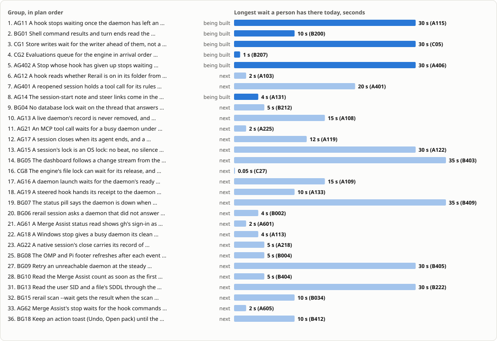

Each bar is the longest wait a person meets today where the group works, read from its timers' rows (an age over two
minutes, such as a session closed after 30 minutes, is left out). Across 29 product groups the longest are BG05 35 s,
BG07 35 s, AG11 30 s, CG1 30 s.

### What a maintainer will see arrive

All of this work arrives as one pull request from one branch. Each change is verified on Linux x64 and on Windows 11,
then joins that branch as commits of its own, each saying which wait goes and what replaces it, so the pull request
can be read change by change. The rest follow in the plan's order, the product before the tests. Being built today:

- **AG11** (being built): A hook stops waiting once the daemon has left an earlier event untaken
- **BG01** (being built): Shell command results and turn ends read the session folder by its change notices, not a whole walk under a 10 s cap
- **CG1** (being built): Store writes wait for the writer ahead of them, not a clock
- **CG2** (being built) with BG03: Evaluations queue for the engine in arrival order instead of being refused, and the TypeScript retry pauses and 2 ms idle poll go
- **AG402** (being built): A Stop whose hook has given up stops waiting and keeps its steers for the next event
- **AG14** (being built) with BG02: The session-start note and steer links come in the event's own answer

Then, in this order: AG12, AG401, BG04, AG13, AG21, AG17, AG15, BG05, CG3, CG8, AG16, AG19, BG07, BG06, AG61, AG18,
AG22, BG08, BG09, BG10, BG13, BG15, AG62, BG18; then the later groups, the ones that need a run once it has run, and
the tests.

### Every group in rank order

| Rank, group | What changes | State | For | What a person gets back | Size | Risk | Depends on | Timers |
|---|---|---|---|---|---|---|---|---|
| 1. AG11 | A hook stops waiting once the daemon has left an earlier event untaken | being built | product | 12 s to about 0.2 s per hook, about 24 s per tool call, for every hook after the first of a silence or a long busy spell; on 16 November two silences of 10 and 13 minutes cost 298 hooks a p50 of 5.7 s and a p95 of 20.7 s, and lost their events. The events are kept, not lost. Wrong state removed: a hook that waits 12 s, then 30 s more, for a daemon already known not to read. | about 300 changed lines (a per-home journal of untaken events written by a hook that waited, drained by the daemon in order at its next request; the hook's check for an untaken entry; the event request on the hook's one deadline), one more change if the pair of /healthz probes goes (A102) | Event order: the daemon must take a session's journalled events before its later ones. The first hook of a silence still waits its bounded 12 s until the never-wait design is ruled on. | On Windows the full-pipe case needs #677 (open). The first hook of a silence keeps its bounded wait until the never-wait design is ruled on. | A101 A102 A115 |
| 2. BG01 | Shell command results and turn ends read the session folder by its change notices, not a whole walk under a 10 s cap | being built | product | Up to 10 s at every shell command result and every turn end in a checkout whose walk takes that long; in smaller checkouts, the walk's own time at each of them. | about 280 changed lines | Writes no notice tells of (hard links, memory maps, a file another program holds open on Windows) move from the next boundary to the background re-read, so they are recorded later instead of steered. Linux's inotify watch budget is shared with the other-worktree watch. A lost or ended notice must always fall back to a whole walk. | Linux's inotify budget is shared with the walk of other worktrees; a lost notice must fall back to a whole walk. | B200 |
| 3. CG1 | Store writes wait for the writer ahead of them, not a clock | being built | product | Per checked edit that meets a background writer: 9 to 42 ms after a single holder today, 0.1 ms with the handoff; behind a writer's back-to-back batches (a Git snapshot publication at a workspace attach, search-index batches, completions) today's waiter loses every gap and waits for the whole run, measured 1.7 to 3.4 s, up to 10 s, then reuse pauses 30 s; with the handoff it waits one batch (8.8 to 104.8 ms median). Wrong states made impossible: results left unpublished, reuse paused, completion not recorded. | about 280 changed lines: a first-come gate per store file in connection.rs and the store registry (80), removal of the in-process deadline, backoff and cooldown (100), tests moved from sleeps to channels (100) | medium: every store write passes the queue; a holder stuck in disk I/O now holds later writes with no deadline (the hook's own limit in TypeScript still bounds the person's wait); the busy handler must stay for a foreign process | None. CG3 and CG4 build on it. | C01 C02 C03 C04 C05 C40 C42 C43 C45 C46 |
| 4. CG2 with BG03 | Evaluations queue for the engine in arrival order instead of being refused, and the TypeScript retry pauses and 2 ms idle poll go | being built | product | Up to 25 ms per contended check after the turn frees, and a check no longer loses the turn to another session's repository scan at every chunk (from reading: up to that scan's end; not measured). Up to 1 s per edit check (the result hook's cap) while another checkout's scan runs, so the steer lands under the edit; at a hook host's turn end, up to the daemon's 12 s wait. The daemon's main thread also stops waking every 2 ms during checks. | about 180 lines: a first-come turn in the engine (90), the two retry loops in code-rule-enforcer.ts removed (30), tests (60); about 120 changed lines | medium: a waiting task must not hold a libuv pool thread (the pool also serves file I/O): park it in the engine's own queue and resolve its promise at its turn | None. Its TypeScript half is BG03 (the retry loops it deletes). | B207 B208 B209 C17 C47 |
| 5. AG402 | A Stop whose hook has given up stops waiting and keeps its steers for the next event | being built | product | After a turn whose shell commands rewrote many checked files: the person's next prompt and the agent's next tool calls stop waiting 30 s each and failing while minutes of checks drain (several hooks at 30 s, each time it happens). Made impossible: steers and Merge Assist notes recorded as delivered into a request no one reads. | about 180 changed lines: 20 in engine-service.ts, 50 in runtime.ts, 110 in tests | A steer the Stop would have carried just after its hook gave up now comes with the next event instead of being lost; a Stop whose hook stays connected behaves as today. | None. | A406 |
| 6. AG12 | A hook reads whether Rerail is on in its folder from disk, never from a wait on the daemon | next | product | 2 s per hook in never-set-up and non-Git folders beside a busy or silent daemon (2.1 s measured on Linux at every build; 2.2 s, and 30 s with a full pipe, on Windows at 0.1.5), and 2 s off the start of every started-checkout hook in that state. Hooks are registered for the whole user, so every session in every folder pays it. | about 120 changed lines (hookRerailStarted reads the start generation's kept answer, else the read-only database, and asks the daemon nothing) | A read-only SQLite open in every hook where the daemon answered before: measure its cost on the slowed Windows machine against the daemon read (0.12 to 0.45 s a hook today). Stopped checkouts are already answered from a kept answer on #674 and a change not yet open; this extends the same fact to the other folders. | Builds on #674 (open), which answers a stopped checkout from a kept answer. | A103 A134 |
| 7. AG401 | A reopened session holds a tool call for its rules only when the call can write, and only once | next | product | Up to 20 s (about 12 s on a Windows laptop) at the first read-only tool call after each reopen, which comes after every 30 min with no event, each daemon restart and each resume; up to 20 s at each later call, result and Stop while an open runs past 20 s. Made impossible: one opening spending the 20 s cap at every event. | about 120 changed lines: 30 in runtime.ts, 90 in tests | A tool that writes files under a name Rerail does not know as a writer (an MCP tool) has its edit checked a turn later after a reopen, as every tool already is on a session's first start. | None. | A401 |
| 8. AG14 with BG02 | The session-start note and steer links come in the event's own answer | being built | product | Up to 4 s (8 s on Windows) per session start and 2 s per delivered steer beside a daemon busy after it answered; two or three requests fewer at every session start and one per steer with a healthy daemon. Up to 4 s per session start and 2 s per steering hook while the daemon is busy (plus a Windows engine proof per read); one to three requests saved per session start and one per steer always; no note or steer loses its link to a read that ran out of time. | about 150 changed lines (the event result carries the dashboard origin, the checkout scope and the rule count; the three adapters read them); about 200 changed lines | The event protocol gains optional fields: an older daemon answers without them, so the adapters keep today's read as the fallback for one release. | None; an older daemon answers without the new fields, so the adapters keep today's read for one release. | A131 A132 B001 B044 |
| 9. BG04 | No database lock wait on the thread that answers hooks: record writes on a writer thread, Rerail's long writes through the daemon | next | product | Up to 5 s per record write, stacked to the hook's 12 s, at every hook while a reset, scrub or upgrade runs beside open sessions. | about 300 changed lines | Reads on the main thread must see the writer's writes in order; queued records are lost if the daemon dies before they commit; the API path for reset and scrub needs the same refusals and reports the CLI gives today. | None. The tests of DG2 wait out its busy timeout. | B212 |
| 10. AG13 | A live daemon's record is never removed, and start and stop act on the home lock's holder | next | product | Up to 15 s per SessionStart, per rerail daemon start and per stop while daemon.json is missing; no false 'holds the home but has not written daemon.json, end that process' error; no second launch beside a live daemon. With #677 the 75 s session start measured on Windows beside a silent daemon becomes 12 s, then about 0.2 s with AG11. | about 100 changed lines | The home lock is asked through the native engine, which loads a DLL Windows keeps from deletion: keep asking it only where the pid rule says a holder may run, as homeDaemonRuns does now. | With #677 (open), which stops reading a full pipe as a dead daemon. | A105 A108 |
| 11. AG21 | An MCP tool call waits for a busy daemon under one bound instead of calling it not running | next | product | On Windows, every MCP tool call made while the daemon is busy 2 to 30 s, and on every system the first call after a daemon start, gets its answer instead of a 2 s wait ending in an error. Wrong state made impossible: the bridge telling an agent to start a daemon that is running. | about 60 changed lines (mcp-bridge.ts, a timeout argument on recordedDaemonAlive in runtime/daemon-control.ts) and 80 lines of tests | A listener that never answers now costs a tool call up to 30 s before it fails, as a stuck daemon already does. | None. | A224 A225 |
| 12. AG17 | A session closes when its agent ends, and a checkout's runtime retires on memory, not on a clock | next | product | A person back from a break of over 15 or 30 minutes no longer waits at the first tool call for the session to reopen and its rules to compile (about 12 s of CPU for a TypeScript repository's packs on a Windows laptop); memory of sessions whose agent died is freed at once, not after 30 minutes or a day. | about 250 changed lines | The agent's pid must be the agent's (Claude Code, Codex and Cursor start hooks differently); a memory mark must hold for native memory V8 does not count. | The agent's process id differs per host (Claude Code, Codex, Cursor start hooks differently). | A118 A119 |
| 13. AG15 | A session's lock is an OS lock: no beat, no silence clock, no polling, no removal | next | product | Up to 10 s for a hook behind a crashed holder, up to 5.5 s per hook on Windows where a scanner holds the new lock file, and the 10 ms loop of about 300 file calls a second beside every waiting hook. The state where a reused pid holds a session's lock can no longer happen. | about 200 changed lines and a blocking lock wait in the engine (tryLockExclusive exists; an async acquire is new) | The hook path loads no native engine today; taking an OS lock loads it in every hook. Measure the load on the slowed Windows machine first: if it costs more than the poll saves, keep the file lock and drop only the removal (A124). | Needs CG8 (a blocking OS lock wait in the engine). Measure the engine's load in every hook on a slowed Windows machine first. | A120 A121 A122 A124 |
| 14. BG05 | The dashboard follows a change stream from the daemon instead of polling every 5 s | next | product | Data shows when it is written instead of up to 5 s later (2.5 s on average) on every view, and the conflict count up to 35 s sooner. An idle tab sends nothing, saving the daemon about 5,800 requests and 2,200 handler runs an hour per tab, and 1,440 git processes an hour per open Merge Assist page. | about 330 changed lines | The daemon serves HTTP/1.1, and browsers allow six connections per origin: each visible tab's open stream takes one, so six dashboard tabs would stall the page's other requests. Hold the stream only while the tab shows (polling already pauses when hidden), or share one stream between tabs with BroadcastChannel. File watching differs per OS and sees nothing on some network filesystems, so a CLI write there would show at the next in-process change or when the tab shows again. Data outside the database (installed packs, a checkout's .rerail/rules, git HEAD for Merge Assist's branch) needs its own watch or a read when the tab shows. A daemon stop closes every connection (src/daemon/daemon.ts:298-301), the right signal for the page; requestTimeout bounds only receiving a request, so a held response is not cut (src/daemon/daemon.ts:66-71). | A change feed in the daemon; browsers allow six connections per origin. | B400 B401 B402 B403 B407 B408 B417 |
| 15. CG3 | Workspace rows end with their process, not a lease | next | product | One write transaction fewer per publishing check (a few ms, up to C01's wait under contention) and one every 30 s; a running workspace can no longer be marked dead and lose its overlay rows; a dead process's rows go at the next open instead of 120 s later | about 220 lines: owners judged at open by the main-instance lock or a per-owner lock file (80), renewals and lease writes removed (70), tests (70); the lease_until column stays, unread | medium: a checkout store shared by processes needs the per-owner lock to be right on Windows and Unix | Needs CG1 (a workspace's close hands its delete to the queue). | C06 C07 C08 C09 C10 C11 C12 C13 C41 |
| 16. CG8 with BG14 | The engine's file lock can wait for its release, and home locks wait on it instead of a 50 ms poll and a 1 s guess | next | product | Up to 50 ms per contended take at daemon start, update, install, activate and a hook's daemon start, and takes in arrival order. Up to 50 ms per contended start or packs change; a heap-ceiling restart whose predecessor takes over 1 s to end no longer leaves no daemon; a start that meets a running daemon stops at once instead of after 1 s. | about 160 lines: a waiting take off the JavaScript thread with cancel (Unix: a thread blocked in flock, Windows: LockFileEx with an OVERLAPPED and CancelIoEx) (100), callers in file-lock.ts and home-daemon-lock.ts (30), tests (30); about 150 changed lines | medium: cancelling a blocked flock on Unix; the TypeScript callers belong to another area's rows | None. AG15 and AG16 need it. | B005 B006 B007 B008 C27 |
| 17. AG16 with CG7 | A daemon launch waits for the daemon's ready signal, not for a clock | next | product | No 'did not become ready within 15s' while a slow machine's daemon is still starting (the person is told it failed and it runs anyway); up to 100 ms per launch and 50 ms per contended start. A daemon that dies at start is reported up to 100 ms sooner on Windows; readiness stays polled. | about 120 changed lines (a ready line on an inherited pipe from the daemon; the launcher waits for it or for the exit) and the async lock wait shared with AG15; about 100 lines | Windows' native spawn passes only NUL stdin and the log: the ready signal needs one more handle, or a watch on daemon.json. A hook's session start keeps its own bound. | Needs CG7 (a launched daemon's exit as an event) and CG8. | A107 A109 C26 C52 |
| 18. AG19 | A steered hook hands its receipt to the daemon instead of opening the database twice | next | product | Up to 10 s per steered hook while the daemon holds the write lock (the agent waits for the hook's exit); two SQLite opens per delivered steer. | about 120 changed lines | A receipt is recorded only once the answer is written (it says what the agent was shown); it must still count when the next event never comes. | None. | A133 |
| 19. BG07 | The status pill says the daemon is down when nothing answered, not 30 s later | next | product | Up to 35 s sooner to learn the daemon stopped and how to start it; no false 'not responding' for a daemon that answered. | about 50 changed lines | A remote daemon behind a passing network fault turns red for that moment, which is true while it lasts. The words for an answered error need a review. | None; pairs with BG05. | B409 |
| 20. BG06 | rerail session asks a daemon that did not answer only once | next | product | 2 s, plus a Windows engine proof, per /rerail while the daemon is busy. | about 25 changed lines | None found: the link is missing in that state today as well. | None. | B002 |
| 21. AG61 | A Merge Assist status read shows gh's sign-in as last read and starts no gh | next | product | 0.5 to 2 s (up to 40 s while gh stalls) on the first status read each 5 minutes per repository, each minute while gh could not tell, at `rerail merge-assist status` and the agent's merge_assist_get; an open dashboard no longer starts two gh runs every 5 minutes. Made impossible: a status read that hangs on gh. | about 100 lines: 30 in service.ts, 70 in service.test.ts | A person who signs gh in sees it on the status only after the next scan or listing, so `on` and the status text should point to a scan when no sign-in was read yet. | None. | A601 |
| 22. AG18 | A Windows stop gives a busy daemon its clean shutdown | next | product | A daemon busy for more than 2 s at a stop, update or uninstall on Windows records the events in flight instead of being killed after 4 s; under 0.1 s per stop from the exit wait. | about 40 changed lines | A daemon that never reads the request still meets the 10 s grace and the kill, as today. | None. | A112 A113 |
| 23. AG22 | A native session's close carries its record of dropped events | next | product | Up to 5 s at each OMP or Pi session switch or exit while the daemon is not answering and events were dropped; one request fewer at every close that has gaps. | about 70 changed lines (the client's close, the server's close taking gaps) and 80 lines of tests | A daemon from before the change ignores gaps sent with a close, so the client must keep the separate record for a daemon whose version predates it, or those gaps lose their record in the database. | A daemon of the release before ignores gaps sent with a close. | A218 |
| 24. AG23 | The heap ceiling is read after each full garbage collection | later | product | When the heap climbs fast, the restart starts at the first full collection past the ceiling instead of up to 30 s later, sparing hooks and tool calls the 1 to 2 s collection pauses in between and the daemon a death without cleanup; no forced full collection runs on the event loop that answers hooks. | about 50 changed lines in heap-ceiling.ts and 60 lines of tests | Node's 'gc' performance entries name the collection's kind in detail.kind; only a major collection leaves the live heap, so the PerformanceObserver must select those, or a reading after a minor one could restart a daemon whose garbage was not yet collected. | None. | A208 |
| 25. BG08 | The OMP and Pi footer refreshes after each event answer instead of every 5 s | next | product | The footer updates right after each tool call instead of up to 5 s later; an idle session sends no reads. | about 60 changed lines | A change with no event in this session (a mode set in the dashboard) shows at the session's next event instead of within 5 s. | None. | B004 |
| 26. AG24 | A native session's poll is answered when a steer is ready | later | product | Ten requests a second per open OMP or Pi session, in the host and the daemon, go while nothing happens; each background steer reaches the agent up to 100 ms sooner. | about 180 changed lines (the server's poll outside the session's queue, a delivery-ready promise in src/runtime/runtime.ts, the client's poll loop outside its request queue) and 120 lines of tests | The held poll must stay out of the session's one-at-a-time queue on both sides, as await-code-rules does, or it would hold every event behind it; and the lease (A211) must count a held poll as a live host. | The held poll must stay out of the session's one-at-a-time queue on both sides. | A214 |
| 27. BG09 | Retry an unreachable daemon at the steady pace, not doubling to 30 s | next | product | Up to 25 s sooner back to Live after a daemon restart. | about 8 changed lines | A remote daemon that hangs instead of refusing: refresh() joins the poll in flight, so requests do not pile up. | None. | B405 |
| 28. BG10 | Read the Merge Assist count as soon as the first poll lands | next | product | 5 s on every dashboard load with Merge Assist on, and no layout shift 5 s into the visit. | about 15 changed lines | One more request right after the first screen; today it goes out 5 s later anyway. | None. | B404 |
| 29. CG4 | Store maintenance runs when a write gives it work | later | product | An idle daemon stops waking 120 times an hour per store; search indexes are built right after their tapes instead of up to 30 s later; collection starts at the write that crossed the capacity line | about 120 lines | low: work moves from a clock to the writes that create it; the stop flag still ends the thread | Needs CG1 (the thread yields the store between batches through its queue). | C14 C15 C16 C58 |
| 30. CG6 | Windows tree watch acts on completions it already receives | later | product | Up to 20 ms shorter window in which renaming or removing a watched worktree fails with access denied, and watching resumes up to 20 ms sooner after a rename | about 60 lines | low to medium: completion order on the port; Windows only | None. | C21 C23 |
| 31. BG13 | Read the user SID and a file's SDDL through the engine instead of whoami and PowerShell | next | product | PowerShell's start (up to seconds on Windows) at each TLS daemon start that checks who may read its key; the 30 s limit goes with the child. whoami's start goes for the SID read. | about 80 changed lines | Low: one native Win32 read beside the calls the engine already makes; icacls (B221) stays. | None. | B220 B221 B222 |
| 32. BG15 | rerail scan --wait gets the result when the scan ends; writes are not aborted after 10 s | next | product | Up to 0.25 s per scan and a result instead of 'running' after 10 s; no write reported failed that the daemon applies (internal testing only). | about 120 changed lines | A held request on the daemon's HTTP server; a daemon that never answers leaves the command waiting until the person stops it. | None. | B032 B033 B034 |
| 33. AG62 | Merge Assist's stop waits for the hook commands only, and a pass that ends after it writes nothing | next | product | up to 2 s at each daemon stop or restart (`rerail daemon stop`, `rerail update`) that lands while a pass waits on gh or Git (rare). Made impossible: a pass writing its conflicts into a database that is closing. | about 60 lines: 15 in service.ts and conflict-detect.ts, 45 in service.test.ts | A pass between its last await and its write when the database closes must see the stop first, so the check goes inside detectConflicts' transaction. | None. | A605 |
| 34. BG16 | The engine's watch tells the daemon when a notice arrives instead of a 250 ms poll | later | product | Background only: a change notice reaches the walk of other worktrees up to 250 ms sooner, and the daemon stops waking four times a second per watch. | about 80 changed lines | A napi thread-safe callback from the watch thread; must not call into JavaScript while the loop is busy. | None. DG5 changes with it. | B204 |
| 35. BG17 | Retry a refused or ended worktree watch on the fact that could change the answer | later | product | Background only: no 10 min of whole re-reads after a watch refused for Linux's budget; no retries of a file system that can never be watched. | about 60 changed lines | Needs the engine's watch to return why it refused. | The engine's watch must return why it refused. | B205 B206 |
| 36. BG18 | Keep an action toast (Undo, Open pack) until the person's next action | next | product | No wait; Undo of a removed rule stays until the person's next action instead of vanishing after 10 s. | about 30 changed lines | A toast that stays longer may cover content; it goes at the next click or navigation. | None. | B412 |
| 37. AG403 | A scan or setting written through the daemon's API reaches the session at once | later | product | Up to 0.25 s per scan request or settings change, which no one notices; 4 fewer wake-ups a second per idle runtime in the daemon, and no settings reread for every session each 250 ms in a busy one. | about 80 changed lines | Runtimes outside the daemon (Pi in-process, the event stream) keep the poll or take requests at their next event, so two paths remain; low value for the change. | None. DG6's audit-control checks change with it. | A408 |
| 38. AG25 | The daemon puts its record back when the home folder says it changed | later | product | Under 1.1 s, rarely: a start, stop or hook that finds daemon.json gone while its daemon runs no longer waits for the next check. Low: not worth a change alone. | about 60 changed lines and 60 lines of tests | File watches differ by system (batched on macOS, absent on some network drives), so the 1 s check would have to stay as a fallback where a watch cannot start. | None. | A204 |
| 39. AG26 | A session's unclaimed answers end with the session | later | product | None a person sees; a state with answers no one can claim ends at a fact instead of a 60 s age. Low: not worth a change alone. | about 20 changed lines and 30 lines of tests | A ticket must not be dropped while its client still waits in await-reply for the same session. | None. | A212 |
| 40. AG27 | A refused connection sends a native session to its rebuild at once | later | product | About 0.7 s fewer dropped OMP or Pi events per daemon restart. Low: not worth a change alone. | about 20 changed lines and 40 lines of tests | The error's code must be read through fetch's cause (ECONNREFUSED), which differs from an abort on timeout; a misread would rebuild a session against a merely busy daemon. | None. | A215 |
| 41. AG63 | A scan mark holds while the very process that claimed it runs | later | product | no seconds; a pid reused within 10 minutes no longer refuses scans and shows old results (rare, mostly Windows). Low: not worth a change on its own. | about 50 lines with a test, more if no helper reads a process's start time on all three systems | Reading a process's start time differs on each system, which may cost more code than the case is worth. | Reading a process's start time on three systems. | A602 |
| 42. AG64 | The remote sender's lock holds while the process that took it runs | later | product | no seconds; `rerail remote push` is no longer refused for up to 2 minutes after a sender died holding the lock. Low: rare, and the remote sink is an internal-testing experiment. | about 50 lines with a test | Same start-time question as AG63; a live sender that stalls keeps the lock, which the 30 s request limit already bounds. | As AG63. | A617 |
| 43. BG19 | One constant for the 30 minute rule that tells a live session from a silent one | later | product | None; one 30 min constant instead of two that could drift apart. | about 10 changed lines | None. | None. | B413 B414 |
| 44. BG20 | Pack staging folders are swept by their owner's liveness, not a 1 h age | later | product | Disk freed at the next fetch; a fetch over 1 h never loses its folder. | about 40 changed lines | Low. | None. | B030 |
| 45. BG21 | pruneCheckouts has no production caller and repeats Git's default limit | later | product | None; less code. | about 10 changed lines | None. | None. | B223 |
| 46. BG22 | Rule provenance move pacing after an upgrade (kept), with the WAL truncate retry replaced by journal_size_limit | later | product | None for a person; the WAL shrinks without a 5 s retry (B217); the rest is kept. | about 15 changed lines | Low. | None. | B214 B215 B216 B217 B218 B219 |
| 47. BG24 | rerail scrub waits for a ledger line being appended by an append lock, not 50 ms naps | later | product | Up to 0.25 s on a rare command. | about 60 changed lines | The daemon's appends take a lock. | The daemon's appends take a lock. | B036 B037 |
| 48. BG25 | A Git read's time limit is one timer at the limit, not a 1 s tick | later | product | None a person sees; up to ten fewer wake-ups per Git read in the daemon. | about 25 changed lines | The stall rule (one more look after Git ended) must keep its test. | None. | B041 |
| 49. AG801 | The local registry wait ends when Verdaccio answers or its process ends | later | contributors and CI | up to 179 s per run whose registry fails to start, on every matrix environment and release gate run that installs a bundle; a dead registry is no longer pinged for three minutes | about 15 changed lines (guest.sh 6, windows-host.ps1 6, tests apart) | On Linux the background job runs under setsid, whose pid stays Verdaccio's only while setsid does not fork, which holds in a script without job control; the test must show it. | None. | A815 A828 |
| 50. AG802 | The matrix learns that a Windows test run ended from its scheduled task, not from the 60 minute deadline | later | contributors and CI | up to about 45 min per Windows environment whose signed-in test run dies without uploading results (two Windows environments per matrix run); the restart can no longer race Run Command's report | about 70 changed lines (matrix.mjs about 40, guest.ps1 about 30) | The second Run Command needs the virtual machine agent back after the restart; if the agent comes up after the test run has ended, its script must read the task's last run rather than wait for a running state. | None. | A823 A844 |
| 51. BG11 | Dev and restore scripts trust `rerail daemon start`'s exit instead of probing again | later | contributors and CI | Up to 30 s and a precise reason on a failed `just rerail-dev` start; up to 5 s and no false failure on `just rerail --restore`. | about 60 changed lines | Low. Both scripts run a CLI from the same release as themselves (the checkout's build, or the launcher `rerail setup` just installed), so the start's readiness wait is always there. A message that the smoke greps must stay word for word. | None. | B600 B613 |
| 52. BG12 | Stopping a dev daemon reads daemon.json and the pid, not /healthz | later | contributors and CI | 2 s per home, up to 4 s, whenever a dev daemon is alive but silent. | about 30 changed lines | Low: on these paths the probe's answer was never read. | None. | B601 |
| 53. BG23 | Dev-checkout registry lock: watch the lock folder instead of a 50 ms poll | later | contributors and CI | Up to 50 ms for contributors when two set-ups run at once. | about 30 changed lines | Low. | None. | B605 B606 |
| 54. BG26 | Dev scripts stop a daemon through rerail daemon stop (one stop path) | later | contributors and CI | Up to 0.1 s per stop for contributors; one copy of the stop loop instead of three. | about 40 changed lines | Low. | None. | B603 B612 |
| 55. BG27 | rerail-smoke waits on Verdaccio's listening line instead of a 1 s ping loop | later | contributors and CI | Up to 1 s per smoke run. | about 20 changed lines | Low. | None. | B614 B615 |
| 56. BG28 | Guidance review saves on change and pagehide instead of a 600 ms debounce | later | contributors and CI | None; the save happens on change instead of 0.6 s after the last keystroke. | about 10 changed lines | Low. | None. | B617 |
| 57. BG29 | Docs site Copy button label ends on pointerleave and blur | later | contributors and CI | None. | about 5 changed lines | None. | None. | B616 |
| 58. BG30 | Windows renames and removals held by another program: measure, then use POSIX semantics where they remove the wait | needs a run first | product | Unknown until the Windows run: up to 2 s per held rename, 5.5 s per held removal, 10 s at update and uninstall. | unknown until the run | Needs a native rename with FILE_RENAME_FLAG_POSIX_SEMANTICS; holders that refuse delete sharing still refuse. | A run on a Windows 11 machine with Defender on, logging each refused try and its holder. | B013 B014 B015 B016 B017 B043 |
| 59. BG31 | Measure whether the five-minute scan budget cuts anything the file and byte budgets do not | needs a run first | product | Unknown until the timing run. | unknown until the run | Coverage of large repositories. | A timing run on a large repository. | B210 B211 |
| 60. CG5 | Writers in other processes block on SQLite's lock | needs a run first | product | Dev builds only: a CLI scan beside a dev daemon wakes at the release instead of polling | about 40 lines if the bundled SQLite supports it | UNSURE until the bundled SQLite version and Windows support are read | Reading the bundled SQLite's version and its Windows locking. | C28 |
| 61. DG1 | The daemon-home tests end their holds and settles on facts, not on 2.5 s and 8 s clocks | tests, last | tests | about 33.0 s of test time per run | about 80 to 120 lines, test code only | medium | Test code only; D5 changes shape with AG16. | D2 D3 D4 D5 |
| 62. DG2 | The rule provenance move tests release the write lock when the move met it, and drive the older-audit window with the clock the move already takes | tests, last | tests | about 13.0 s of test time per run | about 60 to 120 lines | medium | May need one option on the daemon's start; bound to BG04's busy timeout. | D7 D8 D11 |
| 63. DG3 | The engine service close checks its looks by count: the test drives the close's look timer | tests, last | tests | about 12.5 s of test time per run | about 150 to 250 lines | medium | A scheduler on the close's 1 s look (A117, kept). | D15 D16 D17 D18 D19 D20 D21 D22 D23 |
| 64. DG4 | The Windows removal tests record their waits instead of sitting through 5.5 s budgets | tests, last | tests | about 12.8 s of test time per Windows run | about 40 to 70 lines | low | Test code only. | D48 D49 D50 D51 |
| 65. DG5 | Worktree walk tests run the walk schedule on a clock the test drives | tests, last | tests | about 7.8 s of test time per run | about 100 to 200 lines | medium | A clock and scheduler on the worktree walks; changes with BG16. | D44 D45 D46 D47 |
| 66. DG6 | Daemon absence checks count passes, not milliseconds | tests, last | tests | about 5.4 s of test time per run; and checks that can no longer pass without testing | about 100 to 180 lines, with a pass counter on each loop | low | Each loop exposes its passes; bound to AG403, AG25 and the remote sink's tick. | D24 D25 D26 D27 D28 D30 D31 D32 D33 |
| 67. DG7 | runCommand takes its kill grace from the caller, and the test passes 200 ms | tests, last | tests | about 4.8 s of test time per run | about 15 to 30 lines | low | An option on runCommand's kill grace (A621, kept). | D56 |
| 68. DG8 | Hook and lock race tests wait until the second party is waiting | tests, last | tests | about 2.1 s of test time per run; and checks that can no longer pass without testing | about 60 to 120 lines | low | Bound to AG15 (session lock) and CG8 (home locks). | D36 D37 D38 D39 D40 D41 D42 |
| 69. CG9 | Engine tests wait on events, not sleeps | tests, last | tests | Suite time on three OSes (500 ms per QUIET use, 150 ms) and no pass or fail decided by a runner's speed; the store tests' 8 s of sleeps leave with CG1 and CG3 | about 120 lines | low | None. | C44 C50 C57 |
| 70. DG9 | Small polls wait on events (LOW) | tests, last | tests | about 3.3 s of test time per run | about 60 lines | low | D77 is bound to the host smoke's 100 ms poll (A835). | D10 D12 D34 D74 D76 D77 D78 D79 D80 |
| 71. DG10 | Test run folders: a held lock says a run still runs (REMOVE-NEUTRAL) | tests, last | tests | about 0 s of test time per run; a live run's folder can no longer be taken for ended | about 60 to 100 lines | medium | None. | D54 |

## What is not known yet

15 timers need one run to decide whether they can go. Each names the run.

| Timer | Where | What is not known, and the run that settles it | If it can go | Group |
|---|---|---|---|---|
| A216 | `src/harness/native-session-client.ts:387` | Spacing rebuilds keeps a daemon that crashes at start from being spawned again every few hundred milliseconds, and nothing says when a crashing daemon will come up. In the restart case a fact exists: the old daemon's pid exits and the new one writes daemon.json. Whether the first rebuild really meets the closing daemon depends on how long the close takes, which only a run shows. Run on a test machine: attach an OMP session, run rerail daemon stop then rerail daemon start, and compare OMP's stderr times of 'Rerail native runtime unavailable' and 'Rerail native runtime recovered' with daemon.log's close and listening lines; a recovery more than 3 s after the new daemon listens means the pause is felt. | a possible fix: the rebuild waits for daemon.json to change or the old pid to exit, with today's pause kept as the cap for a daemon that never comes up. | - |
| A221 | `src/harness/native-session-client.ts:276` | The code awaits a close it says need not be answered, so a person may wait on a slow daemon at every switch. Whether OMP holds the person's screen on the extension's session handlers or runs them in the background is OMP's behaviour, which only a run shows. Run on a test machine: an OMP session with Rerail attached; start a slow ingest (a code rule audit over a large repository), switch session with /new while it runs, and time until the new session takes input, next to OMP's stderr lines. | a possible fix: the host retires the runtime once its close is queued, taking its gaps first (takeDropped), and the daemon's lease (A211) ends a session whose close never arrives. | - |
| A603 | `src/runtime/merge-assist/service.ts:518` | The window drops edits rather than delaying them: nothing runs the pass it skipped, so a conflict from the last edits of a burst can stay untold for the rest of the session. Two facts could replace it: the end of the running pass (start one more then if an edit landed meanwhile, so passes never overlap) and the agent's turn end (run the skipped pass then). Whether back-to-back passes cost too much depends on a pass's length: with up to 200 open pull requests a pass starts three Git processes per pull request before comparing any (conflict-detect.ts:159-161). | proposed: the running pass's end, with one pass queued when an edit landed during it; or the agent's turn end for edits the window skipped | - |
| A618 | `src/runtime/remote-outbox.ts:916` | Nobody waits for the remote, but each tick's reads run on the daemon's main thread, and whether that delays hooks depends on the size of a home. The daemon knows when it records an event or finishes an audit, which could start a sync in place of the clock, but other processes write too (a CLI scan), so a cheap check of what changed (the newest event sequence and audit) would still be needed. | - | - |
| A809 | `src/harness/rerail-commands.ts:248` | Whether two reads always suffice depends on facts outside these files: `rerail show-me --json` returns once the rule is written to the database, before any daemon has loaded it (src/cli/show-me.ts), and right after a start the daemon may still be indexing, when tool results go on without code rules (extension.ts:474-476). If either outlasts two reads, the person watches the demo fail. | a possible fix: `rerail show-me --json` answers only once the daemon reports the demo rule live and the checkout's code rules open | - |
| B013 | `src/setup/updater.ts:826` | Whether the hold comes from Rerail's own children (their exit is a fact already awaited) or from antivirus (no fact) decides it. Settle with one run on a Windows 11 test machine with Defender on: rerail update to a local tarball 10 times, logging each EPERM retry's count and, at the first refusal, the holder from the Restart Manager (RmGetList). If the holder is always a child Rerail started: wait for that child's exit and drop the retry. | - | **BG30** (needs a run first) |
| B014 | `src/engine/file-replace.ts:44` | Most of Rerail's own readers open files through libuv, which shares delete access, so a POSIX-semantics rename (SetFileInformationByHandle with FILE_RENAME_FLAG_POSIX_SEMANTICS, Windows 10 1607 and later) would succeed at once against them; holders that refuse delete sharing still refuse. Settle with one run on a Windows 11 test machine: rename over a file held by (a) a Node reader, (b) Defender scanning a new file, (c) an editor, with MoveFileEx and with the POSIX flag, counting refusals. A rename with POSIX semantics through the engine; the retry stays only for holders that refuse delete sharing. | - | **BG30** (needs a run first) |
| B015 | `src/engine/file-replace.ts:129` | Same question as B014; a synchronous caller also freezes its whole process for the wait, which in the daemon would stall every hook. As B014. | - | **BG30** (needs a run first) |
| B016 | `src/engine/file-replace.ts:271` | libuv on Windows already deletes with POSIX semantics where the file system allows it, so holders that share delete no longer refuse; what still refuses (antivirus, a program without delete sharing) has no release event. Settle with the run in B014, adding folder removals. Keep only for holders that refuse delete sharing, once the run shows which remain. | - | **BG30** (needs a run first) |
| B017 | `src/cli/setup-cli.ts:192` | The comment blames a lock held 'for a moment after the process holding it has exited'; on Windows a process's handles close before the process ends, so the remaining holder is antivirus or a hook still running. If stopDaemon returns only once the daemon process has ended (src/runtime/daemon-control.ts), the daemon cannot be the holder. Settle with one Windows run: rerail uninstall with a daemon running and Defender on, logging each refused try and its holder (RmGetList). Wait for the daemon's process to end (already a fact) and keep the retry only for an outside holder. | - | **BG30** (needs a run first) |
| B043 | `src/engine/native/file-lock.ts:235` | As B016. As B016. | - | **BG30** (needs a run first) |
| B210 | `src/engine/code-rule/code-rule-enforcer.ts:1486` | #indexRepository stops at the deadline whatever the 100,000-file and 512 MiB work budgets (chunk.overBudget) say. The clock also counts the time #waitForEvaluationIdle spends behind the session's own edits, so a busy session can cut its scan short though the scan is small. The scan runs off every request path (a session start's audit, a scan request), so removing the cut costs background time, which the work budgets already bound, and gives full coverage. Smallest run that settles it: time a repository scan at the work budgets (100,000 files, 512 MiB) on the slowest supported machine, once alone and once beside a session that edits. If both end inside 5 min, the clock cuts nothing the work budgets do not, and the session's close (#closing) plus the work budgets replace it. | - | **BG31** (needs a run first) |
| B211 | `src/engine/code-rule/code-rule-enforcer.ts:1670` | #auditFiles stops at the deadline beside its own file and byte budgets (AUDIT_MAX_FILES, AUDIT_MAX_SOURCE_BYTES), and the time #flushAuditBatch waits behind edits counts against it, as in B210. The run named in B210 settles both sites. | - | **BG31** (needs a run first) |
| C28 | `native/src/content_store/connection.rs:175-209, 312 (the busy handler, for a writer in another process)` | SQLite's blocking locks (SQLITE_ENABLE_SETLK_TIMEOUT with sqlite3_setlk_timeout, in LIBSQLITE3_FLAGS of .cargo/config.toml) would wake a cross-process waiter at the release. Settled by reading the bundled sqlite3.c of libsqlite3-sys 0.39.1: version 3.50 or later, and blocking locks on Windows (os_win.c), then one cargo test of content_store:: on Linux and on Windows. | - | **CG5** (needs a run first) |
| D42 | `test/engine/code-rule/tree-watch.test.ts:59` | A sentinel would remove the false pass: write under a root still watched and wait for its notice, then assert nothing named the unwatched one. Whether the native watch delivers in order across roots is not promised. Settled by: 50 runs of the sentinel version on Linux, macOS and Windows. | - | **DG8** (tests, last) |

### A finding no single census made: Rerail never sees the system's sleep

**DM19, alive to suspended by the system.** the machine sleeps; no Rerail code runs and none marks it (`(no code)`)

**DM20, suspended by the system to alive.** at resume every age measured on the wall clock (Date.now, SystemTime)
counts the sleep as quiet time: a session whose last event is over 30 min old closes at the next 60 s sweep and its
next tool call waits for the reopen; a native session reads expired until its host's next request, and a sweep that
comes first closes it; content-store leases read expired until the next renewal (`src/runtime/engine-service.ts:314,
:349-372; src/daemon/native-session-server.ts:209, :515-523; native/src/content_store/mod.rs:70-85`) The fact that
could fire it: No age at all: an owner's end as the fact (the agent's exit, the host's connection, the workspace's
process). The systems' resume notices (logind PrepareForSleep, NSWorkspaceDidWakeNotification, WM_POWERBROADCAST)
would only patch the ages.

## How it was made

- Four censuses by area, at Rerail 0.1.5 (commit 9cad73564), one row per timer site read in the code: what it waits for, its value and where it is set, who waits and how often, the longest wait, and a verdict with its reason.
- **A, hooks and daemon.** 135 sites, one row each, from 114 files read line by line.
- **B, commands, set-up and dashboard.** 117 sites, one row each, from 95 files read line by line.
- **C, the engine in Rust.** 47 sites, one row each, from 5 files read line by line.
- **D, tests.** 84 sites, one row each.
- Then the map: each row placed on the links and the changes of state it sits on, the 101 changes classed by what fires them, and each category given the practice that replaces it. 5 sites were traced by two censuses and count once.
- Measured, not read: 1 timing model of the content store's write wait, on a Linux machine. Every other figure is read from the code, or from a measurement the row names.

Every id on a drawing was checked against the censuses and every total against the map. Figures are read from the code
of Rerail 0.1.5 (commit 9cad73564) unless a row says it was measured.
