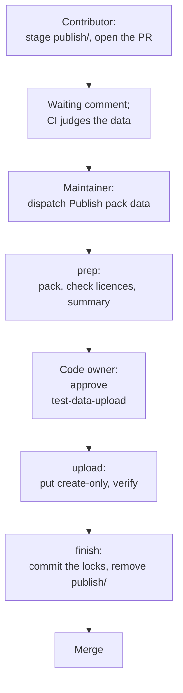

# Upstream snapshots and publishing data

A pack's ported rules are judged against upstream: a linter at the release its tool-pack pins. Upstream's answers are
captured once, stored in S3 and pinned by sha256 in a tracked lock.

A tool-pack (`packs/<pack>/upstream/<tool>/`) has two kinds of pack data, each one S3 archive named by a tracked lock:

| Pack data | Lock | What it holds | How it changes |
| --- | --- | --- | --- |
| Test data | `test-data.lock` | upstream's tests, the expected findings (`fixtures.expected.json`), cases Rerail wrote for the tool | authored cases by hand; derived data only by derive ([Take a new snapshot](#take-a-new-snapshot)) |
| Real-code samples | `samples.lock` (optional) | real files from open-source repositories, labelled per rule | the sample builders in `scripts/samples/`, a library API ([Samples](#samples)) |

Either kind changes through a pull request that stages the new data. One workflow on main puts it in S3 once a code
owner approves ([Publishing pack data](#publishing-pack-data)).

- **File and archive layout:** [pack-format.md, "Pack data"](pack-format.md#pack-data).
- **Licence of each copied file:** [pack-format.md, "Licensing"](pack-format.md#licensing).
- **Contributor commands:** [CONTRIBUTING.md, "Pack test data"](../CONTRIBUTING.md#pack-test-data).
- **Reviewer and approver checks:** [REVIEW.md](../REVIEW.md).
- **What the rules must pass:** the conformance check (`npm run test:conformance`),
  [conformance/README.md](../conformance/README.md#the-gate).

<details>
<summary>Why a snapshot, and gates.yaml</summary>

Upstream is provenance at a point in time. CI only verifies the pinned bytes and scores the rules on them. It never runs
upstream, and never checks whether upstream would still answer the same. A snapshot goes stale only when a maintainer
decides to take a new one.

Each gated tool-pack's `gates.yaml` is its upstream manifest. It holds the pins (`upstream.version`, `upstream.commit`,
the runtime), the file types upstream lints (`upstream.lints`), and the per-rule facts declared at the pins (`rules`). A
maintainer reviews these at each bump.

</details>

## Samples

A sample is a real file from an open-source repository, labelled per rule with the lines to report, or `[]` when clean.

`npm run fixtures:pull` fetches each samples archive with the test data, into
`.rerail/pack-data/samples/<pack>/<tool>/<sha256>/`.

To add, relabel or drop samples, or rename or drop a label's rule key, write a one-off script using the sample builders:

1. Load the set and change it.
2. Write the samples to add or replace into `publish/samples/` with `writeSampleSet` (`scripts/samples/pack.ts`).
3. Update `SAMPLES.md` in the same pull request, then publish as any pack data.

<details>
<summary>Labels, fetching and edge cases</summary>

- A rule the labels do not name is not judged on the file. Labels mark intent by line; a column, if present, is
  provenance.
- Judging is in [conformance/README.md, "How samples are judged"](../conformance/README.md#how-samples-are-judged).
  The archive, `samples.lock` and `SAMPLES.md` are in [pack-format.md, "Pack data"](pack-format.md#pack-data).
- `node scripts/s3/pack-fixtures.mjs samples` fetches samples alone. Samples never extract into the tool directory.
- Samples staged in `publish/samples/` are laid over the locked set, so a pull request's CI judges them before
  publishing.
- `writeSampleSet` checks the samples as the publish does, and writes a `REUSE.toml` licensing the staged copy.
- A label naming no rule of the tool-pack fails the whole pack's conformance check, which catches typos.
- The builders are a library API with no command of their own.
- No rule says how far to trim a set; `SAMPLES.md` says how it was trimmed, if it was.

</details>

### Sample licences

A sample is a whole file of another repository, so its licence comes from a recorded table, not its labels.

`SOURCE_LICENCES` (`scripts/samples/licences.ts`) names every repository samples may come from (`owner/name`) with its
SPDX licence and the licence files that state it. Taking samples from a new repository adds its entry; the reviewer
reads its licence file at the samples' commits.

<details>
<summary>What the table records</summary>

`COPYLEFT_SOURCES` lists repositories found copyleft, with the evidence.

The licence is the one in force at the sample's commit, for its file. That is the licence files of the nearest
directory above it that has any (a monorepo package's own, else the root's). At a commit with none, it is the README's
licence section or `package.json`'s `license`.

A `SOURCE_LICENCES` entry records the repository's licence and files. Under `at` it records each pinned commit where
they differ (jest was BSD-3-Clause with a patent grant until 2018). `at` also records licences no allowlist entry covers
(`NONE` where nothing states one, `CC-BY-4.0` for mocha's docs). The builder then drops the sample, and a publish
staging it is refused, whatever the repository's licence is today.

</details>

On publish, `publishedSamples` (`scripts/samples/publish.ts`) refuses samples that break the table, and
`checkLicenceTexts` refuses samples whose licence files at their commit do not say what the table records. The licence
check then judges each recorded licence against `scripts/check/licence-allowlist.json`.

<details>
<summary>What publish refuses, and LICENSES.md</summary>

`publishedSamples` refuses:

- a sample whose repository has no entry, or whose labels declare a `source.license` other than the entry's at the
  sample's commit;
- a sample from a copyleft source;
- a path that is neither `LICENSES.md` nor `<sample-id>/<path>`, or a sample not staged whole: its file beside its
  labels, the file's sha256 equal to the labels' `source.sha256`.

`checkLicenceTexts` reads, for each repository and commit the staged samples name, the licence files `SOURCE_LICENCES`
records for that commit, from GitHub (`gh api`, cached in `.rerail/pack-data/licences/`). It refuses the commit when a
file is not there, the files do not read as the recorded licence, they name a copyleft licence, or the commit has no
licence (`NONE`). Both checks run when `writeSampleSet` stages a set and again in the publish workflow's prep, the only
way a sample reaches S3.

The approver's summary lists every repository the archive takes files from, with its licence.

The archive's `LICENSES.md` lists each repository, its licence, its files, and the licence texts read at the samples'
commits. A set converted from a test set without reading licence texts (the ESLint test set's) carries only the licence
id the test set recorded, with no text. So an archive holds licence texts only for repositories whose licence files
were read, and `SAMPLES.md` says which: all, none, or the ones it names.

</details>

## Take a new snapshot

Derived test data changes only on purpose, through a pull request that carries the new data in `publish/`.

- **A bump** moves the pins to a newer upstream release and derives again ([Bump pull requests](#bump-pull-requests)).
- **A re-snapshot** derives again at the pinned release: the bump start's `resnapshot` input.
- **A local derive** runs in a maintainer's sandbox ([Derive in a sandbox](#derive-in-a-sandbox)):
  `npm run fixtures:derive -- --pack <id> --tool <tool> [--update]`, then
  `npm run fixtures:stage -- --pack <id> --tool <tool> --all`, then publish with `replace`.

<details>
<summary>When to use each</summary>

A maintainer starts a bump by hand ([Start a bump](#start-a-bump)) after reading the nightly report
([Upstream releases](#upstream-releases)).

A re-snapshot follows a generator, recipe or runtime pin change, or makes data only Linux makes.

A local derive runs a pull request's own pins, generators and recipes.

Generators run upstream's code, so they run only in a maintainer's sandbox or the bump workflow, never pull request CI.

</details>

### What the generators write

Each generator writes a tool-pack's test data in the pulled layout under `packs/<id>/upstream/<tool>/`.

- **Test cases:** upstream's, under `fixtures/`.
- **Expected findings:** `fixtures.expected.json`, what upstream reports on the cases (`expectedFindingsSchema` in
  `conformance/languages/pack.ts`).
- **Rename variants:** for ECMA tool-packs, a renamed copy of every upstream unit under `fixtures/renamed/`
  ([pack-format.md, "Rename variants"](pack-format.md#rename-variants)).
- **Provenance:** `provenance.json` and `LICENSES.md`, from the shared writer `scripts/pack-data/provenance.mjs`.

<details>
<summary>Unit origins and per-case language</summary>

`source.units` gives each unit's origin. Its `rules` are the upstream rules whose tests the unit came from. That makes
it one of that rule's own units for `stays-silent` and `upstream-rule`. A unit with no entry (Rerail's probes, or
unknown origin) is scored but is no rule's own evidence.

ESLint-based generators share `scripts/pack-data/eslint-expected.mjs`.

A generator that lints each case under its own language (`ecmaVersion`, `sourceType`, `parserOptions`) records it as
`languageOptions` in `source.units`. It does so where it differs from ESLint's defaults for the file's extension. The
runner evaluates the unit under it ([pack-format.md](pack-format.md#conformancejson-divergencesjson-upstream)).

</details>

<details>
<summary>How rename variants work</summary>

A variant lives at `fixtures/renamed/<the original's path>`, renamed by `scripts/pack-data/rename/ecmascript.ts`:

- **Renamed:** identifiers, keeping length, character shape and the order of every two names (one bijective map per
  file), so sorting rules judge the same order.
- **Protected:** keywords, standard library, common host, framework and test-runner API names, hook-shaped and
  `…Sync` names, and package exports (imported names, members of a package's binding, props of its components).
- **Kept:** literals, since rules read them (a number's digits, a URL, a font name).

Upstream lints the copy like any unit, so its expected findings are upstream's own. Its `source.units` entry carries
`renamedFrom`, the original's key. The runner scores variants apart from the originals, as `holds-under-rename`.

A port fails if it matches the test cases' names instead of the construct. It also fails if renaming takes every
finding and none survives (held vacuously, which blocks). A `rename_exempt` reason in the rule's `gates.yaml` entry
exempts it ([conformance/README.md](../conformance/README.md)). A family without variants yet takes its overfit evidence
from samples alone.

</details>

<details>
<summary>How provenance is written and checked</summary>

Last, each generator calls `writeProvenance` (or `write_provenance` from Python). The two files go in
`packs/<id>/upstream/<tool>/` and are archived with the data ([pack-format.md, "UPSTREAM.md"](pack-format.md#upstreammd)):

- **`provenance.json`:** each pack test data file with its source, upstream path and how it was made.
- **`LICENSES.md`:** each source's licence and licence text.

The generator names the files it copied from upstream. The writer classifies Rerail's own files (the tool's
`UPSTREAM.md` listing, `authored/`, the tool's recorded output). It reads each source from its tracked
`packs/<id>/licenses/<project>/UPSTREAM.md`.

The derive fails, writing neither file, on any mismatch with those records:

- a pack test data file with no entry;
- a file outside its source's "Taken from it" globs, or such a glob matching no file;
- an upstream path under a "Not copied" prefix;
- a checkout at a commit other than the Source row's.

A generator that writes neither file also fails the derive.

</details>

### Runtimes

`fixtures:derive` installs each generator's pinned runtimes from `scripts/pack-data/runtimes/` (`runtimes.ts`):
upstream's own (`gates.yaml`'s `upstream.runtime`) and the adapter's.

<details>
<summary>Adapter runtimes and how they are pinned</summary>

| Adapter runtime | Tools |
| --- | --- |
| `python` | Ruff, Bandit |
| `php` | PHP_CodeSniffer, PHPStan, Psalm |
| `blade` and `php` | tlint, stillat/blade-parser |

A runtime is pinned by its `package.json`, `pyproject.toml` or `composer.json` alone: every direct dependency at an
exact version and in `overrides`, no committed lockfile.

- **Python** pins its interpreter in `.python-version`, which uv installs.
- **PHP** pins its interpreter in `.php-version`. Composer cannot install it, so derive refuses any other `php`.
- Every PHP process runs with no php.ini (`php -n`, `PHP_INI` in `runtimes.ts`).
- `runtimes/php/extensions.txt` lists the extensions `runtimes/php/build.sh` compiles in; a `php` loading any other
  set is refused.

Transitive packages resolve at install. If one changes what upstream answers, pin it too and take a re-snapshot.

</details>

Build the pinned PHP, then derive with it on `PATH`:

```sh
scripts/pack-data/runtimes/php/build.sh "$PWD/.rerail/php/8.5.11"
PATH="$PWD/.rerail/php/8.5.11/bin:$PATH" npm run fixtures:derive -- --pack php --tool phpcs
```

### Derive in a sandbox

A pull request that changes a pin, generator or recipe must derive its data again; review its code, then derive in a
sandbox.

The sandbox is its own clone in a container or VM, with no reachable AWS or GitHub credentials. Use Linux for
`rust/clippy`. It hands the derived commit back as a git bundle:

```sh
# 1. In a checkout with read access: the archive the pull request's test-data.lock names (main's, unless it changes it).
npm run fixtures:pull -- --pack <id> --tool <tool>

# 2. In the sandbox, a clone checked out at the pull request, with that archive (the
#    .rerail/pack-data/archives/<id>/<tool>/<sha256>.tar.zst its test-data.lock names) copied in, and the samples
#    archive its samples.lock names, when it has one (.rerail/pack-data/archives/samples/<id>/<tool>/):
mkdir -p .rerail/pack-data/archives/<id>/<tool> .rerail/pack-data/archives/samples/<id>/<tool>
cp <path to>/<sha256>.tar.zst .rerail/pack-data/archives/<id>/<tool>/
cp <path to>/<samples sha256>.tar.zst .rerail/pack-data/archives/samples/<id>/<tool>/
npm ci
npm run fixtures:pull -- --pack <id> --tool <tool>               # extracts the copied archive; reads no S3
npm run fixtures:derive -- --pack <id> --tool <tool> --update    # the derived data, from the pins
npm run fixtures:stage -- --pack <id> --tool <tool> --all        # the whole set, for a replace publish
git add -- packs/<id>/upstream/<tool>/publish packs/<id>/licenses
git commit -m "Derive <id>/<tool>"
git bundle create pr-<n>-derived.bundle HEAD

# 3. In a fresh checkout of the pull request's branch:
git fetch <path to>/pr-<n>-derived.bundle HEAD:pr-<n>-derived
git merge --ff-only pr-<n>-derived
git push

# 4. Publish it with replace:
gh workflow run pack-data-publish.yml -R neralabs/rerail -f pr=<n> -f replace=true
```

To check a pull request's derived data, run steps 1 and 2 at its head with its `publish/`. Then
`git status -- packs/<id>/upstream/<tool>/publish` is clean when the derivation agrees.

<details>
<summary>Sandbox rules, prerequisites and failures</summary>

`fixtures:derive` runs the pull request's generators and recipes and the upstream code they fetch. Review that code
first, then run it in a sandbox:

- its own clone, in a container or VM;
- no reachable AWS or GitHub credentials (no `AWS_*` variables, `~/.aws` or `gh` login);
- Linux for `rust/clippy`, whose answers are Linux's (Clippy lints only code rustc compiles for the host).

For a change already on main, the bump workflow's `resnapshot` input does this in CI. The sandbox stages the whole set
into `publish/`, and the git bundle it hands back is data.

`fixtures:derive` needs the network (pinned upstreams and their packages) and `uv`. The PHP and Blade packs need the
pinned PHP (`scripts/pack-data/runtimes/php/build.sh`) and Composer; the Rust pack needs `rustup`. Everything else
installs under `.rerail/pack-data/`.

It fails if a derivation changes a tracked or authored file. `--update` (a pin change) instead keeps the tracked files
it changes (a licence record) for the commit.

When checking a pull request, step 2's `fixtures:pull` lays `publish/` over the locked archive. `git status` then lists
every file where the derivation differs from what the pull request publishes.

</details>

## Publishing pack data

A pull request stages pack data; a gated workflow uploads it, so nobody needs S3 credentials.

A pull request is a publish request for a tool-pack when it:

- tracks `packs/<pack>/upstream/<tool>/publish/`, a directory absent on main; or
- removes rows from the tool's own `upstream/<tool>/UPSTREAM.md`, the list of files Rerail wrote
  ([Removing data](#removing-data)).



To make a request:

1. Make the data in the pulled layout: by hand, with the sample builders, or with `fixtures:derive`.
2. Run `npm run fixtures:stage -- --pack <id> --tool <tool>` to copy changed files into `publish/`. Use `--all` to
   stage the whole set for a `replace` publish.
3. Commit `publish/` and open the pull request.

<details>
<summary>Path mapping and review</summary>

| Path in the pull request | Becomes |
| --- | --- |
| `publish/<path>` | test data archive entry `<path>` (`publish/fixtures/AL04/x.sql` → `fixtures/AL04/x.sql`) |
| `publish/samples/<sample-id>/<path>`, `publish/samples/LICENSES.md` | samples archive entry `<sample-id>/<path>`, `LICENSES.md` |
| `publish/samples/REUSE.toml` | nothing: licensing for the tracked copy only |

Anything else under `publish/` fails the publish.

`fixtures:stage` copies every file the locked archive lacks or holds differently. An overlay cannot delete a file,
hence `--all` for a `replace` publish.

Review sees the bytes in the diff, with `*.expected.json` collapsed. CI lays `publish/` over the pulled data and judges
it. Structure metric #3 blocks the merge while any `publish/` is tracked.

</details>

### The publish workflow

Two workflows carry a request, the request comment and **Publish pack data**; neither runs pull request code.

1. **The request comment** (`pack-data-publish-request.yml`) keeps a sticky "Pack data waiting to publish" comment.
2. **The dispatch.** A maintainer, or an agent with write access, runs **Publish pack data**
   (`pack-data-publish.yml`) on main with the pull request number, from **Run workflow** or `gh`:

   ```sh
   gh workflow run pack-data-publish.yml -R neralabs/rerail -f pr=<n> [-f replace=true]
   ```

3. **prep** packs each `publish/`, checks licences and writes the approver's summary.
4. **upload** waits for a code owner's approval, then puts and confirms each archive.
5. **finish** commits the new locks and deletes `publish/`. The comment then reads "published".

<details>
<summary>What each step does</summary>

**The request comment** runs on `pull_request_target` with the base branch's workflow, so on forks too. It checks out
nothing; its token can only write pull request comments.

- While anything is left to publish, it keeps one comment. Its rows: one per tool-pack with its `publish/` files and
  removed `UPSTREAM.md` authored rows, plus publish steps by hand and with `gh`.
- On a fork's pull request, a proposal ([Forks](#forks)), the comment is "Pack data in a proposal from a fork": the
  same rows, no publish steps, and a note that the pull request porting the change publishes it.
- It deletes a waiting comment once nothing is left to publish. The comment blocks nothing; structure metric #3 does.

**The dispatch.** The run is titled `Publish pack data for #<n>`.

- **`replace` off** (default): the locked archive, less files of removed authored rows, with `publish/` laid over it.
- **`replace` on**: exactly what `publish/` holds. Use it with whole staged sets (`fixtures:stage --all`) to remove
  files or regenerate a set. Bump and re-snapshot pull requests always use it
  ([Bump pull requests](#bump-pull-requests)).

**prep** runs only on main, with main's code and the read role.

- It refuses a pull request that is not open, a head that is no commit on a valid branch, and, for a branch of this
  repository, a head on the default or a protected branch.
- It fetches `refs/pull/<n>/head` as objects (it must be the head GitHub names). It packs each `publish/` from those
  git blobs (`scripts/s3/pack-fixtures.mjs pack --from`), never checking the pull request out.
- Staged samples go through `publishedSamples` and `checkLicenceTexts` ([Sample licences](#sample-licences)), the
  second reading their licence files from GitHub with the workflow's token. Every file bound for S3 must pass the
  licence rules ([pack-format.md, "Licensing"](pack-format.md#licensing)), samples by their recorded licence.
- A refusal fails prep without asking for approval. The log says why: fix the pull request and dispatch again.
- The approver's summary, per archive: kind, tool-pack, sha256, files, bytes, licences with file counts, and Sources (a
  samples archive's repositories and licences; for test data, the `licenses/*/UPSTREAM.md` records).
- Then each archive's added, changed and dropped paths (up to 50 per list; a replace publish's dropped files appear
  nowhere else), and how many `publish/` files the commit will delete.

**upload** waits for the `test-data-upload` deployment, whose required reviewer is a code owner who has read the summary
([REVIEW.md](../REVIEW.md)).

- With no approval on record it fails and puts nothing, since an environment without a required reviewer would gate
  nothing. Only then does it assume the write role.
- It verifies each archive against prep's job outputs, not the artifact's own manifest.
- It puts each create-only (S3 refuses an existing key), tagged `rerail:commit` (the pull request's head), `rerail:pr`,
  `rerail:run-id` and `rerail:uploader` (the approver).
- It confirms every object, even after a failed put: S3's head, plus a fresh download verified against its lock.

**finish** runs only once every object is confirmed.

- It builds one commit on the pull request's head with git plumbing alone (no checkout, no hooks): the new
  `test-data.lock` and `samples.lock`, with every published tool-pack's `publish/` deleted.
- It pushes as the `neralabs-ci` app, whose token makes CI run again. The plain push only succeeds as a fast-forward of
  the head prep packed; it never forces. A rejected push is tried once more after a pause, since GitHub answers a
  transient error with a rejection too; a branch found at the new commit afterwards counts as pushed.

</details>

If finish cannot push, the comment reads "action needed": commit the locks, delete `publish/` and push, or pull and
dispatch again. If an object fails, the **failed** job reports it and nothing is committed. Re-running is safe.

<details>
<summary>Failure causes</summary>

- **"action needed":** someone pushed to the branch since prep, GitHub rejected the push twice for another reason,
  which the comment quotes, or the branch is on a fork, which is never published from ([Forks](#forks)). The run is
  red; the comment gives each lock's text and the reason.
- **failed:** an object was not put and confirmed (a failed put or confirm, a rejected approval, or a cancelled job).
  The **failed** job names each object's failure in the comment. No lock changes.

Re-running is safe because puts are create-only and content-addressed. Confirm accepts an object S3 already holds once
it verifies. Once the locks are committed, **Pack test data is in S3** passes and conformance runs on the published data
([CI](#ci)).

</details>

### Merging (maintainers)

For a pull request with the **Pack data waiting to publish** comment:

1. Review it; its pack data is reviewed like its code ([REVIEW.md](../REVIEW.md#what-blocks-a-merge-here)).
2. Dispatch **Publish pack data** for it (step 2 above); a code owner approves the upload.
3. When the comment reads "published", CI reruns on the branch. Merge when **CI result** passes.

On "action needed" or "failed", act as above.

### Approving a data upload (code owners)

Code owners are the `test-data-upload` environment's required reviewers; the approver is recorded on every uploaded
object.

No CI job re-derives the data, so check the run's prep summary against the pull request's diff
([REVIEW.md, "Approving a pack data upload"](../REVIEW.md#approving-a-pack-data-upload)). Reject the deployment if
anything in it does not follow from the pull request.

### Forks

The project never publishes pack data from a fork; a maintainer ports the change to a branch here first.

<details>
<summary>How a fork's change gets published</summary>

A fork's pull request runs no CI: CI is costly, so maintainers don't approve fork runs. When a maintainer ports the
change to a branch here ([CONTRIBUTING.md](../CONTRIBUTING.md#proposing-a-change-from-your-fork)), `publish/` comes
along. CI judges it there, and the publish runs for the ported pull request. The workflow can read a fork's head via
`refs/pull/<n>/head` and posts its locks in the comment, since finish cannot push to a fork's branch.

</details>

### Removing data

An overlay cannot delete an archived file, so removing one needs a fresh derive and the right kind of publish.

- **An authored file listed in the tool's `UPSTREAM.md`:** delete its row before deriving; an overlay publish drops the
  file.
- **Any other file**, including under `authored/`: delete it after a pull, derive, and stage the whole set
  (`fixtures:stage --all`) for a `replace` publish.

<details>
<summary>Why, and how a removed row publishes</summary>

An archived file is not in the pull request's diff, so an overlay cannot delete it. Removal changes the archive's file
set, which `provenance.json` must match or prep refuses it. So derive the tool-pack again after removing
(`fixtures:derive` on the pinned toolchain; Linux for `rust/clippy`) and stage the changes.

A removed row alone makes a publish request, with nothing in `publish/`. The comment counts it, and prep drops each
authored file the record listed at the merge base with main and no longer lists.

The old archive stays in S3 for the commits that name it.

</details>

### `fixtures:push`

`npm run fixtures:push -- --pack <id> --tool <tool>` uploads a tool-pack's data with your own write credentials,
bypassing the workflow.

<details>
<summary>What it does and when to use it</summary>

It archives the data as on disk, uploads it tagged with the caller's `gh` login, and rewrites the lock (`--dry-run`
shows what it would archive). `node scripts/s3/pack-fixtures.mjs samples push` does the same for a samples archive in
the local cache.

Neither runs prep's licence check or asks for approval, so pull request data goes through the workflow. They exist for
a maintainer with write credentials who must put an archive in S3 outside a pull request. One case is an archive a lock
names but S3 lacks; `fixtures:pull` and **Pack test data is in S3** point to them for it.

</details>

## Replay a commit

Any commit's pack data can be fetched again: locks name it by sha256, and S3 keeps every object ever published.

Check the commit out and run `npm run fixtures:pull`. It fetches, verifies and extracts its archives as that commit's CI
did.

<details>
<summary>From a CI run, or one archive</summary>

S3 writes are create-only, so nothing published is overwritten.

**From a CI run.** Each `.github/actions/pack-test-data` step sets an `archives` output, one
`<pack> <tool> <kind> <sha256>` line per archive (kind `test-data` or `samples`). Its pull adds them as a table to the
job summary. A fetching job that hits the cache runs no pull, so its output lists the locks its cache key names. To
replay, check out the run's commit and run `npm run fixtures:pull`; its locks name those sha256s.

**One archive.** Fetch `rerail/archives/<pack>/<tool>/<sha256>.tar.zst` (samples:
`rerail/archives/samples/<pack>/<tool>/<sha256>.tar.zst`) from `s3://nera-test-fixtures/`. The sha256 is the tar's, so
check it after `zstd -d`.

</details>

## Upstream releases

`upstream-releases.yml` reports, daily on main and on demand, what upstream has published since each pin.

```sh
npm run upstream:watch -- [--pack <id> --tool <tool>] [--json <file>] [--summary <file>]   # scripts/upstream/watch.ts
```

It runs no upstream code and starts nothing; a maintainer reads it and starts the bumps worth making
([Start a bump](#start-a-bump)).

<details>
<summary>How it compares releases</summary>

A pin is the release the rules were ported against. For every gated tool-pack the report finds upstream's latest
stable release (the release check below) and the tag and commit GitHub names for it. It compares that commit with the
pin statically through GitHub's API. It compares both trees, by blob, over the paths in `gates.yaml`'s `watch:` block
([pack-format.md](pack-format.md)). That catches adds, changes, deletes and renames. It downloads only changed test
files, from both commits.

It reads `GH_TOKEN` or `GITHUB_TOKEN`; the workflow passes its read-only `GITHUB_TOKEN`. It does not check that a
tool-pack's own pins agree. CI does, on every pull request and push (`test/scripts/upstream/releases.test.ts`, "this
checkout's pins agree").

</details>

<details>
<summary>Report columns</summary>

The job summary (also `--summary`, or `--json` as data) has one row per tool-pack:

- **Status:** up to date; behind with nothing relevant changed (how many releases; shared code alone is nothing
  relevant); changed; or error (a tool-pack it could not read; the others still report).
- **Gap:** pin to latest release, a breaking one flagged.
- **Tests:** changed test files the generator reads, including a Clippy test's expected `.stderr`. For the ESLint
  family, RuleTester cases added, removed and changed; for other tools, changed files count as changed fixtures. For
  phpstan, exactly the files its tests name, read at both commits.
- **Rule code:** ported rules whose code changed. For psalm, each issue's class and the analyzers that raise it; for
  phpstan, each identifier's rule class. bladestan's rules are phpstan's, in another repository, so it reports shared
  code only.
- **Shared:** changed shared code, a weaker signal. It is listed, but alone it leaves the status at "behind, nothing
  relevant changed".
- **New tests not read:** tests upstream added for a ported rule that the generator does not read (a ruff
  `#[test_case(Rule::…)]` in a ported plugin, a Clippy test whose `//~` annotations name a ported lint, another test
  file in an ESLint rule's directory). Porting them is a generator change.

It fails only on its own errors, never on what upstream published.

</details>

**The release check** (`scripts/upstream/releases.ts`) finds each latest stable release for the report and the bump
start:

```sh
npm run upstream:releases -- [--json releases.json]
```

<details>
<summary>How the release check works</summary>

For every gated tool-pack it reads the release `gates.yaml` pins (`upstream.version`) and the one its runtime installs
(`scripts/pack-data/runtimes/<upstream.runtime>/package.json`, `pyproject.toml` or `composer.json`). The package is the
name upstream is installed as, which may differ from its repository:

- **ESLint family:** from `eslint.release.installed`.
- **Other adapters:** listed in `ADAPTER_PACKAGES` (PHPCSStandards/PHP_CodeSniffer is `squizlabs/php_codesniffer`,
  tighten/tlint is `tightenco/tlint`).
- **Clippy** ships with Rust, so its release is a toolchain's. `gates.yaml` pins its version and commit and names the
  `clippy-<release>` runtime, whose `rust-toolchain.toml` pins the channel. `packs/rust/upstream/common.py` refuses
  any toolchain but `TOOLCHAIN`; `conformance.json` names Clippy `0.1.<minor>`. None of these is the repository's
  `rust-toolchain.toml`, which pins the toolchain Rerail is built with.

Latest stable release per registry:

| Registry | Latest stable |
| --- | --- |
| npm | the `latest` dist-tag |
| PyPI | highest final release with a non-yanked file |
| Packagist | highest version without a `dev`, alpha, beta or RC suffix |
| Rust | `[pkg.rust]` in Rust's stable channel manifest |

Versions compare by numeric components, ignoring a leading `v`. The first differing component is the gap: `patch`,
`minor`, `major`, or `breaking-minor` for a minor release ahead of a `0.x` pin. Rust and Clippy compare on major.minor
only, so a Rust patch release is not behind.

It prints one table row per tool-pack (`Tool-pack`, `Ecosystem`, `Package`, `Pinned`, `Latest stable`, `Gap`,
`Status`), also to the job summary under GitHub Actions. It warns for each tool-pack behind, pins that disagree, or an
unreadable registry, and always exits 0. `--json <file>` writes every pinned and latest release
(`[{pack, tool, toolPack, pinned, latest, gap, breaking}]`, sorted by tool-pack; `latest` and `gap` null when unknown)
for the bump start.

</details>

### Start a bump

Start bumps by hand on main with **Upstream bump (start)** (`upstream-bump-start.yml`), from its Actions page (**Run
workflow**, branch `main`) or:

```sh
gh workflow run upstream-bump-start.yml --ref main -f tool-packs="javascript/eslint-plugin-unicorn python/ruff"
gh workflow run upstream-bump-start.yml --ref main -f tool-packs=all
gh workflow run upstream-bump-start.yml --ref main -f tool-packs=rust/clippy -f resnapshot=true
```

- `tool-packs`: `<pack>/<tool>` ids separated by spaces or commas, or `all` alone: every tool-pack behind its latest
  stable release (with `resnapshot`, every gated tool-pack).
- `resnapshot`: derive again at each tool-pack's pinned release instead of bumping.

Name every tool-pack you want in one start: the next start replaces the open bump pull request's commits.

<details>
<summary>What the start does</summary>

It reads `npm run upstream:releases -- --json` on main's head. A bump targets each tool-pack's latest stable release; a
re-snapshot, its pin. A named tool-pack that is not gated, already latest, or has an unreadable registry fails the run
before anything starts. `all` with nothing behind starts nothing.

Then, with only its `GITHUB_TOKEN` (`contents: write`, `actions: write`), it recreates the work branch
`auto/bump-run/upstream` at main's commit. It dispatches `upstream-bump.yml` there once with the list
(`[{pack, tool, version}]`, sorted by pack then tool). Its job summary lists what it started.

The bump opens one pull request on `auto/bump-upstream` (`auto/resnapshot-upstream` for a re-snapshot). The next start
replaces its commits, published ones included. To keep a tool-pack the open pull request carries, name it again.

</details>

### Bump pull requests

A bump is a pin change plus test data derived from the new pins, proposed as one pull request.

The start ([Start a bump](#start-a-bump)) dispatches `upstream-bump.yml` on the work branch, which runs:

```sh
npm run upstream:bump -- --pack python --tool ruff [--version 0.17.1] [--dry-run]  # scripts/upstream/bump.ts
```

It moves every pin of the release together and checks that only pins moved; the reviewer checks `gates.yaml`'s
`rules`.

<details>
<summary>Which pins move</summary>

The bump reads each file back to check only pins moved.

- `gates.yaml`: `upstream.version`, `upstream.commit` (the commit of the release's GitHub tag; an annotated tag is
  followed to its commit), and an ESLint upstream's `eslint.release.tag`. A release without a tag of the pinned form
  stops the bump.
- The runtime's pin file: upstream's package, and on npm every package of its scope at the same release. A runtime
  directory named `<name>-<version>` is renamed for the new release, and every `gates.yaml` naming it follows.
- `conformance.json`'s `tools[].version`.
- Generator pins (`packs/<pack>/upstream/<tool>/*` and the pack's shared `upstream/*` scripts): the commit, npm's
  `gitHead` where a generator pins that instead, `...VERSION = "<release>"` and `...TAG = "<tag>"` constants, and an
  entry keyed by upstream's package.
- Reference tools a pack pins by hand (`fixtures/vue/tools.mjs`, `fixtures/sql/common.py`): upstream's package entry
  and the commit and tag beside it.
- `packs/<pack>/licenses/<project>/UPSTREAM.md`: the Source row's tag and commit, and the release in its heading. A row
  with no tag (`—`) naming npm's `gitHead`, like react-hooks', moves to the new `gitHead` and keeps `—`.
- Clippy: `TOOLCHAIN`, `RUSTC_VERSION`, `CLIPPY_VERSION` and `CLIPPY_COMMIT` in `packs/rust/upstream/common.py`, and
  `licenses/clippy/UPSTREAM.md`'s Source row and the Rust release in its heading.

Anything still naming the old release (README prose, a comment, the rest of `UPSTREAM.md`, a recipe under
`scripts/pack-data/recipes/`, a renamed runtime's old name) is listed in the summary for the reviewer.

The bump leaves `gates.yaml`'s `rules` alone. The reviewer checks them against the new release: a rule deprecated,
added to a recommended configuration, or gone.

</details>

<details>
<summary>The three bump workflows</summary>

Deriving runs upstream's code at a release nobody has reviewed, with unlocked transitive packages and Composer. It never
runs in main's cache scope or next to a credential, so the work is split:

1. **`upstream-bump-start.yml`** runs no tree code beyond the release check, and dispatches the bump on the work
   branch.
2. **`upstream-bump.yml`**, the producer, runs only on the work branch and refuses any other ref.
   - `scope` empties the branch's cache scope.
   - `test-data` pulls every archive under the read role, with main's code.
   - `bump` legs, one per tool-pack, each failing alone, hold no OIDC token. Each moves its pins (`upstream:bump`),
     derives on Linux every tool-pack the bump made stale (`fixtures:derive -- --update`), and stages each whole set
     into `publish/` (`fixtures:stage --all`). It uploads the patch, summary and `bump.json` as the
     `bump-<pack>--<tool>` artifact.
   - With `resnapshot`, each listed `version` must be the pinned release, which is derived again.
3. **`upstream-bump-publish.yml`** runs on main when a bump run ends, with main's code, treating artifacts as data.
   - `run` checks the bump run's branch, its age, and that main's code is unchanged since its commit.
   - `verify`, one leg per artifact, redoes the pin edits with main's code. It admits a patch only if it makes exactly
     those edits plus the files deriving and staging write, and changes no lock.
   - `compose` makes one commit per tool-pack, `Bump <pack>/<tool> to <version>`, on main's head, and the pull request
     body: pin diffs, upstream facts, what still names the old release, and each leg's own report marked unverified.
   - `pull-request` pushes to `auto/bump-upstream` (`auto/resnapshot-upstream` for a re-snapshot) with the app's
     token and opens or updates the pull request. It publishes nothing; the app needs no Actions permission.
   - `work-branch` deletes the work branch.

A bump that cannot be made (pins already disagree, a release without a tag) fails its leg with the reason. The other
tool-packs are still proposed.

</details>

**Publishing.** Publish as for any pull request ([Merging](#merging-maintainers)), with `replace` on, since each
`publish/` holds the whole derived set:

```sh
gh workflow run pack-data-publish.yml --ref main -f pr=<n> -f replace=true
```

**Nothing merges itself.** Closing a bump pull request declines it; nothing proposes it again until a maintainer starts
it.

<details>
<summary>Publishing details</summary>

The pull request body, the bump publish run's job summary and the sticky comment (`pack-data-publish-request.yml`,
which recommends `replace` on a bump pull request) say the same. Its prep summarises the data, a code owner approves
the upload, and its finish commits the locks and removes `publish/`. Until then the pull request cannot merge.

</details>

**Dropping one tool-pack.** If one tool-pack fails conformance, merge the others without its commit; each commit is one
tool-pack's bump. From your own branch:

```sh
git fetch origin main auto/bump-upstream
git switch -c bump-upstream-<date> origin/auto/bump-upstream
git rebase --onto <its commit>~1 <its commit>   # drop that tool-pack's commit
git push -u origin bump-upstream-<date>
```

Then open a pull request from it, close the bump's, and publish the new pull request.

<details>
<summary>Why publish again, and keeping the dropped release</summary>

Dropping one commit leaves the other tool-packs' bumps as they are. A branch built from the bump's commits before its
publish still carries `publish/`, so the new pull request must be published. To keep the dropped release, restart its
bump once the cause is fixed. Or bump it by hand (`npm run upstream:bump`, then derive, stage and publish).

</details>

## CI

CI checks pack data by sha256 and scores the rules on it; it never re-derives the data or asks upstream.

`ci.yml`'s jobs that touch pack data:

- **Pack test data** (`test-data`) fills the Actions cache with every locked archive.
- **Pack test data is in S3** (`test-data-in-s3`) fails when S3 lacks an archive a lock names.
- **Conformance** (`conformance`) and **Scripts, reference examples, and conformance** (`tools`) run the conformance
  check.
- **Lint and type-check** (`lint`) fails while any `publish/` is tracked (structure metric #3).
- **CI result** (`ci-result`) is the required check; it fails if any other job failed or was cancelled.

<details>
<summary>Job details</summary>

**Pack test data** works through `.github/actions/pack-test-data` with `fetch: "true"`. It looks up the cache key
(from the locked sha256s alone) without restoring it. On a miss it downloads from S3 under the read role's OIDC token.
It runs only this commit's `scripts/s3/pack-fixtures.mjs`.

Jobs that read the data hold no token. They restore with `fetch: "false"`, verify each archive against its lock,
extract it, and fail on a miss. So a job that can mint a token never extracts a cache entry. A job running upstream
code (the bump) has no token to mint.

**Pack test data is in S3** runs `node scripts/s3/pack-fixtures.mjs check` under the read role. It does a
`head-object` per archive in every `test-data.lock` and `samples.lock`, downloading nothing. It fails with each missing
key, its lock and its remedy, so a pull request cannot merge with data S3 lacks.

**Conformance** is a matrix of shards; both it and `tools` run over every pack with `publish/` laid over the pulled
data. Each shard scores a share of every pack (`conformance:languages:check -- --shard <k>/<n>`). `tools` builds and
judges the reports from their results (`-- --results <dir>`). It uploads the summary and comment as the
`conformance-summary` artifact, which the `conformance-report` job posts on the pull request
([conformance/README.md](../conformance/README.md#what-runs-on-a-pull-request)). On a pull request they run only when
it changes what the check reads, including anything under `packs/`. Other changes (docs, the dashboard, the hosts)
skip the shards, the comment and `tools`' conformance steps.

**Lint and type-check**: structure metric #3 also fails when a tool directory lacks its `test-data.lock`, a lock is
malformed, or pack test data is tracked in the pulled layout
([repository-structure.md](repository-structure.md#3-fixture-data-outside-fixtures-and-packsupstream-pack-test-data-in-git-or-unpinned-or-pack-data-waiting-to-publish--target-0)).

**CI result** needs every other job. The ruleset requires it, since GitHub counts a job skipped after a failed
dependency as passing. A job skipped by the `changes` job's path filter, or for a fork or Dependabot, passes it.

Pack test data is a point-in-time artifact: no CI job checks it reproduces from the pins. The approving code owner
checks that what a pull request publishes follows from it, and the conformance check judges the rules on it.

A fork's pull request runs no CI: maintainers don't approve fork runs, and what goes in is ported to a branch here
([Forks](#forks)). Dependabot gets no OIDC token. So `test-data`, `test-data-in-s3`, `conformance`, `tools` (and with
it the conformance comment) and the other jobs that read pack data run only for pushes and same-repository pull
requests.

</details>
