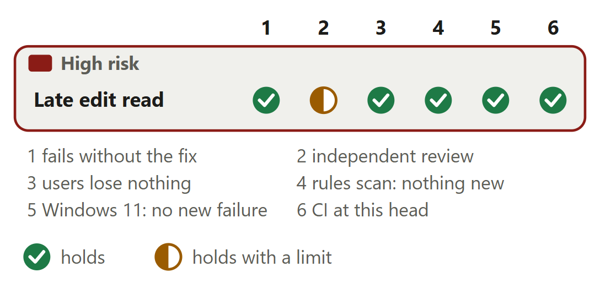

# Code rules: a late Claude Code edit is checked at its result

For [pull request #665](https://github.com/neralabs/rerail/pull/665), head 3c8939321. [report.html](report.html) is the same report as one page: download it and open it.

## 1. The decision

**Does every Claude Code edit `main` checks stay checked, now that an edit whose call arrived after its tool wrote is read from its result?**

**We recommend:** approve it: of 139 edits through a real daemon, 33 read better than `main` on Linux x64, 34 on Windows 11, none worse; one kind of late Write stays unchecked, as at `main`.

| Size | Risk and review | Waits on | Not verified |
|---|---|---|---|
| 1,118 lines in 8 files: 532 ship, 586 are tests and text | Careful. It changes what is checked: a code owner approves. | Nothing. CI passed at this head; no pull request needs it. | 4 |

## 2. Intent, and the gap

| Change | Intended | Found | Now |
|---|---|---|---|
| A late call | Read against the call's capture _(our reading)_ | A late capture holds the write _(daemon and hook runs)_ | Closes the gap. |
| Rewind, late edit | A rollback restores the preimage _(docs)_ | The late capture is the write _(automated review)_ | Closes the gap. |

Found on 13 November 2026 with busy Claude Code sessions on a Windows 11 machine. Run on Linux x64 and Windows 11 through 17 November.

Sources at main, and causes

| Change | Where main states the intent | The cause, and what was measured |
|---|---|---|
| A late call | `src/engine/code-rule/code-rule-bridge.ts` at `main`: `begin` captures each file the call names (`#capturePreimages`), and `#readEdit` returns no edit when `unchangedSince(source, preimage)` holds. `docs/reference.md`: "Pending calls and captured preimages survive daemon restarts." Nothing at `main` says what a call that arrives after its tool is read against. | Claude Code's `PreToolUse` hook gives up on a daemon too busy to answer in time, and the tool runs. The daemon then takes the call up and captures the file as the tool left it. At the result the file equals the capture, so `#readEdit` sees no change. No source file at `main`, at 0.1.4 or at 0.1.5 reads the result's `structuredPatch` or `originalFile`. |
| Rewind, late edit | `docs/reference.md` at `main`, on the `rewind` steer strategy: "if an edit's own check steers before its tool result is answered, every file the call captured returns to its preimage (created files deleted), all or none." It falls back to `message` "when the preimage was unreadable, the call didn't capture the file, or the steer came after the result was answered". | The automated reviewer found it at dcf3d7dd3: `finish` read the edit against the result's report and kept the call's own capture for the rollback. 47c47fc7f records whether every file was read against its capture; 6617b4301 compares the text, so a result that gives the capture's very text keeps the rollback. |

## 3. Where to look

1. **Read first**, 12 min: `reported-preimage.ts`: `claudeCodeReportedPreimage`, `placesBeforeWrite`, `unprovenCaptureBefore`, `capturedOtherThanMade`. Can a result place an on-time capture after the tool, or a late one before it?
2. 12 min: `code-rule-bridge.ts`: `editPreimage`, `changedSinceWrite`, `#takeRewindable`; `runtime.ts`: `#finishCall`.

**Then skim**, 8 min: The bridge's new cases name each late shape. `steer-strategy.test.ts` holds the rollback cases. `docs/reference.md` gains one paragraph on late edits. The release note says what stays unchecked.

## 4. Risk against verification

One half mark: four late Writes read at `main`'s level where an earlier commit of this branch checked them.

Each half mark's limit

| Change | Check | It holds with this limit |
|---|---|---|
| Late edit read | independent review | A second run of 139 edits through a real daemon and the built hook, `main` beside 11bd65a7b, on Linux x64 and Windows 11, found no edit read worse than at `main`. The limit: against 9e0059c26, an earlier commit of this branch, four late Writes read worse, at `main`'s level. |

## 5. The changes

**Late edit read from its result**, high risk: Of 12 late Claude Code Edits, `main` checks 1 and this change 12, on Linux x64 and Windows 11.

<b>6. The decisions</b>

**Which text is a late edit read against?**

**We chose** the tool result's own report, only where the capture cannot be placed before the tool. **Would change our mind:** a Claude Code version whose result no longer carries `structuredPatch` or `originalFile`: late edits would read as at `main`.

| Option | What a user gets | Cost | What it breaks |
|---|---|---|---|
| The result's report, where the capture cannot have come first **(chosen)** | A late Edit or Write is checked at its own result, against its own lines. On-time edits read as at `main`. | 351 lines that parse `structuredPatch` and `originalFile`; 0.9 ms per result for a 0.5 MB file on Linux x64. | An edit read this way is not rolled back under `rewind`: it steers as a message. |
| Leave it, as at `main` | Nothing checked for a late call. | Nothing. | 33 of 139 edits stay unchecked on Linux x64, 34 on Windows 11. |
| Check every late call over its whole file | Every late edit is checked. | A few lines. | The agent is steered on lines it did not write. |
| Tell a late call by when it arrived | Every case told apart. | A time on the call event: a change to the hook protocol. Not built. | Nothing known. |

**Evidence.** Through a real daemon and the built hook, with the call held until the tool wrote: of 12 late Edits, 10 are read against their own lines and 2 over the whole file here, against 1 checked at `main`. The two whole-file rows have no `originalFile` and a line a formatter rewrote. On-time rows read the same at both. Linux x64 and Windows 11 agree.

**What is a Write that made its file read against, when its capture differs?**

**We chose** the capture, as at `main`: no false steer, and one kind of late Write stays unchecked. **Would change our mind:** a maintainer's word that a false steer costs less than an unchecked new file.

| Option | What a user gets | Cost | What it breaks |
|---|---|---|---|
| Keep the capture whenever it is not the Write's `content` **(chosen)** | A file removed and made again steers only its new lines, as at `main`. A late Write in CRLF form, with a byte order mark or a last line ending is still read against an empty file. | Nothing. | A late Write whose new file a formatter changed first stays unchecked, as at `main`: 4 of 139 edits. |
| Read against an empty file once the file changed again | Those 4 late Writes are checked against their own lines, as at 9e0059c26. | Nothing. | The file removed and made again is steered on its old lines too, where `main` steers only the new one. |
| Record the file's state as the call arrives | Both are read right. | A time or a digest on the call event: a change to the hook protocol. Not built. | Nothing known. |

**Evidence.** The two states give the daemon the same facts: a result that says the Write made the file, and a capture with other text. The removed and remade file, 10 tries on each system: only the new function is told, at `main` and at 11bd65a7b. The 4 late Writes: own lines in 4 of 4 runs at 9e0059c26 on Linux x64, unchecked at 11bd65a7b and at `main` on both systems.

<b>7. How it fits</b>

Nothing has to merge first: it holds `main` at 44576f751 and merges with `main` at a9a543d04 without conflict. No open pull request needs it. #738 edits four of its files: one import line conflicts in `code-rule-bridge.ts` and one in its test file. Keep both lines.

**Related pull requests and issues.** Of the 15 other pull requests open on 17 November 2026, two edit a file this one edits, each trial-merged with 3c8939321. #738 (the team's, at 787fb6423): `code-rule-bridge.ts`, its test file, `runtime.ts` and `docs/reference.md`; one import line conflicts in each of the first two. #674 (ours, draft, at 6993ee854): `docs/reference.md` in other lines, no conflict. The 13 others share no file. #623, on calls made while a session's rules open, stays open: this no longer changes them. #548 lists the busy daemon.

<b>8. What is not covered</b>: 4 not verified, 4 smaller gaps, 4 limits that stay

1. **A late Write whose new file a formatter changed first** stays unchecked, as at `main`: 4 of 139 edits. 9e0059c26 checked them. Closing it needs the file's state at the call's arrival.
2. **How often a real call arrives late** is not measured.
3. **Codex, Cursor, OMP and Pi** results do not say what a file held: as at `main`.
4. **macOS** never ran.

**Smaller gaps**

- **A whole-file check of a late Edit.** With no `originalFile` and a line a formatter rewrote, a late Edit is checked over its whole file, so the agent can be told of a line it did not write: 2 of 12 late Edits. `main` checks nothing there.
- **A late Edit nothing rebuilds.** With no `originalFile`, a file that changed again and no longer holds the diff's lines, the edit stays unchecked at `main` and here: 1 of 9 rows.
- **A file made again with its old text.** An on-time Write over a file another process removed, made again with exactly its old text: the agent is told of a function its Write wrote back unchanged. `main` tells nothing there.
- **Published 0.1.4 and 0.1.5.** Read in their code, not run: at v0.1.4 and at 9cad73564, `#readEdit` reads a tool edit against the call's capture alone, and no source file reads `structuredPatch` or `originalFile`.

**Limits that stay**

- Calls made while a session's rules open are answered as at `main`: the first walk after the open checks each changed file whole.
- Under `rewind`, a late edit is steered as a message and stays in the file.
- A `rewind` rollback writes the call's capture back even when another writer changed the file between the call and the tool, as at `main`.
- A real Claude Code session was not run: the hook was fed the result shapes Claude Code 2.1.322 sends.

## 9. What we ask of you

We ask no ruling.

<b>10. Evidence</b>

The description on GitHub is the record. "How you tested it" holds the table of 139 edits, each defect a later run found with its fix, and the runs at 11bd65a7b.

| Where | What ran | Result |
|---|---|---|
| Linux x64, Windows 11 | 139 edits through a real daemon of each build and Rerail's built Claude Code hook, `main` at 44576f751 beside 11bd65a7b; a socket holds a late call's `PreToolUse` event until the tool wrote | Better than `main`: 33 on Linux x64, 34 on Windows 11. Worse: 0. Late Edits 11 of 12, late Writes that made the file 6 of 8, late Edits under `rewind` 3 of 4, the reference paragraph's cases 5 of 9, secret-like files 4 of 16 (5 on Windows 11), others 4 of 90. |
| Linux x64, Windows 11 | The two defects found at 9e0059c26, 10 tries each, `main` beside 11bd65a7b | An on-time Edit beside a tab, space, tab line under `rewind` rolls back in 10 of 10. An on-time Write over a removed and remade file tells only the new function in 10 of 10. Both as at `main`. |
| Linux x64, Windows 11 | Each fix taken out with the head's tests kept, and the new and changed cases 20 times in a row | Linux x64: 5, 1, 1 and 2 cases fail. Windows 11: 3 of 3, 3 of 3 and 20 of 20 runs fail. At 11bd65a7b 0 of 20 runs fail on each system, 10 cases a run. |
| Linux x64, Windows 11 | The 25 test files that import a changed module and two daemon files, at 11bd65a7b | Linux x64: 602 passed, 1 skipped, 0 failed. Windows 11: 600 passed, 3 skipped, 0 failed, nothing `main` does not fail too. |
| Linux x64 | CI's `Integration tests` job and the rules scan as the automated reviewer runs it, at 11bd65a7b | 22 of 22 files, 90 passed, 6 skipped; one file ran on a second machine. The scan: no new finding; all 59 functions added or edited at complexity 6 or under. |
| Linux x64 | The cost of reading the result per on-time Edit result, mean of 5 runs | 0.9 ms for a 0.05 MB and a 0.5 MB file, 13.6 ms for 5.1 MB, 35 ms for 15.7 MB. No timer is new or longer. |

**What this report adds to the description**

- **GitHub on 17 November 2026.** #665 is an open draft at dcf3d7dd3. The automated reviewer asked for changes there on 13 November: one blocker, four follow-ups, one nit. No person has reviewed it. This report describes 3c8939321, which was not pushed when it was written.

**Sources.** Pull request #665, its review and issue #623 on GitHub, read on 17 November 2026. Rerail at `main` (44576f751) for each quoted intent. Each count names the commit it ran at. The 15 other open pull requests on GitHub, each trial-merged with this head.

