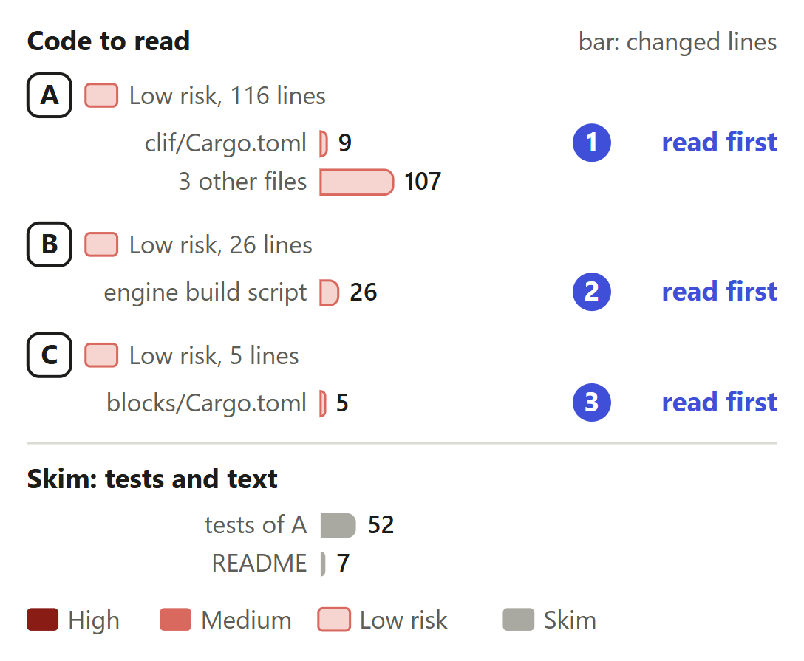
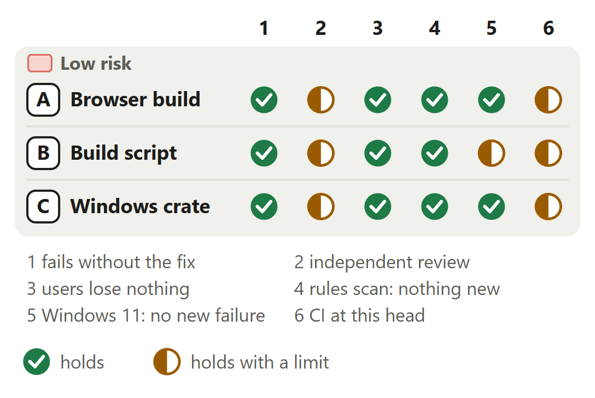

# The engine builds for the browser again, with two build fixes

For [pull request #912](https://github.com/neralabs/rerail/pull/912), head 57487d07f. [report.html](report.html) is the same report as one page: download it and open it.

## 1. The decision

**May the browser build leave out `rerail-clif`'s JIT of the reads, and may CI check that build with wasi-sdk?**

**We recommend:** approve it: the engine builds for the browser again and CI checks it, and `rerail-blocks` builds alone on Windows.

| Size | Risk and review | Waits on | Not verified |
|---|---|---|---|
| 206 lines in 8 files: 44 ship, 103 run in every test run, 59 are tests and text | Standard. Touches the CI workflow: a person approves. | A person's approval. The pull request is open; a person approves high-risk paths. | 2 |

## 2. Intent, and the gap

| Change | Intended | Found | Now |
|---|---|---|---|
| A. The browser build | The engine builds for wasm32 _(docs)_ | It fails in `region` _(one check per commit)_ | Closes the gap. |
| B. The farm check | Each build checks the farm's wrapper _(code comment)_ | A new configuration path goes unseen _(code reading)_ | Closes the gap. |
| C. One crate on Windows | The crate builds on Windows _(code comment)_ | Alone, it fails with E0432 _(one build per crate)_ | Closes the gap. |

Found on 19 November 2026 on Linux x64 machines and Windows 11 virtual machines, building the engine from source.

Sources at main, and causes

| Change | Where main states the intent | The cause, and what was measured |
|---|---|---|
| A. The browser build | `native/wasm/README.md` at bf24c778f, its first lines: "The engine library builds for `wasm32-wasip1`, so a page can run Rerail on files a reader types: the rule explorer beside the rule-syntax site"; its Build section gives `cargo check -p rerail-engine --lib --target wasm32-wasip1`. | `rerail-clif`'s default feature `ir` takes `cranelift-jit` on every target for `rerail_clif::jit`, which only tests use. On wasm every other crate takes the stand-in `native/wasm/cranelift-jit`, so `ir` alone brought the real JIT and its `region` into the browser build. No workflow builds this target. |
| B. The farm check | `native/build.rs` at 2221b5ec9, the comment above `check_compiler_cache`: on a machine with the build farm (its configuration exists), every build goes through the farm's wrapper. | Cargo runs a build script again only when a file or a variable it names changes; the script named `RUSTC_WRAPPER`, `RERAIL_FARM_ANY_ENV` and `RELAX_STD`. |
| C. One crate on Windows | `native/crates/blocks/Cargo.toml` at bf24c778f, line 13, above its `windows-sys` line, which asks for `Win32_Foundation` and `Win32_System_Memory` only; `src/windows.rs` imports `CreateFileMappingW`. | `windows-sys` declares `CreateFileMappingW` only with `Win32_Security`, since it takes security attributes. The engine's other crates ask for that feature, and cargo unifies features in one build, so only a build without them fails. |

## 3. Where to look

1. **Read first**, 5 min: `clif/Cargo.toml`: the `ir` feature and the target table. Does any native build lose `cranelift-jit`, or any wasm build still take it?
2. **Read first**, 2 min: `native/build.rs`: `check_compiler_cache` and `relax_build`. Does the script name every farm variable it reads?
3. **Read first**, 1 min: `blocks/Cargo.toml`: the `windows-sys` features. Does the crate ask for every feature its imports need?
4. 5 min: `lib.rs`, `env.sh` and `ci.yml`: the `jit` gate, the wasi-sdk path and its link order, the new job.

**Then skim**, 2 min: The README's new paragraph: how to build on Linux, and that CI checks the build.

## 4. Risk against verification

Three small changes, low risk: start at the manifest, where the JIT leaves the browser build.

Each half mark's limit

| Change | Check | It holds with this limit |
|---|---|---|
| A. Browser build | independent review | The automated reviewer read b681e3a1e: one follow-up, which libc++ the link takes, answered at this head. |
| B. Build script | independent review | The automated reviewer read b681e3a1e: one follow-up, which libc++ the link takes, answered at this head. |
| B. Build script | Windows 11: no new failure | No run sets `RERAIL_FARM_CONFIG` to another file: the change is one line cargo reads. |
| C. Windows crate | independent review | The automated reviewer read b681e3a1e: one follow-up, which libc++ the link takes, answered at this head. |
| A to C | CI at this head | CI passed at b681e3a1e; this head's run is to come. Its step's checks pass here on Linux x64. |

<b>5. The changes</b>

**A. Browser build, and its check**, low risk. The browser check: 10 errors at `main`, none here.

- **Problem:** The browser build the README gives, and the rule explorer's build, stop at 10 errors in `region`, which has no wasm32 code.
- **Who meets it:** Anyone building the rule explorer or a browser build from source at `main`, every time. No published version has a browser build.
- **What it does:** `rerail-clif` takes `cranelift-jit` off wasm only and leaves `jit` out there. `env.sh` takes a wasi-sdk named by `WASI_SDK_PATH`, its exceptions build of libc++ first. A CI job of its own checks the browser build, and the explorer's one-language build.
- **Risk:** Low: off wasm the manifest resolves as before, and the Homebrew path of `env.sh` is unchanged.
- **Check:** Does any native build lose `cranelift-jit`, or any wasm build still take it? Is the tarball's digest checked before it is used?
- **Picture:** Errors in the browser check: 10 at main, 0 with this change.
- **Method:** The CI step as written, in a new checkout with an empty target folder, once at `main` and once here, on Linux x64.

**B. The engine's build script**, low risk. The farm's variables the engine's build script names to cargo: 3 of 4 at `main`, 4 of 4 here.

- **Problem:** The engine's build script reads `RERAIL_FARM_CONFIG` but does not name it to cargo, so a build with another value keeps the last run's verdict on the farm's wrapper.
- **Who meets it:** Anyone building with the build farm who points `RERAIL_FARM_CONFIG` at another file.
- **What it does:** The script names `RERAIL_FARM_CONFIG` with `rerun-if-env-changed`, and its Relax test moves into `relax_build`.
- **Risk:** Low: one more line cargo reads; `relax_build` gives the same result.
- **Check:** Does the script name every farm variable it reads?
- **Picture:** The farm's variables the engine's build script reads and names to cargo with rerun-if-env-changed: 3 of 4 at main, 4 of 4 with this change.
- **Method:** The script's `rerun-if-env-changed` lines against the farm variables `check_compiler_cache` reads, at `main` 2221b5ec9 and here.

**C. One crate alone on Windows**, low risk. Crates that fail alone on Windows 11 for want of the feature: 4 at `main`, none here.

- **Problem:** `rerail-blocks` imports `CreateFileMappingW`, which `windows-sys` declares only with `Win32_Security`, so it fails to build alone on Windows, and so does every crate built on it alone.
- **Who meets it:** Anyone building one engine crate alone on Windows, such as `cargo test -p rerail-clif`. No published version has the crate.
- **What it does:** `rerail-blocks` asks `windows-sys` for `Win32_Security` itself.
- **Risk:** Low: the engine's other crates ask for the feature, so the engine's build had it already.
- **Check:** Does `rerail-blocks` now ask for every feature its imports need?
- **Picture:** Crates under native/crates that fail cargo check alone on Windows 11 for want of the feature: 4 at main, none with this change.
- **Method:** `cargo check -p <crate> --all-targets` for each crate under `native/crates`, alone, 4 jobs, on Windows 11 and Linux x64.

<b>6. The decisions</b>

**Should the browser build leave out the reads' JIT, or take the stand-in?**

**We chose** to leave it out: it only serves tests, which do not run on wasm. **Would change our mind:** A maintainer who wants every crate to follow one pattern for the JIT on wasm.

| Option | What a user gets | Cost | What it breaks |
|---|---|---|---|
| Leave `jit` out on wasm **(chosen)** | The browser build; nothing on wasm that could only fail there; `Cargo.lock` unchanged. | Two lines of manifest and one `cfg`. | `rerail-clif` differs from the other crates, which take the stand-in. |
| The stand-in in `rerail-clif`, as the other crates | The browser build, in the same form as the other crates. | A new dependency and a change to `Cargo.lock`. | `jit::Reads::new` would compile on wasm and panic at its first call. |

**Evidence.** `rerail_clif::jit` is used by `rerail-clif`'s and `rerail-tape-format`'s tests and one engine test, never by the engine; the browser check passes here with it left out.

**Which C toolchain should CI's browser check use?**

**We chose** wasi-sdk 34, pinned by its digest: the same toolchain on every run. **Would change our mind:** A maintainer who wants CI to run the README's Homebrew steps as written.

| Option | What a user gets | Cost | What it breaks |
|---|---|---|---|
| wasi-sdk 34, digest checked **(chosen)** | The same clang, wasi-libc and libc++ on every run; `env.sh` gains a Linux path. | A 192 MB download per run. | Nothing that runs today. |
| Homebrew on the runner | The README's steps as written. | An LLVM install per run. | Unpinned formulas can change under the check. |

**Evidence.** The step as written passed in a new checkout with an empty target folder on a Linux x64 machine, 174 s at 4 jobs at b681e3a1e and 148 s at this head, the download included.

<b>7. How it fits</b>

Nothing has to merge first, and no open pull request edits these files. #812 needs this for its browser branch to pass a check. Any order works. This one first is better: #812's and #909's next CI runs then check their code for this target.

This pull request stands on main 2221b5ec9, which it merges. An earlier head merged clean with #812, #883, #904 and #909, and the browser check passes merged with #812. Once it lands, the next CI runs of #812 and #909 check their code for the browser target.

**Trial merges and what merged today.** This head merges `main` 2221b5ec9, whose #830 rebuilt `ci.yml`'s jobs and fixed #901 as this branch had; the check runs in a job of its own, so its failure leaves `rust-clippy` and its compile cache as `main` has them. b00488a1d merged clean with #812, #883, #904 and #909, and b681e3a1e with #812. Merged with #812's head, the browser check passes, exit 0 in 172 s. #909 edits `native/src/tree_watch/`, which the check compiles.

<b>8. What is not covered</b>: 2 not verified, 4 limits that stay

1. **The browser engine** builds but still stops when it runs: the content store starts a thread for a new store's schema, and the browser has none. Its own report follows.
2. **macOS** never ran, nor `env.sh`'s Homebrew path.

**Limits that stay**

- `cargo clippy -- -D warnings` for this target stops on warnings `main` has: an unused variable in `rerail-blocks` and four in the engine. No check lints this target.
- `rerail-logic`'s example `versions` calls `libc::mmap` with no Unix gate, so `cargo check -p rerail-logic --all-targets` fails on Windows 11, at `main` as here. A dependency line cannot fix it: Windows has no `mmap`.
- CI checks the browser build and never links it: a link of the explorer's build adds 161 to 172 s at 4 jobs on our machines, past two minutes.
- For the maintainers, not changed here: the compile cache's save action uploads with no `overwrite: true`, and `rust-windows` saves also after a failed step, so on `main` a run again of a failed `rust-windows` can stop at its save.

## 9. What we ask of you

We ask no ruling.

<b>10. Evidence</b>

The description on GitHub is the record: "How you tested it" holds the runs on `main` and here.

| Where | What ran | Result |
|---|---|---|
| Linux x64 | The new CI step as written, in a new checkout with an empty target folder, at `main` and here; then merged with #812's head | At `main` bf24c778f the engine check exits 101, 10 errors in `region`. At b681e3a1e exit 0 in 174 s; merged with #812, exit 0 in 172 s. At this head, as `rust-wasm` writes it, exit 0 in 148 s. |
| Linux x64 | The CI step over a break only the explorer's build compiles: here, here without its new line, and as b00488a1d wrote it | Exit 101 here, E0308 at the break; exit 0 without the line and at b00488a1d. |
| Linux x64 | The explorer's build linked with `--trace` and wasi-sdk 34, at b681e3a1e and here; then again with wasi-sdk's libc++ built without exceptions copied beside libc | Both take `eh/libc++.a` and `eh/libc++abi.a`. With the copy beside libc, b681e3a1e takes it, exit 0; this head still takes `eh/`'s. |
| Linux x64 | #901's four steps as written, at `main` bf24c778f and at this head, with `main`'s fix from #830 | At `main` bf24c778f, step 3 exits 0 without the second checkout's line and step 4 exits 101. Here, step 3 stops on that line and step 4 exits 0. |
| Windows 11 and Linux x64 | `cargo test -p rerail-clif` and `-p rerail-tape-format` on Windows 11, and `cargo check -p <crate> --all-targets` for each of the 45 crates under `native/crates`, alone, at `main` and here | Tests: exit 101 at `main`, E0432; here 9 and 12 passed. Checks: Linux 45 pass; Windows 5 fail at `main`, the 4 on E0432 pass here, `rerail-logic`'s example fails at both. |
| Linux x64 | `check-rustfmt`, `npm run check:native`, CI's Lint and type-check job and three crates' tests at b681e3a1e; `check-rustfmt`, clippy and tests of three crates at 8628762c6, whose Rust files this head keeps; here, the lint job and the new test | All exit 0: 363 files formatted, clippy clean at `-D warnings`, `rerail-clif` 9, `rerail-tape-format` 12 and `rerail-blocks` 11 passed, the guard test passed. The new test: 3 passed here. |
| Linux x64 | The engine's library tests here; the ones that failed, again at `main` | 2775 passed, 22 failed, 146 ignored; `main` fails the same 22 on the same machine, 20 of them for pack test data it lacks. |
| Linux x64 | Rerail's reviewer rules at `main` 2221b5ec9, published and built from `main`, over this head | No new finding. Over df944a0d2, `check_compiler_cache` at complexity 8, now 6. |

**Sources.** The branch at 57487d07f and its diff against `main` 2221b5ec9, read on 20 November 2026; runs at it, at b681e3a1e, at b00488a1d and at `main` on Linux x64 machines and Windows 11 virtual machines.

