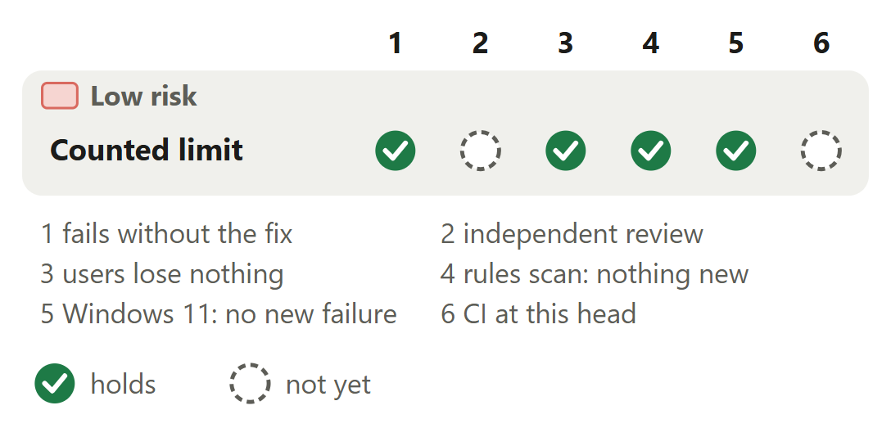

# The engine proof's holder case takes the holder's answer, not a race

For [pull request #988](https://github.com/neralabs/rerail/pull/988), head 9bca30a66. [report.html](report.html) is the same report as one page: download it and open it.

## 1. The decision

**May the engine proof's case for a pipe holder that answers give the proof a limit no case reaches, so the holder's answer decides?**

**We recommend:** approve it: with the holder made to answer after the proof's verdict, `main` fails the case in 10 of 10 runs with CI's words, and here it passes in every run.

| Size | Risk and review | Waits on | Not verified |
|---|---|---|---|
| 64 lines in 1 file: 0 ship, 64 are the tests it changes, 0 are other tests and text | Fast. One test file, no product code. | Nothing. No CI run yet: the branch is not on GitHub. | 1 |

## 2. Intent, and the gap

| Change | Intended | Found | Now |
|---|---|---|---|
| Verdict from the answer | Verdict from the holder's answer _(a test's name)_ | The limit outran PowerShell _(CI run, held runs)_ | Closes the gap. |

Found on 21 November 2026: CI run 44930696552 failed the case in the Windows unit job of a pull request that does not touch it.

Sources at main, and causes

| Change | Where main states the intent | The cause, and what was measured |
|---|---|---|
| Verdict from the answer | `test/runtime/engine-service/engine-proof.test.ts` at 1e80e3b04: the case expects `refused` from a holder that writes `HTTP/1.1 403 Forbidden` once its client connects, through `proveInAnotherProcess`, whose prober gives the proof a 1 s limit. | The holder writes only after `WaitForConnection()` returns and PowerShell runs its next lines, which nothing bounds on a loaded runner; the limit runs from the proof's ask. With the holder made to answer after the verdict, `main` failed 10 of 10 with CI's words, the process ending 12 to 429 ms after its answer, so the product's verdict and its prompt end both held. |

## 3. Where to look

1. **Read first**, 4 min: `engine-proof.test.ts`: `HELD_LIMIT_PROBER`, `holderThatNeverReads`, `proveOnceAsked`. Can the case's verdict now come from anything but the holder's answer?

**Then skim**, 1 min: The case still checks the verdict and that the process ends within 2 s of it; the other case of the group is unchanged.

## 4. Risk against verification

One change, low risk: one test file; the product and the case's assertions on the process's end are as they were.

Each limit, and each check that does not hold yet

| Change | Check | Its limit, or why it does not hold yet |
|---|---|---|
| Counted limit | independent review | No review by another reader yet. |
| Counted limit | CI at this head | No CI run at this head on GitHub yet: the branch is not on GitHub. |

## 5. The changes

**Holder answers on the test's word**, low risk: Windows 11, the holder's answer made late by hand: `main` failed 10 of 10; here none failed.

<b>6. The decisions</b>

**How does the case keep the proof's limit from deciding its verdict?**

**We chose** a 30 s limit the prober counts, and the holder answers on the test's word once the proof asked. **Would change our mind:** A maintainer who wants the limit itself checked here; the case beside it, a holder that never answers, checks it.

| Option | What a user gets | Cost | What it breaks |
|---|---|---|---|
| A 30 s limit the prober counts; the holder answers on the test's word **(chosen)** | The case passes however late PowerShell writes, and checks the answer's verdict, the process's end and that no limit stays pending. | 54 added and 10 removed lines in one test file. | Nothing found: the case fails if the proof ever sets a second timer. |
| A longer limit in the prober, the holder answering at once | A case that fails less often. | One number. | It still races PowerShell, and fails on a machine slow enough. |
| A limit the product takes from its caller | No global wrapped in the prober. | A product option only a test uses. | Nothing, but it widens the proof's interface for a test. |

**Evidence.** On Windows 11, with the holder made to answer after the proof's verdict, `main` failed 10 of 10 runs; with the holder answering after the proof asked, the verdict was `refused` and the process ended at once in every run, the proof setting one timer each time; with the limit left pending after the verdict, the case failed 2 of 2.

<b>7. How it fits</b>

Nothing has to merge first: three commits on `main` 1e80e3b04 and a merge of `main` 8b4c74cbe. #975 adds 39 lines to the same file; a trial merge with its head is clean.

<b>8. What is not covered</b>: 1 not verified, 1 limit that stays

1. **GitHub's Windows runner** never ran this head: the late answer was made by hand on our Windows 11 machines.

**Limits that stay**

- The case "also when the listener keeps the connection open" gives its listener the same 1 s limit to answer `proved`; that listener runs in the test's own process and answers at once, and no run failed it.

## 9. What we ask of you

We ask no ruling.

<b>10. Evidence</b>

The description on GitHub is the record: "How you tested it" holds the runs at `main` and here.

| Where | What ran | Result |
|---|---|---|
| Windows 11 | The case at `main` with the holder made to answer only after the proof's verdict, 10 runs | Failed 10 of 10 with `expected 'silent' to be 'refused'`, the process ending 12 to 429 ms after its answer. |
| Windows 11 | The file at `main`, alone and with the other 96 files of its CI shard | Alone: 30 of 30 passed. Beside the shard: the file's cases passed in 30 of 30 runs; each run failed the same 16 cases of three other files, none of this file. |
| Windows 11 | The file here, alone and with the other 96 files of its CI shard | Alone: 30 of 30 passed. Beside the shard: the file's cases passed in 30 of 30 runs (23 at 6ce644a8d, 7 at 9082694eb); cases of the same three other files failed as at `main`. |
| Windows 11 | The case here with the request kept, or the limit left pending, after the verdict | Failed in every run (5 of 5 and 2 of 2), the process running on 25 s after its answer. |
| Linux x64 | `tsc --noEmit`, the file, and CI's lint and type-check steps at the head | All exit 0; the file 3 passed, 13 skipped (the Windows groups), as at `main` 8b4c74cbe. |

**Sources.** The branch at 9bca30a66 and its diff against `main` 8b4c74cbe, read on 21 November 2026; runs at 6ce644a8d, 9082694eb (one comment line from the head) and the head, and at `main` 1e80e3b04 and 8b4c74cbe, on three Windows 11 x64 machines and two Linux x64 machines.

