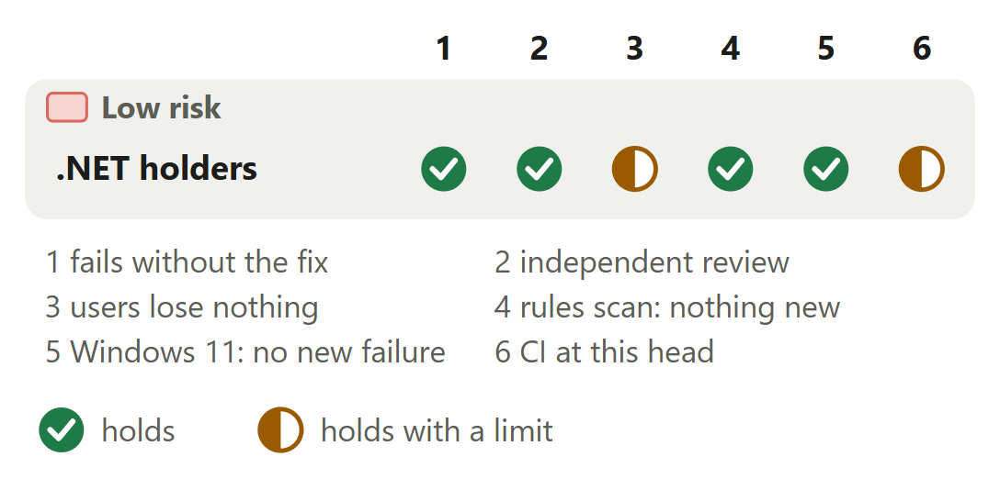

# The tests' Windows pipe holders start at once on any machine

For [pull request #961](https://github.com/neralabs/rerail/pull/961), head 87bb06278. [report.html](report.html) is the same report as one page: download it and open it.

## 1. The decision

**May both Windows pipe holders in the tests call .NET only, so their pipe exists before Windows PowerShell reads any module?**

**We recommend:** approve it: with the module reads held open by hand, the four cases that wait for a holder under a 30 or 45 s limit timed out before in every run and pass here.

| Size | Risk and review | Waits on | Not verified |
|---|---|---|---|
| 41 lines in 2 files: 0 ship, 41 are the tests it changes, 0 are other tests and text | Fast. Two test helpers, no product code. | Nothing. No CI run yet: the branch is not on GitHub. | 1 |

## 2. Intent, and the gap

| Change | Intended | Found | Now |
|---|---|---|---|
| Holder starts at once | The pipe exists at once _(helper comment)_ | Module reads came first _(timed runs)_ | Closes the gap. |
| Second holder starts promptly | The pipe exists at once _(helper comment)_ | Module reads came first _(timed runs)_ | Closes the gap. |

Found on 20 November 2026: CI run 44787771483 at e7957d7fd timed out on both cases in the Windows unit job.

Sources at main, and causes

| Change | Where main states the intent | The cause, and what was measured |
|---|---|---|
| Holder starts at once | `test/runtime/engine-service/engine-proof.test.ts` at d54b586a8, `holderThatNeverReads`. | The holder's script called `Add-Type` and `New-Object`, cmdlets whose module PowerShell looks up first. |
| Second holder starts promptly | `test/support/platform/one-instance-pipe.ts` at d54b586a8, `oneInstanceHolder`. | The helper's script called `Add-Type` and `New-Object` before its pipe existed, as the engine proof's holder did, and the socket cases wait for it inside the 30 s Windows test limit. |

## 3. Where to look

1. **Read first**, 3 min: `one-instance-pipe.ts`: `oneInstancePipeLines`, `oneInstanceHolder`. Is each pipe the same one: one instance, no input buffer, the same wait for its client?
2. 2 min: `engine-proof.test.ts`: `holderThatNeverReads`.

**Then skim**, 1 min: The five cases that start a holder are unchanged.

## 4. Risk against verification

One change, low risk: two test helpers; the product and every case's assertions are as they were.

Each half mark's limit

| Change | Check | It holds with this limit |
|---|---|---|
| .NET holders | users lose nothing | Windows 11 here: the three files whole 9 of 10 and 9 of 10 on two machines, and 10 of 10 as GitHub's runner holds its privileges. Each failed run failed one other daemon home case, which starts no holder: a 15 s and a 7 s wait. Alone, both passed 10 of 10 at `main` and here. |
| .NET holders | CI at this head | No CI run at this head on GitHub yet: the branch is not on GitHub. |

## 5. The changes

**Pipe holders built through .NET calls**, low risk: Windows 11, module reads held open by hand: before, the four cases timed out in every run; here none did.

<b>6. The decisions</b>

**How does the holder make its pipe without waiting on the machine's modules?**

**We chose** it calls .NET only, so Windows PowerShell looks up no module. **Would change our mind:** A machine whose PowerShell runs in Constrained Language Mode, which refuses .NET's static methods; it refuses `Add-Type` too.

| Option | What a user gets | Cost | What it breaks |
|---|---|---|---|
| .NET calls only **(chosen)** | The holder starts in under half a second whatever the machine has installed. | 32 added and 9 removed lines in two test files. | Nothing found. |
| Start the holder in a hook with a longer limit | The case's 45 s no longer holds the wait. | A hook per case. | It raises a limit: the wait stays unbounded, only elsewhere. |

**Evidence.** On Windows 11, with 40 large modules first on PSModulePath and unread, `main` timed out in 10 of 10 runs and this head passed 10 of 10.

**Where do the pipe's lines live?**

**We chose** one function in the helper both holders call, so the reason no cmdlet may come first is written once. **Would change our mind:** A holder whose pipe needs a setting the function does not take.

| Option | What a user gets | Cost | What it breaks |
|---|---|---|---|
| One function, `oneInstancePipeLines` **(chosen)** | One place to read and change the pipe's lines and the reason for them. | An import in `engine-proof.test.ts`, as `engine-service-socket.test.ts` beside it has. | Nothing found. |
| The same lines in each file | No import. | Two copies of the lines and of the reason. | A later holder can copy the old form again. |

**Evidence.** Both scripts ran under the hold here; the engine proof's is the same text as at a3933b8fc.

<b>7. How it fits</b>

Nothing has to merge first: two commits on `main` d54b586a8, and `main` has not touched their files since. It edits two test files: `engine-proof.test.ts` and `one-instance-pipe.ts`.

<b>8. What is not covered</b>: 1 not verified, 2 limits that stay

1. **GitHub's Windows image** never ran here: its modules were stood in for by hand.

**Limits that stay**

- Four other test helpers start Windows PowerShell with a cmdlet first and wait inside a case's limit: `holdOplock` and `holdDeletePending` (`Add-Type`), the launch case's script (`New-Object`), `processTable` (`Get-CimInstance`). None failed in CI.
- Two more call a cmdlet the case checks on purpose: the Cursor hook case pipes through `Get-Content`, and the Windows install steps' tests run `windows-host.ps1`.

## 9. What we ask of you

We ask no ruling.

<b>10. Evidence</b>

The description on GitHub is the record: "How you tested it" holds the runs on `main` and here.

| Where | What ran | Result |
|---|---|---|
| Windows 11 | The engine proof's two cases with 40 large modules first on PSModulePath, unread, at `main` d54b586a8 and at a3933b8fc | `main`: timed out 10 of 10, CI's message. a3933b8fc: passed 10 of 10. |
| Windows 11 | The two socket cases and the daemon home case under the same hold, at a3933b8fc and here | Socket: timed out 10 of 10 at a3933b8fc, passed 10 of 10 here. Daemon home: passed 10 of 10 in 54 to 65 s at a3933b8fc, 10 of 10 in 6 to 7 s here. |
| Windows 11 | The three cases here with a capped holder's EBUSY read as free, or asked for the proof | Each failed 3 of 3 runs with either change. |
| Windows 11 | The engine proof's two cases with the proof's request kept open at its verdict | 3 of 3 runs, each process running on 25 s after its answer. |
| Windows 11 | The three files whole here, on two machines and as GitHub's runner holds its privileges | 9 of 10, 9 of 10 and 10 of 10; each failed run, one other daemon home case that starts no holder. Alone, both passed 10 of 10 at `main` and here. |

**Sources.** The branch at 69fd86eb2 and its diff against `main` d54b586a8, read on 20 November 2026; runs at 69fd86eb2, a3933b8fc and `main` d54b586a8 on three Windows 11 x64 machines and two Linux x64 machines.

