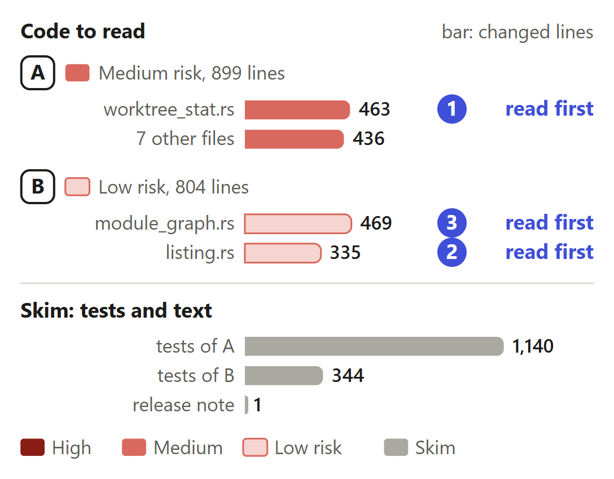
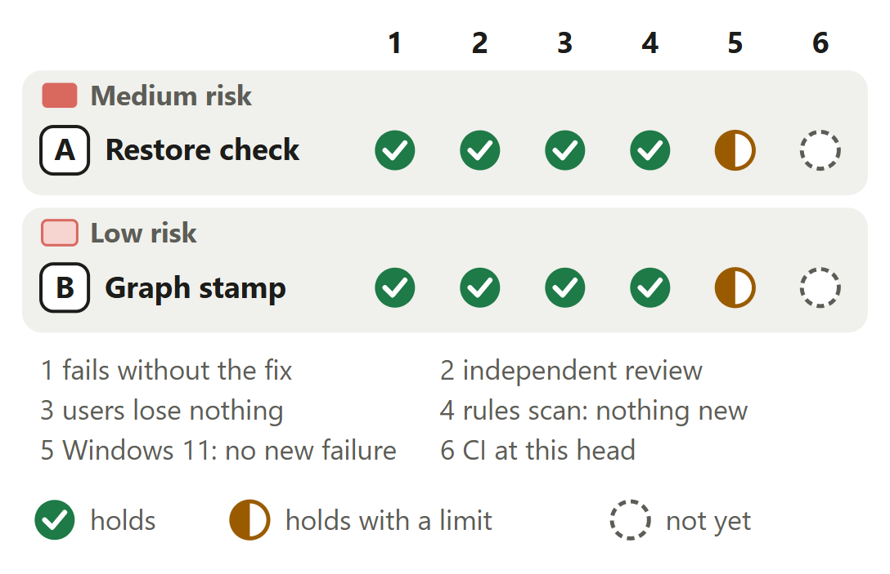

# Engine: Windows reads files edited with their size and time kept

For [pull request #921](https://github.com/neralabs/rerail/pull/921), head 3c9056fd7. [report.html](report.html) is the same report as one page: download it and open it.

## 1. The decision

**Should the Windows restore trust a clean file's stat only while its change time is unchanged since its write or since a restore hashed it?**

1. Trust the stat while nothing changed the file since its write or its last hash.

**We recommend:** approve it: a scan then reads a file edited with its time kept, and still restores untouched files and files marked as placeholders or offline unread.

| Size | Risk and review | Waits on | Not verified |
|---|---|---|---|
| 3,188 lines in 19 files: 1,703 ship, 1,485 are tests and text | Careful. A code owner rules on trust and a new table. | Nothing. It stands alone on `main`; no pull request needs it. | 5 |

## 2. Intent, and the gap

| Change | Intended | Found | Now |
|---|---|---|---|
| A. Restore by stat | Any write ends the stat proof _(code comment)_ | On Windows it does not _(runs through the product)_ | Closes the gap, changes answer 1. |
| B. Server graph summary cache | A kept-time rewrite is read again _(code comment)_ | On Windows it was not _(engine test, Windows 11)_ | Closes the gap. |

Found on 18 November 2026 when the engine's tests ran on Windows 11; CI runs none of them on Windows.

Sources at main, and causes

| Change | Where main states the intent | The cause, and what was measured |
|---|---|---|
| A. Restore by stat | `native/src/git_workspace.rs` at `main` (cccb25a8d), the comment on `RESTORE_STAT` and `GitWorkspace::holds_blob_bytes`. | gix's `Stat::from_fs` puts the creation time in the change-time field on Windows and 0 in the inode, device and owner fields, as Git for Windows does, so a write that keeps the size and puts the modification time back leaves the stat equal. |
| B. Server graph summary cache | `native/src/code_rule_dsl/module_graph.rs` at `main` (cccb25a8d), the comment on `Stamp`. | `Stamp` kept its change time and inode under `#[cfg(unix)]` only, and std's `read_dir` gives no change time on Windows. |

## 3. Where to look

1. **Read first**, 10 min: `worktree_stat.rs`: `VerifiedFiles::proof`, `learn`, `stat_decides`. Can changed bytes pass the proof or a remembered change time?
2. **Read first**, 10 min: `listing.rs`: `listed`, `entries_of`, `entry_of`, `kind_of`. Does each entry get what `read_dir` gives?
3. **Read first**, 5 min: `module_graph.rs`: `Stamp`, `same_write`, `walk`, `on_disk` and the steps they split into. Do the split walk and `on_disk` cache as before?
4. 10 min: `git_workspace.rs`, `verified_files.rs`, `schema.rs`, `index.rs`, `mod.rs`, `Cargo.toml`, `Cargo.lock`: call, table, split.

**Then skim**, 5 min: Cases at `holds_blob_bytes`, the store and the warm index, and three written the way Windows takes paths.

## 4. Risk against verification

Start with `VerifiedFiles::proof`: it decides when a restore trusts a file without reading it.

Each limit, and each check that does not hold yet

| Change | Check | Its limit, or why it does not hold yet |
|---|---|---|
| A. Restore check | Windows 11: no new failure | FAT, exFAT, ReFS, network shares and a cloud provider were not run: a change time of 0, a share's answer and the two placeholder attributes only a provider sets are handed to the proof at the engine's seam. |
| B. Graph stamp | Windows 11: no new failure | The fallback to `read_dir` ran only with an error handed to it; no file system that refuses the listing class was run. |
| A and B | CI at this head | The pull request's own CI run, which starts when it opens. |

<b>5. The changes</b>

**A. Windows restore and its memory**, medium risk. Windows 11, `pront(1)` edited to `print(1)` with its time kept: no violation in three scans at `main`.

- **Problem:** On Windows a warm index restored a clean file's old results when the file was rewritten at the same size with its modification time put back.
- **Who meets it:** Anyone on Windows whose checkout gets a file rewritten in place by a tool that puts its time back, as `touch -r` does, between scans.
- **What it does:** On Windows the restore also reads NTFS's change time through the handle the stat opens; the stat proves the bytes while it equals the modification time, or the change time at which a restore last hashed the file, which the content store keeps with the file's id.
- **Risk:** Medium: an additive table in the content store. A file whose times a tool set is read once, then restored as at `main`. Placeholders, offline and unreadable files keep the stat's answer.
- **Check:** That no file whose bytes changed passes the stat proof, and that an untouched file still passes it without a hash.
- **Picture:** The engine's warm scan of 2,000 files whose times were set, Windows 11, a quiet machine, on the 0.2.0 engine: 166 ms at main, 186.5 ms at the head.
- **Method:** Three `rerail scan --session` runs through a real daemon around one edit on Windows 11 at `main` and at the head; warm scans of 2,000 files through the daemon, three rounds a side; the engine's cases and their mutants on Windows 11 and Linux x64.

**B. Windows server graph stamp**, low risk. Windows 11, `app/a.ts` turned `'use client'` at the same size and time: the server graph kept it and `app/b.ts`.

- **Problem:** On Windows the server graph's disk walk kept a source's cached summary after a same-size rewrite that put its modification time back.
- **Who meets it:** Anyone on Windows with a rule that reads `file.package.serverGraph`, whose Next app gets a source rewritten in place with its time kept while the daemon runs.
- **What it does:** On Windows the walk lists each folder from its handle's `FileIdBothDirectoryInfo`, a page at a time, so each source's stamp holds NTFS's change time and file id at no call more than `read_dir`.
- **Risk:** Low: a folder's pages are read as the walk takes its entries, and `read_dir` lists a folder whose pages fail for any reason but the folder gone. A source that cannot be read keeps its summary, as at `main`.
- **Check:** That the listing gives the kinds std's `FileType` gives (a link is neither folder nor file), and that no source whose bytes changed keeps its summary.
- **Picture:** The warm walk of this repository's tree on Windows 11: 44 ms at main, 32 ms at the head.
- **Method:** The engine's rewrite case on Windows 11 with `main`'s code and at the head; five cold and warm walks of this repository's tree, `main` beside each form.

<b>6. The decisions</b>

**How does a restore on Windows tell an untouched file from an edited one?** (ask 1)

**We chose** change time equal to the modification time, or to the one a restore last hashed, kept with the file's id. **Would change our mind:** a checkout file system whose change time misses writes.

| Option | What a user gets | Cost | What it breaks |
|---|---|---|---|
| Change time equal to modification time, or to a hashed one **(chosen)** | The edited file is read; untouched files, and files whose times were set once a later scan read them, are restored by stat. | After a time set, one read per file; then about 10 microseconds a file more than `main`. | FAT, exFAT, shares, placeholders: the stat decides, as at `main`. |
| Change time equal to modification time alone | The edited file is read. | Every file whose times were set is read on every scan: 531.5 ms against 201.5 ms per warm scan of 2,000, before the 0.2.0 engine. | Nothing. |
| Keep Rerail's own stat of each file from discovery | Edits after discovery are read. | A stored field and a write per file. | Edits before discovery, which Git for Windows calls clean. |

**Evidence.** Through the daemon on Windows 11, 2,000 committed files whose times were set, three rounds a side on one machine, release engines; the engine's own time for each scan.

**How does the server graph's walk get each source's change time on Windows?**

**We chose** the folder handle's `FileIdBothDirectoryInfo`, in place of `read_dir`. **Would change our mind:** a file system people keep checkouts on that lists folders but refuses this class.

| Option | What a user gets | Cost | What it breaks |
|---|---|---|---|
| The folder's `FileIdBothDirectoryInfo` **(chosen)** | A rewritten source is read again; untouched ones keep their summary. | None measured: warm walk 43 ms against 52 ms at `main` (medians of 5). | A file system that refuses the class is listed by `read_dir`, as at `main`. |
| One handle per source | As chosen. | Warm walk 78 ms against 52 ms, slower in each of 5 rounds. | Nothing. |
| Leave it as `main` has it | The stale summary. | Nothing. | The rewrite. |

**Evidence.** One test binary with the three forms, this repository's tree (1,109 sources) on Windows 11, five rounds in a rotating order; cold walks about 10 s for each.

<b>7. How it fits</b>

Nothing has to merge first: it holds `main` at df9358d3f, with the 0.2.0 engine. #812 shares two test files, not their lines; its head merges clean.

This change holds main at df9358d3f, with the 0.2.0 engine, and merges with main at 6ec384ad9 cleanly. Trial merges with #812, #883 and #904 are clean.

**Shared files and trial merges.** Trial merges with this head, read from GitHub on 20 November: `main` at 6ec384ad9 merges clean (#898, #905 and #884 merged after df9358d3f and touch none of these files). #812 at 4f814b43b, #883 at 0603dea82 and #904 at 11e62d867 each merge clean; #883 and #904 share no file.

<b>8. What is not covered</b>: 5 not verified

1. **The published 0.1.4** read, not run; 0.1.5 ran from npm on Windows 11.
2. **macOS** never ran; its stat holds the change time.
3. **The listing's fallback** ran only with an error handed to it.
4. **FAT, exFAT, ReFS and network shares** never ran; the stat decides but on ReFS; the engine's seam shows a zero change time and a share.
5. **A cloud provider** never ran; an offline file ran through the daemon, its attributes at the engine's seam.

## 9. What we ask of you

Ask 1 rules on answer 1.

1. **May a Windows scan read a file Git for Windows still calls clean, when its change time moved?** We recommend yes: the rules check what the file holds.
2. **May the store keep the change time at which a file's hash matched its blob?** We recommend yes: nothing else keeps it across daemon starts.

<b>10. Evidence</b>

The description on GitHub is the record: "How you tested it" holds the failing tests, the runs and the counts.

**Sources.** Rerail at `main` (890802859, f41b8fe6c, cf5ab9083, cccb25a8d and df9358d3f) for the quoted intent; each count names the commit and the kind of machine it ran on.

