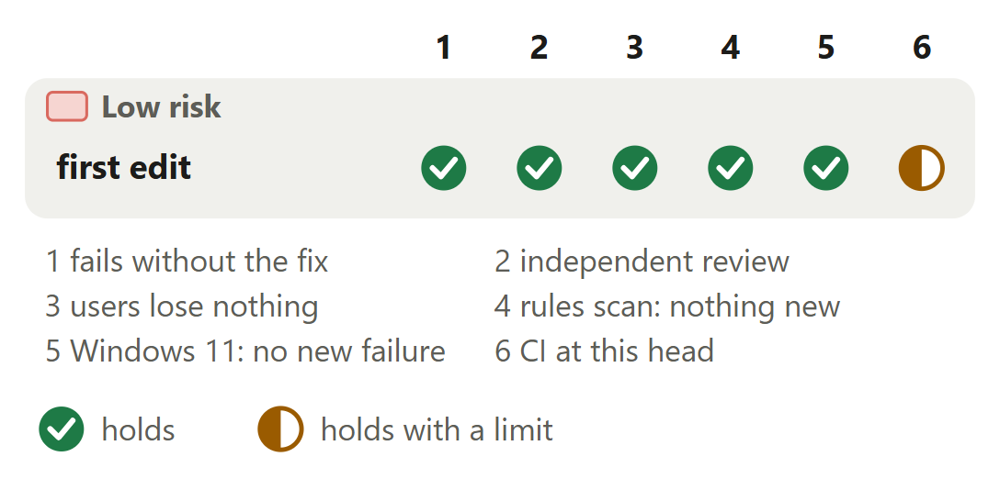

# Two integration cases wait for a new session's code rules

For [pull request #1062](https://github.com/neralabs/rerail/pull/1062), head 4f686a03e6. [report.html](report.html) is the same report as one page: download it and open it.

## 1. The decision

**May two integration cases wait for a new session's code rules before the edit whose steer they read, and list processes on Windows through PowerShell?**

**We recommend:** approve it: test code only; the product does what its docs promise, and on one Windows 11 machine both cases fail at `main` and pass with this change.

| Size | Risk and review | Waits on | Not verified |
|---|---|---|---|
| 63 lines in 2 files: 0 ship, 63 are the tests it changes, 0 are other tests and text | Fast. Two test files, no product code. | Nothing. CI on GitHub runs at this head. | 2 |

## 2. Intent, and the gap

| Change | Intended | Found | Now |
|---|---|---|---|
| The first edit's steer | First edits checked in the next pass _(docs)_ | Cases read the steer at once _(test run)_ | Closes the gap. |
| Windows runner check | No runner left, on every system _(test name)_ | Windows failed the check itself _(test run)_ | Closes the gap. |

Found on 24 November 2026, when `main`'s integration runs failed by chance on a busy Windows 11 machine.

Sources at main, and causes

| Change | Where main states the intent | The cause, and what was measured |
|---|---|---|
| The first edit's steer | `docs/in-session-surfaces.md`, "Edits made by shell commands and before rules are ready", at `main` be0def9c3. | A first start of a session waits for no index, by design; the cases asked more than the product promises. |
| Windows runner check | `integration/rerail-pack-rules.test.ts:231` at `main` be0def9c3. | Unix-only process listing, and a reader opened at each poll and never closed. |

## 3. Where to look

1. **Read first**, 3 min: `claude-hook-rules.test.ts`: the wait in `startSession()`. Does a read that records no `code-rules-pending` event show the rules running?
2. 4 min: `rerail-pack-rules.test.ts`: `awaitCodeRules()`, `windowsChildren()` and `audits()`.

**Then skim**, 1 min: Nothing else changes.

## 4. Risk against verification

One change, low risk: two test files; the product is as it was.

Each half mark's limit

| Change | Check | It holds with this limit |
|---|---|---|
| first edit | CI at this head | CI's integration job runs on Linux only, so it never ran the deadline case on Windows. |

## 5. The changes

**Two cases wait for the rules**, low risk: A new session's first edit is steered once its rules run; both cases now wait for that.

<b>6. The decisions</b>

**How does a case read a new session's first steer without asking more than promised?**

**We chose** it waits for the session's code rules through Read calls that edit nothing, until one records no `code-rules-pending` event. **Would change our mind:** A product change that makes a first start wait for its rules, as a reopened session does for up to 20 seconds.

| Option | What a user gets | Cost | What it breaks |
|---|---|---|---|
| Wait for the rules through reads, then edit **(chosen)** | The case reads the steer at the edit's own answer, as before, once the product promises it. | One more hook pair per probe, usually one probe. | Nothing: the helper is the one two other files use. |
| Read the steer at the next call or the turn's end | No wait. | Nothing. | The case no longer shows that an edit is steered under itself once rules run. |
| A longer wait or a retry of the edit | Fewer failures. | Seconds a run. | Still a clock or a guess: a slower machine fails it again. |

**Evidence.** At every miss the session's record showed the rules still opening; with the wait, the cases passed on the machine where `main` fails them.

<b>7. How it fits</b>

Nothing has to merge first: three commits on `main` be0def9c3. #1051 also edits `claude-hook-rules.test.ts`, in other lines; Git merges the two in either order.

<b>8. What is not covered</b>: 2 not verified, 1 limit that stays

1. **macOS** never ran.
2. **OMP's engine contract case** has the same shape through a real OMP; not changed here.

**Limits that stay**

- The wait reads the session's own record: a product change that stopped recording `code-rules-pending` would make it pass at once.

## 9. What we ask of you

We ask no ruling.

<b>10. Evidence</b>

The description on GitHub is the record: "How you tested it" holds the runs at `main` and at this head.

| Where | What ran | Result |
|---|---|---|
| Windows 11 | Each case at `main`, on a machine whose test folder is on a hard disk, beside other runs | The hook case failed 6 of 9 runs; the deadline case 3 of 3. |
| Windows 11 | Both cases alone, this change and `main` in turn, on the same machine | 4 of 4 passed here; 4 of 4 failed at `main`, at lines 335 and 238 and once in the file's set-up. |
| Windows 11 | Each changed file, 30 runs | `rerail-pack-rules.test.ts` 30 of 30; `claude-hook-rules.test.ts` 30 of 30, on two machines. |
| Linux x64 | Each changed file, 30 runs | `rerail-pack-rules.test.ts` 30 of 30; `claude-hook-rules.test.ts` 26 of 26. |

**Sources.** The branch at 4f686a03e6 and its diff against `main` be0def9c3, read on 25 November 2026; runs on Linux x64 machines and Windows 11 machines.

