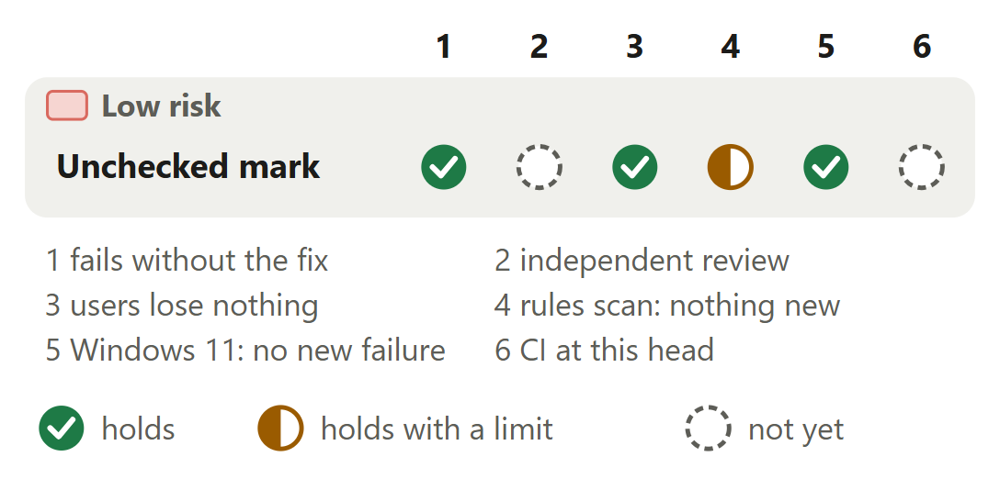

# A worktree written before its first read is named on the record

For [pull request #1105](https://github.com/neralabs/rerail/pull/1105), head e129300677. [report.html](report.html) is the same report as one page: download it and open it.

## 1. The decision

**May a worktree's first read name it on the session's record when it finds a file no rule checked, whoever wrote that file?**

1. A session's record names a worktree whose first read found an unchecked file.

**We recommend:** approve it: the file stays no one's, as #738 decided, and a person sees one line naming the worktree and the command that checks it, where today nothing shows.

| Size | Risk and review | Waits on | Not verified |
|---|---|---|---|
| 306 lines in 6 files: 48 ship, 258 are tests and text | Careful. It adds a reason to the record's unchecked places. | Nothing. CI has not run at this head. | 3 |

## 2. Intent, and the gap

| Change | Intended | Found | Now |
|---|---|---|---|
| A worktree's first read | First read is the baseline _(docs)_ | Early write leaves no trace _(runs through the hook)_ | Closes the gap, changes answer 1. |

Found 25 November 2026 running an agent's worktree commands through the hook on Linux x64 and Windows 11 machines.

Sources at main, and causes

| Change | Where main states the intent | The cause, and what was measured |
|---|---|---|
| A worktree's first read | `docs/rule-scoping.md` line 289 at d54013c841, the sentence quoted. `src/engine/code-rule/code-rule-bridge.ts` at d54013c841: `#claimOwnWrites` (line 4324) sets a change no call of the session made and no walk handed it aside as another writer's (line 4342), and nothing tells the record. | The first read is the worktree's baseline, so a file found there is no session's and not the repository's. The record's list of places the walks could not check (#922) takes folders and files a walk could not read, and nothing else, so the record says nothing of the worktree. A headless scan of the worktree found the file in each run. |

## 3. Where to look

1. **Read first**, 5 min: `code-rule-bridge.ts`: `#claimOwnWrites`, `#markUncheckedFirstRead`, `#otherWorktreeOf`, `worktreeGaps`, `walkGaps`, `saidGaps`. Can a worktree still in `fresh` at `#claimOwnWrites` be one the session's walks read before?
2. 1 min: `operations.ts`: the `discoveryGaps` description lists the new reason.

**Then skim**, 4 min: `first-read-marks.test.ts`: three cases mark, five do not; the docs paragraphs and the release note say what a person sees.

## 4. Risk against verification

One change, low risk: one more place in a list the record already shows; nothing is recorded or steered differently.

Each limit, and each check that does not hold yet

| Change | Check | Its limit, or why it does not hold yet |
|---|---|---|
| Unchecked mark | independent review | No review independent of the author has read this head. |
| Unchecked mark | rules scan: nothing new | With Rerail built from `main` d54013c841 the reviewer's rules give no new finding; added or edited functions at most 3. The published 0.2.1 could not load `main`'s own pack, so that scan gave none. |
| Unchecked mark | CI at this head | The repository's CI has not run at this head. The commit hook's checks pass. |

## 5. The changes

**First read marks unchecked worktree**, low risk: One command adds a worktree and writes there: marked 0 of 10 runs at `main`, 10 of 10 here.

<b>6. The decisions</b>

**Mark on any change the first read finds, or only on the session's own?**

**We chose** any change no call of the session made there: the narrower test marked none of the runs it was for. **Would change our mind:** A way to tell, at the first read, that the session's own command wrote the file, which needs call times kept until then.

| Option | What a user gets | Cost | What it breaks |
|---|---|---|---|
| Mark on any such change the first read finds **(chosen)** | The early write marks the record 10 of 10 runs through the hook; the later write stays one Log entry for the repository. | No Git process; one entry per worktree. | None of `main`'s cases. An editor's or another session's file marks too: 15 marks, 5 of them the session's own, in a test of three sessions and 12 worktrees. |
| Mark only when one of the session's calls ran as the file was written | Fewer marks, in principle. | A call window kept per session. | It marked 0 of 10 runs: a call in the session's folder is let go once that folder's walk answers it, before the worktree's first read. |
| Record the file for the session whose call ran as it was written | A steer on the early write, by timing. | No Git process. | It names the wrong session, an editor's file becoming another session's edit, and fails one of `main`'s cases; it reverses #738. |
| Record the file for the repository | One Log entry in both orders. | No Git process. | It fails 5 of `main`'s cases: a write before a worktree's first walk, a resumed session, and three of a worktree removed and added again. |

**Evidence.** Each option was built and run through the hook (10 runs per order) and against the worktree walks' two test files whole, at an earlier `main` with the same rule. A sixth, the command that added the worktree owning what is written there while it runs, is not built: it needs that command's time kept until the first read, and it narrows #738's rule.

<b>7. How it fits</b>

It stands alone on `main` 80cfc21dec, by Git's own merge, and needs nothing first. #1095 and one draft edit other lines of its files; `git merge-tree` with each head finds no conflict.

<b>8. What is not covered</b>: 3 not verified, 2 smaller gaps, 2 limits that stay

1. **macOS** never ran; the change reads no path in a new way.
2. **Daemon restart** after a restart every worktree's next read is a first read; not run. A suspension and reopen in one daemon was, and marks nothing.
3. **A committed early file** a file the command also commits in the new worktree before the first read: not run.

**Smaller gaps**

- **Who wrote it.** The mark says a file went unchecked, not whose it is: every session whose first read finds the file is marked.
- **The scan it names.** `rerail scan` is in internal testing: run as written it refuses and names the setting it needs, as the record's other reasons name no setting.

**Limits that stay**

- A file written before the session opened marks nothing: the first read takes only files stamped since the session opened, as at `main`.
- A coding agent gets the count of places only, as for every reason the record lists.

## 9. What we ask of you

Ask 1 rules on answer 1.

1. **May the mark go on every session whose first read finds the file, though it cannot tell whose it is?** We recommend yes: for each of them the file went unchecked..

<b>10. Evidence</b>

The description on GitHub is the record: "How you tested it" holds the runs at `main` and here.

| Where | What ran | Result |
|---|---|---|
| Windows 11 | Through the hook at `main` d54013c841: one command adds a worktree and writes, or a later command writes; 10 runs each | Write first: 10 no record, 0 marked. Read first: 10 one Log entry for the repository, 0 marked. Linux x64 at an earlier `main` ca72d63ba1: the same. |
| Windows 11 | The same at this head | Write first: 10 no record, 10 marked with `../w`. Read first: 10 one Log entry, 0 marked. Linux x64 at 5007463dec: the same. Steered 0 of 80; a headless scan found the file in 80 of 80. |
| Linux x64 | The new test file over `main`'s source and here, and each deciding line taken out | 3 marking cases fail at `main`, 8 of 8 pass here; 4 of 4 lines taken out fail a case. |
| Linux x64 | The worktree walks' two test files and the importing test files, here and at `main` | Walks: 356 passed, 3 skipped, and 62 passed at both. Importing files: 794 passed, 7 skipped here; 786 and 7 at `main`; none failed. |
| Linux x64 | Git processes at a first read beside 1, 20 and 100 new worktrees, `main` then the change, twice | 22 and 401 at both; 1,951 to 1,958 beside 100, run to run. |
| Linux x64 | Three sessions whose agents add 12 worktrees in five shapes, one suspension | 15 marks, 5 of them the marked session's own early write; no early write unmarked. |
| Windows 11 | The new test file, 30 runs at this head; the importing test files once | 30 of 30, 8 cases each, with the engine built for its native tree. Importing files: 799 passed, 2 skipped here. |

**Sources.** The branch at e129300677 and its diff against `main` d54013c841, read on 25 November 2026; runs on 16-processor Linux x64 machines and Windows 11 machines.

