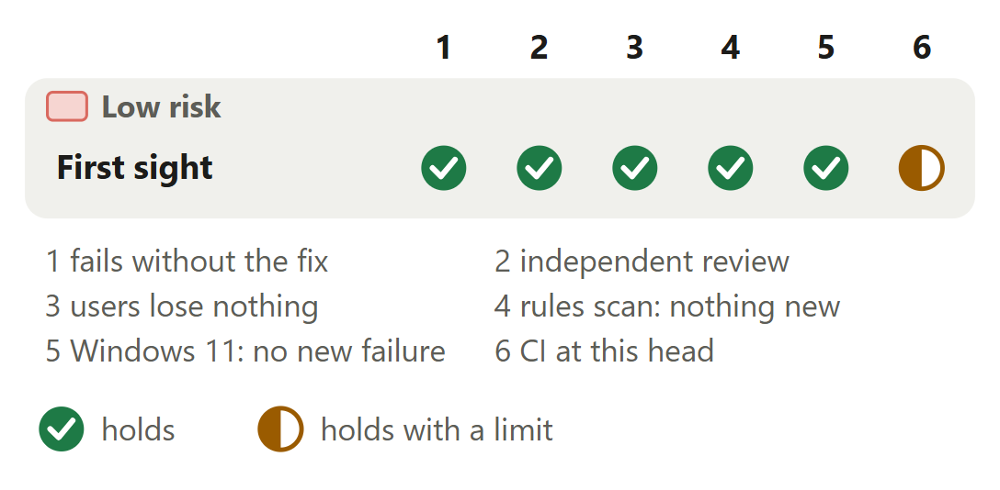

# A worktree removed as Rerail first reads it records no files

For [pull request #911](https://github.com/neralabs/rerail/pull/911), head e0b0eba3c. [report.html](report.html) is the same report as one page: download it and open it.

## 1. The decision

**May the other worktrees' walk drop a first-seen worktree's files, and a known one's deletions, once its `.git` entry is gone after Git answered?**

**We recommend:** approve it: a worktree removed as Rerail reads it no longer fills the Log or holds back the next Write's steer, and a worktree that stays is still checked as before.

| Size | Risk and review | Waits on | Not verified |
|---|---|---|---|
| 168 lines in 2 files: 77 ship, 91 are tests and text | Fast. Low risk, no high-risk path. | Nothing. No CI run on GitHub yet: not opened. | 1 |

## 2. Intent, and the gap

| Change | Intended | Found | Now |
|---|---|---|---|
| Removed worktree files | A removed worktree's files are no edits _(code comment)_ | About 200 recorded at first sight _(loop through the hooks)_ | Closes the gap. |

Found on 19 November 2026 measuring tool calls with 120 worktrees on Linux x64 machines, then shown through a real daemon.

Sources at main, and causes

| Change | Where main states the intent | The cause, and what was measured |
|---|---|---|
| Removed worktree files | `src/engine/code-rule/code-rule-bridge.ts` at cccb25a8d, `#syncWorktrees`: "The repository's other worktrees as they are now ... One gone took its files with it, and none of them is an edit"; `#applyWalk`: "A worktree removed while its own walk ran took its files with it". | `#firstSightPaths` takes every file of a worktree new to the session stamped since it opened; `#gitVerdicts` dismisses Git's own files. `git worktree remove` deletes the `.git` entry before Git stops listing the worktree, so a reading made after it got no verdict (`readGitView` undefined) and every file stayed unexplained, checked in Log mode beside the next Write's own check. |

## 3. Where to look

1. **Read first**, 10 min: `code-rule-bridge.ts`: `#separateOwnWrites`, `#checkoutStands`, `stillACheckout`, `#sortByVerdicts`. Can a worktree that stays ever read as gone, and lose a file written there before first sight?

**Then skim**, 5 min: The tests: six cases, worktrees added during the session, one the session knew, and a folder a walk could not read, whose `.git` entry goes or stays.

## 4. Risk against verification

One change, low risk: one look after Git's answer, at a worktree's first sight or where a file there is gone; every other check `main` makes is made here too.

Each half mark's limit

| Change | Check | It holds with this limit |
|---|---|---|
| First sight | CI at this head | No CI run at this head on GitHub yet: the pull request is not open. CI's lint and type-check job passed here on Linux x64. |

## 5. The changes

**First sight checks the worktree**, low risk: Removals leaving Log batches: `main` 5 of 75; here 0 of 150.

<b>6. The decisions</b>

**Where does the walk decide a removed worktree's files are no edits?**

**We chose** a look for the `.git` entry after Git answered, at first sight or where a file is gone. **Would change our mind:** A removed worktree's deletions recorded in Log through a real daemon: on Linux Git can delete the `.git` entry after the look.

| Option | What a user gets | Cost | What it breaks |
|---|---|---|---|
| Look for `.git` after Git answered, at first sight or with a file gone **(chosen)** | No Log batch of a removed worktree's files, at its first sight or later; every file of a worktree that stays checked as before. | One `lstat` per session, only where a walk shows a worktree first or finds a file there gone. | A file the removal deleted before the `.git` entry, where that entry is still there at the look, is judged as at `main`. |
| The same look at every checkout a walk finds a change in | The same. | One more `lstat` per session and walk on the common path. | Four walk-cost cases count it, and failed with it on Linux x64 and Windows 11. |
| First sight takes only what Git lists as changed | The batch gone whole. | A rule `main` keeps rewritten. | A file written and committed before the first sight, which Git lists as unchanged, is no longer read: less than `main` gives. |
| A tool call's own check goes before a walk's Log checks | The steer on time. | An order across the evaluator's checkouts, a larger change. | The Log still records about 200 checks of files that no longer exist. |

**Evidence.** Through a real daemon on one 32-core machine, 120 worktrees: here 0 of 304 Writes late and no Log batch in 150 removals; `main` beside it left a batch after 5 of 75 removals. The two first-sight cases fail over `main`'s source and pass here 20 of 20 on Linux x64 and Windows 11. The look at every checkout failed four walk-cost cases on both systems.

<b>7. How it fits</b>

Nothing has to merge first: the head merges `main` 13d26a8f0, which holds #865 and #881; Git merged every file by itself. #904 edits the bridge too and merges clean with this head; #812, #883, #884 and #905 share no file with it.

<b>8. What is not covered</b>: 1 not verified, 2 limits that stay

1. **macOS** never ran.

**Limits that stay**

- A file `git worktree remove` deletes before the worktree's `.git` entry, where that entry is still there at the walk's look after Git's answer, is judged by Git's verdicts as at `main`.
- A first-seen worktree whose Git runs past its time limit, its `.git` entry there, still has its files stamped since the session opened taken as writes, as at `main`.

## 9. What we ask of you

We ask no ruling.

<b>10. Evidence</b>

The description on GitHub is the record: "How you tested it" holds the runs on `main` and here.

| Where | What ran | Result |
|---|---|---|
| Linux x64 and Windows 11 | The `.git`-look cases over `main`'s source or 923a49672, here, and with the one `lstat` line or the look's call removed, one machine each | The two first-sight cases fail 20 of 20 over `main`'s source on each system and pass 20 of 20 here; the case of a worktree the session knew fails at 923a49672; with the line removed all four fail. Two cases where the entry stays fail with the look's `stillACheckout` call removed. |
| Linux x64 | A real daemon and the built Claude Code hook, 120 worktrees, 75 removals per build: this head and `main` 13d26a8f0 in turn on one busy 16-core machine | Here no Log batch of a removed worktree and 5 of 152 Writes late, each with its own hooks taking 1.4 to 6 seconds. `main`: a batch after 1 of 75 removals (132 Log checks), 12 of 152 late, 5 beside it. |
| Linux x64 | A real daemon and the built Claude Code hook, 120 worktrees, 75 removals per build: this head's code twice and `main` cccb25a8d once, in turn on one 32-core machine | Here 0 of 304 Writes late, no Log batch of a removed worktree in 150 removals. `main`: 0 of 152 late, a batch after 5 of 75 removals, 14 to 98 Log checks each. |
| Linux x64 | The report's steps: a repository of 205 files and 120 worktrees, 40 removals, the built hook and a real daemon | `main` cccb25a8d: 2 of 40 Writes late, 2 removed worktrees with 287 Log audits and 10 findings. On another machine, here and `main`: none. |
| Linux x64 and Windows 11 | The bridge's test file, the evaluator's and the 13 others that import the bridge, here and at `main` 6ec384ad9 | Windows 11: here 539 passed, `main` 533, none failed. Linux x64, a busy machine: here 533 passed and 5 failed by time in three files, `main` 528 and the same 4; those files again at both at once elsewhere: here 320 passed, `main` 314, none failed. |
| Linux x64 | CI's lint and type-check job | Passed: the Justfile, the release notes, `npm run check`, the UI tokens and the generated references. |
| Linux x64 | The automated reviewer's rules at `main` 6ec384ad9 over the diff | No new finding; every added or edited function at complexity 6 or under. |
| Linux x64 | The same, `main` at d0c10e05e (just before #756) and a81b07ac3 (#756) in turn on one 16-core machine | d0c10e05e: no batch in 75 removals, 0 of 152 late. a81b07ac3: a batch after 4 of 75 (436 Log checks), 2 of 152 late, each beside a batch. |

**Sources.** The branch at e0b0eba3c, which holds 923a49672 (`main` 13d26a8f0 merged in), and its diff against `main`, read on 19 November 2026; runs at e0b0eba3c, at 2f8c56eb2, at 923a49672, at e6fd5b483 and c1fa44408 (the same change on `main` cccb25a8d) and at `main`'s source on Linux x64 machines and Windows 11 machines.

