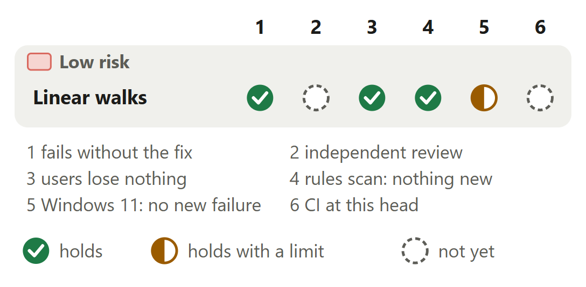

# A large checkout's first walk stops holding every hook for 40 s

For [pull request #1078](https://github.com/neralabs/rerail/pull/1078), head 144aa75909. [report.html](report.html) is the same report as one page: download it and open it.

## 1. The decision

**May a walk's grouping take each file's checkout from its folder, looked up once a folder, rather than ask the disk for every file?**

**We recommend:** approve it: a file a walk finds is no symbolic link, so its checkout is its folder's, as the walk's own read of each file already takes it.

| Size | Risk and review | Waits on | Not verified |
|---|---|---|---|
| 334 lines in 5 files: 71 ship, 263 are tests and text | Careful. It changes how a walk groups files by checkout. | Nothing. CI has not run at this head. | 3 |

## 2. Intent, and the gap

| Change | Intended | Found | Now |
|---|---|---|---|
| Grouping by checkout | Group a walk's files by checkout _(code comment)_ | Grouping held the daemon 41.7 s _(the issue's shape)_ | Closes the gap. |

Found 22 November 2026 measuring large checkouts on a 16-processor Linux machine and a Windows 11 machine.

Sources at main, and causes

| Change | Where main states the intent | The cause, and what was measured |
|---|---|---|
| Grouping by checkout | `src/engine/code-rule/code-rule-bridge.ts` at 70892dfacf: `#byOwningCheckout` (line 4835, the comment quoted) builds each group as `[...(owned.get(checkout) ?? []), item]` and asks `#owningCheckout`, the auditor's `sourceRoot`, of every path; `#discoverEdits` (line 4093) sorts every path the walk saw. | n files of one checkout cost n(n-1)/2 element copies, 5,000,050,000 for 100,001; `sourceRoot` makes a `realpath` and an `lstat` a file on the daemon's thread; the sort compares about 1.5 million times at a first walk of 100,001 paths. A timing mark around the grouping measured 37,885 ms of the 37.95 s pause. |

## 3. Where to look

1. **Read first**, 4 min: `code-rule-bridge.ts`: `#byOwningCheckout`, `#walkedCheckoutOf`, `#discoverEdits`, `#separateOwnWrites`, `#firstSeenModifiedOrUntracked`. Can a path the grouping takes by its folder belong to another checkout than its folder's?
2. 2 min: `checkout-code-rule-router.ts` and `code-rule.ts`: `walkView`, `auditGeneratedEdits`, `appendToGroup`, `WalkView`.

**Then skim**, 3 min: `walk-grouping-cost.test.ts`: three cases count elements read, comparisons and checkout lookups with no clock; one checks the groups and their order.

## 4. Risk against verification

One change, low risk: the same groups in the same order, built in one pass; the cases count the work, not the time.

Each limit, and each check that does not hold yet

| Change | Check | Its limit, or why it does not hold yet |
|---|---|---|
| Linear walks | independent review | No review has read this head. A review of the larger change these lines come from found no defect in them. |
| Linear walks | Windows 11: no new failure | The new test file 30 of 30 on Windows 11 on two machines with its own engine; the 27 importing test files 961 passed here, 957 at `main`, none failed. In the issue's shape the first walk's read outlasted the session's minute at `main` and here, so Windows shows no pause at `main` to compare. |
| Linear walks | CI at this head | The repository's CI has not run at this head. The commit hook's checks pass. |

## 5. The changes

**Walk grouping, sorting and lookups linear**, low risk: Issue's shape, Linux x64: first walk's grouping 37.9 s at `main`, 10.4 ms here; longest pause 0.57 s.

<b>6. The decisions</b>

**Take a walked file's checkout from its folder, or ask the disk per file?**

**We chose** the walk's view, one lookup a folder, which the walk already reads each file through. **Would change our mind:** A walk that reads a link, or a session that observes one into another checkout, would need the path's own lookup.

| Option | What a user gets | Cost | What it breaks |
|---|---|---|---|
| The walk's view, one lookup a folder **(chosen)** | No 100,001 `realpath` and `lstat` calls on the daemon's thread at a first walk. | A map of the folders, for one grouping. | Nothing: a walk skips links, and the router gives a link into another checkout no checkout, so the session does not take it. |
| Ask the disk per file, as `main` does | The same groups. | Two file-system calls a file on the daemon's thread: 3.9 s at 100,000 files on Linux x64, once the copies were gone. | Nothing. |
| Keep each file's checkout with its observation | No lookup at the grouping. | A field in each of 100,000 observations the session keeps. | The observations' shape, which later sessions share. |

**Evidence.** The order case writes seven files across a nested checkout, the session's checkout and folders no checkout owns, and gets the audit in `main`'s order over `main`'s source and here. The lookups case counts 417 lookups at `main` and 21 here.

<b>7. How it fits</b>

It stands alone on `main` 70892dfacf and needs nothing first. #1074 also edits `code-rule-bridge.ts`, in other functions; `git merge-tree` with its head 2469395115 finds no conflict.

<b>8. What is not covered</b>: 3 not verified, 2 smaller gaps, 2 limits that stay

1. **The walk itself** the first walk still reads every file, so the first turn's end waited 3.2 s for it here on Linux x64, 9.2 s beside other work.
2. **Windows pause** on Windows 11 the first walk's read outlasted a minute of turns at `main` and here, so no pause at `main` was reached to compare.
3. **macOS** never ran; by reading, a volume that ignores case gives a file its folder's checkout, as the walk's view already does to read it.

**Smaller gaps**

- **Other copies.** Groupings that take no walk's every file still copy a list per item: the session's own observations in other worktrees, a touched-files audit's paths, and lists of packs and records.
- **Preimage recovery.** Changes with no preimage captured are grouped with a lookup a path, as at `main`, since a tool call can name one.

**Limits that stay**

- A checkout whose every file sits in a folder of its own costs one lookup a file, as at `main`.
- A walk that finds every file changed sorts them all, as at `main`.

## 9. What we ask of you

We ask no ruling.

<b>10. Evidence</b>

The description on GitHub is the record: "How you tested it" holds the runs at `main` and here.

| Where | What ran | Result |
|---|---|---|
| Linux x64, load 4 | The issue's shape, 100,000 files, `main` then this change in one job, a timing mark around the grouping | Grouping 37,885 ms at `main`, 10.4 ms here; longest pause 37.95 s and 0.57 s; first turn's end 30,241 ms (gave up) and 3,167 ms; the write steered at both. |
| Linux x64, beside other work | The same pair at load 17 to 22, and `main` alone at load 5 | Grouping 67.2 s at `main`, 21.7 ms here; longest pause 1.17 s here, `main` held at the end. `main` alone: 41.8 s. |
| Linux x64 | The new test file over `main`'s source and here, and each deciding line taken out | Three cost cases fail at `main`, all four pass here; 8 of 8 lines taken out fail their case. |
| Linux x64 | The test files that import a changed module, here and at `main` | 27 files here: 957 passed, 11 skipped; 26 at `main` on the same machine: 953 passed, 11 skipped; none failed. |
| Windows 11, one machine | The issue's shape, `main` then this change in one job, the virus scanner busy beside them | At both the first walk still read files after a minute; hooks waited 10 s for it. `main` reached no grouping; here 71,489 files grouped in 13.5 ms. |
| Windows 11, Linux x64 | The new test file, 30 rounds: two Windows 11 machines of ours; GitHub's Linux and Windows runners in our fork | 30 of 30 on each. |

**Sources.** The branch at 144aa75909 and its diff against `main` 70892dfacf, read on 25 November 2026; runs on a 16-processor Linux x64 machine and Windows 11 machines.

