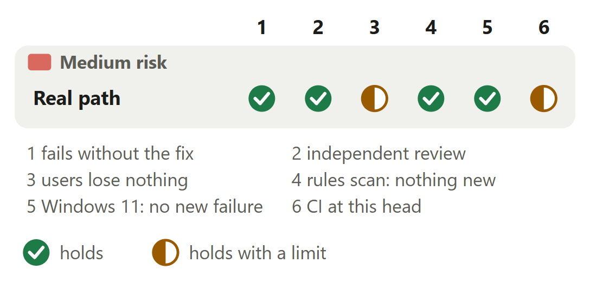

# Secret-like files reached through links keep only their digest in the ledger

For the pull request of branch `JeanFrancoisGagne/folder-link-earlier-text`, not opened yet, head d4d507b45. [report.html](report.html) is the same report as one page: download it and open it.

## 1. The decision

**When an edit reaches a file in a secret-like folder through a link or short name, should the ledger keep only its digest?**

1. At the runtime, `rewind` no longer puts back a write held open across a restart.
2. A late call is checked over the whole file: one more finding, message withheld.

**We recommend:** approve it: the ledger keeps the digest as for a direct edit; at the runtime `rewind` no longer puts such a write back after a restart, and late calls are checked over the whole file.

| Size | Risk and review | Waits on | Not verified |
|---|---|---|---|
| 530 lines in 10 files: 171 ship, 359 are tests and text | Careful. A maintainer weighs the two changes from `main`. | Nothing. It stands alone on `main` cccb25a8d; nothing needs it. | 2 |

## 2. Intent, and the gap

| Change | Intended | Found | Now |
|---|---|---|---|
| Secret-like earlier text | No copy of a secret file _(docs)_ | A copy through a link _(runs through the product)_ | Closes the gap, changes answer 1. |
| Late call's reported text | No copy of a secret file's text _(code comment)_ | A late edit read against a copy _(runs through the product)_ | Closes the gap, changes answer 2. |

Found in November 2026 on Linux x64 and Windows 11, through Rerail's runtime and Claude Code's built hook.

Sources at main, and causes

| Change | Where main states the intent | The cause, and what was measured |
|---|---|---|
| Secret-like earlier text | `docs/threat-model.md` at `main` (c21947263), line 583: "Preimages of a secret-like file, or one whose text holds a secret, keep only a hash and size." `src/engine/code-rule/code-rule-bridge.ts`, `preimageOf`: judges `sensitiveByName(source.path)`, the path as the tool spelled it. | `preimageOf` and `keptPreimage` judge the path as the tool spelled it. The read follows a link in any segment but the last, and resolves the real path only to keep the file inside its checkout; the router already judges that real path. |
| Late call's reported text | `src/engine/code-rule/code-rule-bridge.ts` at `main` (c21947263), line 210, on `keptPreimage`: "a file named like one holding secrets keeps only its digest and size." It judges `path`, the path as the tool spelled it. | `keptPreimage` judges the spelled path. Through a link a late call's reported text stayed, the edit was read against it, and only the lines it changed were checked. |

## 3. Where to look

1. **Read first**, 10 min: `code-rule-bridge.ts`: `textPreimage`, `ledgerPreimage`, `keptPreimage`, `judgedWhereItLeads` and `#realPathInPlace`. Can any spelling of a file in such a folder reach the ledger, or an ordinary file lose its text?
2. 3 min: `operations.ts` and `audit-store.ts`: `recordedPathJudge`, `violationView`, `workspaceRoots`.

**Then skim**, 5 min: Bridge cases read the ledger form of `.aws/config.py` spelled through links, on time and late, and on Windows by short names; a runtime case reads the ledger and the rollback.

## 4. Risk against verification

Start with `textPreimage` and `ledgerPreimage`: they decide what the session and the ledger keep.

Each half mark's limit

| Change | Check | It holds with this limit |
|---|---|---|
| Real path | users lose nothing | Ordinary files, a checkout inside `.docker/`, `.aws` linking to an ordinary folder and direct edits keep `main`'s result, each with a case. Two states change, each asked below: a write held open across a daemon restart is not put back, and a late call tells of a finding on an unchanged line, message withheld, where `main` told nothing. |
| Real path | CI at this head | No CI run at this head on GitHub yet: the branch is not pushed. CI's integration job passed on Linux x64 at 6640685ca: 22 files, 90 tests. |

## 5. The changes

**Secret-like files judged where they are**, medium risk: An `Edit` through `conf/config.py`, `conf` linking to `.aws`: the whole earlier text in the ledger at `main`, the digest here.

<b>6. The decisions</b>

**Where is the text of a file secret-like only by its real path kept?** (ask 1)

**We chose** in the session's memory, marked, and never in the ledger, as for text that holds a secret. **Would change our mind:** a reader of the session's memory that writes it to disk outside the ledger.

| Option | What a user gets | Cost | What it breaks |
|---|---|---|---|
| In the session, not in the ledger **(chosen)** | The digest in the ledger through a folder link, junction or short name; at the runtime `rewind` puts a write naming the link path back, as on `main`. | No file-system call. | At the runtime, after a daemon restart mid-write there is nothing to put back: the file stays as written and the finding is told in a message. Through Claude Code's hook it stays as written on `main` too. |
| Nowhere: the digest at capture too | The digest in the ledger and in memory. | No file-system call. | Under `rewind`, a write naming the link path, which `main` puts back, is left as written. |
| Kept across restarts in Rerail's own store | The put-back after a restart too. | A write of the text per such edit. | A copy of the text on disk again, outside the checkout. |

**Evidence.** Through Claude Code's built hook on Linux x64: at `main` the ledger held the text for three spellings, here the digest. At the runtime, `rewind` puts a write naming `conf/config.py` back on `main` and here; held open across a restart, `main` put it back and this head leaves it as written. Each kept result has a case that fails with its line taken out.

<b>7. How it fits</b>

Nothing has to merge first: it holds `main` at cccb25a8d, merged in; the one conflict, in `operations.ts`, keeps both changes. #738 shares the bridge and conflicts with it as with `main` alone; #865 merges cleanly.

**Shared files and trial merges.** Trial merges with this head, at the heads a clone held on 19 November: #738 shares the bridge, its test file, `operations.ts`, `audit-store.ts`, `docs/threat-model.md` and `docs/reference.md`, and conflicts in the same four files as with `main` alone. #865 shares the bridge and its test file, and merges cleanly.

<b>8. What is not covered</b>: 2 not verified, 4 smaller gaps

1. **macOS** never ran.
2. **A real coding agent** did not run: Claude Code's hook JSON was fed to the built hook entry.

**Smaller gaps**

- **The text an agent's own tool call carries** is recorded as on `main`.
- **Copies written before the upgrade** stay: `rerail scrub` judges a preimage's text only.
- **Hard links** keep the text in the ledger, as on `main`.
- **A `subst` or mapped drive on Windows** is not changed here.

## 9. What we ask of you

Asks 1 and 2 rule on answers 1 and 2.

1. **At the runtime, may `rewind` leave a write through such a link, held open across a restart, as written?** We recommend yes: keeping the put-back needs the text on disk again.
2. **May a late call be checked over the whole file, telling a finding on an unchanged line, message withheld?** We recommend yes: `main` told nothing then; on time both tell it at Stop.

<b>10. Evidence</b>

The description on GitHub is the record: "How you tested it" holds the failing tests, the runs and the counts.

| Where | What ran | Result |
|---|---|---|
| Linux x64 | Claude Code's built hook against a daemon of `main` c21947263 (and 7efcac9c6, and ba0545900 before the engine) and of this head, 16 sessions each: two texts, four spellings, on time and late | The edit's preimage in the ledger: `main` the whole text in 12 of 16 sessions (27 to 39 characters), the same before the engine; here the digest in 16 of 16. Late with a finding on an unchanged line: told at the edit, message withheld, 3 of 3 here; `main` nothing, 3 of 3. |
| Windows 11 | The same hook through a junction, `AWS~1` and `WP-CON~1.PHP`, on time and late, with `main`'s bridge and this one | `main` the text in 6 of 6 sessions, here the digest in 6 of 6; late: told at the edit, message withheld, 3 of 3 here, nothing at `main`. |
| Linux x64 | At the runtime, under `rewind`, a write through `conf` begun before a daemon restart and answered after it, at 6640685ca | `main` put the file back from the ledger's text; here it is left as written and the finding told in a message. |
| Linux x64 and Windows 11 | The new cases over `main`'s source, and here; with the fix's first line out; with the late call's judgment by spelling | Over `main`'s source: Linux 5 fail. Here: 20 of 20 runs pass on each. First line out, at 6640685ca: Linux 3 fail, Windows 4 fail in 3 of 3. A late call through `conf` whose file is written again: each call site of `changedSinceWrite` by spelling fails its case on Linux; both fail in 3 of 3 on Windows. |
| Linux x64 and Windows 11 | The 18 changed and importing test files, here and at `main` | Linux: here 486 passed, 0 failed; at `main` one bridge case failed that passes here. Windows: here 486 passed, `main` 475, none failed. |
| Linux x64 | CI's integration job, at 6640685ca | Exit 0: 22 files, 90 tests passed, 4 skipped. |
| Linux x64 | The reviewer's rules at `main` cccb25a8d over the diff against it | The reviewer's rules at `main` cccb25a8d over the diff against it: no new Steer, Log or complexity finding, with the published 0.1.5 and with Rerail built from `main`; every function added or edited counts 6 or under. |

**Sources.** The branch at d4d507b45 and its diff against `main` cccb25a8d, read on 19 November 2026; runs at that head on Linux x64 machines and Windows 11 virtual machines; `main`'s source for the comparisons.

