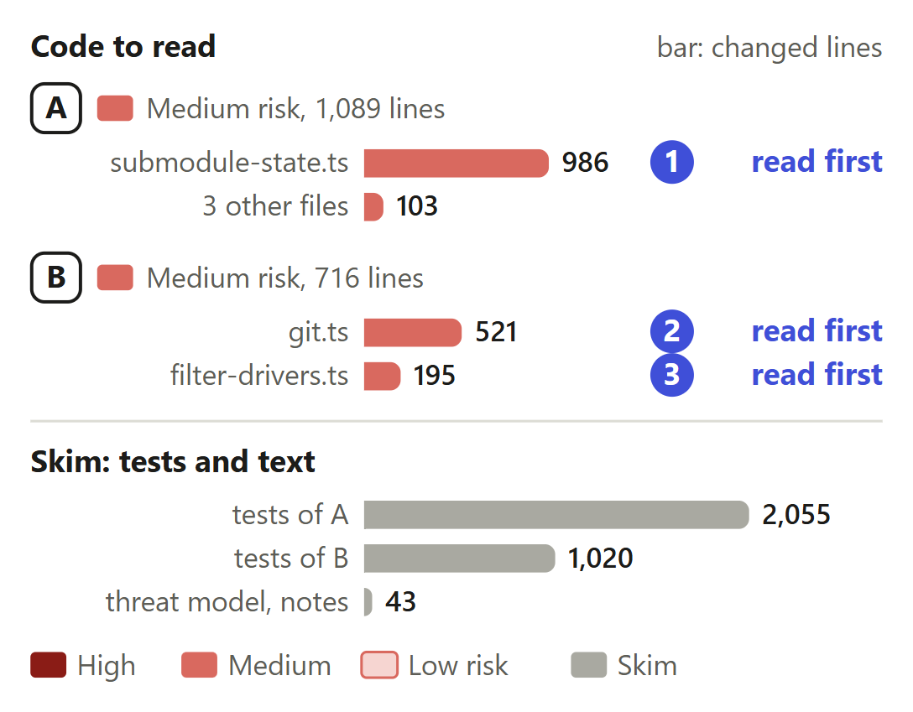
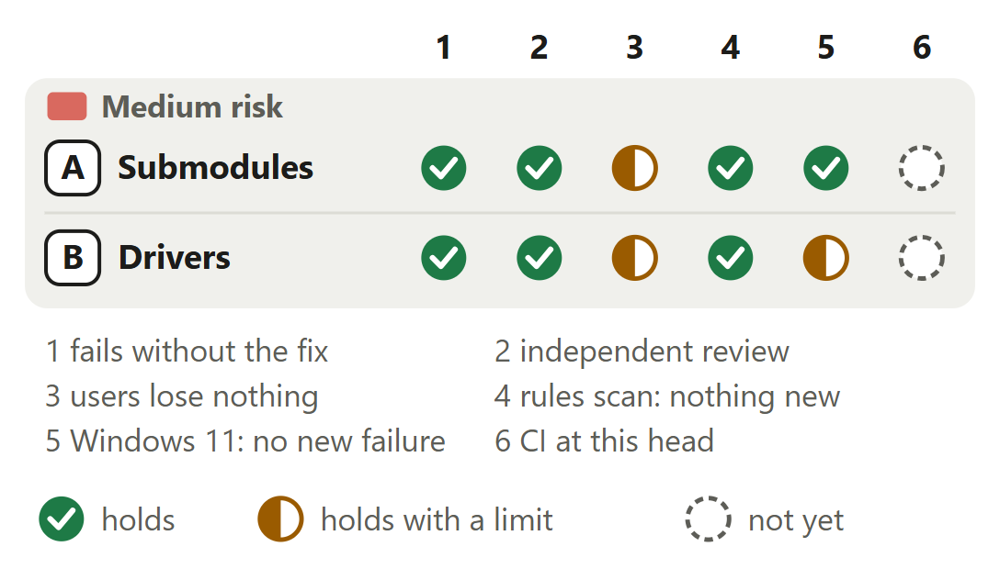

# Git: Rerail's own Git calls start no program a repository's config names

For [pull request #978](https://github.com/neralabs/rerail/pull/978), head 114e1105e. [report.html](report.html) is the same report as one page: download it and open it.

## 1. The decision

**May Rerail's Git calls set a repository's own filter drivers to the person's value or none, and ask each checked-out submodule itself?**

1. A file only its repository's driver maps is compared as it is on disk.

**We recommend:** approve it: at main five calls started a program a repository's config names, here none does; the person's drivers run, and a call starts the Gits main's starts, plus three where the checkout records submodules.

| Size | Risk and review | Waits on | Not verified |
|---|---|---|---|
| 4,923 lines in 24 files: 1,805 ship, 3,118 are tests and text | Maintainer approves. It changes what Rerail's own Git calls start. | Nothing. It stands on main alone. | 4 |

## 2. Intent, and the gap

| Change | Intended | Found | Now |
|---|---|---|---|
| A. Submodule programs | No program from a repository's config _(code comment)_ | 3 runs per submodule state _(stand-in program)_ | Closes the gap. |
| B. Repository filters | No program from a repository's config _(code comment)_ | 5 filter runs per audit, scan, walk _(stand-in program)_ | Closes the gap, changes answer 1. |

Found in November 2026 on Linux x64 and Windows 11 machines, with a stand-in program per call.

Sources at main, and causes

| Change | Where main states the intent | The cause, and what was measured |
|---|---|---|
| A. Submodule programs | `src/engine/git.ts` at main, above `SAFE_CONFIG`: "A repository's own config can't run programs through Rerail's git calls: no fsmonitor, no hooks." | Git's diff starts `git status --porcelain=2` in each checked-out submodule to tell whether it changed. That status reads the submodule's own config with none of the call's options on it, so its filter ran; a Git folder placed at a registered submodule's path ran its program the same way. |
| B. Repository filters | `src/engine/git.ts` at main, above `SAFE_CONFIG`: "A repository's own config can't run programs through Rerail's git calls: no fsmonitor, no hooks." | `git diff --name-only` and `git ls-files --modified` compare a file whose size matches its index entry and whose stat does not through `filter.<name>.clean`. The calls set no filter key, so the program the repository's config names ran as the person. |

## 3. Where to look

1. **Read first**, 15 min: `submodule-state.ts`: `withChangedSubmodules`, `submoduleChanged`, `worktreeIndex`. Does each diff list the submodules Git's own diff lists?
2. **Read first**, 15 min: `git.ts`: `runGit`, `runGitWithoutBlocking`, `guardedBy`, `submoduleOpener`. Can a call that reads worktree files still start a repository's driver?
3. **Read first**, 5 min: `filter-drivers.ts`: `driverOverrides`, `worktreeRead`. Does every driver a repository defines get the person's value or none?
4. 5 min: `audit-control.ts`, `headless-scan.ts`, `operations.ts`: the callers await the diff.

**Then skim**, 10 min: The differential cases compare each answer with Git's own; the threat model says what the calls keep from a repository's config.

## 4. Risk against verification

Start with the submodule rules: they follow Git's own and are where a wrong answer lists or drops a path.

Each limit, and each check that does not hold yet

| Change | Check | Its limit, or why it does not hold yet |
|---|---|---|
| A. Submodules | users lose nothing | Layouts under eighteen rule sets equal Git's own stdout byte for byte. A checkout of more than about four million files that records a submodule fails where main answered. |
| B. Drivers | users lose nothing | A file under a driver only the repository defines is listed as changed when only its stat changed. |
| B. Drivers | Windows 11: no new failure | The test files pass on Windows 11; the cases with a stand-in Git run on Linux only. |
| A and B | CI at this head | CI runs once the branch is on GitHub. |

<b>5. The changes</b>

**A. Submodules asked through the guard**, medium risk. 450 submodules, Windows 11 running nothing else: audit 3.5 s here, 5.4 s at main, every call answered.

- **Problem:** Git's diff starts `git status` in each checked-out submodule, which runs the programs that submodule's own config names, also in a Git folder placed at a registered submodule's path.
- **Who meets it:** Every audit request with the default scope and every `rerail scan` in a checkout with submodules. How many checkouts have them is not measured.
- **What it does:** `runGitWithoutBlocking` runs the diff with `--ignore-submodules=dirty`, then `withChangedSubmodules` asks each checked-out submodule its status through the same guard, all at once, within the call's one 10 s limit, following Git's rules for which submodules a diff looks into.
- **Risk:** Medium: Rerail now follows Git's rules (2.31 to 2.53) for submodules, and a rule it gets wrong lists a submodule Git would not, or leaves one out.
- **Check:** Read `withChangedSubmodules` and `submoduleChanged` beside Git's `is_submodule_modified`. Check that a `.gitmodules` in conflict, a linked worktree and an index the environment names each answer as Git does.
- **Picture:** At main a checked-out submodule's own filter ran 3 times and a placed Git folder's program 3 times; here neither runs.
- **Method:** A stand-in program per state that writes a line to a file of the test's own, each call made as its caller makes it, at main 1e80e3b04 and here, on Linux x64 and Windows 11.

**B. Drivers set for each call**, medium risk. A repository's clean filter at main: 5 runs per audit, scan and walk. Here: 0.

- **Problem:** The audit's and the scan's diff and the session walk's listing ran the `filter.<name>.clean` program a repository's config names, as the person, outside any agent's sandbox.
- **Who meets it:** Every session walk, audit request and `rerail scan` in a repository whose config names a filter. How many do is not measured.
- **What it does:** `runGit` and the reads that do not block list the config with its scopes once, then set each driver a repository defines to the person's own value or to no program, through `GIT_CONFIG_COUNT`. Every call sets `log.showSignature=false`.
- **Risk:** Medium: every call that reads worktree files starts one Git more, and a writer changing the config between the listing and the call can still have its driver started.
- **Check:** Read `guardedBy` and `driverOverrides`: does any driver a repository defines keep a program, and does the person's own driver, Git LFS among them, keep its value?
- **Picture:** At main a repository's clean filter ran 5 times across an audit, a scan and a walk, and the signing program once in a reflog read; here neither runs.
- **Method:** A stand-in program per state that writes a line to a file of the test's own, each call made as its caller makes it, at main 1e80e3b04 and here, on Linux x64 and Windows 11.

<b>6. The decisions</b>

**How should a call keep a repository's drivers from running?**

**We chose** list the config with its scopes, then set each driver a repository defines to the person's value or none. **Would change our mind:** a repository whose rules need its own driver's output in Rerail's diff.

| Option | What a user gets | Cost | What it breaks |
|---|---|---|---|
| Listing, then overrides for the drivers it found **(chosen)** | No repository driver runs; the person's drivers, Git LFS among them, run. | One Git more per call that reads worktree files. | A writer changing the config between the listing and the call can have its driver started. |
| A view of the config Rerail writes for each call | No window between listing and call. | As built. | Conditional config: 1 to 3 files wrongly listed per call; the scan's diff lost replace refs. |

**Evidence.** Generated layouts equal Git's own answer but for a file whose stat alone changed under a repository's driver; Git LFS on Windows 11 cleans as the person's own Git does.

**How should the diffs learn which submodules changed?**

**We chose** Git kept out of them, and Rerail asks each checked-out submodule through the same guard, all at once. **Would change our mind:** a checkout with so many submodules that main answers and this does not.

| Option | What a user gets | Cost | What it breaks |
|---|---|---|---|
| One Git a submodule where its config and index allow, all at once **(chosen)** | With 450 submodules every call answers on a Windows 11 VM running nothing else, in 3.5 s where main takes 5.4 s. | 460 Git starts for an audit at 450, against 457 at main. | Nothing main gives, measured. |
| One Git for all, with the guard's options | Main's cost. | As main. | The options name only the checkout's drivers, so a submodule's own driver and a placed Git folder run their programs. |

**Evidence.** At 0, 80, 200 and 450 submodules, 5 calls each on a Windows 11 virtual machine and Linux x64, beside main on the same machine: every call answered with Git's own paths.

<b>7. How it fits</b>

Nothing has to merge first. It meets #964 in two import lines; whichever lands second keeps both.

The change is based on main at 1609ac3a3, merged in with no conflict. A trial merge with the open pull request #964 conflicts in two import lines, and whichever lands second keeps both.

**The shared lines and the trial merge.** A trial merge with #964 conflicts in line 3 of `integration/rerail-without-daemon.test.ts`, the `node:fs/promises` names, and line 10 of `src/engine/audit/audit-control.ts`, the imports beside `../git.js`. No other open pull request of ours touches these files.

<b>8. What is not covered</b>: 4 not verified, 3 limits that stay

1. **macOS** never ran.
2. **Git LFS on Linux** never ran; on Windows 11 it cleans as the person's own Git does.
3. **A Git older than 2.31** ran through stand-ins on Linux only, not through the built command line.
4. **The stand-in Git cases** run on Linux only: Windows cannot start a script as its Git.

**Limits that stay**

- A writer changing the config between the listing and the call has its driver started in some calls: 9 of 40 audits on Linux.
- A checkout of more than about four million files that records a submodule passes the listing's cap and fails the diff.
- Submodules more than 16 deep fail the diff, where Git follows them.

## 9. What we ask of you

Ask 1 rules on answer 1.

1. **May a file under a driver only its repository defines be compared as it is on disk?** We recommend yes: the other way runs that repository's program.

<b>10. Evidence</b>

The description on GitHub is the record: "How you tested it" holds the failing runs, the figures and the test files.

| Where | What ran | Result |
|---|---|---|
| Linux x64 | The five calls, at main and here | All five fail at main and pass here. |
| Windows 11 | The five calls, at main and here | All five fail at main and pass here. |
| Linux x64 | 31 test files importing git.ts or submodule-state.ts | 1090 passed, 33 skipped; main's 27 files: 881 passed, 32 skipped. |
| Windows 11 | The same 31 files | 1076 passed, 68 skipped, 2 failed (two rows whose Git 2.56.0 message the head now takes), with the engine built for this tree; main's: 897 passed, 39 skipped. |
| Linux x64 | The third review's 11 new or changed cases at bbcdd72d8, and 15 lines changed one at a time | 10 of 11 fail at bbcdd72d8, the eleventh holding behaviour it had; each change fails its case. |
| Linux x64 | Each line of the review's answer taken out, 11 runs | With nothing changed the cases pass; each of the 8 changes fails its case. |

**Sources.** The branch and its diff against main, read on 22 November 2026; Git 2.53 and 2.56 for Git's own answers.

