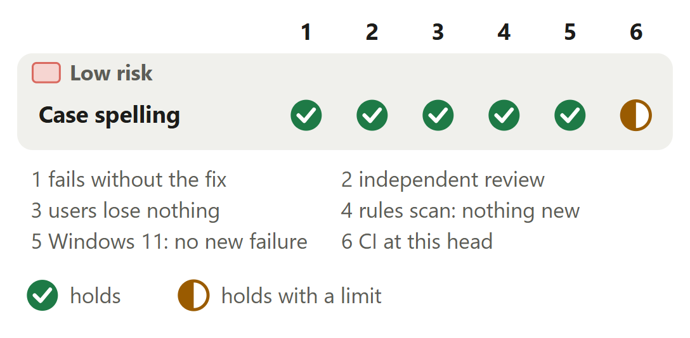

# The Git ignore case passes on Windows

For [pull request #919](https://github.com/neralabs/rerail/pull/919), head 1b16a673f. [report.html](report.html) is the same report as one page: download it and open it.

## 1. The decision

**May the Git ignore case that names a pattern's file expect that file with the separator the engine's matcher returns on each platform?**

**We recommend:** approve it: the case then passes on Windows 11, 20 of 20 runs where `main` fails 20 of 20, passes on Linux as before, and Rerail itself does not change.

| Size | Risk and review | Waits on | Not verified |
|---|---|---|---|
| 9 lines in 1 file: 0 ship, 9 are the tests it changes, 0 are other tests and text | Fast. One test case, no product code. | Nothing. No CI run on GitHub yet: not pushed. | 2 |

## 2. Intent, and the gap

| Change | Intended | Found | Now |
|---|---|---|---|
| Expected file spelling | The file Git read _(code comment)_ | Spelled with `/` on Windows _(Windows 11 runs)_ | Closes the gap. |

Found on 19 November 2026 by running the engine's tests on Windows 11 at `main`, where CI does not run them.

Sources at main, and causes

| Change | Where main states the intent | The cause, and what was measured |
|---|---|---|
| Expected file spelling | `native/src/git_ignore.rs` at cccb25a8d, `GitIgnoreMatch`: "the file Git read it from (absolute; `None` when it came from no file)". | `root.join(path)` with a `/`-separated `path` keeps the `/` on Windows; the exclude stack builds its paths a component at a time. |

## 3. Where to look

1. **Read first**, 3 min: `git_ignore.rs`: the `source` closure of `names_the_pattern_its_file_and_line`. Does the expected path now match what the matcher returns on every platform, and nothing else change?

**Then skim**, 1 min: Nothing else changes.

## 4. Risk against verification

One change, low risk: a test's expected value; the matcher and Rerail are as they were.

Each half mark's limit

| Change | Check | It holds with this limit |
|---|---|---|
| Case spelling | CI at this head | No CI run at this head on GitHub yet: the branch is not pushed. CI runs this crate's tests on Linux only. |

## 5. The changes

**The case expects the matcher's spelling**, low risk: Windows 11: `main` failed the case in 20 of 20 runs; here it passed 20 of 20.

<b>6. The decisions</b>

**Change the case or the matcher?**

**We chose** the case: it expects the path as the matcher returns it, since a person already sees the right file. **Would change our mind:** A maintainer who wants `GitIgnoreMatch.source` spelled with `/` on every platform for readers of the engine's API.

| Option | What a user gets | Cost | What it breaks |
|---|---|---|---|
| The case expects the platform's separator **(chosen)** | The case passes on Windows and Linux; nothing else changes. | 8 added and 1 removed lines in one case. | Nothing found. |
| The matcher returns `/`-joined paths | The same case passes. | A change to what the engine returns. | A Windows path mixing `C:\` and `/`, which no reader needs: the TypeScript side already shows the file with `/`. |

**Evidence.** On Windows 11 at `main` 95ad00618 the case failed 20 of 20 runs; here it passed 20 of 20. `test/runtime/follow-gitignore.test.ts` passed 6 of 6 there at `main`.

<b>7. How it fits</b>

Nothing has to merge first: `main` 95ad00618 is merged in. #812 edits `git_ignore.rs` but not this case, which still fails at its head; they merge clean.

<b>8. What is not covered</b>: 2 not verified

1. **macOS** never ran.
2. **Windows in CI** CI runs this crate's tests on Linux only; adding them to the Windows Rust job is left to a change of its own.

## 9. What we ask of you

We ask no ruling.

<b>10. Evidence</b>

The description on GitHub is the record: "How you tested it" holds the runs on `main` and here.

| Where | What ran | Result |
|---|---|---|
| Windows 11 | The case 20 times, then the crate's library tests, at `main` and here, in new checkouts on one machine | `main`: 20 of 20 failed; 183 passed, 1 failed. Here: 20 of 20 passed; 184 passed, none failed. |
| Windows 11 | #896's steps as written at `main` and at #812's head | `main`: failed 20 of 20. #812: failed 20 of 20. |
| Linux x64 | The case 20 times at `main`, #812 and here; the crate's tests, rustfmt, clippy and the browser build check here | The case passed 20 of 20 at each; 184 passed here; every check passed or matched `main`. |
| Windows 11 | `test/runtime/follow-gitignore.test.ts` at `main` cccb25a8d | 6 of 6 passed: the ignored-edit event names `.git/info/exclude`. |
| Linux x64 | The automated reviewer's rules at `main` 95ad00618 over the diff | No new finding, with the published 0.1.5 and with Rerail built from `main`. |

**Sources.** The branch at 1b16a673f and its diff against `main` 95ad00618, read on 20 November 2026; runs at 1b16a673f and 431bd9139, at `main` 95ad00618 and at #812's head 4f814b43b on Windows 11 virtual machines and a Linux x64 machine.

