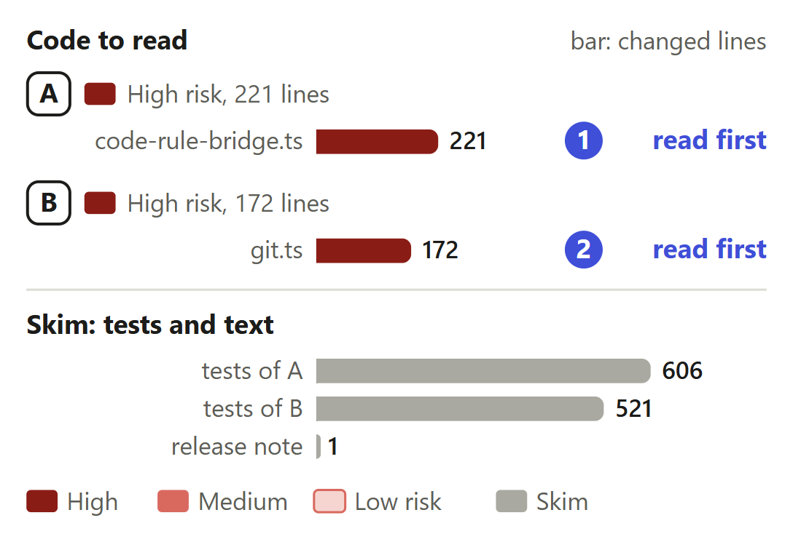
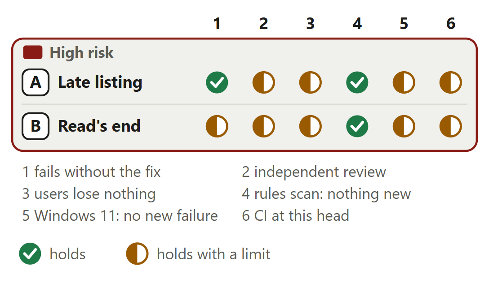

# Git: a late listing is asked again; no finished Git is ended

For [pull request #679](https://github.com/neralabs/rerail/pull/679), head d7aa8b2c5. [report.html](report.html) is the same report as one page: download it and open it.

## 1. The decision

**Where should a late listing be told, and in which words: to the agent, on the session's record, or both?**

1. A late listing is asked again; `checkpoint`'s answer holds its text, which no one reads. **Changes the intent.**
2. A read's Git writes its stderr to the null device.
3. `gitModifiedOrUntrackedPaths` answers `undefined`, not `[]`, when late or stopped.

**We recommend:** the session's record, beside the boundaries `main` records as answered before their walk ended: a person can act on a slow Git; the agent cannot. This pull request tells no one.

| Size | Lane | Waits on | Not verified |
|---|---|---|---|
| 1,521 lines in 6 files: 393 ship, 1,128 are tests and text | Careful. A code owner approves. | #668. No maintainer has answered yet. | 4 |

## 2. Intent, and the gap

| Change | Intended | Found | Now |
|---|---|---|---|
| A. Late listing | A late listing is no `checkpoint` gap _(code comments)_ | Late read as none; whole-file steer _(daemon replay)_ | **CHANGES THE INTENT: ANSWER 1.** Asked again; `checkpoint` holds the text, unread. A maintainer must agree. |
| B. A finished Git | A finished Git is read, never ended _(code comments)_ | Read as none, or ended as hung _(tests, the field)_ | Closes the gap, changes answer 2. |
| B. Listing's answer | Empty past the timeout _(code comment)_ | Late reads as unchanged _(reading the code)_ | Closes the gap, changes answer 3. |

The field showed only the stall (#668); tests made the rest.

Sources at main, and causes

| Change | Where main states the intent | The cause, and what was measured |
|---|---|---|
| A. Late listing | `src/engine/code-rule/code-rule-bridge.ts` lines 2245 and 2246 at `main`, above `#readFirstSeenTexts`: "changed before the session, neither its index nor its \`HEAD\` blob is the preimage of the session's next shell write to it." Lines 621 and 622, above `discoveryGap`, say what `checkpoint` returns: "What the last walks of the session folder and of the other worktrees could not check". A late listing is not in it. | Line 2264 reads `gitModifiedOrUntrackedPaths`' answer, `[]` past its limit, so the next shell edit has no first-sight text. The head adds to `checkpoint`'s answer `<checkout>: Git did not list the checkout's changed files in time`. Failed when asked again: `<checkout>: Git could not list the checkout's changed files when asked again: a shell edit to a file changed there before the session is checked against Git's text of it, or whole`. Late again: the first text, `again:` and that clause. |
| B. A finished Git | `src/engine/git.ts` lines 749 and 750 at `main`, above `settleWhenDone`: "A Git that exits by itself is read to the end of its output". Line 767, in `end`: "A child that has exited has no tree left to reach, and its pid may name another process by now." Line 339 sets the limit: `DEFAULT_TIMEOUT_MS = 10_000`. Nothing at `main` says what a read does while another process holds stderr. | Line 771 is one timer: `setTimeout(end, timeoutMs)`. After a stall Node runs timers before it handles a finished Git's exit, so `end` calls `endProcessTree` on a process that has exited, on Windows a `taskkill /T /F`: 2 trees ended at `main`, 0 here. `execFile` answers once stdout and stderr close; a clean filter's leftover process keeps stderr open, so `main` answers `[]` after 10.5 s. Here a Git that fills stderr answers what it printed; `main` reads none. |
| B. Listing's answer | `src/engine/git.ts` lines 701 to 703 at `main`, above `gitModifiedOrUntrackedPaths`: "Empty without Git, outside a repository, past the timeout, or past \`MAX_LISTED_PATH_BYTES\` of paths." Line 697, above that limit: "past it, the first lists none and the second cannot say." | Line 707 turns every read that gave no output into `[]`. At the head `readGit` says whether a read printed, failed or timed out, and the listing answers `undefined` for timed out or stopped. Its one caller is the bridge's walk. A Git past 64 MiB that ignores SIGTERM and prints no more ends at the read's time limit, by SIGKILL: the head reads that listing as late, `main` as none. On Windows 11 SIGTERM ends it at once. |

## 3. Where to look

1. **Read first**, 12 min: `code-rule-bridge.ts`: `#takeListedAgain`, `#gitListingInSlot`, `newlyLate`. Can a kept text be stale, or a slot leak?
2. **Read first**, 12 min: `git.ts`: `readGit`, `gitPrinted`, `timeLimit`, `settleWhenDone`. Does a read answer as `execFile` did, and spare a finished Git?

**Then skim**, 8 min: `main`'s two changed assertions: a stopped listing's `undefined`; Git's starters, `[1, 0, 3]`. The tests' Git stand-ins, now on `spawn`.

## 4. Risk against verification

Start at A: it decides which findings are steered.

Each half mark's limit

| Change | Check | It holds with this limit |
|---|---|---|
| A. Late listing | independent review | The automated reviewer approved aa8d7a049, 48f4d7df5, 8040a36e1 and d7aa8b2c5, the last two with no finding in this file; 1ed11613b, 411d80d82 and 104bb092e answer its earlier findings, each with a test. The eight commits since 8040a36e1 change only comment lines here: the built JavaScript is the same without comments. The limit: no person on the team has reviewed it. |
| A. Late listing | users lose nothing | Through a daemon of each build on Linux x64, a replayed Claude Code session whose first listing hangs: `main` steers the shell edit on a function written before the session, the head only on the agent's own. A bridge test pins every change checked at its boundary while listings hang. The limit: one more `git ls-files` per late checkout. |
| A. Late listing | Windows 11: no new failure | On Windows 11 at d7aa8b2c5 the 14 files that import `git.ts` or the bridge: 424 passed, 3 skipped, 0 failed. The three slot tests passed 20 of 20 rounds, also beside four busy processes. The limits: on a loaded desktop one slot test timed out once at an earlier tree, and two tests of `main` failed at 886503476; repeats passed. |
| B. Read's end | fails without the fix | At the first head its tests failed over `main`'s source on Linux x64 and Windows 11. 231cbc4f7's two clean-filter tests fail over 8e23142d9's source on both. Ten one-line changes each turn a test red: eight to the output limit, two for c4b2246ea's tests. The limits: its 64 MiB test is Linux only; its stderr test passes with Git's stderr inherited. |
| B. Read's end | independent review | The automated reviewer approved d7aa8b2c5 after reading the eight commits since 8040a36e1, 231cbc4f7's move to `spawn` among them: 0 blockers, 1 nit, the `execFile` import unused here. It stays: `main`'s `runGitAsync` calls it once merged. 8e23142d9's test showed a broken pipe, which 231cbc4f7 fixes; no test held the output limit until 9288b6014. The limit: no maintainer has reviewed it. |
| B. Read's end | users lose nothing | The seven output-limit tests pass over `main`'s `git.ts` on Linux x64 and Windows 11: each answer is `main`'s. A process a clean filter left writes 1 MiB to Git's stderr with status 0 on both, as on `main`. The limits: answers 2 and 3 differ on purpose; the hung Git's end was last measured at 76c347b32, before `spawn`. |
| B. Read's end | Windows 11: no new failure | `git.test.ts` and `child-process.test.ts` pass on Windows 11 at d7aa8b2c5 within the 14 files: 424 passed, 3 skipped, 0 failed. The seven output-limit tests passed 20 of 20 rounds there, as did c4b2246ea's stderr test. The limit: c4b2246ea's 64 MiB test skips off Linux and prints why; on Windows 11 SIGTERM ends that Git at once, and both builds list none. |
| A and B | CI at this head | The 31 checks at d7aa8b2c5, read on 15 November 2026: 28 pass, 3 are skipped, none fails. The limit: CI run 43709552376 passes on its third attempt. The first two failed only in `Unit tests (Windows, 2/2)`, on `runtime-notes.test.ts` (#683) and, in the first, `claude-status.test.ts` (#681). This branch changes neither; `git.test.ts` and the bridge test passed there each time. |

<b>5. The changes</b>

**A. Late listing asked again**, high risk. Replayed session, late listing: 2 violations at `main`, 1 not the agent's; 1 here.

- **Problem:** When Git lists a checkout's changed files past its 10 s limit, `main` reads no files changed. The next shell edit to a file changed before the session is measured whole: the agent is steered on every finding in it.
- **Who meets it:** A session whose first listing takes Git over 10 s. None was seen in the field: 783 Git processes in 15 minutes on a loaded Windows 11 machine, none longer than 0.86 s. Tests make one with a hung Git.
- **What it does:** `#firstSeenModifiedOrUntracked` sets a late checkout's first sights aside; the walk goes on. `#listLateAgain` adds one text per checkout for `checkpoint`'s next answer. `#gitListingInSlot` asks Git again in one of four slots, handed on at Git's answer or after 1 s. `#takeListedAgain` keeps each text still as the walk saw it, or adds a late or failed text. `newlyLate` returns each.
- **Risk:** High. It changes which earlier text a shell edit is measured from, so which findings the agent is steered on. It also adds three texts to `checkpoint`'s answer, which no one reads today.
- **Check:** Can `#keepFirstSeenTexts` keep a text the file no longer has? It takes only a digest the session last observed. Can a slot leak, or serve a closed session? `#gitListingInSlot` hands each on once and asks Git nothing once `#abandoned`. `newlyLate` clears each text when `checkpoint` answers, and the daemon's one call (`src/runtime/runtime.ts` line 1033 at `main`, 1002 at the head) does not read that answer, so each text is gone after the turn's end, unread.
- **Picture:** A Claude Code session replayed through a daemon on Linux x64, its first listing hung. After a shell edit that appends a function over the complexity ceiling to a file changed before the session, main records 2 violations, one on a function the agent did not write; this change records 1, the agent's. Main runs 1 listing, this change 2.
- **Method:** a Claude Code session replayed through the built hook against a daemon of each build on Linux x64, with a `git` on PATH that hangs the first listing: `main`'s build, and the head's at 231cbc4f7, the last commit to change code. The second listing started 10.01 s after the first. A simple function appended instead: 1 violation at `main`, none.

**B. How a Git read ends**, high risk. After a 10.5 s stall: 2 finished Gits ended at `main`; none here.

- **Problem:** A Git that exited while a process its clean filter started holds stderr reads as no files changed, after the whole limit. After a stall `main` answers right but ends finished Gits as hung, on Windows with `taskkill /T /F`.
- **Who meets it:** A repository whose clean filter leaves a process running. Any Git read that finishes during a stall past the limit: in the field `taskkill` ended two listings 11.1 s after they started; both Gits had exited within 100 ms.
- **What it does:** `readGit` starts Git with `spawn`, stderr on the null device, and says how the read ended. `gitPrinted` keeps `execFile`'s output limit; past it `endPastMaxBuffer` closes the output and sends SIGTERM. `timeLimit` reads the clock, `lookPastTimeLimit` looks each second, one loop turn after the tick, and `settleWhenDone` tells `settle` what ended the read. `gitModifiedOrUntrackedPaths` answers `undefined` for timed out.
- **Risk:** High. Answers 2 and 3 differ; the rest are `main`'s. Every read through `readGit` and `streamGit` ends through the new limit, and `readGit` leaves `execFile`. A wrong look ends a read early or never. Its options: the description's "Decision 3".
- **Check:** Does `gitPrinted` answer what `execFile` answered: UTF-8, at most `maxBuffer` bytes, only for status 0? Can a look end a Git that has exited? `end` drains when `child.exitCode` is set, and `timeLimit` allows one more look after an exit or an end of output. Does every way a read ends stop the interval: `stopLooking` in `forget` and in `end`? The first `close` listener settles `printed`: can `settleWhenDone` answer first? `execFile` stays imported, unused here; `main`'s `runGitAsync` uses it once merged.
- **Picture:** A listing and a HEAD read whose Gits finish during a 10.5 s stall of the event loop: main answers both and ends 2 process trees; this change answers both and ends none, on Linux x64 and Windows 11.
- **Method:** a test of `git.test.ts` at the head, on Linux x64 and Windows 11: a listing and a `HEAD` read whose Gits finish during a 10.5 s stall of the event loop, with the calls that end a process tree counted. `main`'s side: the same test over `main`'s source, and a probe there, twice on Linux x64.

<b>6. The decisions</b>

**What does a walk do when its listing is late?** (ask 1)

**We chose** go on, ask Git again in the background, tell no one yet. **Would change our mind:** an answer on #668, or field listings late twice.

| Option | What a user gets | Cost | What it breaks |
|---|---|---|---|
| Go on, ask again in the background, put the text in `checkpoint`'s answer **(chosen)** | Every change is checked at the boundary it reaches. The text before the session comes back when Git answers. The late listing's text is ready for whichever place #668 names. | One more `git ls-files` for each late checkout, off the walk's path. | No one is told: the daemon does not read `checkpoint`'s answer. A shell edit made before the listing asked again answers is measured whole, as on `main`. |
| Also record it on the session, as `main` records an unfinished walk | The session's history marks the boundary, beside those `main` records as answered before their walk ended (`onDiscoveryPending`). A person can act on a slow Git. | A callback of the bridge and a kind of session event, wired in `src/runtime/runtime.ts`. Not built. | Nothing found. Not built, so not tested. |
| Also tell the agent at the turn's end | The agent learns that a shell edit in that checkout may be measured whole. | A hook answer that carries the text: the turn's end answered `{}` in the replayed session. Not built. | The agent cannot act on a slow Git. |
| Ask nothing, as `main` does | Nothing. | Nothing. | The edit is measured whole: the agent is steered on findings it did not write. |

Before: At main a listing that runs past its limit is read as no files changed. The next shell edit to a file changed before the session is measured whole. After: Here the walk goes on and checks every change. The answer of checkpoint holds the late checkout once; the daemon does not read it. One more listing runs in one of four slots; nothing waits for it. A shell edit after its answer is measured from the text before.

**Evidence.** Linux x64. Before 205572b5a the test of a walk that checks what it found while Git lists late fails: no audit. Before 9bfb777c8 the three late-listing tests fail. Through a daemon of each build, a replayed Claude Code session: `main` ran 1 listing and steered the shell edit on a function written before the session; the head ran 2 and did not. At both, no hook answer, session event, audit, `gaps` count or log line held the late listing's text.

**Where does a read's Git write stderr?** (ask 2)

**We chose** the null device: no answer ever read it. **Would change our mind:** a reader of that text.

| Option | What a user gets | Cost | What it breaks |
|---|---|---|---|
| Start Git with `spawn`, its stderr on the null device **(chosen)** | The read answers once Git has exited and its output has closed. A process a clean filter left writes there for as long as it runs: 1 MiB, status 0, on Linux x64 and Windows 11. | `readGit` reads the output itself as `execFile` did: UTF-8, the output limit, SIGTERM past it. 41 lines added and 27 removed in `git.ts`. | Git's stderr no longer counts toward the output limit: a Git that fills it answers what it printed, where `main` reads none. No such case is known. |
| Keep stderr flowing, unreferenced, until its last writer ends | The same answers, and the same writes. | A pipe and a read loop in the daemon for each process that holds a read's stderr, for as long as it lives. The read leaves `execFile` all the same. Not built. | Nothing found. Not built, so not tested. |
| Keep `execFile` and read the output a second time | The same answers, and the same writes. | Up to 64 MiB of a listing held twice, and the time-limit look ticks on until the read closes. Not built. | Nothing found. Not built, so not tested. |
| Wait for stderr to close, as `main` does | Nothing. | Nothing. | The clean-filter listing answers no files changed, after the whole limit. |

**Evidence.** 231cbc4f7's two clean-filter tests, on Linux x64 and Windows 11: the answer comes while the leftover process still runs; it writes 1 MiB to Git's stderr with status 0; once it ends, Rerail holds no more pipes or descriptors than before the read. Over 8e23142d9's source, which closed that stderr, both fail with status 141. A search of `git.ts` and the test files that import it found no reader of a read's stderr.

**How many listings asked again run at once?** (ask 3)

**We chose** four per session, each handed on within 1 s. **Would change our mind:** more than 72 late checkouts, or slower listings.

| Option | What a user gets | Cost | What it breaks |
|---|---|---|---|
| Four slots, each handed on at the answer or after 1 s **(chosen)** | With 72 late checkouts on Windows 11, all 710 shell edits made 2 s after the boundary kept their first-sight text: with every listing fast, behind one held 1 s, and behind one at the limit. | 4 Gits at once while each answers in time, 5 behind a slow one, 44 when every one is slow, counted as Git processes. | Behind four slow listings the next waits about a second for a slot, and each further four ahead add about a second. |
| All at once | Every edit kept its text. | 72 Gits at once for 72 late checkouts, under the load that made them late. | Nothing measured. |
| One at a time | 1 Git at once, 2 behind a slow one, 11 when every one is slow. | The last checkout's listing answered a median 1.7 to 2.9 s after the boundary on Windows 11. | On Windows 11, 581, 486 and 456 of the 710 edits kept their text in the three cases; the rest were measured whole. |
| Two slots | All 710 kept with every listing fast and behind one held 1 s. | 2 Gits at once, 3 behind a slow one, 22 when every one is slow. | Behind a listing at the limit, 18 of 710 edits were measured whole. |

**Evidence.** A probe on a Windows 11 desktop and a Linux x64 machine, beside other runs: 3, 10 and 72 late checkouts of 300 files, the next shell edit of each checkout's changed file 2 s after the first boundary, 10 sessions per case, 5 at each of two loads. Run again at 48f4d7df5 over 132 sessions on each system: every edit kept. Linux x64 kept every edit with one slot. Eight slots were not measured.

<b>7. How it fits</b>

It stands on `main` alone. It waits on [#668](https://github.com/neralabs/rerail/issues/668), which has no maintainer's answer yet.

Pull request #679 is based on main at f277c6e29 and merges clean with main at c89f068ed. It waits on issue #668, not answered yet. No open pull request needs it. In trial merges it conflicts in one hunk each with the drafts #680 and #665, in two with the team's draft #532, and merges clean with #667 and #640.

**Shared files and trial merges.** Trial merges with d7aa8b2c5. #680 (d724d2090, a draft, approved): 1 conflict hunk in `code-rule-bridge.ts`, where both add fields to one object. #665 (dcf3d7dd3, a draft) and the team's draft #532 (559baf3b2): 1 and 2 hunks there; each conflicts with `main` too. The team's #667 (34dae62e9) and #640 (3a0233710) edit `git.ts` and `code-rule-bridge.ts`: both merge clean. The other 22 open pull requests share no file with it. A pull request to follow, one walk of a repository's other worktrees for all its sessions, builds on this bridge code.

<b>8. What is not covered</b>: 4 not verified, 6 smaller gaps, 8 limits that stay

1. **No one is told:** the daemon reads no gap `checkpoint` returns (#693).
2. **The field:** no Git ran past the limit; tests hang one.
3. **Review:** no person on the team has reviewed it.
4. **Two tests' limits:** the 64 MiB test is Linux only; no test pins Git's stderr on the null device.

**Smaller gaps**

- **Where Git's stderr goes.** c4b2246ea's test pins the answer of a Git that writes 2 MiB to its stderr, and fails when the read's stderr is a pipe. With that Git inheriting its parent's stderr every test of `git.test.ts` still passes on Linux x64: no test pins the null device.
- **Before the head.** The hung Git's end (10,046 and 10,047 ms, against 10,509 and 10,663 ms at `main`) and the CPU a listing costs (7 to 13 µs more) were measured at 76c347b32, before `spawn`. The 72-checkout probe ran last at 48f4d7df5 (132 sessions on each system), also before `spawn`.
- **Not run.** macOS never ran. c4b2246ea's 64 MiB test is Linux only; on Windows 11 a unit test shows both builds answer none, and no daemon ran. The two test files' time on Windows 11 was not taken at the head: 86 s against `main`'s 77 s at 8040a36e1.
- **A walk applied after the close.** A walk whose own audit runs while its session closes can still find checkouts late. The closed-session check in `#gitListingInSlot` stops their listings too. No test of its own holds that path.
- **Several sessions, and more checkouts.** The four slots are each session's own: sessions whose walks find checkouts late at the same moment each run up to four listings, about 44 when every listing is slow. Counted in one session with up to 72 late checkouts; not across sessions.
- **Main since the merge base.** Main moved from f277c6e29 to c89f068ed. The trial merge is clean; no run of ours tested it. `git.ts` at the head imports `execFile` and no longer uses it: `main`'s `runGitAsync`, added since, does, so the merged file needs the import.

**Limits that stay**

- A shell edit made before its checkout's listing asked again answers is measured whole, as on `main`. With 72 late checkouts the last answered a median 124 to 335 ms after the boundary on Windows 11, before it on Linux.
- A listing asked again that runs late, fails or throws is that walk's last. `checkpoint`'s answer holds one more text, and a shell edit to a file changed there before the session is measured from Git's text or whole.
- A read past the limit gets one more look, about a second, when Git exited or its output ended since the last. `checkpoint`'s answer holds a checkout again, once per boundary, after each later walk that lists it late.
- The limit stays 10 s. A walk's own listing with a Git error inside a repository, or past 64 MiB of paths when SIGTERM ends its Git, still lists none, as on `main`.
- Cost: one more `git ls-files` per late checkout, up to about 44 at once in a session with 72 late checkouts when every listing is slow; a 1 s interval per running read.
- A read the session's close stops answers as a late one. `runGit`'s reads, which block, keep `spawnSync`'s own 10 s timeout; `runGitAsync` keeps `execFile`'s; the native engine reads Git's status itself.
- `git.test.ts` took 0.88 s against `main`'s 0.43 s on Linux x64 at 9288b6014 (one worker, medians of 5), the seven output-limit tests 0.26 s of it. c4b2246ea's two tests add 0.18 s. No test waits out the 10 s limit.
- `settleListingsAgain` is a public method of `CodeRuleBridge`, which the package's index exports, so it is new on the package's API; only tests call it. The other way is an option of the bridge for tests alone.

## 9. What we ask of you

Asks 1 and 2 rule on answers 1 and 2.

1. **On [#668](https://github.com/neralabs/rerail/issues/668): where is a late listing told?** We recommend the session's record: a person can act on it.
2. **Git's stderr goes to the null device, so a Git that fills it answers: accept?** We recommend yes: no answer, error or log read it.
3. **Four more Gits at once per session, 44 when all are slow: acceptable?** We recommend yes: two slots lost first-sight texts.

Answer 3 asks no ruling. One caller, in the bridge.

<b>10. Evidence</b>

The description is the record: "What and why" and "How you tested it".

| Where | What ran | Result |
|---|---|---|
| CI on GitHub | The pull request's checks at d7aa8b2c5, read on 15 November 2026; CI is run 43709552376 | Of 31 checks, 28 pass, 3 are skipped, none fails. CI passes on its third attempt. The first two failed only in `Unit tests (Windows, 2/2)`: `runtime-notes.test.ts` > "never rejects, nor fails the edit's result, when reading the notes fails after a detection" in both (#683), and `claude-status.test.ts` in the first (#681). `git.test.ts` and the bridge test passed there each time. At 9288b6014 three attempts failed, on the same two tests. |
| Linux x64, a real daemon | A Claude Code session replayed through the built hook against a daemon of each build, a `git` on PATH hanging the first listing: `main`'s build, and the head's at 231cbc4f7, the last commit to change code | `main`: 1 listing; the shell edit steered on `legacy`, a function changed before the session, and on `added`, the agent's: 2 violations. 231cbc4f7: 2 listings, the second 10.01 s after the first; the steer named `added` alone: 1 violation. With a simple function appended: 1 violation at `main`, none here. At both, no hook answer, session event, audit, `gaps` count or log line held the late listing's text. |
| Linux x64, Windows 11 x64 | 8040a36e1's two test files over the merge base's source (f277c6e29), Node 24.21.0; 231cbc4f7's two clean-filter tests over 8e23142d9's source | 20 failed, 156 passed, 2 skipped on Linux x64: the 20 are this pull request's tests. The two clean-filter tests both fail, `expected 'wrote 141' to be 'wrote 0'`, on Linux x64 and in 2 of 2 rounds on Windows 11; at 231cbc4f7 both pass. |
| Linux x64, Windows 11 x64 | The 14 test files that import `git.ts` or `code-rule-bridge.ts`, at d7aa8b2c5 | Linux x64: 421 passed, 6 skipped, 0 failed. Windows 11: 424 passed, 3 skipped, 0 failed, nothing outside `main`'s baseline; the 3 skips are in `git.test.ts`, `main`'s own 2 and c4b2246ea's Linux-only test. At 886503476 on a loaded Windows 11 desktop: 422 passed, 2 failed in `code-rule-runtime-lifecycle.test.ts`, which this branch does not touch; repeated, 0 of 10 failed there and at 9288b6014. |
| Linux x64, Windows 11 x64 | In rounds: 231cbc4f7's new and changed tests; 9288b6014's seven output-limit tests; the three slot tests 8040a36e1 changes; the three tests of c4b2246ea and 886503476 | 231cbc4f7's: 20 of 20 runs on Linux x64, 20 of 20 rounds on Windows 11, and 20 of 20 there with four busy processes beside every test. The seven: 20 of 20 on both systems, no process left running. The slot tests: 20 of 20 on both, also with four busy processes on Windows 11. The three: 20 of 20 on both; the 64 MiB test skips on Windows 11. |
| Linux x64, Windows 11 x64 | One-line changes to the fix, each over its test file: eight to the output limit's code at 9288b6014; the slot rule at 8040a36e1; one at d7aa8b2c5 for each of the three tests added since 9288b6014 | Each of the eight turns tests red on Linux x64: nothing ends a Git past the limit, 5 tests; no SIGTERM, 4 (5 on Windows 11); the output left open, 1 (none on Windows 11). The seven tests pass over `main`'s `git.ts` on both systems. Each slot-rule change fails a test; a 1.5 s wait fails only 886503476's. c4b2246ea's fail with stderr on a pipe, or the limit's end unmarked. |
| Linux x64, Windows 11 x64 | The probe at aa8d7a049, run again at 48f4d7df5 over 132 sessions on each system: 3, 10 and 72 late checkouts of 300 files, the next shell edit 2 s after the boundary, at two loads | Every edit kept its first-sight text on both systems, with every listing fast, behind one held 1 s and behind one at the 10 s limit. Listings asked again at once at 72 checkouts, counted as Git processes: 4, 5 behind a slow one, 44 when every one is slow. With one slot, Windows 11 kept 456 to 581 of 710 edits. Since 48f4d7df5 the bridge changed in comments only. |
| Linux x64 | The automated reviewer's rules scan over the diff against `main` at d7aa8b2c5; two probes of the output limit, over 9288b6014's source and `main`'s | 0 new findings; 7 existing elsewhere. A Git that writes 2 MiB to stderr and `abc` to its output answers `abc` at 9288b6014, none at `main`. A listing past 64 MiB whose Git ignores SIGTERM and prints no more reads as late at 9288b6014, as no files changed at `main`; both builds end that Git by SIGKILL at the time limit. c4b2246ea's tests now pin both. |

**What this report adds to the description**

- **The reading order.** The description reads `timeLimit`, `lookPastTimeLimit` and `readGit` first, then `#listLateAgain` and `#gitListingInSlot`. This report starts at the bridge, where a kept text decides which findings the agent is steered on, and names `#takeListedAgain`, `newlyLate` and `gitPrinted` too.
- **Since 9288b6014: four commits, no behaviour change.** 74e510866 rewords this branch's comments in `code-rule-bridge.ts` and five bridge test names that said a boundary "reports" a late checkout: its text goes into `checkpoint`'s answer, which the daemon does not read. c4b2246ea tests a Git that fills stderr, and the silent Git past 64 MiB. 886503476 tests the 1 s slot wait. d7aa8b2c5 prints why the 64 MiB test skips off Linux. Under `src` only comment lines differ.
- **Two more asks, and the options.** The description asks one question, on #668, and leaves nothing more for the maintainers to decide. This report adds asks 2 and 3: Git's stderr on the null device, and how many Gits a session may run at once. The options for the clock limit are in the description, under "The decisions".
- **Read at the head: what `checkpoint` returns, and the blob reads.** One failure with clause `source-discovery`, code `source-incomplete` and stage `scan`, its texts joined with the walks' other gaps. Each text names the checkout relative to the session folder, `.` for the folder itself. A listing asked again that throws counts as failed, with one line on the daemon's stderr. `streamGit` calls `settleWhenDone` too, so `readGitBlobs`, `readGitBlobIds` and the read of Git's attributes end at a look on the clock.

**Sources.** Pull request #679, its diff, its checks with the failed jobs' logs, its automated reviews, and issues #668, #693, #683 and #681, read on GitHub on 15 November 2026. Rerail at `main` (c89f068ed) for each quoted intent and its line. The diff of d7aa8b2c5 against its merge base f277c6e29 for the sizes. Our run records, each with its commit. `git merge-tree` of the head with `main` and five pull requests.

