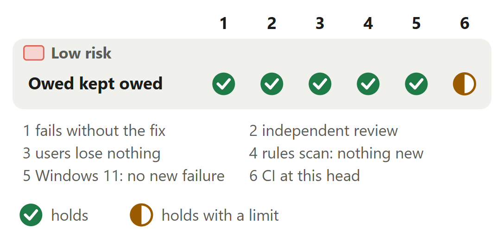

# A steer a reopened session owed survives a hook that gave up

For the pull request of branch `JeanFrancoisGagne/given-back-steer-stays-owed`, not opened yet, head 384827d67. [report.html](report.html) is the same report as one page: download it and open it.

## 1. The decision

**May a steer a session owed as it opened again, given back by an answer no hook read, go back to what the session owes?**

**We recommend:** approve it: when a reopened session's rules fail to open, the next hook tells that steer once, where `main` never tells it; while they still open, the daemon's next answer takes it.

| Size | Risk and review | Waits on | Not verified |
|---|---|---|---|
| 144 lines in 2 files: 41 ship, 103 are tests and text | Fast. Low risk, no high-risk path. | Nothing. No CI run on GitHub yet: not pushed. | 2 |

## 2. Intent, and the gap

| Change | Intended | Found | Now |
|---|---|---|---|
| Owed steers skip gate | Owed steers do not wait _(code comment)_ | A given-back one waited _(code review, two cases)_ | Closes the gap. |

Found on 19 November 2026 by the automated reviewer reading #874, and shown by two cases on Linux x64 and Windows 11.

Sources at main, and causes

| Change | Where main states the intent | The cause, and what was measured |
|---|---|---|
| Owed steers skip gate | `src/runtime/runtime.ts` at d64e54fb7, `OwedState`: "Its steers go out with the session's next answer without waiting for its evaluator, which did not find them"; `#collectPendingSteers` takes them before `if (!state.codeRuleReady) return deliveries;`. | `returnUndelivered` put every given-back steer on `pendingSteers`, those `#takeOwed` handed out included. An answer takes `pendingSteers` only once the evaluator is open, and a failed open empties them (`opened.pendingSteers = []`), while the ledger already holds the steer's delivery. |

## 3. Where to look

1. **Read first**, 5 min: `runtime.ts`: `returnUndelivered`, `#takeHandedOut`, `#giveBack`, `#takeOwed`. Can a steer given back reach a list no answer takes, or be told twice?

**Then skim**, 5 min: The tests: four cases in the unheard-answers file and an option of its service that holds or fails the rules of a session opened again.

## 4. Risk against verification

One change, low risk: where a given-back steer waits; every check, record and steer `main` makes is made here too.

Each half mark's limit

| Change | Check | It holds with this limit |
|---|---|---|
| Owed kept owed | CI at this head | No CI run at this head on GitHub yet: the branch is not pushed. CI's lint and type-check job passed here on Linux x64. |

## 5. The changes

**A given-back owed steer stays owed**, low risk: Rules that fail to open: `main` told the given-back steer in 0 of 7 runs; here 7 of 7.

<b>6. The decisions</b>

**Where does an owed steer go when the answer that took it was never heard?**

**We chose** back to what the session owes, so one list holds what the session owes and the next answer takes it. **Would change our mind:** A maintainer who wants a given-back steer checked only against revisions, not against the files it was kept with.

| Option | What a user gets | Cost | What it breaks |
|---|---|---|---|
| Back to what the session owes **(chosen)** | The steer at the next hook, rules open or not; checked again as at its first take; a close keeps it with the digests it was kept with. | A flag on the hand-out record and one function of five lines. | A steer whose file changed after its first take is dropped at the second; `main` told it once the rules opened, unless a revision overtook it. Through a real daemon, with the file edited meanwhile, neither told it. |
| Recorded pending steers go out before the evaluator check | The same at the next hook. | Two exceptions: in the evaluator check, and in both places a failed open empties the pending steers. | Two lists for what a session owes; a close digests the file as it reads then, which can keep a steer whose file changed. |

**Evidence.** Two cases at the engine service's socket, one per state: over `main`'s source the next hook answers nothing in both, at cccb25a8d 1 of 1 run on Linux x64 and 20 of 20 on Windows 11; here it tells the steer, once, recorded once, 20 of 20 on each.

<b>7. How it fits</b>

Nothing has to merge first: it merges `main` cccb25a8d, which holds #874. Of the open pull requests #812, #865, #880, #881 and #883, only #812 edits `runtime.ts`, none the test file; #812 merges clean with this head.

<b>8. What is not covered</b>: 2 not verified, 2 limits that stay

1. **macOS** never ran.
2. **Rules still opening** through a real daemon the agent heard it at the Stop at both: the tool call between hit the hook's 30 s limit waiting for the rules.

**Limits that stay**

- A given-back owed steer whose file changed after its first take is dropped at the second; `main` told it once the rules opened, unless a revision overtook it. Through a real daemon, with the file edited meanwhile, neither told it.
- A daemon that stops without closing the session between the give-back and its next answer loses the steer, as `main` loses any given-back steer then.

## 9. What we ask of you

We ask no ruling.

<b>10. Evidence</b>

The description on GitHub is the record: "How you tested it" holds the runs on `main` and here.

| Where | What ran | Result |
|---|---|---|
| Linux x64 | The two new cases over `main` cccb25a8d's source, then here, one machine | Over `main`'s source: both fail, 1 of 1 run, the next hook answering nothing. Here: both pass, 20 of 20. |
| Windows 11 | The same, 20 runs a side in turn, one machine, engine built for this tree | Over `main` cccb25a8d's source: both fail, 20 of 20 runs. Here: both pass, 20 of 20. |
| Linux x64 and Windows 11 | A real daemon and the built Claude Code hooks: a reopened session's owed steer, its prompt's hook gone, then the rules held or failed as they open; `main` d64e54fb7 and 78c1a2998 on one machine | Rules failing: `main` told it in 0 of 7 runs (4 on Linux x64, 3 on Windows 11), here once in 7 of 7, at the Stop; one ledger entry each. Rules opening: both told it at the Stop after they opened. |
| Linux x64 | The unheard-answers file and the 10 test files that import `runtime.ts`, here, and at 5596af86d and `main` cccb25a8d on one machine | Here 215 passed, 10 skipped; at 5596af86d 213 and `main` 211 passed, 10 skipped each. A first run at 5596af86d at load 20 ran three cases past their 5 s limit; each passed in this one. |
| Windows 11 | The same 11 files at 78c1a2998, against `main`'s Windows results | 221 passed, 2 skipped, none failed. |
| Linux x64 | CI's lint and type-check job | Passed: the Justfile, the release notes, `npm run check`, the UI tokens and the generated references. |
| Linux x64 | The automated reviewer's rules at `main` cccb25a8d over the diff | No new finding and no function over complexity 6, with the published 0.1.5 and with Rerail built from `main`. |

**Sources.** The branch at 384827d67 and its diff against `main` cccb25a8d, read on 19 November 2026; runs at 384827d67, 5596af86d and 78c1a2998 and at `main`'s source on Linux x64 machines and Windows 11 virtual machines.

