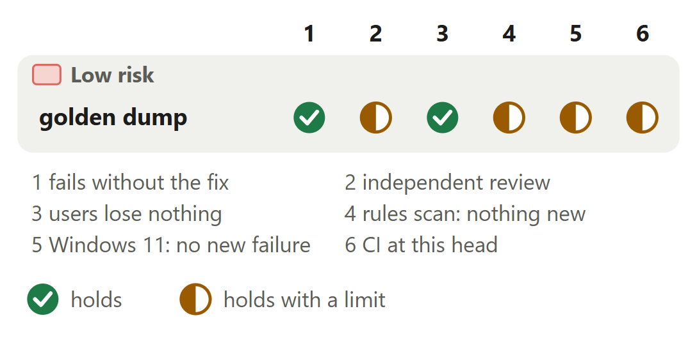

# The wave's golden dump follows regex-syntax 0.8.12

For [pull request #1090](https://github.com/neralabs/rerail/pull/1090), head 14489000678f. [report.html](report.html) is the same report as one page: download it and open it.

## 1. The decision

**May the wave's golden dump take the six program digests regex-syntax 0.8.12 gives, so `main`'s Rust tests pass again?**

**We recommend:** approve it: one test data file, 153 digest lines; each changed program keeps its ops, strings and predicates, and the wave's other 45 tests pass at this head.

| Size | Risk and review | Waits on | Not verified |
|---|---|---|---|
| 306 lines in 1 file: 0 ship, 306 are the tests it changes, 0 are other tests and text | Fast. One golden file, no source. | Nothing. CI on GitHub runs at this head. | 3 |

## 2. Intent, and the gap

| Change | Intended | Found | Now |
|---|---|---|---|
| The wave's golden dump | The dump equals its golden _(code comment)_ | Six digests moved with 0.8.12 _(CI run, #1079)_ | Closes the gap. |

Found on 25 November 2026: `main`'s CI failed the waves tests at 261a0e92d9, #1067, and at each push since.

Sources at main, and causes

| Change | Where main states the intent | The cause, and what was measured |
|---|---|---|
| The wave's golden dump | `native/src/code_rule_dsl/waves/matches/tests.rs:182` at `main` c1b2189a55, the doc comment of `the_wave_dumps_as_rir_and_assembles_back`; the comparison at line 204. | 0.8.12 lifts only literals, classes and look-around assertions out of an alternation whose branches start alike; 0.8.11 also lifted a repetition such as `\s*`. Six Python pack regexes have such branches, so the Thompson NFAs built for them, and the six programs' digests, differ. |

## 3. Where to look

1. **Read first**, 4 min: `wave.rir`: the wave line, six clause lines and six program blocks. Does each moved program block hold the same ops, strings and predicates as the one it replaces?

**Then skim**, 1 min: Nothing else changes.

## 4. Risk against verification

One change, low risk: one test data file; the engine, its dependencies and every rule are as on `main`.

Each half mark's limit

| Change | Check | It holds with this limit |
|---|---|---|
| golden dump | independent review | No code to review: each of the six changed program blocks was compared line by line with its old one, and only the digest line differs. |
| golden dump | rules scan: nothing new | The rules review was not run: it reads code, and this changes one test data file. |
| golden dump | Windows 11: no new failure | Not run on Windows 11: CI's Windows Rust job does not run the waves tests (`ci.yml`, its filters). |
| golden dump | CI at this head | CI on GitHub runs at this head; `main`'s CI failed the waves tests at each push since #1067. |

## 5. The changes

**Golden follows regex-syntax 0.8.12**, low risk: `main`'s waves tests: 45 passed and 1 failed; here 46 passed, 1 ignored as before.

<b>6. The decisions</b>

**Follow regex-syntax 0.8.12 in the golden, or take #1067 back?**

**We chose** follow it: the golden is test data, and the engine keeps the parser fix 0.8.12 brings. **Would change our mind:** A changed program in the dump beyond its digest line.

| Option | What a user gets | Cost | What it breaks |
|---|---|---|---|
| Regenerate the golden **(chosen)** | `main` passes with regex-syntax 0.8.12, which keeps leftmost-first matches right. | One data file, 153 lines. | Nothing found: each program's text is the same. |
| Pin regex-syntax at 0.8.11 again | `main` passes too. | Three manifests and the lock file. | The next bump fails the same way, and the engine stays a version behind. |

**Evidence.** The six changed blocks differ from their old ones only in the digest line; the waves tests pass here: 46 passed, 1 ignored.

<b>7. How it fits</b>

It follows #1067 and needs nothing else; it touches no source. It merges with `main` ca72d63ba1 and with our open pull requests #1076, #1077 and #1078 cleanly; none edits `wave.rir`.

<b>8. What is not covered</b>: 3 not verified, 1 limit that stays

1. **macOS** not run; CI's macOS job runs the tree watch tests only.
2. **Windows 11** not run: CI's Windows Rust job does not run this test.
3. **#1067's own run** skipped the Rust jobs: Dependabot's runs do, by the workflow's design.

**Limits that stay**

- The pack's fixtures are what the other 45 tests match; a rule no fixture reaches is not run by them.

## 9. What we ask of you

We ask no ruling.

<b>10. Evidence</b>

The description on GitHub is the record: "How you tested it" holds the runs at this head.

| Where | What ran | Result |
|---|---|---|
| Linux x64 | The one test at 70892dfacf, at `main` c1b2189a55, and with `RERAIL_BLESS=1` at `main` | Passed at 70892dfacf; failed at `main` with CI's message; the blessed dump differs in 153 lines. |
| Linux x64 | The waves tests whole, filter `code_rule_dsl::waves::`, at this head's tree | 46 passed, 0 failed, 1 ignored, as `main` had before #1067. |
| Linux x64 | The repository's check before a commit | Passed. |

**Sources.** The branch at 14489000678f and its diff against `main` c1b2189a55, read on 25 November 2026; `main`'s CI logs of 25 November; regex-syntax 0.8.11 and 0.8.12 as published; runs on a Linux x64 machine.

