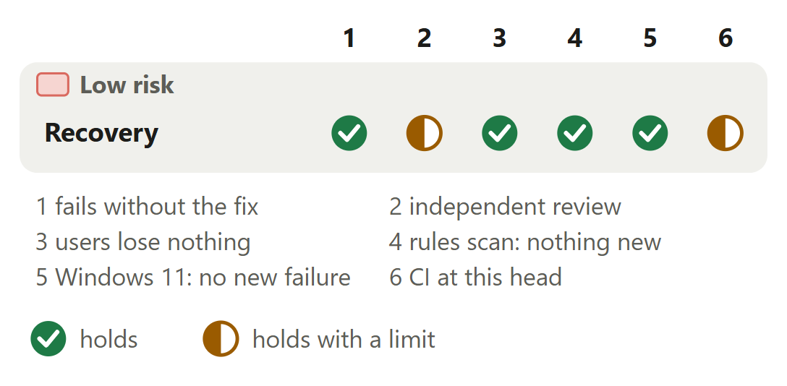

# Preimage recovery starts Git only for the edits it audits

For [pull request #916](https://github.com/neralabs/rerail/pull/916), head d1d7c564c. [report.html](report.html) is the same report as one page: download it and open it.

## 1. The decision

**May preimage recovery read Git only for the edits in the batch it audits?**

**We recommend:** approve it: a walk no longer starts four Git processes in a removed worktree, or in one where Git wrote every change, for files it never audits.

| Size | Risk and review | Waits on | Not verified |
|---|---|---|---|
| 77 lines in 2 files: 14 ship, 63 are tests and text | Fast. Low risk, no high-risk path. | Nothing. No CI run on GitHub yet: not opened. | 2 |

## 2. Intent, and the gap

| Change | Intended | Found | Now |
|---|---|---|---|
| Recovery for audited edits | Recover preimages of the batch's edits _(code comment)_ | Git read for changes not audited _(a counting case)_ | Closes the gap. |

Found on 20 November 2026 following the review of #911, by cases on Linux x64 and Windows 11 machines.

Sources at main, and causes

| Change | Where main states the intent | The cause, and what was measured |
|---|---|---|
| Recovery for audited edits | `src/engine/code-rule/code-rule-bridge.ts` at a5ed5ccb8, `#recoverPreimages`: "Gives each edit `uncaptured` names (made with no preimage captured ...) the source it changed". Its loop reads every digest of `uncaptured`, not each edit's. | `#discoverEdits` keeps each changed file's earlier digest in the walk's `uncaptured`. `#sortByVerdicts` leaves the digest of a change Git wrote there, and `#separateOwnWrites` that of each change it drops with a worktree being removed. `#recoverPreimages` hands every digest to `#recoverFromTexts`, and each unresolved path's checkout gets `recoverFromGit`: `cat-file --batch`, two `config --get` and `check-attr`. |

## 3. Where to look

1. **Read first**, 5 min: `code-rule-bridge.ts`: `batchDigests`, `#recoverPreimages`. Can an edit in the batch ever lose a digest it had, and its preimage with it?

**Then skim**, 5 min: The tests: two cases beside a write in another worktree, one worktree removed and one switched by Git, and a hook that runs as the walk looks for `.git`.

## 4. Risk against verification

One change, low risk: recovery reads fewer digests, and every edit in the batch keeps its own.

Each half mark's limit

| Change | Check | It holds with this limit |
|---|---|---|
| Recovery | independent review | No review by a second person yet: the automated reviewer approved #911 and named this leftover there. |
| Recovery | CI at this head | No CI run at this head on GitHub yet: the pull request is not open. CI's lint and type-check job passed here on Linux x64. |

## 5. The changes

**Recovery reads only the batch**, low risk: Git processes started in the worktree it does not audit: `main` 4; here 0.

<b>6. The decisions</b>

**Where does the walk stop reading Git for changes it does not audit?**

**We chose** where recovery reads the digests: only the batch's own edits, which covers every change the walk leaves out. **Would change our mind:** A change the walk audits whose digest is kept under another path than the edit's own: none is today.

| Option | What a user gets | Cost | What it breaks |
|---|---|---|---|
| Recovery reads only the digests of the batch's edits **(chosen)** | No Git for a removed worktree's changes or for Git's own writes; one filter where the map is read. | One map of the batch's digests per audit that recovers preimages. | Nothing found: every edit in the batch keeps its digest. |
| The review's fix: drop a removed worktree's paths from the map | No Git for a removed worktree's changes. | One loop in `#separateOwnWrites`. | Git's own writes in another worktree still start 4 Git processes there: the second case fails with it, on Linux x64 and Windows 11. |
| Also drop each change Git wrote from the map in `#sortByVerdicts` | The same as the chosen fix today. | A delete at each place that leaves a change out. | A later path that leaves a digest behind starts Git again until it gets its own delete. |

**Evidence.** The second case passes with the chosen fix and fails with the review's, 4 Git processes in the switched worktree on Linux x64 and Windows 11. Both cases fail with the chosen line reverted.

<b>7. How it fits</b>

Nothing has to merge first: the head stands on `main` a5ed5ccb8 and merges clean with `main` 2221b5ec9. #904 and #909 edit the bridge too, in other functions; each merges clean with this head.

<b>8. What is not covered</b>: 2 not verified

1. **macOS** never ran.
2. **A real daemon** not run: the count comes from the two cases only.

## 9. What we ask of you

We ask no ruling.

<b>10. Evidence</b>

The description on GitHub is the record: "How you tested it" holds the runs on `main` and here.

| Where | What ran | Result |
|---|---|---|
| Linux x64 and Windows 11 | The two cases over `main`'s source, over the review's fix, and with the one changed line reverted | The removed worktree: 4 Git processes over `main`'s source on each system and with the line reverted. The switched worktree: 4 over the review's fix on each system and with the line reverted. |
| Linux x64 and Windows 11 | The two cases 20 times here | None started: 20 of 20 on Windows 11, and twice 20 of 20 on Linux x64. A third 20 on a Linux machine four of our test runs held ended 3 runs with an error that was no failed assertion, beside 6 other tests there past the 5-second limit. |
| Linux x64 | CI's lint and type-check job | Passed: the Justfile, the release notes, `npm run check`, the UI tokens and the generated references. |
| Linux x64 | The automated reviewer's rules at `main` 2221b5ec9 over the diff | No new finding; `batchDigests` at complexity 3, `#recoverPreimages` 3. |

**Sources.** The branch at d1d7c564c and its diff against `main` a5ed5ccb8, read on 20 November 2026; runs at d1d7c564c, at 37d78d9bf (the review's fix), at 590a41300 (`main`'s source with the first case) and with the changed line reverted, on Linux x64 and Windows 11 machines.

