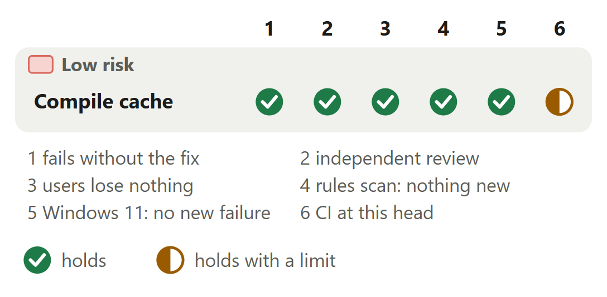

# A Windows Claude Code hook call reuses the code Node compiled

For [pull request #959](https://github.com/neralabs/rerail/pull/959), head 023690bfb. [report.html](report.html) is the same report as one page: download it and open it.

## 1. The decision

**May Rerail's Claude Code hook launcher turn on Node's compile cache, in Node's default folder, so each Windows hook call reuses earlier compiled code?**

**We recommend:** approve it: every hook does what it did, and each Windows hook call starts about 21 ms sooner, 180 to 159 ms at the median on Windows 11.

| Size | Risk and review | Waits on | Not verified |
|---|---|---|---|
| 199 lines in 4 files: 39 ship, 160 are tests and text | Fast. Low risk: one module; every session's hooks answer as before. | Nothing. CI at an earlier form: no failure `main` lacks. | 5 |

## 2. Intent, and the gap

| Change | Intended | Found | Now |
|---|---|---|---|
| A compile each call | No script compiled twice _(our reading)_ | Every call compiles it again _(marks, 140 calls)_ | Closes the gap. |

Found in November 2026 on Windows 11 virtual machines, timing each part of a Claude Code hook call.

Sources at main, and causes

| Change | Where main states the intent | The cause, and what was measured |
|---|---|---|
| A compile each call | `src/harness/hook-launcher.ts` at d54b586a8, lines 1 to 13: the launcher "runs the hook under the node recorded at registration, in this process when that node started it". Nothing in it turns on Node's compile cache. | Each hook event starts a Node, and Node keeps its compile cache off unless `NODE_COMPILE_CACHE` or `module.enableCompileCache` turns it on, so V8 compiles the whole script in every process. A CPU profile of 3 calls on a busy machine put `compileSourceTextModule` at 44.3 ms a call at `main`. With `NODE_COMPILE_CACHE` set by hand, `main`'s calls went from 227 to 201 ms at the median. |

## 3. Where to look

1. **Read first**, 5 min: `hook-launcher.ts`: `turnOnCompileCache`, and the launcher it starts under the recorded node with `--here`. Can an old node, `NODE_DISABLE_COMPILE_CACHE=1` or a file named `--here` stop a hook or start a third launcher?

**Then skim**, 3 min: `hook-launcher.test.ts`: a stand-in hook reports `getCompileCacheDir()`, run through the launcher in its own process and under another node, with the cache on and off, and a launcher started with `--here`.

## 4. Risk against verification

One change, low risk: the Windows hook launcher turns the cache on, under another node from the recorded node; no hook command or hook code changes.

Each half mark's limit

| Change | Check | It holds with this limit |
|---|---|---|
| Compile cache | CI at this head | The repository's CI ran at fad788bb3, an earlier form, on GitHub's runners in the fork: no failure `main` lacks there. One Rust job was cancelled; the change reaches no Rust. |

## 5. The changes

**The launcher turns on the cache**, low risk: Windows 11: a hook call takes 180 ms at the median on `main`, 159 ms here.

<b>6. The decisions</b>

**Remove the compile with Node's cache, or with a smaller hook script?**

**We chose** the compile cache in the launcher: it removes the compile with one call and changes no module the hook loads. **Would change our mind:** A maintainer who prefers the slimmer hook script first, which would also shorten the hook's top-level code.

| Option | What a user gets | Cost | What it breaks |
|---|---|---|---|
| Compile cache in the launcher **(chosen)** | The script's compile in a Windows call goes from 37 to 9 ms. | One call in the launcher. | Nothing found. |
| A hook script holding only the hook's own modules | Less to compile and less top-level code to run: that code and the work before the first request take 36.0 ms a call. | Moving the daemon's event client and its runtime out of the hook's imports, in several modules. | Nothing, if built. |
| One request to the daemon per call in place of four | Part of the 30 ms the four requests take beside the daemon's own answers, not measured apart. | A new daemon request. | A daemon of an earlier release would not answer it. |
| The compile cache for Linux and macOS too | The same gain there: on Linux x64 the compile is 33.9 ms of a 169 ms call. | A new registered hook command, rewritten in every person's settings. | Nothing, if built. |

**Evidence.** Marks in a throwaway copy of the installed hook, 140 calls on idle Windows 11, medians: Windows starts the process in 16.9 ms, Node's own start takes 14.1 ms, built-ins and better-sqlite3's JavaScript 22.7 ms, the daemon's answers 30.9 ms.

**Keep the cache in Node's default folder, or under the Rerail home?**

**We chose** Node's own folder, or the one `NODE_COMPILE_CACHE` names: Node's tools already share it, and the launcher works out no path. **Would change our mind:** A maintainer who prefers the cache folder under the Rerail home.

| Option | What a user gets | Cost | What it breaks |
|---|---|---|---|
| Node's default folder, or the one `NODE_COMPILE_CACHE` names **(chosen)** | One cache for every Node program a person runs, where a person who set `NODE_COMPILE_CACHE` expects it. | About 1.2 MB more in the temporary folder. | Nothing found. |
| A folder under the Rerail home | Rerail's files in one place. | A path the launcher works out before it loads the hook. | A person's own `NODE_COMPILE_CACHE` would not be followed. |

**Evidence.** After the Windows 11 run the temporary folder's cache held 596 files, 4,052 KB here against 580 files, 2,856 KB at `main`, where npm's own set-up entries are the rest.

<b>7. How it fits</b>

Nothing has to merge first: the head holds `main` 92fae67d8 through one merge Git made alone. #963 shares no line with it and merges alone either way. With #963, only older entries and paths `cmd.exe` cannot start take two Nodes.

<b>8. What is not covered</b>: 5 not verified, 3 limits that stay

1. **Linux and macOS** start the hook from a shell-form entry without the launcher, so they still compile the script at each call.
2. **Codex's and Cursor's Windows entries** start the hook from PowerShell without the launcher, and still compile it at each call.
3. **Another node first on PATH** still starts two Nodes a call, as at `main`, and the second loads the launcher too: 204 ms against 221 ms at `main`.
4. **The slimmer hook script** is the next option, not built here: it would leave less to compile and less top-level code to run.
5. **macOS** never ran.

**Limits that stay**

- A registered command that names the cache would bring the gain to Linux and macOS; it rewrites every person's settings, so it is left for a change of its own.
- The two requests a call makes before its event, a check of the daemon's capability and a read of the repository's state, and the event itself stay as they are.
- The Windows 11 machine was idle during the timing, 1% CPU at its start and end; a short test run on a sibling virtual machine overlapped its first rounds, which all four forms shared.

## 9. What we ask of you

We ask no ruling.

<b>10. Evidence</b>

The description on GitHub is the record: "Why it is worth landing" holds the timings, and "How you tested it" the cases and the runs.

| Where | What ran | Result |
|---|---|---|
| Windows 11 and Linux x64 | `test/harness/hook-launcher.test.ts` with the test alone at `main` d54b586a8, then here | With the test alone: the two cache cases fail on each system. Here: 22 passed on two Windows 11 machines and on Linux x64. |
| Windows 11 and Linux x64 | The launcher with its check of `--here` taken out | The `--here` case fails alone: 1 failed, 21 passed, on each system. |
| Windows 11, 8 cores | Rerail packed and set up from a local registry, `main` 92fae67d8 and this change; seven hook kinds, 50 calls each a form, round by round, with `node` on PATH the recorded node and with another node first | Medians: 180 ms at `main`, 159 ms here; 221 and 204 ms with the other node first, two Nodes a call at both; 35 ms for `node -e 0`. 95th percentiles 290, 266, 354 and 316 ms. |
| Linux x64, 16 cores | The same set-up and hook calls at `main` 92fae67d8 and this change, 350 calls a build | Medians: 168 ms at `main`, 167 ms with the change, 171 ms for 0.1.5, 21 ms for `node -e 0`: unchanged, as expected, since the shell-form entry skips the launcher. |
| Windows 11, 8 cores | The issue's steps with the first form, twice: the hook as the launcher leaves it, the hook with the cache off, and `node -e 0` | `main` 254, 259 and 87 ms, then 167, 169 and 46 ms; with the change 219, 255 and 84 ms, then 127, 149 and 43 ms. Other work kept the machine at 100% CPU in the first run. |
| GitHub's runners, in the fork | The repository's CI at fad788bb3, the first merge of `main` | No failure that `main` does not have there; one Rust job was cancelled, and the change reaches no Rust. |

**Sources.** The branch at 023690bfb and its diff against `main` 92fae67d8, read on 21 November 2026; tests and Windows and Linux timings at this head and `main` 92fae67d8 on Windows 11 virtual machines and Linux x64 machines; the issue's steps with the first form on `main` d54b586a8.

