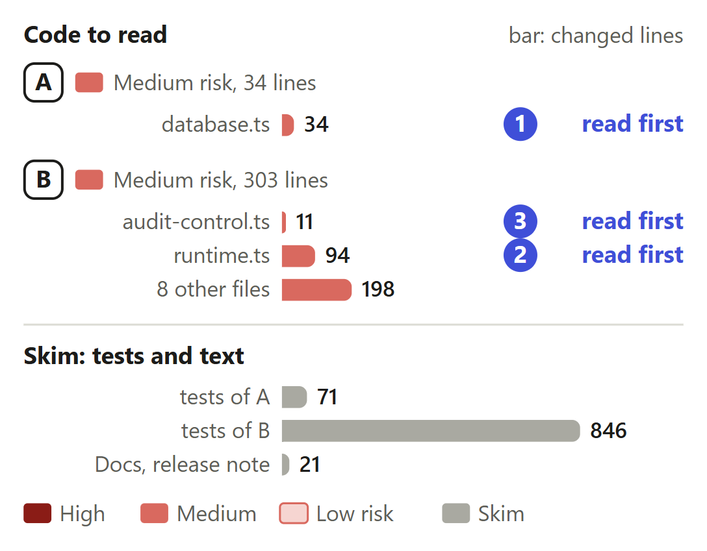
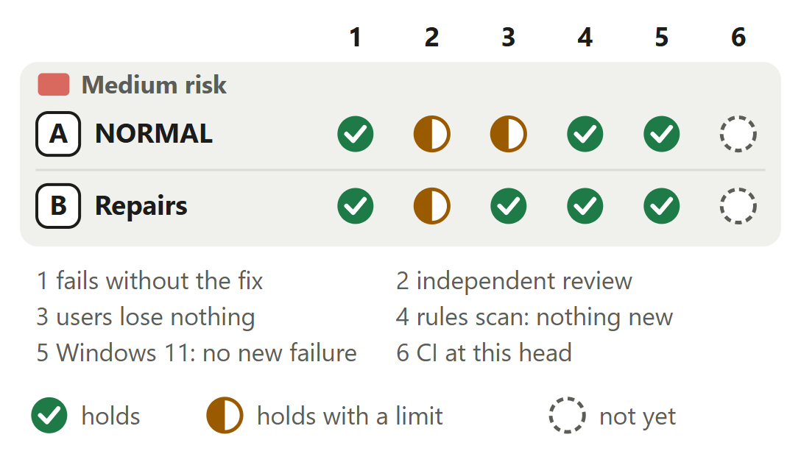

# A hook no longer waits for the disk at each daemon commit

For [pull request #974](https://github.com/neralabs/rerail/pull/974), head 0156da0af. [report.html](report.html) is the same report as one page: download it and open it.

## 1. The decision

**May Rerail's store commit with `synchronous = NORMAL`, so hooks no longer wait for the disk at each commit, with three repairs for a power cut?**

1. After a power cut or a system crash, the last seconds of records may go. **Changes the intent.**

**We recommend:** approve it: a power cut or an operating system crash can take the last seconds of records, nothing is lost when only Rerail stops, and the next start and open repair the records it leaves.

| Size | Risk and review | Waits on | Not verified |
|---|---|---|---|
| 1,275 lines in 27 files: 337 ship, 938 are tests and text | Ruling. Medium risk: what the store keeps changes; a maintainer rules. | Nothing. It merges onto `main` 1e80e3b04 alone. | 3 |

## 2. Intent, and the gap

| Change | Intended | Found | Now |
|---|---|---|---|
| A. Each commit waits | Every commit on disk before the answer _(our reading)_ | A hook waits for each commit _(measure, #971)_ | **CHANGES THE INTENT: ANSWER 1.** The last seconds may go in crashes. A maintainer must agree. |
| B. A loss leaves wrongs | Records say what happened _(our reading)_ | A loss leaves three things wrong _(cases, cut log)_ | Closes the gap. |

Found in November 2026 on Linux x64 and Windows 11 machines, timing Claude Code's hooks beside a program that kept the disk busy (#971).

Sources at main, and causes

| Change | Where main states the intent | The cause, and what was measured |
|---|---|---|
| A. Each commit waits | `src/engine/storage/database.ts` at `main` 21f86868e, `prepareWriter`: `PRAGMA synchronous = FULL` beside `journal_mode = WAL`, for every writer of the store. No comment says why FULL; the daemon answers a hook only after `runtime.ingest` returns (`engine-service.ts`). | With FULL, each commit syncs the write-ahead log before it returns, on the daemon's only thread: one commit before an Edit (the event's row), three after it (the row, the check's start and its finish). A writer that keeps the disk busy makes each sync wait behind its data, and every other session's hook waits behind the daemon's thread. |
| B. A loss leaves wrongs | At `main` 21f86868e: `audit-store.ts` closes a session's running checks only when its evaluator opens again; `remote-outbox.ts` sends events after its cursor, by number; `runtime.ts` writes an event's row, then its ledger line, and nothing reconciles them. | Under NORMAL a power cut or a system crash takes the store's last commits, and the next start reads the store as it stands: the check's finish, the counter past the remote's cursor and the event rows are gone, while the daemon is gone and the ledger keeps its lines. |

## 3. Where to look

1. **Read first**, 10 min: `database.ts`: `prepareWriter`, where every writer of the store opens. May the store lose its last seconds of records to a power cut?
2. **Read first**, 10 min: `runtime.ts`: `lostEvents`, `firstDatedEvent` and `persistEvent`. Can a history a reset deleted, or an older build's ledger, read as lost?
3. **Read first**, 10 min: `audit-control.ts`: `#endAbandoned`, which closes a gone daemon's running checks. Can a check of a daemon that still runs be closed?
4. 3 min: `remote-cursors.ts`, `remote-outbox.ts`, `session-store.ts`, `session-state.ts`, `operations.ts`, `transcript-boundary.ts`, `timeline.js`, `sessions-model.js`.

**Then skim**, 10 min: `power-cut.ts` cuts the log at an earlier commit; `engine-service-power-cut.test.ts` kills a daemon, cuts the log, starts the next and reads what the dashboard reads.

## 4. Risk against verification

Two changes, both medium risk: start with `prepareWriter`, then the repairs and the case that cuts the log under each.

Each limit, and each check that does not hold yet

| Change | Check | Its limit, or why it does not hold yet |
|---|---|---|
| A. NORMAL | independent review | No second reader of ours read this branch. 27 mutants of its lines ran against their cases: 24 fail the case meant for them; 3 survive by design, two cost guards and a `max` that only a race tells. |
| A. NORMAL | users lose nothing | A user loses the last seconds of records to a power cut or an operating system crash, which the release note and the reference say. Nothing when only Rerail stops; the file is never damaged. |
| B. Repairs | independent review | No second reader of ours read this branch. 27 mutants of its lines ran against their cases: 24 fail the case meant for them; 3 survive by design, two cost guards and a `max` that only a race tells. |
| A and B | CI at this head | The repository's CI has not run on this branch yet: it runs once the branch is on GitHub. |

<b>5. The changes</b>

**A. Commits without waiting for the disk**, medium risk. Busy disk, one commit: 46 to 55 ms median on `main`, 0.1 ms here.

- **Problem:** Each commit of the store waited for the disk to confirm it, inside the hook that made it: one before an Edit, three after it, while another program kept the disk busy.
- **Who meets it:** Every session, at every tool call: Claude Code waits for the hook before and after each one. Source: the measure behind #971 and the runs here.
- **What it does:** `prepareWriter` opens every writer of the store with `synchronous = NORMAL`, the write-ahead log kept: a commit returns once it is in the log, which a checkpoint syncs when it copies it into the file. Its comment says what that keeps and what it gives up.
- **Risk:** Medium. The last seconds of records can go in a power cut or a system crash; SQLite keeps the file whole and the earliest commits, and nothing goes when only Rerail stops.
- **Check:** Is the loss of the last seconds of records, after a power cut or a system crash, a price the store may pay? `docs/reference.md` and the release note say it to a person upgrading. Every writer, the daemon's, the hook process's and the CLI's, opens through `prepareWriter`.
- **Picture:** The 95th percentile of every hook but session start, one session, beside a writer that kept an NVMe disk busy at 1.3 GB/s: 408 to 443 ms at main over two runs, 227 to 234 ms here over two runs.
- **Method:** Rerail built from source at main and here, set up in one TypeScript repository; Claude Code's hooks for an Edit run as set-up wrote them, 100 rounds, main and here in turn, twice, on a 16-core Linux machine with an NVMe disk.

**B. Repairs for what a loss leaves**, medium risk. After a cut: no check left running, no event left unsent, the lost events named.

- **Problem:** After a lost tail of commits, a gone daemon's check read as running for good, events after the loss took numbers a remote held and were never sent, and the history missed events without a word.
- **Who meets it:** Every person after a power cut or a system crash; the check left running also after a kill or a machine restart. Source: the cases here, in the state SQLite's recovery leaves.
- **What it does:** The next start closes the gone daemon's running checks as interrupted. A store's first session open moves its counter past every number a remote may hold, which the outbox writes before each batch goes. A session's next open writes one `events-lost` record from its ledger, and a session whose row went starts at its ledger's first event.
- **Risk:** Medium. Each repair decides by a fact: the owner row's writer, a remote's cursor, a row present or not. A wrong fact would close a live check or mark a reset history as lost; cases hold both.
- **Check:** In `endSessionsOfEndedOwners`, can a live daemon's check be closed? In `keepEventNumbersPastRemotes`, can the counter move back? In `lostEvents`, can a reset's deleted history read as lost? `recordLostEvents` writes one record per stretch, at its last event's time.
- **Picture:** An engine service's start over 200 sessions a gone daemon left open, a check running in each, with 0, 1,000 or 100,000 stored events: 27 to 31 ms at main and 32 to 43 ms here, where it also closes the 200 checks.
- **Method:** From each build's own dist on a 16-core Linux machine with an NVMe disk: five starts per count of stored events (0, 1,000, 100,000), each on a fresh copy of the same database, medians.

<b>6. The decisions</b>

**Which way removes a hook's wait for the disk at each commit?**

**We chose** `synchronous = NORMAL` with the write-ahead log: of five ways measured or sized, it alone removed the wait in every pairing. **Would change our mind:** A maintainer who wants every answered hook on disk whatever it costs: then the store's writes on a thread of their own, FULL kept.

| Option | What a user gets | Cost | What it breaks |
|---|---|---|---|
| `synchronous = NORMAL` with the write-ahead log, and the three repairs **(chosen)** | A commit returns in 0.1 ms beside a busy disk; a hook's 95th percentile went from 408 to 443 ms to 227 to 234 ms. | After a power cut or a system crash, the commits since the log was last synced: seconds of records. | Nothing found: the repairs close what such a loss left wrong. |
| A hook's event and its check's start and finish in one transaction | One commit after an Edit in place of three, every answered hook still on disk. | The write lock held across the hook's awaits; every writer a hook meets on one connection. | Hooks run one at a time: four sessions reached a slowest hook of 5.8 s. |
| The answer before the commits | One session answers before its commits wait. | A queue run after the answer. | A daemon crash between the answer and the commit loses the event and its check, and nothing sends them again. |
| The store's writes on a thread of their own | Every answered hook on disk, and the daemon's thread free while the disk syncs. | Every reader and writer of the store becomes asynchronous; not built. | Nothing, if built. |

**Evidence.** The measure behind #971 timed each way beside a busy disk on Linux x64 and Windows 11, `main` measured again between them: NORMAL 280 / 360 and 216 / 254 ms at the 95th percentile (one session / four), the one transaction 558 / 996 and 504 / 1,131, the answer first 387 / 1,096 and 494 / 1,907, against 495 to 1,253 / 934 to 2,096 at `main`.

<b>7. How it fits</b>

Nothing has to merge first: it stands on `main` 1e80e3b04, and no open pull request of ours touches its files.

This pull request stands on main at 1e80e3b04, with no merge and no open pull request of ours touching its files. Its two changes go together: the setting gives up the last seconds of records to a power cut, and the repairs make what such a loss leaves read right.

<b>8. What is not covered</b>: 3 not verified, 3 smaller gaps, 2 limits that stay

1. **The slowest hooks** remain: a commit that runs a checkpoint, about one in 140, still syncs the log and the file on the daemon's thread, 23 to 311 ms beside a busy disk.
2. **A session that never opens again** keeps no record of its lost events: the record is written at the session's next open.
3. **macOS** never ran.

**Smaller gaps**

- **A steer receipt the loss takes** leaves the footer, the feedback and the evidence one steer short: the record itself is what went.
- **A session the gone daemon left open** ends at the idle limit after its newest event the loss left, earlier by the span of the lost commits.
- **A session whose every record the loss took** gets its start time back from its ledger, but reports no loss: a reset leaves the same state.

**Limits that stay**

- The outbox's record of each batch waits for the disk on the daemon's timer, once per batch. If a loss takes the cursor's last move, the remote receives events it holds again, the same records under the same ids.
- `rerail status` says nothing was recorded since a hook failure later than the newest event the loss left, as at `main`, until the next event is recorded.

## 9. What we ask of you

Ask 1 rules on answer 1.

1. **May the store give up its last seconds of records to a power cut, so hooks skip the disk wait?** We recommend yes, with the three repairs here.

<b>10. Evidence</b>

The description on GitHub is the record: "Why it is worth landing" holds the timings, "What is not covered" the limits, and "How you tested it" the cases and the runs.

| Where | What ran | Result |
|---|---|---|
| Linux x64 | `engine-service-power-cut.test.ts` and `remote-outbox.test.ts` with the power-cut helper alone at `main` 21f86868e, then here, 5 runs each | At `main`: the 9 repair cases fail in all 5 runs. Here: the 42 cases pass in all 5. |
| Linux x64 | 27 mutants of the change, each against its cases | 24 fail the case meant for them; 3 survive by design: two cost guards and `max(seq, ?)`, which only a race between two writers tells. |
| Linux x64, 16 cores, NVMe | Rerail built from source at `main` and here, set up in one TypeScript repository; Claude Code's hooks for an Edit, one session and four, quiet and beside a writer at 1.3 GB/s, in turn, twice | Busy, one session: 218 to 246 ms at the median at `main`, 166 to 184 ms here; four: 249 to 288 and 173 to 202 ms. One commit 46 to 55 ms at `main`, 0.1 ms here. |
| Linux x64, 16 cores, NVMe | An engine service's start over 200 sessions a gone daemon left open, a check running in each, with 0, 1,000 and 100,000 stored events, 5 runs each | 27 to 31 ms at `main`, 32 to 43 ms here, alike for every count of events. |
| Windows 11 | Rerail built from source at `main` and here, the same hooks once each, quiet and beside a writer on a slower disk, each daemon started before the writer | Busy, one session: 671 ms at the median at `main`, 202 ms here; four: 2,094 and 215 ms. One commit 332 ms at `main`, 0.1 ms here. |
| Linux x64 | The repository's rules review and CI's lint and type-check commands | No new finding, complexity included; the commands pass. |

**Sources.** The branch at fa4ccdcb5 and its diff against `main` 21f86868e, read on 21 November 2026; tests at this head and at `main` with the helper alone; timings on Linux x64 and Windows 11 machines at 3e3341fc2 and `main` 21f86868e; the five ways from the measure behind #971.

