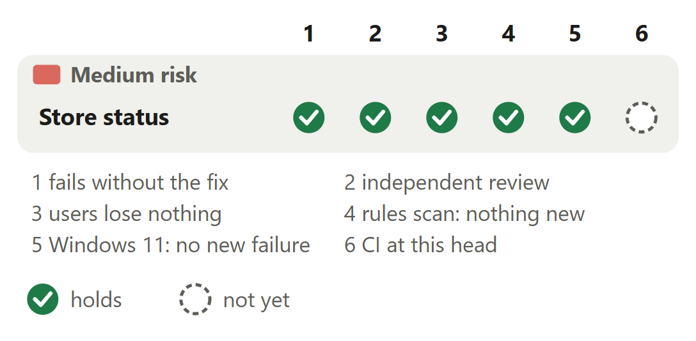

# A Rerail whose code rules can open no content store says so

For [pull request #1095](https://github.com/neralabs/rerail/pull/1095), head d626e6875. [report.html](report.html) is the same report as one page: download it and open it.

## 1. The decision

**Should the engine read unavailable, with the reason, when its code rules can open no content store?**

1. `rerail status` says why no code rule runs, and exits 5, without a store.

**We recommend:** approve it: five surfaces that called the engine fine while every code rule audit failed now give the reason, and the status asks the store question through the function the audit opens its store with.

| Size | Risk and review | Waits on | Not verified |
|---|---|---|---|
| 250 lines in 11 files: 56 ship, 194 are tests and text | Standard. It changes what is reported, not what runs in sessions. | Nothing. No CI run at this head yet: not pushed. | 2 |

## 2. Intent, and the gap

| Change | Intended | Found | Now |
|---|---|---|---|
| Engine status | No store, reported on first scan _(docs)_ | Engine ok, exit 0, audits failing _(3 of 3 runs)_ | Closes the gap, changes answer 1. |

Reported from a Windows x64 laptop; still shows at `main` 70892dfac and in 0.2.1 from npm on Linux x64 and Windows 11, 25 November 2026.

Sources at main, and causes

| Change | Where main states the intent | The cause, and what was measured |
|---|---|---|
| Engine status | `docs/how-setup-works.md`, "Which store a build uses": "Neither (say, an `npx` copy): no store, reported on its first scan." `readNativeStatus` in `src/daemon/daemon.ts` asked only `nativeHealth()`. | `readNativeStatus` probed the kernel only. The store was asked only in `#prepareWorkspace` (`contentStorePath`, then `assertContentStoreOwner`), whose throw each audit recorded as a failure, then "Policy workspace could not be initialized". |

## 3. Where to look

1. **Read first**, 5 min: `daemon.ts`: `readNativeStatus`. Does the status read unavailable when each audit fails to open its workspace, and only then?
2. 3 min: `main-instance.ts` and `code-rule-enforcer.ts`: `ownedContentStorePath`, `contentStoreProblem`, `#prepareWorkspace`.

**Then skim**, 4 min: An end-to-end test runs the built CLI from a package copied outside Git. Troubleshooting names each reason and what to do.

## 4. Risk against verification

One change. Start at `readNativeStatus`.

Each limit, and each check that does not hold yet

| Change | Check | Its limit, or why it does not hold yet |
|---|---|---|
| Store status | CI at this head | No CI run at this head on GitHub yet: the branch is not pushed. |

## 5. The changes

**Engine status asks for store**, medium risk: Storeless Rerail: `Engine: ok`, exit 0 at `main`; `Engine: unavailable` with the reason, exit 5 here.

<b>6. The decisions</b>

**Say it on every surface, refuse at install, warn once, or run without a store?**

**We chose** say it on every surface with the reason, and leave what runs as it is. **Would change our mind:** A maintainer's choice for `rerail install --root`, which this change neither needs nor blocks.

| Option | What a user gets | Cost | What it breaks |
|---|---|---|---|
| The engine status says no code rule can run, and why **(chosen)** | Status, `/healthz`, footer, `daemon.log` and bundle give the reason, however the package was started. | A person still has to act. | Nothing found. |
| Refuse such a package at `rerail install --root` | No such install through that command. | Changes what a command accepts: the maintainers' choice. | A package run through its own CLI still says `Engine: ok`. |
| Warn once at `install --root` | One line, once. | Gone after that line. | Status and footer still say ok in every later session. |
| Run code rules without a store | Code rules run there. | No reuse between sessions: each repository audit reads every source again. | It changes what runs; #581 leaves that to the maintainers. |

**Evidence.** On Linux x64 at `main` the package's own CLI said `Engine: ok`, exit 0, 3 of 3 runs, and `install --root --dry-run` took it; a warning there would not reach a daemon started by the package's CLI.

**Ask the store through the audit's own function, or check it apart?**

**We chose** one function both use, so the status and the audits ask one question. **Would change our mind:** A store check the daemon needs that the audit does not.

| Option | What a user gets | Cost | What it breaks |
|---|---|---|---|
| One function, `ownedContentStorePath`, for the audit and the status **(chosen)** | The engine reads unavailable for what makes each audit fail to open its workspace. | One edit in `#prepareWorkspace`. | Nothing found. |
| The status calls `contentStorePath` and the owner check itself | The same today. | No enforcer edit. | A check the audit adds later is missed by the status. |
| Reuse the support bundle's rule for a package | The same for a package outside Git. | Moves code. | It asks for the managed build where the audit asks for the main instance. |

**Evidence.** With the store variable naming a file in the machine-wide directory, `main` said ok, exit 0, while the audit refuses that store outside the main daemon; here the status reports that refusal, exit 5.

<b>7. How it fits</b>

It stands on `main` 70892dfac alone: it needs no other change, and none needs it; it merges with today's `main` 261a0e92d with no conflict.

**The trial merges.** #1051, #1056's fix, #1076 and #1074 change files near it and none edits a file this one edits; Git merges this head with each alone, and with `main`, exit 0.

<b>8. What is not covered</b>: 2 not verified, 2 limits that stay

1. **Code rules** still do not run in such a package; this change makes that visible, nothing more.
2. **macOS** never ran.

**Limits that stay**

- The daemon asks once, at its start: a store that appears while it runs shows at its next start.
- `rerail install --root` still takes such a package without a word: the maintainers' question.

## 9. What we ask of you

Ask 1 rules on answer 1.

1. **May `rerail status` exit 5 for a Rerail whose code rules can open no store?** We recommend yes: it exits 5 for a kernel that does not load.
2. **What should `rerail install --root` do with a package that would have no store?** We recommend install it and say on stderr that no code rule runs.

<b>10. Evidence</b>

The description on GitHub is the record: "How you tested it" holds the runs at `main` and here.

| Where | What ran | Result |
|---|---|---|
| Linux x64 | A package outside Git, its CLI's daemon, a Claude Code edit breaking a complexity rule, at `main` | `Engine: ok`, exit 0; footer `audit failed (1 failure)`; edit not steered; bundle daemon engine ok. |
| Linux x64 | The same at this head | `Engine: unavailable` with the reason, exit 5; footer `engine unavailable · audit failed (1 failure)`; bundle daemon engine not ok with the reason. |
| Linux x64 | The new cases with `main`'s `src/`; 8 mutants | 4 of the 6 new cases fail at `main`, the other 2 pin the order `main` already has; every mutant caught. |
| Windows 11 | The 24 test files, against `main`'s Windows baseline | 436 passed, 8 skipped; no failure the baseline lacks. |
| Windows 11, Linux x64 | The 4 changed test files, 30 runs on our Windows machine and 30 rounds on GitHub's two runners | The new cases passed every run; one run of ours failed in a status-line case of `main`'s; GitHub's runners: 30 of 30 on each. |
| Windows 11 | Every file under `integration/`, `main` and here | The same 11 failures in 6 files at both. |

**Sources.** The diff against `main` 70892dfac and the runs, read on 25 November 2026.

