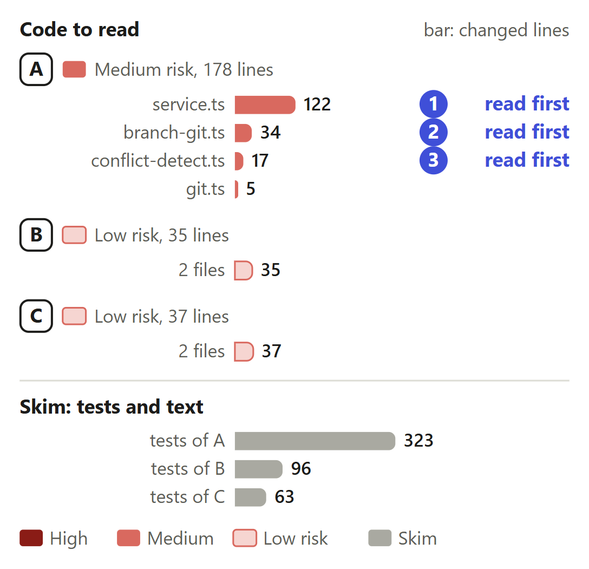
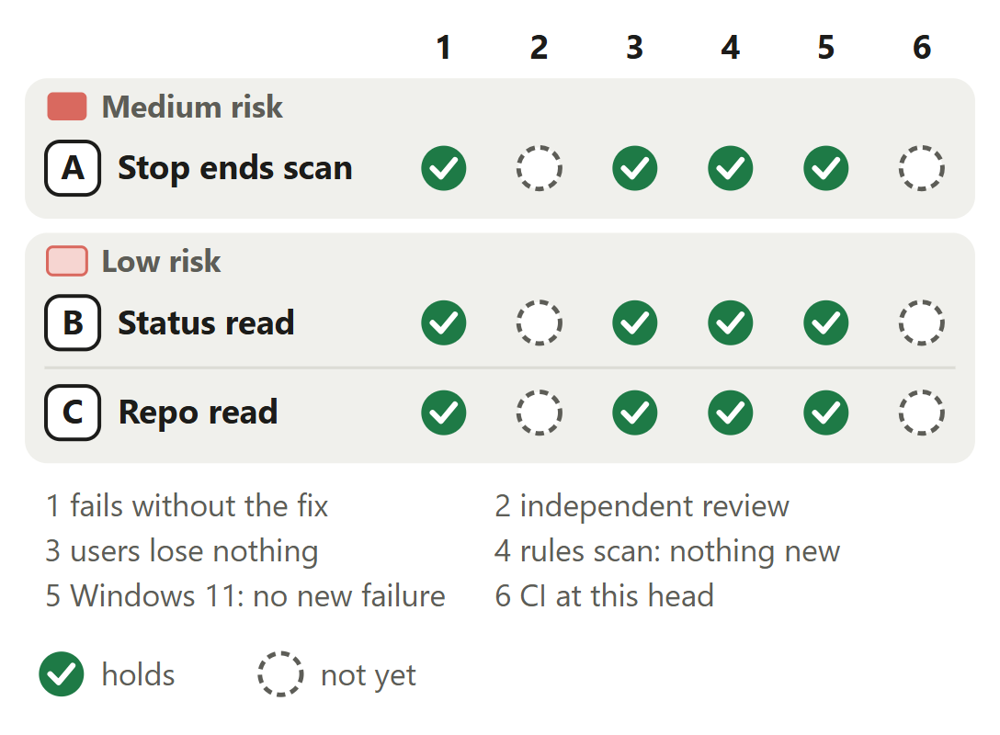

# Merge Assist: checkout reads off the thread; stops end late Git reads

For [pull request #816](https://github.com/neralabs/rerail/pull/816), head cec5931f3. [report.html](report.html) is the same report as one page: download it and open it.

## 1. The decision

**Once `stop()`'s 2 s wait is over, should Merge Assist end a scan's Git at its next read and return once that Git exits?**

**We recommend:** approve it: on Windows a hook no longer waits behind a status read; a disposed runtime starts no Git; a scan ending in the wait stores; no file read of Rerail's holds a runtime's stop.

| Size | Risk and review | Waits on | Not verified |
|---|---|---|---|
| 732 lines in 12 files: 250 ship, 482 are tests and text | Normal. Medium risk: every pass's Git reads run through the stop. | Nothing. It stands alone. | 2 |

## 2. Intent, and the gap

| Change | Intended | Found | Now |
|---|---|---|---|
| A. A stopped scan | A stop ends Merge Assist's work _(code comment)_ | About a thousand Git processes on _(a runtime, five runs)_ | Closes the gap. |
| B. A status read | Reads only _(code comment)_ | Hooks wait 120 ms during a read _(a real daemon)_ | Closes the gap. |
| C. A repository's read | Pick the main checkout _(code comment)_ | A blocking Git per checkout _(a case, Linux x64)_ | Closes the gap. |

Found on 14 November 2026 on Windows 11 and Linux x64, and measured again on 18 November on the same kinds of machine.

Sources at main, and causes

| Change | Where main states the intent | The cause, and what was measured |
|---|---|---|
| A. A stopped scan | `src/runtime/merge-assist/service.ts` at `main`, `stop()`: it races the scans in `#scans` against a 2 s timer and returns; `#detect` checks `#stopped` only after `gh` answers. | Nothing told a pass to end. `detectConflicts` ran every Git read of the pass and wrote at its end; `RerailRuntime.dispose()` closed the database right after `stop()`. A detection after an edit was not in `#scans`, so `stop()` did not wait for it. |
| B. A status read | `src/runtime/merge-assist/service.ts` at `main`, `#checkout`: `repositoryIdentityLocation(checkoutPath).git`, then `lookupCheckout`, each a `git rev-parse` through `runGit` (spawnSync). | Both locates ran on the thread that answers hooks; #667 had moved the branch and base reads off it. Hooks that arrived during a read waited for both processes. |
| C. A repository's read | `src/api/repository-operations.ts` at `main`, `checkoutOnDisk`: `present.find(checkout => repositoryIdentityLocation(checkout.checkoutPath).main)`. | `repositoryIdentityLocation` runs `git rev-parse` through spawnSync; the page reads every 5 s. |

## 3. Where to look

1. **Read first**, 8 min: `service.ts`: `#detect`, `stop`, `#checkout`, `#activeCheckout`. Does a pass ending within the wait store, one stopped after store nothing, and no file read hold the stop?
2. **Read first**, 5 min: `branch-git.ts`: `readsStoppedBy`, `runRead`. Does every Git read of a pass go through `runRead`?
3. **Read first**, 4 min: `conflict-detect.ts`: `detectConflicts`, `detectPass`. Does a stopped pass answer null on every path?
4. 6 min: `repository-identity.ts`, `repository-registry.ts`, `repository-operations.ts`, `merge-assist-operations.ts`, `git.ts` (`GitReads.stopped`).

**Then skim**, 8 min: Cases that count blocking processes per read, stop a scan with its read held until the stop ends it, and let a scan or detection end within the wait.

## 4. Risk against verification

Start with A: every detection pass's Git reads now register with the stop's owner. No review by anyone but the author yet.

Each limit, and each check that does not hold yet

| Change | Check | Its limit, or why it does not hold yet |
|---|---|---|
| A. Stop ends scan | independent review | No review by anyone but the author yet. |
| B. Status read | independent review | No review by anyone but the author yet. |
| C. Repo read | independent review | No review by anyone but the author yet. |
| A to C | CI at this head | CI runs once the pull request opens. |

<b>5. The changes</b>

**A. A stop ends a pass**, medium risk. Disposed mid-scan on Windows 11: about a thousand Git processes after `dispose()` at `main`, then a failure line; none here.

- **Problem:** A runtime that made its own Merge Assist closed its database while the scan read Git on, then printed a failure line.
- **Who meets it:** Pi sessions that run Rerail in their own process, and `rerail events` without a daemon, when they end during a scan; on Windows the running Git blocks removing the folder.
- **What it does:** `stop()` waits within its bound for the hook, the scans, and each session's or edit's work: what ends meanwhile stores what it found. Then it stops the service's `GitReads`, where every Git read of a pass registers (`readsStoppedBy`): a running Git ends, none starts, the pass stores nothing, and `stop()` resolves once that Git exits.
- **Risk:** Medium: every detection pass's Git reads, and a session's locate, now run through the stop's owner, and a read it ends answers as a failed read.
- **Check:** That a pass that ends within the wait stores as at `main`, and one stopped past it stores nothing: `detectConflicts` returns null when aborted, before its transaction, and `#detect` writes no last scan then. And that the stop waits for the ended Git's exit, not for the pass.
- **Picture:** On Windows 11 with 200 remote branches, 891 to 1,095 Git processes started after dispose() at main and the failure line was printed 15 of 15 times; at this head none started and no line was printed.
- **Method:** A `RerailRuntime` as Pi builds it, disposed at its scan's 40th Git process, five times a run: three runs per side alternating on a Windows 11 desktop (200 remote branches), one per side on Linux x64 (1,500).

**B. A status read off the thread**, low risk. Windows 11: a hook during a status read waited 120 ms at the median at `main`, 44 ms here.

- **Problem:** Every status read ran two `git rev-parse` through spawnSync on the daemon's thread; a hook that arrived meanwhile waited.
- **Who meets it:** Every Windows user with the Merge Assist page open (a read every 5 s), and every session start and edit where Merge Assist is on.
- **What it does:** `repositoryIdentityLocationAsync` reads the location with one Git process through `runGitAsync`; `lookupCheckoutAt` finds the recorded checkout there with no second process. Its `service.ts` lines (`#checkout`, `#activeCheckout`) are counted under A.
- **Risk:** Low: the same location is read, off the thread, once instead of twice.
- **Check:** That `#checkout` and `#activeCheckout` answer as at `main` for a folder outside Git, a folder that is gone, an unrecorded checkout and Git missing.
- **Picture:** On a Windows 11 desktop, a hook during a status read waited 120 ms at the median at main and 44 ms here; with the daemon and hooks on 4 logical processors, 3 kept busy, 168 ms at main and 63 ms here.
- **Method:** A real daemon from the built CLI, Claude Code hooks every 100 to 400 ms through `runClaudeHook`, the page's read of `GET /api/merge-assist` back to back, 12 s per phase, five rounds per side on one Windows 11 desktop.

**C. A repository's read off the thread**, low risk. A repository's read: four blocking Git at `main` (three on Windows), two choosing the checkout; none here.

- **Problem:** With no checkout in scope, the API asked Git synchronously whether each checkout on disk is the main one, until one was.
- **Who meets it:** The Merge Assist page with only a repository in scope, at each read, and rule pack recommendations, which choose their checkout this way; their scan's own two Git processes still block, as at `main`.
- **What it does:** `checkoutOnDisk` asks the same with `repositoryIdentityLocationAsync`, one checkout at a time; its two callers wait for it.
- **Risk:** Low: the same checkout is chosen, off the thread.
- **Check:** That `mainCheckout` stops at the first main checkout as `find` did.
- **Picture:** A read for a repository whose linked worktree sorts first started two blocking git rev-parse at main and none here.
- **Method:** The case `api-merge-assist-thread.test.ts`, which counts spawnSync and execFileSync calls during one read, run over `main`'s source and this head on Linux x64.

<b>6. The decisions</b>

**How does a stop reach every Git read of a pass?**

**We chose** one `AsyncLocalStorage` in `branch-git.ts`, the module all Merge Assist Git reads go through. **Would change our mind:** a maintainer preferring an explicit `signal` argument through every read.

| Option | What a user gets | Cost | What it breaks |
|---|---|---|---|
| Each Git read registers with the stop's `GitReads` through `readsStoppedBy` **(chosen)** | The running Git ends at once and none starts; a read added later is stopped too; the stop waits for that Git only. | About 30 lines. | Context a reader of `conflict-detect.ts` does not see. |
| A `signal` argument through every read | The same, in plain sight. | About 30 functions in four files change. | A read added later without it runs on after a stop. |
| Check the signal between branches only | Fewer lines. | About 5 lines. | Up to six branches' reads run on after a stop. |

**Evidence.** Mutants of each line are caught on Linux x64 and Windows 11; a scan stopped at three points starts no Git after the stop, and none runs when it resolves.

**When does the stop end a pass, and what does it wait for?**

**We chose** wait within the 2 s `stop()` already gives, then end what still reads Git and wait for its exit only. **Would change our mind:** a maintainer who wants `dispose()` to return at once and accepts that a scan about to finish is dropped.

| Option | What a user gets | Cost | What it breaks |
|---|---|---|---|
| Wait within the bound, end what reads Git, wait for its exit **(chosen)** | A pass that ends in time stores its result, as at `main`; no Git after the stop; a file read that never answers does not hold the stop. | About 10 lines. | Up to the bound per stop while a pass runs, as at `main`, plus the ended Git's exit. |
| The same, then wait for each ended pass | The same while every file read answers. | About 10 lines. | A pass waiting on a file read on a share that stopped answering holds `dispose()` and the daemon's stop until it returns: about a minute on SMB, without end on a hard NFS mount. |
| End every pass at once | `dispose()` in tens of milliseconds. | About 5 lines. | A scan that would have ended within the bound stores nothing. |
| Wait for every pass, no bound | Every pass stores. | About 5 lines. | `dispose()` waits for a whole scan: 10 to 20 s on a Windows 11 desktop with 200 remote branches. |

**Evidence.** Through Pi's runtime on Windows 11, `dispose()` took 2.05 to 2.15 s here and started no Git after; a case that holds a worktree folder's `access` fails over the form that waited for each pass and over `main`'s source, and passes here.

**How does a read find its checkout?**

**We chose** one asynchronous `git rev-parse`, then `lookupCheckoutAt` at that location. **Would change our mind:** the change that keeps checkout placements landing first: its kept answers need no Git.

| Option | What a user gets | Cost | What it breaks |
|---|---|---|---|
| One `rev-parse` through `runGitAsync`, then `lookupCheckoutAt` **(chosen)** | No Git on the thread; answers as at `main`. | One process per read. | Nothing. |
| The daemon's cached checkout resolver | No Git after a checkout's first read. | A few lines. | The first read still blocks; a removed folder still reads as a checkout. |
| Hand the service the API's resolved checkout | No locate from the API. | The service's interface. | The CLI and the runtime call it with a path. |

**Evidence.** A parity case: the location read off the thread equals the blocking one for a checkout, a folder in it, a linked worktree, a folder outside Git and one that is gone.

<b>7. How it fits</b>

It stands alone: nothing must merge first, and nothing waits on it. #813 edits the same file and merges cleanly; #756 and #621 gain no conflict beyond their own with `main`.

This pull request holds main at cf5ab9083 and merges clean with it. #813 edits repository-identity.ts too and merges cleanly with it. #756 and #621 edit git.ts and gain no conflict beyond their own with main. A change of ours that follows #813 edits the same locate and will keep both functions.

**Shared files and trial merges.** Trial merges with cec5931f3 at the pull requests' heads of 19 November, 02:06 UTC; this head holds `main` at cf5ab9083. #813 (ours, `repository-identity.ts`) merges cleanly. #756 (ours) and #621 share `git.ts` and gain no conflict beyond the one each already has with `main` there. A change of ours that follows #813 also changes the locate in `repository-identity.ts`; it will keep both functions.

<b>8. What is not covered</b>: 2 not verified, 3 smaller gaps, 2 limits that stay

1. **macOS** never ran.
2. **The remaining cost** with reads back to back, hooks took 44 ms at the median against 35 ms with none on Windows 11: each read still starts three Git processes.

**Smaller gaps**

- **A change's own locate** a change (on, off, scan, dismiss, settings) still records its checkout through `recordCheckout`, which locates synchronously: a person's click, on the registry's write path every session start shares.
- **A checkout's first read** the page's first read for a checkout the daemon has not resolved yet still starts one blocking `git rev-parse` in the API's own resolution, as at `main`; later reads reuse its answer.
- **Rule pack recommendations** choose their checkout off the thread; the recommendation scan's own two Git processes still block, as at `main`.

**Limits that stay**

- A pass waiting for `gh` is not ended by the stop: `stop()` gives up on it after its bound, as at `main`, and it stores nothing once `gh` answers.
- A pass waiting on a file read is not ended either: the stop does not wait for it, and it stores nothing and starts no Git once the read returns.

## 9. What we ask of you

1. **Should `recordCheckout`, run by each Merge Assist change, locate off the thread too?** We recommend a separate change: every session start shares that path..

<b>10. Evidence</b>

The description is the record: "How you tested it" holds the failing cases, the runs through a real daemon and a runtime, the mutants, and every run with its counts.

| Where | What ran | Result |
|---|---|---|
| Windows 11, a real daemon | Hooks every 100 to 400 ms beside the page's reads back to back, five rounds per side, `main` and this head | Hook during a read, p50: 120 to 44 ms; 168 to 63 ms with 3 of 4 processors busy; blocking Git per read 2 to 0. |
| Windows, Linux: runtime and daemon | A `RerailRuntime` disposed at its scan's 40th Git process and `rerail daemon stop` during a session's scan, `main` and this head alternating | Windows: 891 to 1,095 Git processes after `dispose()` at `main`, none here; dispose 2.01 to 2.20 s at `main`, 2.05 to 2.15 s here; daemon stop 2.28 to 2.58 s at `main`, 2.38 to 2.79 s here. Linux: 30 to 155 Git at `main`, none here. |
| Linux x64, tests | The 38 test files of the changed modules and their importers, the new cases 20 times, 11 mutants of the stop's lines, CI's integration job | 810 passed, 26 skipped; 20 of 20; 11 of 11 caught; passed. |
| Windows 11, tests | The 38 files compared with `main`'s runs, the new cases over `main` and 20 times here, 7 mutants | 835 passed, 5 skipped; one timing case of `main`'s own failed once and passed five of five runs there at this head and at `main`; 3 of 4 new stop cases fail at `main`; 20 of 20; 7 of 7 caught. |

**Sources.** This branch's diff over `main` cf5ab9083 at cec5931f3 (ad77ceb2b, read on 18 November 2026, with `main` merged in); issues #685 and #686; a real daemon and a runtime on Windows 11 and Linux x64 machines; test runs there.

