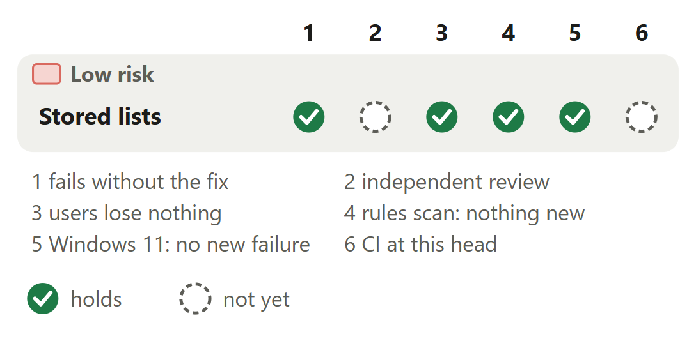

# Audits: unreadable stored lists of one audit no longer fail its pages

For [pull request #989](https://github.com/neralabs/rerail/pull/989), head 33de51166. [report.html](report.html) is the same report as one page: download it and open it.

## 1. The decision

**Is an audit whose stored lists cannot be read better listed with those lists empty and a failure for each, than answered with 500?**

**We recommend:** approve it: every audit page and the session's page answer, a coding agent's `audits_list` too, the audit says what is wrong, and `daemon.log` names the row to mend.

| Size | Risk and review | Waits on | Not verified |
|---|---|---|---|
| 996 lines in 11 files: 342 ship, 654 are tests and text | Fast. Low risk, no high-risk path. | Nothing. It stands alone on `main`. | 2 |

## 2. Intent, and the gap

| Change | Intended | Found | Now |
|---|---|---|---|
| A page of audits | Pages every recorded audit _(docs)_ | One damaged row fails the page _(built daemon, real hook)_ | Closes the gap. |

Found on 16 November 2026 on Linux x64, reading audits a Claude Code session recorded, after one audit's stored text was cut short by hand.

Sources at main, and causes

| Change | Where main states the intent | The cause, and what was measured |
|---|---|---|
| A page of audits | `docs/reference.md` at `main`, the `audits_list` row: "`{ audits, total }` with `violations` and failures". `src/engine/audit/audit-store.ts` at `main`: `auditColumns` selects every column of `audits` through Drizzle's JSON mode, and `ruleProvenance()` maps the provenance with `.mapWith(audits.ruleProvenance)`. | Drizzle's JSON mode runs `JSON.parse` on each row as `.all()` maps it, so one row's parse error throws out of the whole page's query: 500 on the route, an error result in MCP. A damaged stored copy fails every audit that names it. The session's summary counts failures and violations with SQLite's JSON functions, which raise `malformed JSON` on such text. `daemon.log` gets the error and a stack, with no audit named. |

## 3. Where to look

1. **Read first**, 10 min: `audit-store.ts`: `record`, `readLists`, `parsedList`, `latestAuditSummary`, `holdsList`, `readableAudits`. Does an intact audit read exactly as before, and a damaged one say what is wrong?
2. 5 min: `remote-outbox.ts`: `#addPending`, `#mendedFrom`, `#addAudit`, `auditHash`; `audit-control.ts`: `onlyToleratedFailures`; `support-bundle.ts`: the log.

**Then skim**, 5 min: Store cases: each damaged list in a page and alone, a damaged stored copy, the summary against the record, one log line per text; the support bundle keeps the failure.

## 4. Risk against verification

Start with `record`: every reader of an audit goes through it. No review by anyone but the author yet.

Each limit, and each check that does not hold yet

| Change | Check | Its limit, or why it does not hold yet |
|---|---|---|
| Stored lists | CI at this head | CI runs once the pull request opens. |

## 5. The changes

**Unreadable stored lists read as none**, low risk: Linux x64 and Windows 11, one of 5 audits damaged: `GET /api/audits` 500 at `main`, 200 with all 5 here.

<b>6. The decisions</b>

**Where should the lists be read so one row cannot fail the page?**

**We chose** parse them in `record`, the one function every audit record goes through, and guard the session's summary in SQL. **Would change our mind:** a maintainer preferring a field on the record over failures.

| Option | What a user gets | Cost | What it breaks |
|---|---|---|---|
| Parse in `record`, a SQL guard in the summary **(chosen)** | Every reader answers, and the damaged audit says what is wrong. | One parse per list per row, as before; the summary checks five texts of one row. | Nothing for an intact audit. |
| A SQL guard in the page's select | The same answers. | SQLite parses each list once more before JavaScript parses it again, up to 221 KB of provenance a row. | Nothing, but every row pays for a case only damage makes. |
| The summary from the record | The same answers. | Every presentation request parses the latest audit's whole violations and provenance. | Nothing, but the status line and the hooks pay for it at each read. |
| Catch the error in the route | The page answers without the audit. | A catch per route. | `total` is off by one; the outbox and the support bundle still fail. |

**Evidence.** Linux x64, one session of 200 audits, each naming one of two stored provenances of 200 rules: a page read 100 times through each store alternately, 2.2 and 2.6 ms more than `main` at the paired median, within the spread. The summary, read 2,000 times: 0.17 ms at `main`, 0.59 ms here, 0.36 ms without the check of each list's items. Summing it up from the record would parse 2 MB of violations in one daemon test.

<b>7. How it fits</b>

It stands alone on `main`; nothing waits on it. Issue #983 follows: one damaged row fails the violation history and repository pages alike. Clean with #979; Git stops at one import hunk of the outbox test with #974, and at one hunk of `SqliteAuditStore` with #964.

**Shared files and trial merges.** Read from a local clone on 22 November 2026. Clean: #979 at 7f999c574 (`docs/reference.md`). #974 at 3b1685caf, six shared files: one hunk in the outbox test's first two imports, this change adding `createHash` and #974 `existsSync`; the merge keeps both. #964 at 4c0fa4e9b (`audit-store.ts`, `audit-control.ts`, `docs/reference.md`): one hunk over `SqliteAuditStore.get` and `list`, #964 reading through its own connection and this change passing the connection and the error output to `record` and `listAudits`; the merge keeps both. #964 also has a merge conflict with `main` itself in `code-rule-bridge.test.ts`.

<b>8. What is not covered</b>: 2 not verified, 3 limits that stay

1. **macOS** never ran; the change is a parse in JavaScript and SQLite's JSON functions, with no platform path.
2. **The violation history** still answers 500 for a page holding a violation of an audit whose `violations_json` a damaged file broke. It needs its own design: issue #983.

**Limits that stay**

- The repository audit list and entries, in internal testing, count from `failures_json` and `violations_json` in SQL and were not changed.
- An audit a remote holds whole is not sent again for a list damaged later, so the remote keeps the whole copy; only damage that changes its violations' stored length, which the hash counts, sends it again.
- No CHECK guards `audits.rule_revisions_json`, which Rerail only ever writes as an array; adding one is a schema change, left out here.

## 9. What we ask of you

We ask no ruling.

<b>10. Evidence</b>

The description is the record: "How you tested it" holds the failing runs, the runs through the product on Linux x64 and Windows 11, and every run with its counts.

| Where | What ran | Result |
|---|---|---|
| Linux x64 and Windows 11 | The issue's steps as written, 5 runs at `main` and 5 at this head, each system on one machine | `main`: 500 on the page, its page of 200 and the damaged audit, 200 for another, in 5 of 5. Here: 200 four times with 5 audits, in 5 of 5, and one `daemon.log` line naming the audit. |
| Linux x64 | Each other list and the stored copy damaged, at `main` and here | `main`: every audit read 500, and the session's page 500 for failures and violations. Here: every audit read and the session's page 200, the damaged audit marked. |
| Linux x64 | 108 one-line changes to the new and changed lines, one at a time | 104 caught; the 4 left change only the cost. The unchanged files pass every case. Listing the unreadable lists' failures after the audit's own fails 4 cases. |
| Linux x64 and Windows 11 | The changed test files and every file importing a changed module, 14 files, here and at `main` on one machine each | Linux x64: 500 passed here, 456 at `main`, support bundle cases over their 5 s limit at both, the same 2 again at both. Windows 11: 513 of 513 here, 468 of 468 at `main`. |
| Linux x64 | Syncs through `main`'s outbox, 4a663d799's and this head's alternately in one process | 4,000 audits sent marked, the first batch: 42.3 ms here with one statement testing lists, 1,190.6 ms at 4a663d799 with 4,000, where they name one damaged stored provenance; 45.9 and 326.2 ms for damaged paths of their own. `main` ends each such sync with the parse error. 4,000 audits not sent: 170.6 ms here, 175.5 ms at `main`. 40 runs each. |

**Sources.** This branch's diff over `main` at 1609ac3a3, read on 22 November 2026; `main` at 1609ac3a3 for the quoted intent; `main` and this head each built from source for the runs through the product.

