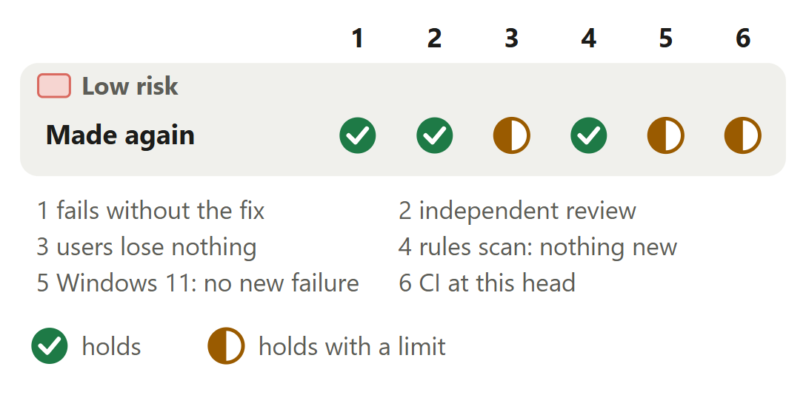

# A worktree made again is read as soon as Git lists it

For [pull request #909](https://github.com/neralabs/rerail/pull/909), head 15b7926f2. [report.html](report.html) is the same report as one page: download it and open it.

## 1. The decision

**May the walk of a repository's other worktrees watch the folder where Git registers them, so that a change Git makes there starts a walk?**

**We recommend:** approve it: a file written in a worktree made again reaches the Log within seconds where it waited for an unrelated change, and the watch starts no Git process of its own.

| Size | Risk and review | Waits on | Not verified |
|---|---|---|---|
| 972 lines in 16 files: 447 ship, 525 are tests and text | Careful. It adds one watched folder per repository. | Nothing. No CI run on GitHub yet: not pushed. | 6 |

## 2. Intent, and the gap

| Change | Intended | Found | Now |
|---|---|---|---|
| Made again, read again | A write reaches the Log within seconds _(docs)_ | Waited for an unrelated walk _(a traced daemon)_ | Closes the gap. |

Found in November 2026 on Linux x64, tracing a daemon's walks across a worktree removed and added again.

Sources at main, and causes

| Change | Where main states the intent | The cause, and what was measured |
|---|---|---|
| Made again, read again | `docs/rule-scoping.md` at 6b3990ba8, the paragraph on walking the other worktrees. `src/engine/code-rule/worktree-walks.ts` at 6b3990ba8, `#forget`: `this.#notices.retain(roots)`. | The walk's list leaves out a path with no folder, so the walk lets go of the worktree; nothing watches Git's registry, so the add asks for no walk. With no walk between, the walk after the add read the new folder but would not watch it within 5 s of the old watch ending, and asked for no later walk. |

## 3. Where to look

1. **Read first**, 10 min: `worktree-notices.ts`: `watchRegistry`, `registryNoticeCounts`, `#registryNotice`, `folderAt`, `#endedAt`. Can Git's own work in a worktree ask for walks, or a folder renamed away and back be chased?
2. 5 min: `worktree-walks.ts`, `checkout-code-rule-router.ts`, `code-rule.ts`, `code-rule-bridge.ts`, `tree_watch/inotify.rs`, `tree_watch/mod.rs`, `tree-watch.ts`, `native.ts`: where the registry is named, watched and gives way.

**Then skim**, 5 min: The tests: a scripted watch for the notices, and a real repository through the bridge for the walks.

## 4. Risk against verification

One change, low risk: one more watched folder per repository; what a walk reads and records stays as on `main`.

Each half mark's limit

| Change | Check | It holds with this limit |
|---|---|---|
| Made again | users lose nothing | Every worktree is watched as on `main` near the Linux watch budget, shown at the engine's seam only: the registry watch takes only spare room and gives it up. On Windows 11 a lock-file cycle in a registry entry takes about 0.25 ms more. |
| Made again | Windows 11: no new failure | Windows 11: the 24 changed and importing test files pass at this head (759) and at `main` 0a3ce014c (744), none failed. Five states, 5 runs at 1e7110240: here 5 of 5 in every state. One other run's 35 s hook stall is unexplained. |
| Made again | CI at this head | No CI run on GitHub yet: the branch is not pushed. On Linux x64 CI's lint and type-check job passes at this head; the build and integration job (23 files, 91 tests) at 1e7110240. |

## 5. The changes

**Worktrees made again, read again**, low risk: Written after a walk while the folder was gone: `main` 6b3990ba8 0 of 3 runs, here 3 of 3.

<b>6. The decisions</b>

**What tells the walks that Git lists a worktree again?**

**We chose** a watch of the folder where Git registers the worktrees: any add, remove, move, repair or prune changes it. **Would change our mind:** A Git that rewrites an entry's `gitdir` or `locked` file on ordinary commands: each would ask for a walk.

| Option | What a user gets | Cost | What it breaks |
|---|---|---|---|
| Watch Git's registry folder **(chosen)** | A worktree read and watched again as soon as Git lists it, with or without a walk while it was gone. | One watch per repository; on Linux one per entry. | A repository's first linked worktree, or its only one removed and added again: no registry folder then, as on `main`. |
| Watch the folder above a gone worktree | The same, while one is gone. | On Windows the engine watches that folder's whole tree, every other worktree with it. | Every write in every worktree comes as a notice of it. |
| Read the registry at each tool call | The same at the next tool call. | A read of every entry per tool call. | A file written while the session is idle waits. |

**Evidence.** Linux x64, five states, `main` and here side by side: every state records both files here in every run (3 runs at this head, 5 at 1e7110240). The watch gave 26 notices in one traced run, one per add and one for `git worktree prune`, none from the walks' own Git processes.

**When is a worktree whose watch ended watched again?**

**We chose** at once when another folder stands at its path (device, file number, birth time); one that ties waits as before. **Would change our mind:** A Linux file system that stamps birth times more coarsely than its clock's tick.

| Option | What a user gets | Cost | What it breaks |
|---|---|---|---|
| Folder identity **(chosen)** | A folder made again is watched as the next walk reads it. | One `lstat` per watch start. | One made within a clock tick waits as before. |
| End every wait when Git's registry changes | The same, mostly. | None. | Notices of two roots come in no fixed order, so the wait may begin after the registry's notice. |
| Drop the 5 s wait | Every ended watch watched at once. | None. | A folder being renamed back and forth is chased at every walk. |

**Evidence.** With no walk between, `main` 6b3990ba8 recorded a file written 3 s after the add in 0 of 3 runs on Linux x64; here 3 of 3. On ext4 the birth time tells a folder made at once from the one removed, unless both came within one 4 ms tick. Taking out the file number or the birth time fails a case on Linux x64.

**Where does the registry watch take its room on Linux?**

**We chose** only room the watch budget has left, folders above it included, given up to a worktree that needs it. **Would change our mind:** A user whose engine runs at its budget and who would rather have the registry watched than the budget kept.

| Option | What a user gets | Cost | What it breaks |
|---|---|---|---|
| The budget's spare room **(chosen)** | Every worktree watched as on `main`; the registry while room is left. | A room check per watch call, the same comparison as before. | At the budget's edge the registry is not watched, as on `main`. |
| Outside the budget | The registry watched at the edge too. | Up to one inotify watch per registered worktree past the engine's share. | Another program of the user may find no inotify watch left. |
| After the walk's worktrees | The same at the first walk. | None. | A worktree that grows at a later walk finds the registry in its room and is not watched. |

**Evidence.** Cases with a budget sized so the last worktree just fits without the registry: it fits here too and the registry's watch ends; with room for the registry but not the folder above it, the registry is not watched; a spare root ends no other. Each fails with its line taken out.

<b>7. How it fits</b>

Nothing has to merge first: it stands alone on `main` 0a3ce014c, which it has merged. It shares files with #812, whose trial merge is clean, and with #904, where one file and its test file conflict.

**The files it shares.** #812 edits `checkout-code-rule-router.ts`, its test file and `native.ts`; the trial merge is clean. #883 shares no file. #904 edits `code-rule-bridge.ts`, the router and `worktree-walks.ts`, which merge clean, and `worktree-notices.ts` and its test file, which conflict: the one that lands second merges `main` and keeps both. #865, #879, #881 and #887, merged today, edit files this one edits; Git merged them cleanly and they compose.

<b>8. What is not covered</b>: 6 not verified, 1 limit that stays

1. **One Windows 11 run** at 1e7110240: two Read tool calls took about 35 s and the late file was missed, cause unknown; four more runs recorded every file.
2. **macOS** never ran.
3. **A repository's only linked worktree** removed and added again, or its first one added, waits for the next walk, as on `main`: Git keeps no registry folder without one.
4. **A folder made within a clock tick** of the old one, on Linux, waits as on `main`.
5. **A folder put back by another program** moved away and back with `mv`: a write there waits for the 10-minute reread, as on `main`.
6. **The Linux watch budget's edge** an engine at its budget does not watch the registry, as on `main`; shown at the engine's seam only.

**Limits that stay**

- The walk this change asks for still waits for the 5 s gap after the session's last walk.

## 9. What we ask of you

We ask no ruling.

<b>10. Evidence</b>

The description on GitHub is the record: "How you tested it" holds the runs on `main` and here.

| Where | What ran | Result |
|---|---|---|
| Linux x64 | The built Claude Code hook against a daemon of `main` and of this branch, five states, one machine | `main` 6b3990ba8 beside this head, 3 runs each: `main` walked 0 of 3, the folder above 1 of 3, another branch 1 of 3; no walk between, late file 0 of 3. Here 3 of 3 in every state. Earlier, 5 runs each: `main` cccb25a8d and ba0545900 2 or 3 of 5 in the walk-between states; 1e7110240 5 of 5. |
| Windows 11 | The same probe at 1e7110240 and `main` cccb25a8d on one machine, 5 runs each | `main` cccb25a8d: 1 to 4 of 5 in the walk-between states, late file 3 or 4 of 5 with no walk between. Here 5 of 5 in every state, each with the engine built for its own commit. One other run stalled 35 s, cause unknown. |
| Linux x64 and Windows 11 | The 24 changed and importing test files, this head and `main` 0a3ce014c on one machine | Linux: here 755 passed and 1 `audit-history.test.ts` case at its 5 s limit; `main` 741 passed. That file alone, both at once on the same machine: 14 passed at each. Windows, each with the engine built for its own commit: here 759 passed, `main` 744, none failed. |
| Linux x64 | Each new or changed case in repeated runs | The spare root's nine cases 10 of 10 runs at 1e7110240. At this head `worktree-notices.test.ts` 5 of 5 on the machine where the old `folderAt` case failed 3 of 3 at 26afefb92: a folder made again at once took the first one's file number and birth time in 98 of 100 tries there. |
| Linux x64 | Each line of the change taken out alone | 20 of 20, 9 of 9, and this round's 4 of 4 at this head, fail a case on Linux x64; an earlier head's 28 each failed one, and 12 of the 28 ran as Windows 11 builds, 11 failing their case (birth time aside). |
| Linux x64 and Windows 11 | Daemon CPU per Bash tool call at 48 worktrees; Git's lock-file cycle in a registry entry | Linux, 12 alternating pairs: medians 402 ms at `main` cccb25a8d and 408 at 1e7110240, higher in 6 and lower in 6. Windows, 6 pairs of 300 cycles: median 153 ms unwatched, 229 ms watched. |
| Linux x64 | CI's lint and type-check job, the engine's format check, clippy and tests | At this head: lint and type-check exit 0; at the merge with `main` 0a3ce014c, the engine source here, `check-rustfmt.mjs`, clippy with `-D warnings` and the tree watch's 31 cases, each exit 0. The build and integration job at 1e7110240: 23 files, 91 tests passed. |
| Linux x64 | The automated reviewer's rules at `main` 0a3ce014c over the diff against it | No new finding and no new complexity, with the published 0.1.5 and with Rerail built from `main`. |

**Sources.** The branch at 15b7926f2 and its diff against `main` 0a3ce014c, read on 20 November 2026; runs on Linux x64 machines and Windows 11 machines.

