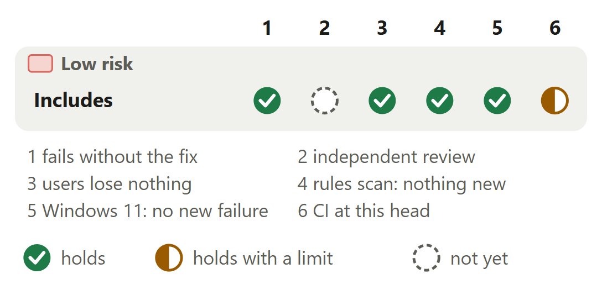

# A linked worktree reads the config includes Git reads there

For [pull request #996](https://github.com/neralabs/rerail/pull/996), head 924dfc503. [report.html](report.html) is the same report as one page: download it and open it.

## 1. The decision

**May the engine's Git opener follow a linked worktree's config includes again, testing `gitdir:` against the worktree's own Git folder as Git does?**

**We recommend:** approve it: a session in a linked worktree then leaves out exactly what `git check-ignore` names there, and a main checkout keeps the config it reads today.

| Size | Risk and review | Waits on | Not verified |
|---|---|---|---|
| 400 lines in 4 files: 136 ship, 264 are tests and text | Standard. One engine function; main checkouts take the old path. | Nothing. No CI run here yet: the branch is not pushed. | 1 |

## 2. Intent, and the gap

| Change | Intended | Found | Now |
|---|---|---|---|
| What a session skips | Leave out what Git leaves out _(code comment)_ | Main checkout's excludes applied _(real-daemon runs, #797)_ | Closes the gap. |

Found on 18 November 2026 on Linux x64 and Windows 11, in runs that checked a session's answers against Git's in many worktrees.

Sources at main, and causes

| Change | Where main states the intent | The cause, and what was measured |
|---|---|---|
| What a session skips | `native/src/git_ignore.rs` at 1609ac3a3, module comment: the matcher answers as `git check-ignore` does; it and `git_workspace::discover` open the repository through `git_access::opener::discover`, which called `gix::discover_opts`. | gix 0.90 loads the config with the repository's shared Git folder as the `gitdir:` condition's folder (`open_from_paths` passes `common_dir_ref`); Git uses the folder of the worktree the command runs in (`repo_read_config`: `opts.git_dir = repo->gitdir`). |

## 3. Where to look

1. **Read first**, 6 min: `opener.rs`: `include_as_git_does`, `open_as_git_does` and `discover`. Does dropping every included section and following the includes again give the config Git gives the worktree, and nothing else?

**Then skim**, 5 min: The tests: a repository with a linked worktree and conditions on each checkout's Git folder, checked against Git's own answers in both.

## 4. Risk against verification

One change, low risk: only linked worktrees take the new path, through gix's own include code.

Each limit, and each check that does not hold yet

| Change | Check | Its limit, or why it does not hold yet |
|---|---|---|
| Includes | independent review | No reviewer outside the change has read this head yet. |
| Includes | CI at this head | No CI run at this head on GitHub yet: the branch is not pushed. CI's integration job and its lint job passed on Linux x64. |

## 5. The changes

**Linked worktrees read Git's config**, low risk: Real-daemon writes answered otherwise than Git: `main` 4 of 6 in 5 of 5 runs, this head 0 of 6.

<b>6. The decisions</b>

**Correct the includes after gix's open, or open with includes off?**

**We chose** correct them after gix's open: `safe.directory` read during the open keeps counting the included files. **Would change our mind:** A gix open option that takes the worktree's own Git folder for conditions: the second pass then goes.

| Option | What a user gets | Cost | What it breaks |
|---|---|---|---|
| Follow every include again after gix's open, in linked worktrees **(chosen)** | Git's config in every worktree, for every value a condition can set. | A second read of the included files per open, in linked worktrees only. | Nothing found: a main checkout keeps gix's config. |
| Open with includes off, then follow them once | The same, and no read of a file Git would not read there. | Less. | gix checks `safe.directory` during the open: one named only in an included file would stop counting, and another user's repository would be refused. |
| Correct only the excludes file the matcher reads | The ignore matcher right. | Less. | The workspace discovery's untracked files and every other value a condition sets stay as gix reads them. |

**Evidence.** Git's `repo_read_config` uses the worktree's own Git folder for `gitdir:`; gix's `open_from_paths` passes the shared one, and `Cache::from_stage_one` reads `safe.directory` from the config it loads. The engine alone, asked in a new process in four checkouts, was wrong only for `gitdir:` and `gitdir/i:` in the linked worktree.

<b>7. How it fits</b>

Nothing has to merge first: it stands on `main` 1609ac3a3. #921 edits the opener's tests in another case's lines; Git merges the two alone.

**The files and calls it shares.** #921 edits `native/src/git_access/tests.rs`, in other lines. #978 shares no file: it changes how Rerail starts its own Git processes, and this changes the engine's in-process reads, which start no Git. Trial merges with both heads are clean. Any order works.

<b>8. What is not covered</b>: 1 not verified, 1 smaller gap, 2 limits that stay

1. **macOS** never ran.

**Smaller gaps**

- **How many users.** How many people name an excludes file under `includeIf "gitdir:..."` is not measured.

**Limits that stay**

- An include file that cannot be read, under a condition only the main checkout meets, still stops the open in a linked worktree, as on `main`: gix reads it before the second pass.
- An include named from `%(prefix)/` takes the running program's folder, as gix's own open does; Git takes its own install folder.

## 9. What we ask of you

We ask no ruling.

<b>10. Evidence</b>

The description on GitHub is the record: "How you tested it" holds the runs on `main` and here.

| Where | What ran | Result |
|---|---|---|
| Linux x64 | A real daemon through the Claude Code hook, one session per checkout, 6 writes, 5 runs each | `main` 4 of 6 answered otherwise than Git in 5 of 5 runs; this head 0 of 6 in 5 of 5 runs. |
| Windows 11 | The same, 5 runs each | `main` 4 of 6 answered otherwise than Git in 5 of 5 runs; this head 0 of 6 in 5 of 5 runs. |
| Linux x64 and Windows 11 | The engine alone against `git check-ignore`, 16 conditions in four checkouts | `main` 5 of 64 wrong on each system; this head 0 of 64 on each. |
| Linux x64 | Each changed line of the fix replaced, against the cases | 16 of 18 mutants fail a case; the two left change nothing a case can see: a drop for `commit()`, on which gix commits too, and no early return in a main checkout, where the second pass gives the same config. |
| Linux x64 and Windows 11 | The new cases 30 runs in a row | 0 of 30 rounds failed for the five Rust cases, and 0 of 30 runs for the runtime file, on each system. |
| Linux x64 and Windows 11 | The test files that reach the matcher, and the changed Rust crates | Linux x64: 40 files, 1280 passed (`main` 1279), 14 skipped; Rust: opener 21, `rerail-store` 242, `rerail-w` 35. Windows 11: the 40 files pass; the 5 new Rust cases pass and 6 older opener cases fail as on `main`. |
| Linux x64 | CI's integration and lint jobs | Integration: 22 files passed, 1 skipped (93 tests passed, 4 skipped). Lint and type-check: every step passed. |
| Linux x64 | The automated reviewer's rules over the diff against `main` 1609ac3a3 | No new finding. |

**Sources.** The branch at 924dfc503 and its diff against `main` 1609ac3a3, read on 22 November 2026; runs on Linux x64 machines and a Windows 11 machine.

