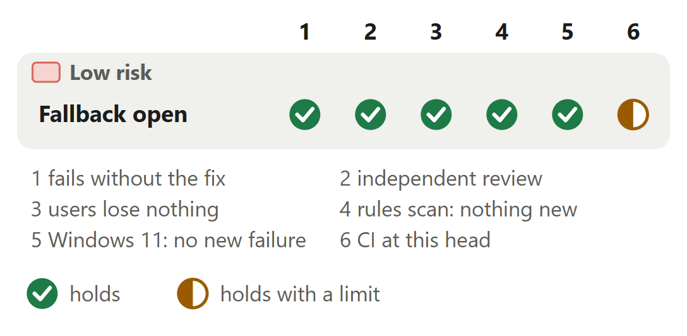

# A linked worktree opens where Git opens it, past main-only includes

For [pull request #1048](https://github.com/neralabs/rerail/pull/1048), head 6ac453be2. [report.html](report.html) is the same report as one page: download it and open it.

## 1. The decision

**May the Git opener open a linked worktree again with includes off when gix's open fails on an include only the main checkout selects?**

**We recommend:** approve it: a linked worktree of your own repository then opens where Git opens it, and another user's keeps every `safe.directory` check it has today.

| Size | Risk and review | Waits on | Not verified |
|---|---|---|---|
| 218 lines in 9 files: 92 ship, 126 are tests and text | Standard. One engine function; only failed linked-worktree opens change. | Nothing. No CI run here yet: the branch is not pushed. | 3 |

## 2. Intent, and the gap

| Change | Intended | Found | Now |
|---|---|---|---|
| Open as Git opens | Open as Git opens _(code comment)_ | Refused where Git opens _(the approval of #996)_ | Closes the gap. |
| One opener for reads | Every read through the opener _(code comment)_ | Three reads open gix directly _(the approval of #996)_ | Closes the gap. |

Found on 23 November 2026 on macOS by a maintainer, in the approval of #996.

Sources at main, and causes

| Change | Where main states the intent | The cause, and what was measured |
|---|---|---|
| Open as Git opens | `native/src/git_access/opener.rs` at 3b9b967d5, its module doc; `open_as_git_does` ran the second pass only after `gix::discover_opts` succeeded. | gix 0.90 follows the includes with the main checkout's Git folder during its open, so it reads the file Git skips in the linked worktree, and fails on it before the second pass runs. |
| One opener for reads | `native/src/git_access/opener.rs` at 3b9b967d5, line 1; the same in `mod.rs`, both crates' `lib.rs`, `owner.rs` and `docs/threat-model.md`. | `logic/strings/git.rs:90` and `logic/plan/corpus/inputs.rs:181` call `gix::discover`, `facts/observe/roots.rs:144` calls `gix::open`. |

## 3. Where to look

1. **Read first**, 5 min: `opener.rs`: `open_as_git_does`, `open_without_includes` and `is_linked_worktree`. Should the open with includes off stay out of repositories another user owns?
2. 3 min: `owner.rs`, `lib.rs`, `mod.rs`, `store/lib.rs`: doc lines that name the reads through the opener.

**Then skim**, 4 min: The four cases put a damaged file under the main checkout's condition and compare with `git config`; the threat model's and the Windows page's new sentences.

## 4. Risk against verification

One change, low risk: only a linked-worktree open that fails today takes the new path.

Each half mark's limit

| Change | Check | It holds with this limit |
|---|---|---|
| Fallback open | CI at this head | No CI run here yet: the branch is not pushed. |

## 5. The changes

**Opens past main-only includes**, low risk: A linked worktree whose main checkout's include loops: `main` refuses it; here it opens, as Git does.

<b>6. The decisions</b>

**Open again with includes off in every linked worktree, or only the user's own?**

**We chose** only where the user owns the repository: elsewhere the open would skip an included `safe.directory` that empties the list. **Would change our mind:** A gix option that reads `safe.directory` with includes while the repository's own includes stay off.

| Option | What a user gets | Cost | What it breaks |
|---|---|---|---|
| Open again with includes off where the user owns the repository **(chosen)** | A linked worktree of one's own repository opens where Git opens it. | One more open, where the first failed. | Another user's linked worktree with such an include stays refused, as on `main`, where Git opens it once `safe.directory` names it. |
| Open again with includes off in every linked worktree | The same in another user's repository. | The same. | A worktree whose global config names it in `safe.directory`, then includes a file that empties the list, opens where Git refuses it. |
| Only add the row to the table | Nothing changes. | Nothing. | The linked worktree stays refused where Git opens it. |

**Evidence.** gix 0.90's `open_from_paths` reads `safe.directory` only below full trust or for another user's worktree, from the config its open loaded. With the trust check taken out, the case with an included empty `safe.directory` fails: the opener opens the worktree Git refuses.

<b>7. How it fits</b>

Nothing has to merge first: it stands on `main` 9d539290a, merged in. #921 and #975 edit `docs/windows.md` or `docs/threat-model.md` in other lines; neither conflicts with this where it does not conflict with `main`.

**The files it shares.** #921 and #975 edit the two docs pages and other files under `native/` than this one's; a trial merge with each head conflicts only where one with `main` does. #974 and #997 share no file. Any order works.

<b>8. What is not covered</b>: 3 not verified, 2 limits that stay

1. **Another user's repository** Such a linked worktree stays refused, as on `main`, where Git opens it when `safe.directory` names it.
2. **macOS** Not run here; the maintainer's reproduction of the refusal was on macOS.
3. **The three direct reads** They still open gix with its defaults; routing them through the opener is an issue of its own.

**Limits that stay**

- The open with includes off keeps that option: a repository gix opens from it, such as a submodule, would follow no include; the engine opens none that way.
- The mode-000 case checks nothing where the test process reads the file anyway, as a superuser does, and does not run on Windows.

## 9. What we ask of you

We ask no ruling.

<b>10. Evidence</b>

The description's "How you tested it" holds every run; "What is not covered" holds the limits.

| Where | What ran | Result |
|---|---|---|
| Linux x64 and Windows 11 | The three linked-worktree cases with `main`'s opener | Linux x64 3 of 3 fail, Windows 11 2 of 2 fail (the mode-000 case runs on Unix only); all pass at this head. |
| Linux x64 | Each new line of the open taken out, four mutants | 4 of 4 fail a case; without the trust check the opener opens a worktree Git refuses. |
| Linux x64 and Windows 11 | The opener's cases with their neighbours, 30 rounds | 0 of 30 rounds failed on each system. |
| Linux x64 and Windows 11 | 99 test files: those that reach the engine's Git reads and those `main` changed | Windows 11 2834 passed, 122 skipped of 3912 here and at `main`; Linux x64 2912 passed here; on both the same 956 fail in `packs.test.ts`, which lacks its pack test data. |
| Linux x64 and Windows 11 | Rust: the store, the Git ignore cases, the guards, rustfmt, clippy, CI's Windows engine step | `rerail-store` 252 passed; `rerail-w` 35; `rerail-logic` 416 here and at `main`; rustfmt and clippy pass; Windows 11 engine step 58 passed. |
| Linux x64 and Windows 11 | CI's lint and integration jobs; every integration file on Windows 11 | Lint and type-check passes; integration 108 passed, 4 skipped; Windows 11 the same 12 failures here and at `main`, 96 passed at both. |

**Sources.** The branch at 6ac453be2 and its diff against `main` 9d539290a; gix 0.90's open and gix-path 0.14.1's source; runs on Linux x64 machines and Windows 11 machines.

