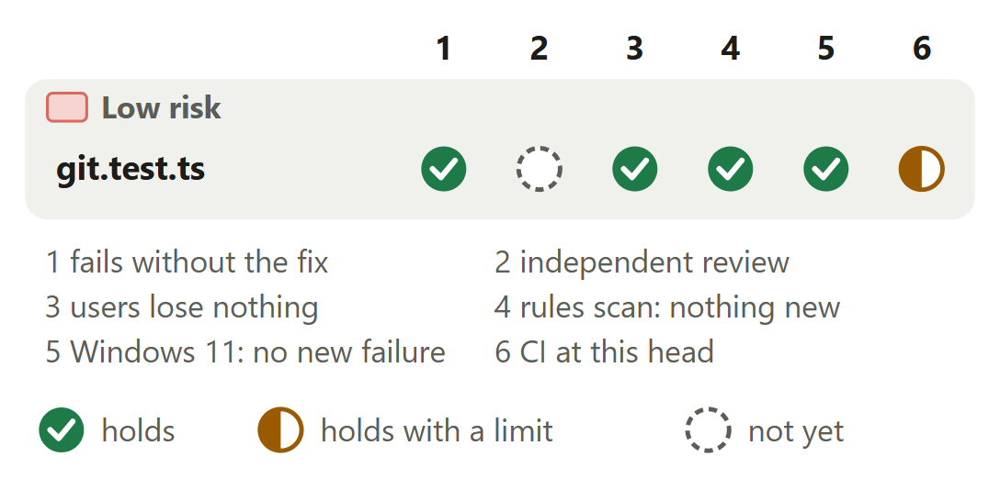

# The changed-files listing cases wait for facts, not a 5 s timer

For [pull request #1021](https://github.com/neralabs/rerail/pull/1021), head c9e4a21016. [report.html](report.html) is the same report as one page: download it and open it.

## 1. The decision

**May the listing cases of `test/engine/git.test.ts` wait for facts (the read's answer, `endProcessTree`) instead of a 2 or 5 s timer?**

**We recommend:** approve it: the read answers once Git exits and waits for nothing else, so the cases no longer fail by the time a Git start takes, only by their answer.

| Size | Risk and review | Waits on | Not verified |
|---|---|---|---|
| 107 lines in 1 file: 0 ship, 107 are the tests it changes, 0 are other tests and text | Fast. One test file, no product code. | Nothing. No CI run on GitHub yet: not pushed. | 3 |

## 2. Intent, and the gap

| Change | Intended | Found | Now |
|---|---|---|---|
| Answer once Git exits | Answers once Git exits _(test name)_ | Timed out at 5 s on GitHub _(CI run on main)_ | Closes the gap. |
| Git ended at limit | No answer once the limit ends Git _(test name)_ | Listed both files _(runs on Windows 11)_ | Closes the gap. |

Found on 24 November 2026: the first case failed `main`'s Windows unit tests on GitHub; its neighbour failed in runs on a Windows 11 machine.

Sources at main, and causes

| Change | Where main states the intent | The cause, and what was measured |
|---|---|---|
| Answer once Git exits | `test/engine/git.test.ts` at `main` b6e0bf959e, from #679: `heldListing` raced the read against `setTimeout(settle, 5_000, "still waiting at 5 s")`. | The timer covered one Git start, Git's run of a clean filter through Git for Windows' `sh` and Git's exit. Tagged times on a Windows 11 machine with 8 CPUs show the read answering in the same millisecond Git exits, 0.1 to 0.4 s after the call. The 5 s did not come back in 40 runs here, so what took that long on GitHub's runner is not measured. |
| Git ended at limit | `test/engine/git.test.ts` at `main` b6e0bf959e, from #679, with b.py's clean filter `hang` from `hangAfterHeld`. | At its time limit the read ends Git's process tree with `taskkill /T /F`. That could end b.py's hanging filter before Git; Git then compared b.py as it is, listed both files and exited with status 0, so the read answered a list. |

## 3. Where to look

1. **Read first**, 8 min: `git.test.ts`: `heldListing`, `hangAfterHeld` and the time-limit and output-limit cases. Does each case still fail when the read waits for the left process, or when no limit ends Git?

**Then skim**, 1 min: Nothing else changes.

## 4. Risk against verification

One change, low risk: one test file; `src/` is as it was.

Each limit, and each check that does not hold yet

| Change | Check | Its limit, or why it does not hold yet |
|---|---|---|
| git.test.ts | independent review | No one but its author has read the change yet. |
| git.test.ts | CI at this head | No CI run at this head on GitHub yet: the branch is not pushed. |

## 5. The changes

**The listing cases wait for facts**, low risk: Windows 11: the neighbour case failed in 5 of 40 runs before; here it passed every run.

<b>6. The decisions</b>

**What bounds the held listing case, now that it has no timer?**

**We chose** the read's own 10 s limit: a read that waited for the left process answers `undefined` there. **Would change our mind:** A maintainer who wants a failing case to show sooner than 10 s.

| Option | What a user gets | Cost | What it breaks |
|---|---|---|---|
| Await the read **(chosen)** | The same product; the case fails only by its answer, and still fails a read that waits for the left process. | A failure takes the read's 10 s limit to show. | Nothing: no product code changes. |
| A longer timer | Fewer red runs. | One number. | The case still fails by how long a machine takes to start Git. |
| Check the answer one loop turn after Git's `close` | A failure at once. | A hook into the read's own events. | Ties the case to how many promise turns the read takes. |

**Evidence.** With the read's `stderr` kept on a pipe, the case fails with `undefined` after 10.6 s on Linux x64. Tagged times on a Windows 11 machine with 8 CPUs show the read answering in the same millisecond Git exits.

<b>7. How it fits</b>

Nothing has to merge first: it is one commit on `main` b6e0bf959e. No other open pull request of ours edits the test file; they overlap nowhere.

<b>8. What is not covered</b>: 3 not verified, 1 limit that stays

1. **macOS** never ran.
2. **GitHub's timeout** not reproduced here in 40 runs, so what took that long on GitHub's runner is not measured. The case now fails only by its answer.
3. **Review** no one but its author has read the change yet.

**Limits that stay**

- The launcher case of `runGitAsync` and its two neighbours, from #667, still race real timers of 300 ms, 3 s and 5 s. Left as they are.

## 9. What we ask of you

We ask no ruling.

<b>10. Evidence</b>

The description on GitHub is the record: "How you tested it" holds the runs here and at `main`.

| Where | What ran | Result |
|---|---|---|
| Windows 11 | The test file beside its four shard neighbours, two copies at once on one machine with 8 CPUs, at `main` and before #978, then here | Before: the first case did not fail; its neighbour failed in 5 of 40 runs. Here: none of 20 runs failed. |
| Windows 11 | The test file here, on three machines: beside its shard neighbours, and beside `main` | Here every run passed; `main` failed the neighbour case once in 16. |
| Linux x64 | The test file beside two others, 30 runs here and 30 at `main`, on one machine | 30 of 30 passed at both. |
| Linux x64 | The cases with the read's `stderr` on a pipe, then with no end at the time-limit look | The first case fails with `undefined` after 10.6 s; then all 10 limit cases fail. |
| Linux x64, Windows 11 | CI's lint and type-check job, and `integration/` here and at `main` on both systems | Lint passed. Linux: one updater case failed here and at `main`, 104 passed at each. Windows: the same 12 failures here and at `main`, 93 passed at each. |
| Linux x64 | The automated reviewer's rules at `main` b6e0bf959e over the diff | No new finding, with the published 0.1.5 and with Rerail built from `main`. |

**Sources.** The branch at c9e4a21016 and its diff against `main` b6e0bf959e, read on 24 November 2026; runs at c9e4a21016 and at `main` b6e0bf959e on Linux x64 and Windows 11 machines; `main`'s failed CI run on GitHub.

