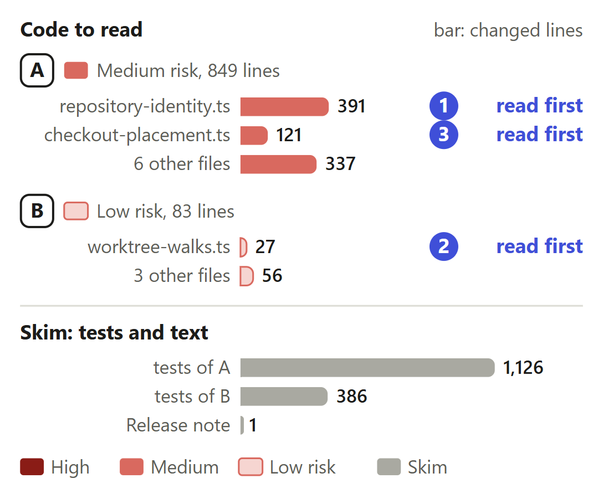
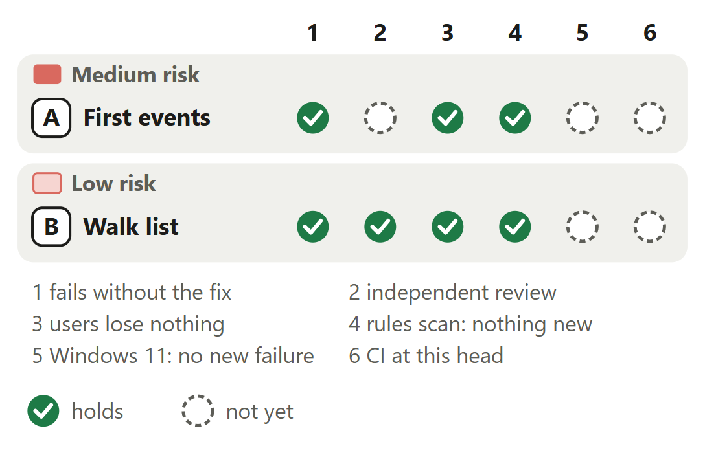

# Sessions starting together no longer wait on Git per worktree

For [pull request #997](https://github.com/neralabs/rerail/pull/997), head 248ea1d3b. [report.html](report.html) is the same report as one page: download it and open it.

## 1. The decision

**Can an answer the daemon learnt as a session opened, or keeps for a clone's remote or submodules, differ from what Git answers now?**

**We recommend:** approve it: each answer is kept by one owner under the files Git read for it, and eight session starts with 190 worktrees leave 3 Git processes on the daemon's thread, not 396.

| Size | Risk and review | Waits on | Not verified |
|---|---|---|---|
| 2,445 lines in 22 files: 932 ship, 1,513 are tests and text | Review. Medium risk: kept Git answers on every session's first events. | Nothing. `main` 6a257957c8 merged in, #985 with it, no conflict. | 4 |

## 2. Intent, and the gap

| Change | Intended | Found | Now |
|---|---|---|---|
| A. Git per worktree | Hooks answered while sessions start _(our reading)_ | 396 blocking Git starts per burst _(the issue's steps)_ | Closes the gap. |
| B. The walks' worktree list | Hooks answered while worktrees appear _(our reading)_ | One blocking list per batch _(the daemon's marks)_ | Closes the gap. |

Found in November 2026 on Linux x64 and Windows 11 machines, counting the Git processes a daemon starts while eight sessions open.

Sources at main, and causes

| Change | Where main states the intent | The cause, and what was measured |
|---|---|---|
| A. Git per worktree | `src/engine/catalog/repository-identity.ts` at 21f86868e: `readRemoteAddress` runs `git ls-remote --get-url origin` and `git remote` through `gitText`, a blocking start, and keeps nothing; `checkout-owner.ts` `declaredSubmodules` runs two blocking Git processes per call. | Each recorded worktree of a clone asks for its remote, two blocking Git processes each, and a repository start records every listed worktree; each walk asks for the submodules again. On Windows 11 the daemon left `/healthz` unanswered for 17.5 to 28.1 s over ten runs, and lost 3 hook events in two. |
| B. The walks' worktree list | `src/engine/code-rule/checkout-code-rule-router.ts` at 6a257957c8: `worktreeRoots` asks `worktreeRegistry`, which runs `git worktree list --porcelain` through `runGit`, a blocking start, once the registry folder changed. | Each walk of the session's folder and of the other worktrees reads Git's list as it begins, and a batch of new worktrees changes the registry folder. |

## 3. Where to look

1. **Read first**, 15 min: `repository-identity.ts`: `placeWithoutBlocking`, `learnWorktreeRegistry`, `learnWorktreeList`, `readRemoteAddress` and `remoteSource`. Can a kept remote or a placement learnt without blocking outlive a change Git would see?
2. **Read first**, 5 min: `worktree-walks.ts`: `#prepare` before `#start`. Can a walk start on a worktree list older than the registry folder it read?
3. **Read first**, 5 min: `checkout-placement.ts`: what a session's opening learns. Does every read of the opening settle before the session goes on?
4. 10 min: `declared-submodules.ts`, `git-access.ts`, `runtime.ts`, `checkout-owner.ts`, `git-placement.ts`, `git.ts`, `code-rule-bridge.ts` and `checkout-code-rule-router.ts`.
5. 2 min: `code-rule.ts`: the auditor's `learnWorktreeRoots`.

**Then skim**, 10 min: `checkout-placement.test.ts`, `first-events-git.test.ts` and the new cases of `git-placement.test.ts`: Git counted by blocking and not, changes Git would see, abort and dispose.

## 4. Risk against verification

One change, medium risk: start at `placeWithoutBlocking`, which keeps answers as `main`'s placement does.

Each limit, and each check that does not hold yet

| Change | Check | Its limit, or why it does not hold yet |
|---|---|---|
| A. First events | independent review | No second reader has reviewed this head yet. |
| A. First events | Windows 11: no new failure | Windows 11 at this head: the 9 changed test files ran 30 times, 0 failed; the files that import a changed module did not run there. |
| B. Walk list | Windows 11: no new failure | No second reader has reviewed this change yet. |
| A and B | CI at this head | The repository's CI runs once the branch is pushed. |

<b>5. The changes</b>

**A. First events learn Git without blocking**, medium risk. 190 worktrees, eight sessions: 3 Git processes on the daemon's thread with this change, 394 to 400 at `main`.

- **Problem:** Several sessions start together in a repository with worktrees, and the daemon's one thread waits on Git for each recorded worktree's remote, for each walk's submodules and for the first worktree list. Every hook of every session waits as long.
- **Who meets it:** Everyone who starts several sessions at about the same time in a repository with many worktrees, at every such burst; most of all a clone with no remote, whose remote is asked twice per worktree. Source: #795.
- **What it does:** `placeCheckout`, awaited beside the session's ledger, learns the placement, worktree list, remote and submodules as Git processes no thread waits on, and each owner keeps its answer under the files Git read. `main` 6a257957c8 is merged in: #977's gone-worktree answer is kept off the thread, and #985 lets go of worktrees by the list learnt off it.
- **Risk:** Medium. A kept answer serves every session's first events, so a fact Git reads that the keeper does not would leave an old answer.
- **Check:** Can a kept remote, submodule list or placement outlive a change Git would see? `remoteSource` names every file Git reads a remote from, or keeps nothing.
- **Picture:** Git processes on the daemon's thread while eight sessions start with 190 worktrees: 394 to 400 at main and 3 with this change on Linux x64; 398 to 400 and 3 on Windows 11. Five runs a build, at 846fccd27 beside main 1609ac3a30.
- **Method:** the issue's steps through the built CLI, a real daemon and the built hook: one repository of 303 files and 190 worktrees, eight sessions 60 ms apart, five runs a build against `main` 21f86868e with this change at bcbc84ffb, on Linux x64 and Windows 11.

**B. Walks learn the worktree list**, low risk. A worktree added while sessions work: no Git list on the daemon's thread from the walks.

- **Problem:** While sessions work, a batch of new worktrees changes Git's registry folder, and the next walk lists Git's worktrees on the daemon's thread before it begins. Every session's hooks wait behind it.
- **Who meets it:** Anyone whose agents add worktrees while sessions run, once per batch: 61 ms a list on Windows 11 in an earlier run. Source: #984's measurements.
- **What it does:** `WorktreeWalks` asks each session to prepare before a walk begins, and the router learns Git's list through `learnWorktreeList` as a process no thread waits on, only once the registry folder changed; the walk's start then takes the list the learn step read in the same synchronous run, and reads the registry again after an await.
- **Risk:** Low. The list is kept as the registry keeps it; a worktree added in between is listed on the thread as at `main`.
- **Check:** Does a walk with nothing to learn begin as at `main`? `learnWorktreeList` answers with nothing to wait for while the stored list stands.
- **Picture:** Git worktree lists on the daemon's thread while 51 and then 51 more worktrees were added with sessions working, Linux x64: 3 at the merge with main, none at 6c540c21c.
- **Method:** two sessions, 20,000 files, 51 worktrees added while one and then two sessions worked, the daemon's marks of every Git it starts with the caller's frames, at the merge and at 6c540c21c on Linux x64.

<b>6. The decisions</b>

**What should a kept remote rest on?**

**We chose** the text of every file Git reads remotes from, the system file included, and the environment's configuration. **Would change our mind:** A fact Git reads a remote from that this neither reads nor hands to Git.

| Option | What a user gets | Cost | What it breaks |
|---|---|---|---|
| The text of `config`, `config.worktree`, the global and system files and the environment's configuration **(chosen)** | Git's remote at the next record after any change to them. | Four or five small file reads and two folder listings per record. | Nothing: an include, a relative path or a system file Git did not name asks Git each time. |
| The same, the system file left out | Git's remote after a change to any other file. | One small file read fewer per record. | A remote or `insteadOf` set only in the system file keeps its old answer. |
| Ask Git each time, as `main` does | Git's answer. | Two Git processes per recorded worktree for a clone with no remote. | The daemon's thread. |
| File times | The same, while the clock is known. | Three or four `lstat` calls. | A same-size rewrite within one clock tick keeps the old answer. |

**Evidence.** `kept-remote.test.ts`: a remote set in each fact, changed, and the next answer compared with Git's own, 20 cases on Linux x64; a failed Git keeps nothing. Each of the 32 lines that read a fact fails a case when changed.

**What should an opening ask where no placement keeps Git's answer?**

**We chose** nothing ahead: the session's events ask Git as at `main`. **Would change our mind:** A placement that can be kept under a lookup variable.

| Option | What a user gets | Cost | What it breaks |
|---|---|---|---|
| Ask nothing ahead **(chosen)** | Git's answers, asked by the session's events as at `main`. | Those events wait on Git on the daemon's thread, as at `main`. | Nothing. |
| Ask ahead and keep it for the registry alone | The worktree registry served. | Each placement still asks Git, so the opening adds Git processes no placement takes. | Git processes per event above `main`'s. |

**Evidence.** Seam cases: an opening under `GIT_DIR` or `GIT_OBJECT_DIRECTORY`, and one in another account's checkout, start no Git; each fails with its line turned.

<b>7. How it fits</b>

Nothing merges first: `main` 6a257957c8 is merged in, #985 with it; Git merged `code-rule-bridge.ts` alone, and a case covers where the two meet. The change for #984 ends the other half of what new worktrees cost; Git merges the two alone. #964 edits `runtime.ts` and `code-rule-bridge.ts`: keep both.

This change stands on main at 6a257957c8, merged in. The change for #984 edits code-rule-bridge.ts, worktree-walks.ts, git.ts and two test files too and merges with it alone; #964 edits runtime.ts and code-rule-bridge.ts, where both sides are kept.

<b>8. What is not covered</b>: 4 not verified, 5 limits that stay

1. **The silence that remains** with 190 worktrees, 1.7 to 2.3 s on Linux x64 and 3.5 to 3.9 s on Windows 11 with 3 Git processes on the thread, lies outside this issue's named causes.
2. **A submodule's failed placement** no case makes one fail, so `Promise.allSettled` in `placeSubmodules` turned back to `Promise.all` fails no case.
3. **Independent review** no second reader has reviewed this head.
4. **macOS** never ran.

**Limits that stay**

- Three Git processes stayed on the daemon's thread per burst at bcbc84ffb: the repository's first presentation read, and `main`'s read of Git's installation, once per daemon, which this head makes off the thread where a session's opening needs it first.
- A session in a folder below its checkout's top level places that folder with Git at its events, as at `main`.
- A remote read from a file no one can name ahead (an included file, a relative path) is asked of Git at each record, as at `main`.
- A kept remote or submodule list leaves once Git lists its repository's worktrees again and its checkout is gone; a clone removed whole keeps its entries, as its placements do at `main`.
- Where no engine owner of Git reads stands (a one-shot `rerail remote`, or no engine loads), the remote is asked of Git as at `main`.

## 9. What we ask of you

We ask no ruling.

<b>10. Evidence</b>

The description on GitHub is the record: "Why it is worth landing" holds the counts, and "How you tested it" the cases and the runs.

| Where | What ran | Result |
|---|---|---|
| Linux x64 | The case where this change meets #985, over `main` 6a257957c8's source, over 846fccd27's and at this head | Fails at both (3 lists on the daemon's thread; the write with a preimage), passes here; #985's 11 cases pass here. |
| Linux x64 and Windows 11 | The 9 test files this change adds or changes, together, 30 runs at this head | 0 of 30 runs failed on Linux x64 and 0 of 30 on Windows 11; each file 30 of 30 on each. |
| Windows 11 and Linux x64 | The issue's steps: 190 worktrees, eight sessions 60 ms apart through the built hook, five runs a build in turn | Git on the daemon's thread 3 against 394 to 400; longest silence 3.5 to 3.9 s against 16.7 to 17.3 s on Windows 11, 1.7 to 2.3 s against 3.4 to 5.5 s on Linux x64; no hook event lost. |
| Linux x64 | The same with 1 and 48 worktrees, one run a build | Git on the thread 3 against 20 and 114; remote reads 2 against 16 and 110. |
| Linux x64 | 34 single-line changes of the change's earlier lines and 32 of the lines that read a remote's facts, one at a time | Each fails a case. |
| Linux x64 | 39 single-line changes of the lines added after 59eeb47db, one at a time | 35 fail a case; three change nothing a caller gets; one, `Promise.allSettled` in `placeSubmodules`, has no case. |
| Linux x64 and Windows 11 | Four repositories, 190 worktrees in one, eight sessions through the built hook, at f4b220f29 (and at `main` on Linux x64) | Git on the daemon's thread 5, none for the remote; 412 at `main`, 404 of them the remote. |
| Windows 11 | The 17 test files that import `git-access.ts` or `repository-identity.ts`, and the changed ones, at f4b220f29's source, compared with `main`'s results | 462 passed, 30 skipped, none failed. |

**Sources.** The branch at 248ea1d3b and its diff against `main` 6a257957c8, read on 22 November 2026; the issue's steps against `main` 21f86868e with this change at bcbc84ffb, through the built CLI, a real daemon and the built Claude Code hook on Linux x64 and Windows 11 machines, each beside other test runs.

