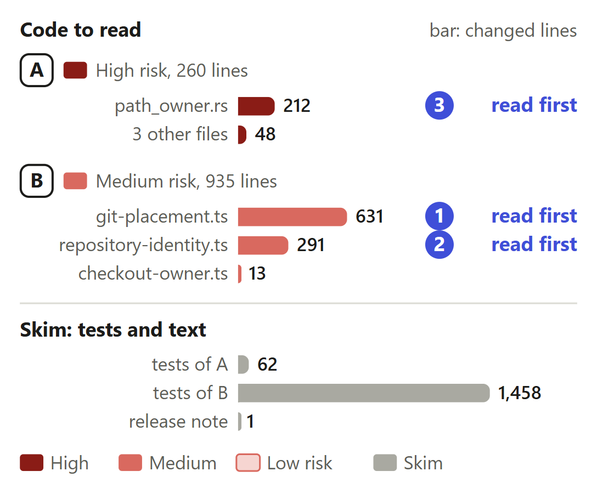
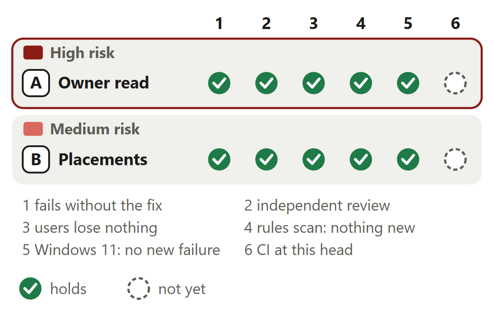

# A repository start places each worktree without one Git process per worktree

For [pull request #813](https://github.com/neralabs/rerail/pull/813), head 96f4a1171. [report.html](report.html) is the same report as one page: download it and open it.

## 1. The decision

**Can a placement the daemon keeps give an answer Git no longer gives?**

**We recommend:** approve it: a kept answer holds only while what Git reads stays the same and Git takes the folders for the user's own; through a real daemon every placement equaled Git's.

| Size | Risk and review | Waits on | Not verified |
|---|---|---|---|
| 2,716 lines in 11 files: 1,186 ship, 9 run in every test run, 1,521 are tests and text | Careful. A code owner approves: it edits `ci.yml`. | Nothing. CI runs the whole set; no pull request needs it. | 3 |

## 2. Intent, and the gap

| Change | Intended | Found | Now |
|---|---|---|---|
| A. Owners on Windows | Placement follows Git's owner rule _(our reading)_ | No owner from Node on Windows _(our reading)_ | Closes the gap. |
| B. Each worktree's top level | Answers dropped when checkouts change _(code comment)_ | One Git process per worktree _(a daemon preload)_ | Closes the gap. |

Found on 15 November 2026 in a load of 16 sessions on a busy Windows 11 machine; counted there and on Linux x64.

Sources at main, and causes

| Change | Where main states the intent | The cause, and what was measured |
|---|---|---|
| A. Owners on Windows | Git's `safe.directory` check, and on Windows Git for Windows' owner rule: the user, or the Administrators group for a member. At `main` every placement is Git's own answer, so it follows that rule. | `fs.lstat` returns uid 0 for every file on Windows. Placing from files needs the owners Git compares. |
| B. Each worktree's top level | `src/engine/catalog/checkout-owner.ts` line 220 at `main` f41b8fe6c, on `#revalidate`. Each answer is confirmed by `topLevelAt` (line 314), which asks `repositoryIdentityLocation`, whose `locateInGit` runs `git rev-parse --show-toplevel` (`repository-identity.ts` line 58). | Each runtime holds its own `CheckoutOwners` (`runtime.ts` line 1079). A session's walk lists the worktrees and confirms each one's top level with a `spawnSync` of Git, and every start records checkouts, so every runtime asks again. The worktree list is kept per checkout (`repository-identity.ts` line 160). |

## 3. Where to look

1. **Read first**, 10 min: `git-placement.ts`: `placementInputs`, `linkedWorktreeFromFiles`, `configOf`. Can Git place a folder otherwise while every fact here reads the same?
2. **Read first**, 6 min: `repository-identity.ts`: `placed`, `answersInputs`, `worktreeRegistry`. Is every kept answer dropped once its stamp moves?
3. **Read first**, 5 min: `path_owner.rs`: the owner read. Does it take an owner exactly when Git for Windows does?
4. 3 min: `checkout-owner.ts`, `native.ts`, `lib.rs` and `ci.yml`: the callers, the binding and the test filter.

**Then skim**, 8 min: `git-placement.test.ts` compares each answer with `git rev-parse`. `git-placement-same-size.test.ts` rewrites files at the same size with their `lstat` left as it was.

## 4. Risk against verification

Start at change A: it touches `ci.yml` and adds an engine read. CI runs the whole set.

Each limit, and each check that does not hold yet

| Change | Check | Its limit, or why it does not hold yet |
|---|---|---|
| A and B | CI at this head | The whole set is CI's run on the pull request. |

<b>5. The changes</b>

**A. Windows owners read by engine**, high risk. On Windows a worktree is placed from its files: 0.62 ms a kept ask against a 33.2 ms Git process.

- **Problem:** Node gives no file owner on Windows, and Git refuses a repository whose folders another account owns. Without an owner read, change A would have to ask Git on Windows, where a Git process costs most.
- **Who meets it:** Everyone on Windows with linked worktrees, at each start, as in change B.
- **What it does:** `path_owner.rs` reads each path's owner as Git for Windows does: the user, or the Administrators group while the process's token is a member. `pathsOwnedByCurrentUser` in `native.ts` calls it; `ci.yml` adds its tests to the Windows engine step.
- **Risk:** High. It touches `.github/workflows/ci.yml`, which `REVIEW.md` lists as high-risk, and a wrong owner answer would place a folder Git refuses.
- **Check:** Does `path_owner.rs` take an owner exactly when Git for Windows does? An engine built before it lacks the function, and Rerail asks Git then.
- **Picture:** On Windows 11 one ask about a worktree's placement costs 33.2 ms at main, a Git process, and 0.62 ms with this change, 27 file calls and one engine call, over 110 worktrees.
- **Method:** 110 worktrees and the main checkout, each placed once, then asked again in passes on one Windows 11 virtual machine beside other test runs; median per ask, 3 passes at `main` and 20 here.

**B. Placements read and kept**, medium risk. A start with 72 and 38 worktrees: the daemon's thread ran 2 Git processes, against 2,648 (Linux) and 2,781 (Windows).

- **Problem:** Every session in a repository with many worktrees makes the daemon start one Git process per worktree at each change of the recorded checkouts. The daemon answers nothing while Git runs.
- **Who meets it:** Everyone with linked worktrees, at every start and every newly recorded worktree. A preload on the daemon counted 2,648 processes in a five-minute start at `main` 7ff56e15e on Linux x64 and 2,781 on Windows 11.
- **What it does:** `placementInputs` reads what Git reads to place a folder. `linkedWorktreeFromFiles` places a linked worktree of a repository Git placed. `repositoryIdentityLocation` keeps Git's answer while its stamp holds. `worktreeRegistry` keeps one list per repository.
- **Risk:** Medium. A wrong placement would have a file judged by another checkout's rules, or by none.
- **Check:** Can Git's answer move while the stamp stays the same? The stamp holds both real paths, the texts of `.git` and `commondir`, the config lines that place a checkout, whether `HEAD`, `objects` and `refs` make a Git folder, and the owners of the real folder, its `.git` and its Git folder, read at every use. A checkout those files cannot describe keeps Git's acceptance for the list under the raw facts Git reads there.
- **Picture:** A start with 72 and 38 worktrees and 16 sessions on Linux x64: the daemon ran 2,648 Git processes on its thread at main 7ff56e15e and 2 with this change, one git worktree list per repository.
- **Method:** a preload on the daemon recorded each `spawnSync` with its caller, 16 sessions, starts in repositories of 72 and then 38 worktrees, counted over the five minutes after, `main` then the change on one Linux machine shared with other test runs.

<b>6. The decisions</b>

**What is a kept placement checked against at each use?**

**We chose** the texts, real paths and owners Git reads, read at every use: no file time or clock stands in. **Would change our mind:** a change Git sees that moves none of these texts, real paths or owners.

| Option | What a user gets | Cost | What it breaks |
|---|---|---|---|
| The texts, real paths and owners Git reads, at every use **(chosen)** | Git's answer at the next ask after any change Git sees. | 27 file calls a kept ask, and on Windows one engine call: about 1.3 ms on Windows 11 and 51 µs on Linux x64. | Nothing measured. |
| File times and sizes, with Git's rule for a write within one tick | The same, while the file system's clock is known. | 5 file calls: 0.12 ms on Windows 11. | A same-size rewrite within one tick keeps the old answer: NTFS left the file's times unchanged in 231 of 300 tries. |
| Ask Git each time, as `main` does | Git's answer. | 41.8 ms a Git process on Windows 11. | The daemon's one thread: 96.6 s without an answer on a busy Windows 11 machine. |

Before: At main a session asks where a worktree is, the daemon starts a Git process, and the answer is dropped when the recorded checkouts change. After: With this change the daemon reads the texts, real paths and owners Git reads. Unchanged, it gives the kept answer with no process; changed, it places the folder from its files or asks Git.

**Evidence.** Through a real daemon and Claude Code's hooks, each answer compared with Git's after each change: links retargeted at renamed folders, `core.bare` in `config.worktree`, 150 same-size rewrites of a `.git` file. On Windows 11, at 12b6cff39's code, 0 of 9,044 answers about the rewritten worktree were wrong, and 0 of 1,573 at `main`. Cost: 110 worktrees asked again in 20 passes, median per ask.

**How does Rerail know Git takes a folder's owners on Windows?**

**We chose** the engine reads each owner as Git for Windows does, so worktrees are placed from files there too. **Would change our mind:** Node gaining a file owner on Windows, or Git changing its owner rule.

| Option | What a user gets | Cost | What it breaks |
|---|---|---|---|
| The engine reads owners as Git for Windows does **(chosen)** | No Git process per worktree on Windows. | One engine call for three paths at every placement: about 0.3 ms. | Nothing: an older engine makes Rerail ask Git. |
| Ask Git once per worktree on Windows only | The gain on Linux and macOS only. | A Git process per worktree on Windows. | No gain where a Git process costs most. |

**Evidence.** Rust tests of a folder another account owns and one the user owns, in CI's Windows engine step. With the owner comparison forced to true, one fails on Windows 11.

<b>7. How it fits</b>

It stands on `main` at cf5d520e4. The pull request that keeps the daemon answering while sessions start builds on it. Three open pull requests add lines where this one does: #756 in `native.ts`, #805 in `ci.yml`, the draft #508 in three files. Keep both sides.

This pull request is based on main at cf5d520e4 and needs no other change. In trial merges it adds one conflict with #756 in native.ts, one with #805 in ci.yml, one in each of two files with the draft #508, and none with #812, #816 and #677.

**Open pull requests that share a file.** Trial merges with 96f4a1171 at the pull requests' heads of 19 November 2026; this head holds `main` cf5d520e4. #756 (ours): `native.ts` conflicts, each adding an optional engine function at the same place: keep both. #805: both edit the Windows job's engine steps in `ci.yml`: keep #805's steps and add this change's one test filter. #508 (draft): `ci.yml` and `native.ts` conflict, each adding lines at the same place: keep both. #812 and #816 (ours) share a file with no conflict this head adds. #677 shares no file.

<b>8. What is not covered</b>: 3 not verified, 5 limits that stay

1. **CI** runs the whole set on the pull request; the runs here are the changed modules' test files.
2. **The start on a Windows 11 machine with every core busy** ran at `main` only: 96.6 s without an answer and 685 failed hooks, one daemon.
3. **macOS** never ran.

**Limits that stay**

- Another account's folders, which Git takes only through `safe.directory`, are asked of Git at every placement, as on `main`: no gain there, and nothing kept that Git could refuse.
- `CheckoutOwners`' own answers are as on `main`: after `core.bare` is set in `config.worktree`, a file's owner stays until the recorded checkouts change.
- A worktree registered by a relative path (Git 2.48) under a link retargeted at a renamed folder keeps its old list until a worktree is added or removed.
- Under a lookup variable the list's kept acceptance follows the checkout's own files and the variables' values, not the folders they name, as `main` keeps its first answer.
- A folder between a checkout and the repository above it, made a repository, leaves the checkout's list as the repository above's until that registry changes, as on `main`; Git's list of it is never stored for the repository above.

## 9. What we ask of you

We ask no ruling.

<b>10. Evidence</b>

The description is the record: "How you tested it" holds the failing tests, the runs and the counts, by system.

| Where | What ran | Result |
|---|---|---|
| Windows 11 and Linux x64 | The start with 72 and 38 worktrees, 16 sessions, `main` 7ff56e15e then 86308dd8f's code, one daemon each | Two runs on each system: Git on the daemon's thread 2,648 to 2,859 against 2 (Linux x64), 2,710 to 2,781 against 2 to 4 (Windows 11); on Windows 11 hooks over 12 s 76 to 80 at `main`, 3 to 27 with this change, and failure records 46 to 65 against 0 to 9. |
| Windows 11, Node 24.21.0 | The 70 test files of the changed modules and their importers, compared with `main`'s results there, engine of this head's tree | 1,934 passed, 957 failed, 10 skipped. Three failures not in `main`'s: two pack tests for data the machine lacks, and one case whose Windows premise this head rewrote, where its test file passes. |
| Windows 11 and Linux x64 | A real daemon and Claude Code's hooks: 12 changes while it runs, 150 same-size rewrites, sessions of nine events | Windows 11, at 12b6cff39's code: no wrong placement or worktree list; `main` gave wrong lists after `core.bare`, `core.worktree` and a `.git` folder made over a `.git` file. Same-size rewrites: 0 of 9,044 wrong at 12b6cff39's code, 0 of 1,573 at `main`. Linux x64: the same, and 0 of 9,266 same-size answers wrong at 12b6cff39's code, 0 of 1,106 at `main`. |
| Windows 11 and Linux x64 | Cost of one placement ask over 110 worktrees, and of the worktree list of a checkout whose `.git` is a link, median of passes | Kept ask: `main` 33.2 ms and 1.05 ms (a Git process); 86308dd8f's code 0.62 ms and 55 µs. The link checkout's list: the reviewed head 41.5 ms and 1.04 ms (a Git process); 86308dd8f's code 0.93 ms and 86 µs. |
| Linux x64 | CI's integration job, the 70 test files at this head and at `main`, the new cases 20 runs in a row, each line taken out | Integration 90 passed; the files fail only for pack data the machine lacks, as at `main`; 0 of 20 runs failed; of 71 single-line changes of the review's lines, 55 fail a case on Linux x64 and 51 on Windows 11, and of the last two fixes' lines 9 of 13 and 10 of 11. |

**Sources.** Rerail at `main` 7ff56e15e for each quoted intent. Each count from a run named in the description's "How you tested it".

