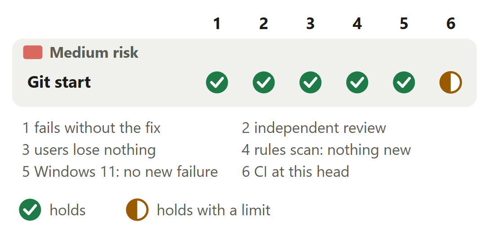

# Daemon: starting Git no longer stalls every hook on Linux

For [pull request #756](https://github.com/neralabs/rerail/pull/756), head 374bdf726. [report.html](report.html) is the same report as one page: download it and open it.

## 1. The decision

**Does any Git the daemon starts now answer, end or take a signal differently from one Node's `spawn` or `spawnSync` starts?**

**We recommend:** approve it: every read answers as through Node in 9 repository states, every limit and kill ends Git as Node does; a hook beside 2,000 Git reads waits 144 to 154 ms, main's 4.6 s.

| Size | Risk and review | Waits on | Not verified |
|---|---|---|---|
| 2,233 lines in 11 files: 1,488 ship, 745 are tests and text | Fast. Fast lane: no high-risk path; the automated reviewer can approve. | Nothing. It stands alone on `main`; no pull request needs it. | 3 |

## 2. Intent, and the gap

| Change | Intended | Found | Now |
|---|---|---|---|
| A Git start's cost | A Git start costs Git's run _(code comment)_ | 44 to 92 ms a start _(a timer in-process)_ | Closes the gap. |

Found on 14 November 2026 in CPU profiles of a daemon under a 10-minute load on a Linux x64 machine.

Sources at main, and causes

| Change | Where main states the intent | The cause, and what was measured |
|---|---|---|
| A Git start's cost | `src/engine/git.ts` line 366 at `main`, on `runGitAsync`: "{@link runGit} without blocking: the same safe configuration, environment and timeout". Lines 486 and 951 say the same of `gitOutput` and `streamGit`. Each starts Git with `spawn` from `child-process.ts`, and `runGit` with `spawnSync`. | On Linux, libuv's `uv_spawn` calls `fork()` (`posix_spawn` only on macOS; libuv 1.52.1 in Node 24.21.0) and waits on the calling thread until the child has run `exec`. Copying and dropping the page tables grows with resident memory. `runGit` (`spawnSync`), `runGitAsync`, `readGit` and `streamGit` (`spawn`) in `src/engine/git.ts` all start Git that way, on the daemon's event loop. |

## 3. Where to look

1. **Read first**, 12 min: `run.rs`: `run`, `collect`, `end`, `read_ready` and `poll_until`. Does a blocking run end at its time and output limits exactly as `spawnSync` ends one?
2. 30 min: `spawn.rs`, `git_start.rs`, `lib.rs`, `git-start.ts`, `git.ts`, `native.ts` and `daemon-entry.ts`: the start, the child readers get, the switch.

**Then skim**, 6 min: `git-start.test.ts` compares each answer with Node's start, field by field, and reads facts, not times. The release note is one line.

## 4. Risk against verification

Start with `run.rs`: the blocking run holds the daemon's thread, so its ends at each limit decide what a hook waits for.

Each half mark's limit

| Change | Check | It holds with this limit |
|---|---|---|
| Git start | CI at this head | CI's integration job and the change's 79 test files ran on Linux x64 at this head; GitHub's CI is the pull request's own run. |

## 5. The changes

**Git starts without copying the daemon**, medium risk: A Git read holds a 4.0 GB daemon 64.1 to 91.9 ms at `main` and 0.2 to 0.4 ms here.

<b>6. The decisions</b>

**How does the daemon start Git without copying itself?**

**We chose** the engine's `posix_spawn`, with no process between the daemon and Git. **Would change our mind:** a Node release whose `child_process` starts children on Linux without the copy: the engine's start would then go.

| Option | What a user gets | Cost | What it breaks |
|---|---|---|---|
| The engine's `posix_spawn` **(chosen)** | Every Git start holds the daemon 0.2 to 0.5 ms at 1.8 and 4.0 GB, against 44 to 92 ms. | About 680 lines of Rust and 410 of TypeScript; one thread per running Git, for its run, on Rust's default stack. | Nothing measured: every read answers as through Node in 9 repository states. |
| A process kept beside the daemon to start Git for it | The same for the reads that do not block. | A 65 to 73 MiB process, a framing protocol and its own failure states; `runGit` still forks. | Every Git shares its one pipe, so a read's end can queue behind another read's output. |
| A `cat-file --batch` reader kept per repository | No start for blob reads. | A long-lived Git keeps the index and packs it first read. | Every other start still copies the daemon. |

**Evidence.** A real daemon from the built entry, grown to 1.8 and 4.0 GB, timed each Git read with a 1 ms timer beside it, five rounds a side on a 32-core Linux x64 machine. A test starts the built daemon and counts its Git starts through Node: 20 of 20 at `main`'s source, 0 here. The thread that waits for each Git's exit runs on Rust's default stack: 64 KiB crashed debug builds on Debian 13.

**How does a blocking run through the engine end at its limits?**

**We chose** as `spawnSync` does: one `SIGTERM`, both outputs closed at once, then the exit. **Would change our mind:** a caller that needs what a process Git started prints after Git was ended: none reads output once the error is set.

| Option | What a user gets | Cost | What it breaks |
|---|---|---|---|
| One `SIGTERM`, both outputs closed, then the exit **(chosen)** | `runGit` ends at its limit as through `spawnSync`, whatever a process Git started still holds. | The exit pipe watched beside both outputs. | Nothing measured. |
| Keep `runGit` on `spawnSync` | The same ends. | Nothing. | Each blocking first-event call still copies the daemon: 317 of 2,008 starts in one measured span. |

Before: Before 86208776f a blocking run through the engine sent SIGTERM at its limit and read on until every process holding the output closed it: 30,002 ms against 503 with a 500 ms limit. After: With this change the run sends one SIGTERM at its limit, closes both outputs at once and waits for Git's exit alone, as spawnSync does: 503 ms with a 500 ms limit, as at main.

**Evidence.** Node's `SyncProcessRunner::Kill` closes all its pipes before it waits for the child. The cases compare each answer with `spawnSync`'s, field by field, and read facts: the process holding the output still runs when the run returns, and a write after the `SIGTERM` ends on `EPIPE`.

<b>7. How it fits</b>

Nothing has to merge first: the head holds `main` with #801, whose look for a moved Git now wraps each start in `git.ts`. #813, #807 and the draft #508 each add lines where this does: one conflict a file, keep both. #816, #812 and #621 gain none.

**Shared files and trial merges.** Trial merges with 374bdf726 at the pull requests' heads of 19 November, 02:21 UTC. #813 (ours): 1 conflict in `native.ts`, both adding an optional engine function. #807: 1 in `daemon-entry.ts`'s imports, both changing one line. #508 (draft): 1 each in `native.ts` and `lib.rs`. Keep both sides in each. #816 and #812 (ours) and #621 share `git.ts` or `native.ts` and gain no conflict.

<b>8. What is not covered</b>: 3 not verified, 2 smaller gaps, 2 limits that stay

1. **macOS** never ran; the switch acts on Linux only and macOS keeps Node's start.
2. **A daemon audit with a submodule past its limit** was not run through a daemon; the run's end was shown at `runGit` itself, with a Git alias that leaves a process holding the output.
3. **A 10-minute load with many worktrees** was not run at this head.

**Smaller gaps**

- **A start the engine refuses** goes through Node for that start only, with no line in `daemon.log`: shown with a refusing engine in a test.
- **The time limit read before each look** has no case that fails when it is taken out: one socket always runs dry for a moment, and the run then ends at once either way.

**Limits that stay**

- `runGit` still blocks the daemon's thread for Git's own run (5 to 20 ms), as at `main`: moving it off the thread is another change's work.
- Rerail asks Git as often as at `main`: each start is cheap now, and asking less is separate work.

## 9. What we ask of you

1. **When squashing, drop the clause of 86208776f's message saying a printing child ran on to its output limit?** We recommend yes: a later run found it ended at its time limit.
2. **When squashing, take 8a908c3fd's account of where the 64 KiB stack ran out over 5d7d7607d's?** We recommend yes: a backtrace shows it ran out as the thread started.

<b>10. Evidence</b>

The description on GitHub is the record: "How you tested it" holds the failing tests, the runs and the counts.

**Sources.** Rerail at `main` (e8a6b0b5a) for each quoted intent and for Node's start; Node's `src/spawn_sync.cc` for how `spawnSync` ends a run. Each count names the commit and the kind of machine it ran on.

