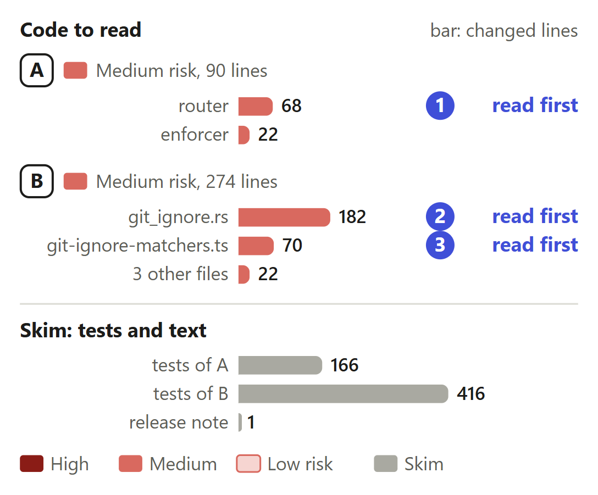
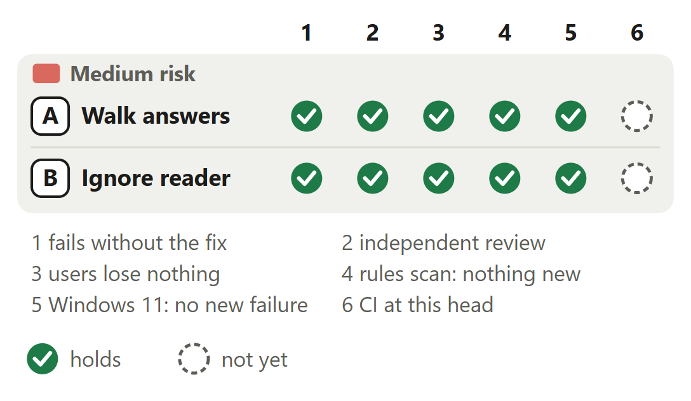

# A first session's walk of many worktrees takes about half the memory

For [pull request #812](https://github.com/neralabs/rerail/pull/812), head f91e3a92e. [report.html](report.html) is the same report as one page: download it and open it.

## 1. The decision

**May a walk answer for a worktree by another's rule engine holding the same rules, and sessions share each checkout's Git ignore reader?**

**We recommend:** approve it: the first session's walk of 153 checkouts takes 1,024 MB where `main` takes 2,212 MB, and every answer about what is checked, ignored and recorded stays `main`'s.

| Size | Risk and review | Waits on | Not verified |
|---|---|---|---|
| 947 lines in 11 files: 364 ship, 583 are tests and text | Careful. It changes which engine answers a walk's questions. | Nothing. No CI result at this head yet. | 4 |

## 2. Intent, and the gap

| Change | Intended | Found | Now |
|---|---|---|---|
| A. A walk's questions | Each worktree answered by its rules _(our reading)_ | An engine opened per worktree _(heap snapshot)_ | Closes the gap. |
| B. Git ignore readers | Ignore rules read once _(code comment)_ | Read once per session _(one reading)_ | Closes the gap. |

Found in November 2026 on Linux x64 and Windows 11 machines, measuring #726's steps in a repository of 153 checkouts.

Sources at main, and causes

| Change | Where main states the intent | The cause, and what was measured |
|---|---|---|
| A. A walk's questions | `src/engine/code-rule/checkout-code-rule-router.ts` at b032b8430: `#accepts` and `#ignores` answer through `#lane(owner.checkoutRoot)`, which opens that checkout's rule engine on first use. | `#accepts` and `#ignores` call `#lane`, which opens a `NativeCodeRuleEnforcer` and its workspace (the checkout's rules, a content store, its index) in every worktree the first walk reaches. A heap snapshot after one session held one per checkout. |
| B. Git ignore readers | `src/engine/code-rule/checkout-code-rule-router.ts` at b032b8430, `#gitIgnores`: "Whether Git ignores `owner`'s path in its checkout, while the session follows `.gitignore`; its rules open once." Once per router: each session opens its own. | `openGitIgnoreMatcher` is called per router and per engine, so sessions in a repository of many worktrees each hold a copy of every asked worktree's Git index. |

## 3. Where to look

1. **Read first**, 8 min: `checkout-code-rule-router.ts`: `#accepts`, `#readsIn`, `#laneWithRulesOf`, `#refreshAnsweredCatalogs`. Can a worktree be answered by an engine whose rules read paths its own would not?
2. **Read first**, 10 min: `git_ignore.rs`: `sources_unchanged`, `Sources`, `Stamp`. Is there a change of ignore rules a new reader would see and `Sources` misses?
3. **Read first**, 4 min: `git-ignore-matchers.ts`: `matcher`, `release`. Is a reader ever kept after every router that took it has closed?
4. 3 min: `code-rule-enforcer.ts`, `native.ts`, `engine-service.ts` and `runtime.ts`: the version and path questions, the binding and the wiring.

**Then skim**, 8 min: The router cases count engines and readers opened; the reader cases change one Git source at a time and ask a later router.

## 4. Risk against verification

Start at change A: it decides which engine answers. Change B decides what a later session ignores.

Each limit, and each check that does not hold yet

| Change | Check | Its limit, or why it does not hold yet |
|---|---|---|
| A and B | CI at this head | CI runs on the pull request once it opens. |

<b>5. The changes</b>

**A. Walk answered without new engines**, medium risk. First session, 153 checkouts of 7,500 files: 2,212 MB at `main`, 1,024 MB here, on Linux x64.

- **Problem:** A session's first walk asks of every file of every worktree whether a rule reads it. `main` opens a rule engine in each worktree to answer, with the checkout's rules, a content store and its Git index.
- **Who meets it:** Everyone who opens a session in a repository with many worktrees, once per daemon start. #726 measured 846 MB with 110 worktrees on 0.1.5.
- **What it does:** `#accepts` answers for a worktree with no engine by an open engine at the same rules version (`#laneWithRulesOf`, `rulesVersion`, `readsPath`), through that worktree's own Git ignore rules; its catalog is read again with the engines' own.
- **Risk:** Medium. The answer comes from another engine: a rule whose reach depended on more than its catalog version would read differently. None does at `main`.
- **Check:** Is a catalog version enough to say two worktrees read the same paths, and is every worktree answered by another read again when the rules are?
- **Picture:** After the first session in a repository of 153 checkouts of 7,500 files with 383 rules, the daemon holds 2,212 MB at main and 1,024 MB with this change, on Linux x64.
- **Method:** A generated repository of 153 checkouts of 7,500 files with the four suggested rule packs (383 rules); a fresh daemon, then sessions through real Claude Code hooks; resident memory once the daemon settles. One run each, `main` first, on one Linux x64 machine.

**B. One Git ignore reader per checkout**, medium risk. Sessions share each checkout's ignore reader: the engine 96 MB less a later session, at 153 checkouts.

- **Problem:** A Git ignore reader holds its checkout's Git index. At `main` each session opens one in every worktree it asks about.
- **Who meets it:** Every session after the first in a repository with many worktrees.
- **What it does:** `GitIgnoreMatchers` hands the daemon's reader for a checkout to a router while `sourcesUnchanged` holds: the engine reads Git's configuration again through gix as its open does and compares the bytes of the root `.gitignore`, `info/exclude` and the excludes file.
- **Risk:** Medium. A stale reader would hide files from the rules or check ignored ones; the engine reads the configuration again as its own open does and compares what the rules come from.
- **Check:** Does `Sources` hold everything a reader opened now would read differently? It compares the worktree, the common Git folder, the excludes file, the pattern case, precious parsing and the bytes of the root `.gitignore`, `info/exclude` and the excludes file; a folder's own `.gitignore` is read again as a path enters it.
- **Picture:** With a file changed in every one of 153 checkouts before each later session, each later session adds 1,364.5 MB of engine memory at main and 1,268.5 MB with this change, on Linux x64, at an earlier head with the same reader sharing.
- **Method:** 153 checkouts of 7,500 files, a file changed in every checkout before each of three later sessions, through real hooks; the engine's allocated bytes; one run each on one Linux x64 machine, at an earlier head with the same reader sharing.

<b>6. The decisions</b>

**Which engine answers a walk's questions about a worktree with none open?**

**We chose** an open engine at the same rules version, which reads the same paths, so no engine opens to answer. **Would change our mind:** A rule whose reach depends on the worktree beyond its catalog version; none exists at `main`.

| Option | What a user gets | Cost | What it breaks |
|---|---|---|---|
| An open engine at the same rules version answers **(chosen)** | The same answers, about half the first session's memory. | A version check per question about a worktree with no engine. | Nothing found: records equal `main`'s. |
| An engine in every worktree the walk reaches | The same answers. | Twice the memory after one session at 153 checkouts. | Memory. |
| A table of the paths each rule reads, per rules version | The same answers. | A second reader of rule placements beside the engine's. | Two places that must agree on what a rule reads. |

**Evidence.** A heap snapshot after one session at an earlier `main` held one engine per checkout the walk reached. Router cases count the engines a walk opens, at `main` and here.

**Who says a shared Git ignore reader still reads what a new one would?**

**We chose** the engine, reading Git's configuration again through gix as its open does and comparing what the rules come from. **Would change our mind:** A source of ignore rules gix reads that `Sources` misses.

| Option | What a user gets | Cost | What it breaks |
|---|---|---|---|
| The engine reads the configuration again and compares three files' bytes **(chosen)** | Each later session follows the rules a new reader would read. | One configuration read and three small file reads per checkout per later session. | Nothing found through real hooks on two systems. |
| A list of Git's files kept in TypeScript | The same, until Git reads a file the list lacks. | A second list that trails Git. | Missed includes, conditional includes and a commented value in an earlier version. |
| One reader per session | The same answers. | A copy of each checkout's index per session. | Memory. |

**Evidence.** Through real Claude Code hooks, sessions opened after each change of ignore sources answered as `main` on Linux x64 and Windows 11; in one state the shared reader answered as Git where `main` did not.

<b>7. How it fits</b>

Nothing has to merge first: it stands on `main` at e021bf5c0. #508 has one Git merge conflict with it, in `git_ignore.rs`, beyond those it has with `main`.

This pull request is based on main at e021bf5c0 and needs no other change. In trial merges it has one Git merge conflict with #508, in native/src/git_ignore.rs, beyond those #508 has with main.

**Open pull requests that share a file.** Trial merges with f91e3a92e, read from a clone of 18 November: clean with `main` e021bf5c0. #508 shares three files; it has Git merge conflicts with `main` in 13 files, `native.ts` among them, and with this change in one more, `git_ignore.rs`. No other open pull request this clone holds edits a file this change edits.

<b>8. What is not covered</b>: 4 not verified

1. **Later sessions** still grow the daemon about as at `main`: this is part of #726.
2. **Daemon CPU beside busy worktrees** read within 3% of `main`'s either way, in a job whose readings fell 25% from its first case to its last; no cause in this change was found.
3. **Windows 11, the first session's walk** ends later: 85 against 70 s at `main` (medians, seven pairs), on no more CPU; profiles show the walk's own work equal.
4. **macOS** never ran; #726 was measured there.

## 9. What we ask of you

We ask no ruling.

<b>10. Evidence</b>

The description on GitHub is the record: "How you tested it" holds the runs at `main` and here.

| Where | What ran | Result |
|---|---|---|
| Linux x64 | 61 checkouts of 3,000 files, a session in the main checkout and one in a worktree, through real hooks, at `main` e021bf5c0 and here, two runs a side | First session settled at 822 and 937 MB at `main`, 481 and 355 MB here; engine 539 and 92 to 93 MB. |
| Linux x64 | 153 checkouts of 7,500 files, a session in the main checkout and three worktrees, at d79e58947 (the same source) and `main` b032b8430 on one machine | First session 2,212 MB at `main`, 1,024 MB here; later sessions +4 MB of heap, and +8 to +9 MB of engine memory here against +8 to +16 MB at `main`. |
| Linux x64 | One session beside eight busy worktrees, 20 rounds, `main` and this change twice each, V8 profiles | 72.9 and 54.5 s at `main`, 74.9 and 54.3 s here; Stop answers 377 to 440 ms in every case. |
| Windows 11 | 31 checkouts of 1,500 files, the first session, seven pairs at d79e58947 and `main` b032b8430, with CPU profiles of two | The walk of the other worktrees ended 5 to 20 s later here in each pair; CPU 23 to 37 s here, 27 to 41 s at `main`; the walk's JavaScript work equal. |
| Linux x64 | The 90 test files that test or import a changed module, here and at `main` e021bf5c0 | The same 956 failures at both, from pack test data the machine lacks; nothing new. |
| Linux x64 and Windows 11 | Every changed source line taken out | Each fails a case: six Rust mutants on each system at this head, 17 TypeScript ones on each at d79e58947. |
| Linux x64 | CI's integration job at this head | 90 tests passed, 4 skipped. |
| Windows 11 | The 90 test files with the engine built at this head, and the new cases 20 runs in a row | Four failures outside `main`'s record: two pack cases lacking test data, two in code this change leaves alone. The 18 new cases pass 20 runs in a row; the engine's cases 20 runs, failing only the case `main` fails. |

**Sources.** The branch at f91e3a92e and its diff against `main` e021bf5c0, read on 18 November 2026; runs on Linux x64 and Windows 11 machines of ours.

