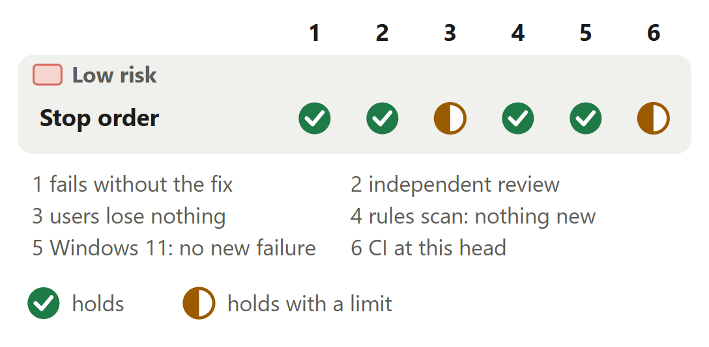

# A stop ends the hook's commands before it waits for a lock

For the pull request of branch `JeanFrancoisGagne/merge-assist-stop-ends-commands-first`, not opened yet, head 73ae3ef36. [report.html](report.html) is the same report as one page: download it and open it.

## 1. The decision

**Should a stop with a wait end the hook's commands before keeping a turn-off's events, which can wait for another process's write lock?**

**We recommend:** approve it: hook commands get their signal at once, not up to 5 s later; each taken event is kept once; a stopped turn-off starts no Git; running scans keep their wait.

| Size | Risk and review | Waits on | Not verified |
|---|---|---|---|
| 204 lines in 2 files: 13 ship, 191 are tests and text | Fast. Low risk, no high-risk path. | Nothing. No CI run on GitHub yet: not pushed. | 3 |

## 2. Intent, and the gap

| Change | Intended | Found | Now |
|---|---|---|---|
| Commands ended first | A stop signals the hook's commands _(code comment)_ | They waited on another process's lock _(the automated review)_ | Closes the gap. |
| No Git after stop | A stopped turn-off hands nothing _(code comment)_ | It still read every checkout's branches _(the automated review)_ | Closes the gap. |

Found on 19 November 2026 by the automated review of #816; cases reproduce both on Linux x64 and Windows 11.

Sources at main, and causes

| Change | Where main states the intent | The cause, and what was measured |
|---|---|---|
| Commands ended first | `src/runtime/merge-assist/service.ts` at d64e54fb7, lines 106 and 107 (the stop's comment), and in `stop()` line 658, `this.#keepTaken(waitMs > 0);`, before line 663, `await this.#commands.stop(Math.min(STOP_KILL_GRACE_MS, waitMs / 2));`. | A stop with a wait kept a turn-off's events not handed yet before anything else. That keep is a synchronous `immediate` transaction under the connection's five-second busy timeout, so while another process held the write lock the thread waited there, and `#commands.stop` ran only after it. |
| No Git after stop | `src/runtime/merge-assist/service.ts` at d64e54fb7, line 544: "stop that comes while the branches are read keeps the events not handed yet (`#keepTaken`)"; lines 547 to 549, the loop: `const branches = await this.#branches(entry.path); this.#taken.delete(entry);`, with no stop check. | The loop over the checkouts a turn-off took had no `#stopped` check. `#fire` hands nothing once stopped, so each later checkout's `currentBranchAsync` and `baseBranchAsync` ran for an answer nobody used. |

## 3. Where to look

1. **Read first**, 5 min: `service.ts`: `stop`, `setEnabled`, `#keepTaken`. Can an event a turn-off took be handed, dropped or kept twice between the stop's start and its keep?

**Then skim**, 5 min: The tests: three cases in the stop's file; `holdWriteLock` takes its bound and a process whose exit frees the lock as options.

## 4. Risk against verification

One change, low risk: the order of two steps inside a stop with a wait, one stop check in the turn-off's loop, and the running scans' wait kept at `main`'s.

Each half mark's limit

| Change | Check | It holds with this limit |
|---|---|---|
| Stop order | users lose nothing | No second reader of ours read this head. At this head each fix line removed fails a case of the stop's file on Linux x64, and the earlier lines' 18 mutants each failed one. |
| Stop order | CI at this head | No CI run at this head on GitHub yet: the branch is not pushed. CI's lint job passed on Linux x64. |

## 5. The changes

**Commands ended before the lock wait**, low risk: Over `main`'s source both fix cases fail on Linux x64 and Windows 11; here 0 of 20.

<b>6. The decisions</b>

**Where does a stop with a wait keep a turn-off's events?**

**We chose** once the hook's commands are ended, so a held write lock no longer delays their signal. **Would change our mind:** A caller that must have the events kept before the commands get their signal; none of Rerail's does.

| Option | What a user gets | Cost | What it breaks |
|---|---|---|---|
| Keep once the commands are ended **(chosen)** | The commands' signal at once; every event a turn-off took kept once, after the lock wait. | One check in the turn-off's loop, so a branch read that answers in between hands nothing. | On Windows a command may still be exiting when the lock wait starts. |
| Keep first, as on `main`, and document the delay | The same events kept. | None in code. | The commands run on up to 5 s, and the stop passes its wait. |
| Keep first without waiting for the lock | The commands' signal at once. | None in code. | Every event a turn-off took is lost while another process holds the lock. |

**Evidence.** Two cases at the service, over `main`'s source and here, 20 runs each on Linux x64 and Windows 11. With the keep first, another process that holds the lock until the hook command exits keeps it all five seconds, and nothing is kept. Here the command is ended first, the lock frees, and both checkouts keep their events.

**What does the scans' wait count once the keep has waited for a lock?**

**We chose** the wait less the commands' end time, from the keep's end: running scans stop when they did on `main`. **Would change our mind:** A caller that wants running scans given longer than on `main`.

| Option | What a user gets | Cost | What it breaks |
|---|---|---|---|
| Leave out the keep's wait, count the commands' **(chosen)** | The scans' timer ends when it did on `main`; the stop takes as long as on `main`. | One more time read in `stop()`. | Nothing found. |
| Count the whole wait from the keep's end | The scans get `main`'s wait plus the time the commands took to end. | None in code: one line moved. | A stop whose scan runs past its wait takes up to the 500 ms kill grace longer than on `main`. |

**Evidence.** A case at the service: a scan in another repository, held until another process frees the lock the keep waits for, then let go. With the lock wait taken from its wait it stores nothing in every run; over `main`'s `service.ts` and here it stores its conflict, 20 runs each on Linux x64.

<b>7. How it fits</b>

Nothing has to merge first: it stands on `main` cccb25a8d, merged in, with #816. No open pull request edits its two files.

<b>8. What is not covered</b>: 3 not verified, 2 limits that stay

1. **macOS** never ran.
2. **How often in use** a stop meets another process's write lock during a turn-off was not measured: the cases build that state on purpose.
3. **Through a daemon** only Linux x64 ran; on Windows 11 every figure is from the service's own tests.

**Limits that stay**

- On Windows a stop waits at most the 500 ms kill grace for `taskkill`, so a command may still be exiting when the lock wait starts.
- As on `main`, the keep still waits up to 5 s for the lock, so a stop can pass its wait by up to that lock wait; this change does not shorten it.

## 9. What we ask of you

We ask no ruling.

<b>10. Evidence</b>

The description on GitHub is the record: "How you tested it" holds the runs on `main` and here.

| Where | What ran | Result |
|---|---|---|
| Linux x64 | The two fix cases, 20 runs each over `main`'s `service.ts` and here, one machine | Over `main`'s source 20 of 20 runs each: four Git reads of the other two checkouts; the lock held five seconds and nothing kept. Here 0 of 20 failed. |
| Windows 11 | The same cases, 20 rounds over `main`'s source and at 175466c7d in turn, then 20 at this head | Over `main`'s source 20 of 20 rounds failed: 19 by the same assertions as on Linux, one by the 60 s limit on a busy machine. At 175466c7d 0 of 20 failed; at this head 0 of 20 failed. |
| Linux x64 and Windows 11 | The scans' wait case, 20 runs with the keep's lock wait taken from the scan's, over `main`'s `service.ts` (Linux) and here | Lock wait taken: Linux 20 of 20 failed, Windows 20 of 20 rounds: the scan stored nothing. `main`'s `service.ts`: Linux 0 of 20 failed. Here: Linux 0 of 20, Windows 0 of 20 failed. |
| Linux x64 | Each fix line removed, the stop's case file once each | Without the stop check 1 case fails; without the keep after the commands' end 4 fail. |
| Linux x64 and Windows 11 | `test/runtime/merge-assist/`, 11 files, here and at `main` on one machine per system | Linux: here 146 passed, `main` 143. Windows: here 145 passed and 1 skipped, `main` 142 and 1. No failure on either. |
| Linux x64 | CI's lint job | Each step passed: `just --fmt --check`, the release-notes check, `npm run check`, `check:ui-tokens` and `check:reference`. |
| Linux x64 | The automated reviewer's rules at `main` cccb25a8d over the diff against its merge base | No new finding and no new complexity, with the published 0.1.5 and with Rerail built from `main`. |
| Linux x64 | The built daemon stopped by SIGTERM during a turn-off, a 3 s lock held, 8 runs here and 8 at `main` | The hook command's signal: here 1 to 2 ms after the stop, `main` 3,031 to 3,185 ms. Both kept one row per checkout. The second checkout's branches read after the stop: `main` in every run, here never. |

**Sources.** The branch at 73ae3ef36 and its diff against `main` cccb25a8d, read on 19 November 2026; runs at 73ae3ef36 and at `main` cccb25a8d on a Linux x64 machine and Windows 11 virtual machines, and the Windows rounds of the fix cases at 175466c7d over d64e54fb7's source; the automated review of #816 at f3c3b644a.

