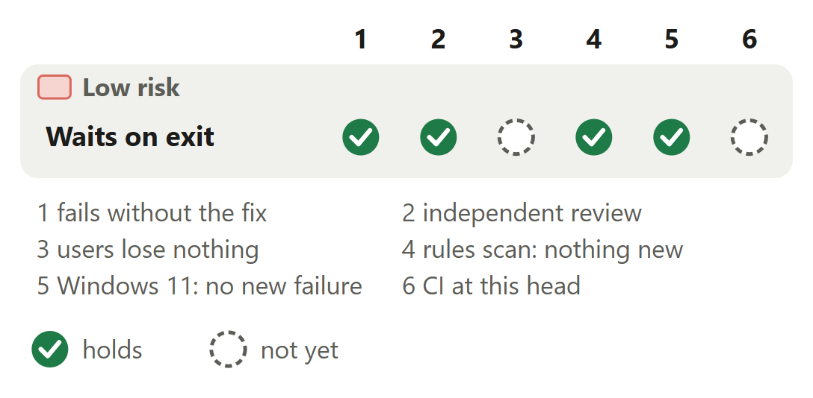

# The named-pipe case waits for its writer's exit before its folder goes

For [pull request #986](https://github.com/neralabs/rerail/pull/986), head a55d51895. [report.html](report.html) is the same report as one page: download it and open it.

## 1. The decision

**May the named-pipe case of `outside-git.test.ts` end its writer with SIGKILL and wait for its exit before it returns?**

**We recommend:** approve it: `main` returns before Node has seen the writer's exit, and failed the case with CI's message in 30 of 90 runs; here the case waits for that exit and passed every run.

| Size | Risk and review | Waits on | Not verified |
|---|---|---|---|
| 10 lines in 1 file: 0 ship, 10 are the tests it changes, 0 are other tests and text | Fast. One test file, no product code. | Nothing. No CI run yet: the branch is not on GitHub. | 1 |

## 2. Intent, and the gap

| Change | Intended | Found | Now |
|---|---|---|---|
| Folder goes after writer | Folder removed after the case _(a test's name)_ | The writer outlived the case _(CI runs, held runs)_ | Closes the gap. |

Found on 21 November 2026: CI runs 44964043395 and 44964751718 failed the case in Linux unit jobs of two pull requests not touching it.

Sources at main, and causes

| Change | Where main states the intent | The cause, and what was measured |
|---|---|---|
| Folder goes after writer | `test/engine/catalog/outside-git.test.ts` at 1609ac3a30: the case starts `sh` to write into a named pipe at `notes/.git`, checks that Rerail asks Git, sends the shell SIGTERM in `finally` and returns. | The case returned before Node's exit event for the writer, which comes on a later turn of the event loop; the removal counts such a child as running unless `/proc` shows it exited, and on a loaded runner the system had not yet ended the shell. As the case returned, Node had not seen the exit in 30 of 30 runs. |

## 3. Where to look

1. **Read first**, 2 min: `outside-git.test.ts`: the case "a .git that is a named pipe is never opened". Can the case now return while its writer still runs?

**Then skim**, 1 min: One import, `once` from `node:events`; every other case of the file is unchanged.

## 4. Risk against verification

One change, low risk: one case of one test file; the product and the folder removal's check are as they were.

Each limit, and each check that does not hold yet

| Change | Check | Its limit, or why it does not hold yet |
|---|---|---|
| Waits on exit | users lose nothing | No review by another reader yet. |
| Waits on exit | CI at this head | No CI run at this head on GitHub yet: the branch is not on GitHub. |

## 5. The changes

**The case waits for its writer**, low risk: Linux x64, two busy processors: `main` failed 29 of 60 runs with CI's message; here none failed.

<b>6. The decisions</b>

**How does the case keep its writer from outliving it?**

**We chose** SIGKILL, then the case waits for the writer's exit event before it returns. **Would change our mind:** A maintainer who wants the folder removal itself to wait for a process the test signalled.

| Option | What a user gets | Cost | What it breaks |
|---|---|---|---|
| SIGKILL, then wait for the exit event **(chosen)** | The case returns only once the writer has exited, and checks that the signal ended it, still in its open of the pipe. | 9 added and 1 removed lines in one test file. | Nothing found: a writer that never exited would fail the case at its own time limit. |
| SIGTERM, then wait for the exit event | The same here: SIGTERM ended the shell in every run. | The same lines. | A shell that handles or ignores SIGTERM would keep the case waiting until its time limit. |
| A removal that waits for processes the test signalled | Every case's signalled processes waited for. | A change to the removal every test uses. | It hides a case that leaves a process running, which the check exists to name. |

**Evidence.** On Linux x64 the shell slept in its open of the pipe with no child process in 30 of 30 runs, and SIGTERM ended it in 30 of 30; as the case returned, Node had not seen the exit in every run, and `/proc` still showed the shell running in 26 of 30 runs under load.

<b>7. How it fits</b>

Nothing has to merge first: one commit on `main` 1609ac3a30.

<b>8. What is not covered</b>: 1 not verified, 2 limits that stay

1. **GitHub's Linux runner** never ran this head: the load was made by two busy processes on the run's two processors.

**Limits that stay**

- The file beside the other test files of its CI shard was not run 30 times: one shard run on two processors takes several minutes.
- Under two busy processes, two other cases of the file timed out at 5 s in some runs, at `main` and here alike; alone they passed every run.

## 9. What we ask of you

We ask no ruling.

<b>10. Evidence</b>

The description on GitHub is the record: "How you tested it" holds the runs at `main` and here.

| Where | What ran | Result |
|---|---|---|
| Linux x64 | The case at `main` with a check of Node's view as it returns, 10 runs, and the head's case without its wait, 30 runs | Failed 40 of 40: Node had not seen the writer's exit when the case returned. |
| Linux x64 | The case at `main` recording what `/proc` shows of the writer | Before the signal: asleep in its open of the pipe, no child process, 30 of 30; ended by SIGTERM, 30 of 30. Read right after the signal under load: Node had not seen the exit in 30 of 30, `/proc` showed the shell running in 26 of 30, and the folder's removal failed with CI's message in 7 of 30. |
| Linux x64 | The file at `main`, pinned to two processors, alone and with two busy processes there | Alone: the case failed 1 of 30 runs with CI's message. With two busy processes: 29 of 60 (21 of 30 and 8 of 30 on two machines). |
| Linux x64 | The file here, pinned to two processors, alone and with two busy processes there | Alone: the file passed 30 of 30. With two busy processes: the case passed 60 of 60; on one machine the file passed 30 of 30, on the other two runs failed other cases at their 5 s limit, as at `main` there. |
| Windows 11 | The file at the head and at `main`, once each | Both passed, 71 passed and 1 skipped: the case is skipped on Windows. |
| Linux x64 | CI's lint and type-check steps at the head | All exit 0: `npm run check` with `tsc --noEmit`, `check:ui-tokens`, `check:reference`, `just --fmt --check --unstable`, the changelog check. |

**Sources.** The branch at a55d51895 and its diff against `main` 1609ac3a30, read on 21 November 2026; runs at the head and at `main` on two Linux x64 machines and one Windows 11 x64 machine.

