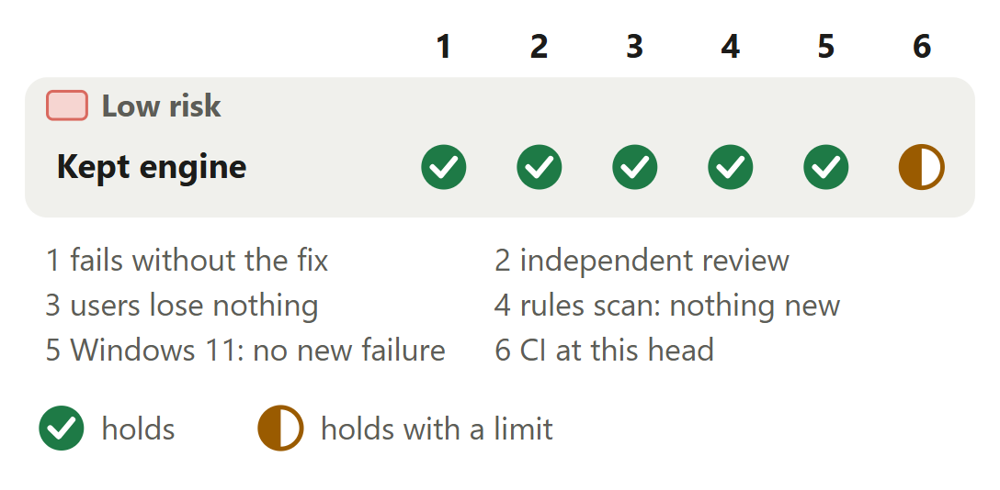

# The engine loader keeps the engine it loaded

For [pull request #1053](https://github.com/neralabs/rerail/pull/1053), head ef6f4630fc. [report.html](report.html) is the same report as one page: download it and open it.

## 1. The decision

**May the engine loader keep the engine it loaded, and look for its file on disk again only where `RERAIL_ENGINE_PATH` has changed?**

**We recommend:** approve it: a call after the first load looks for no file, where `main` looks once or twice; on Windows 11, at 180 worktrees, those looks took about a quarter of a daemon's samples.

| Size | Risk and review | Waits on | Not verified |
|---|---|---|---|
| 107 lines in 4 files: 42 ship, 65 are tests and text | Standard. One loader; every call after the first skips the look. | Nothing. No CI run here yet: the branch is not pushed. | 2 |

## 2. Intent, and the gap

| Change | Intended | Found | Now |
|---|---|---|---|
| Find the engine once | Find the engine once per process _(code comment)_ | Every call looked on disk _(two CPU profiles)_ | Closes the gap. |

Found in November 2026 in CPU profiles of a busy daemon on Windows 11, serving a repository of about 180 linked worktrees.

Sources at main, and causes

| Change | Where main states the intent | The cause, and what was measured |
|---|---|---|
| Find the engine once | `src/engine/native/native.ts` at 302a47d1a5, the comment on `packagedEngines`. `loadNativeBinding` still ran `resolveNativeBindingPath` and `require` at every call into the engine. | `loadNativeBinding` kept nothing between calls: `resolveNativeBindingPath` called `existsSync` on the paths in `native/`, two misses where the engine comes from its package, before `require` handed back the addon Node already held. Over 100,000 calls after the first: 100,000 looks, 8.9 to 9.2 us a call on Windows 11 and 1.9 to 2.3 us on Linux x64, on shared test machines. |

## 3. Where to look

1. **Read first**, 5 min: `native.ts`: `loadNativeBinding`, `requireEngine` and `isWorkspaceBusy`. Should a later `RERAIL_ENGINE_PATH` still load another engine, or should a process keep its first engine for good?

**Then skim**, 3 min: The test counts `existsSync` calls on `.node` paths over 1,000 calls and around a failed look; the docs line and the release note say when a process looks.

## 4. Risk against verification

One change, low risk: a call after the first skips the look, and a changed `RERAIL_ENGINE_PATH` is still looked up.

Each half mark's limit

| Change | Check | It holds with this limit |
|---|---|---|
| Kept engine | CI at this head | No CI run here yet: the branch is not pushed. |

## 5. The changes

**Keep the engine the loader loaded**, low risk: 100,000 calls after the first: `main` looks on disk 100,000 times, here none; 0.12 us a call on Linux x64.

<b>6. The decisions</b>

**Key the kept engine on `RERAIL_ENGINE_PATH`, or keep the first engine whatever it says?**

**We chose** the value it was found under: a process that names another engine file later still loads it, as at `main`. **Would change our mind:** A ruling that `RERAIL_ENGINE_PATH` is read once per process, at its first call into the engine.

| Option | What a user gets | Cost | What it breaks |
|---|---|---|---|
| Keep the engine under the `RERAIL_ENGINE_PATH` value it was found with **(chosen)** | No look after the first call; a changed variable is looked up again, and a missing file still throws. | One string compare per call. | Nothing that works at `main`. |
| Keep the first engine for the life of the process | The same where the environment never changes. | Nothing. | A process or a test that sets `RERAIL_ENGINE_PATH` after its first call gets the old engine, and a missing file no error. |
| Look at every call, as `main` does | Nothing new. | 2 to 9 us a call by system, and 23 to 25 percent of a busy daemon's samples on Windows 11 at 180 worktrees. | Nothing. |

**Evidence.** Node never unloads an addon, so a later look can only hand back the engine already loaded or load a second one beside it. The test file's fourth case sets `RERAIL_ENGINE_PATH` to a missing file: each call looks and throws, and once the variable holds its first value again the kept engine comes back with no look.

**Which of the two values kept beside the engine still have a reason?**

**We chose** drop the busy refusal's own value, and keep the engine package file once found, which later looks still use. **Would change our mind:** A ruling that every later look should read the engine package's version again; then the file and its case go.

| Option | What a user gets | Cost | What it breaks |
|---|---|---|---|
| Drop the busy refusal's value, keep the engine package file **(chosen)** | The same answers as `main`. | The kept file stays, with the looks it serves named in its comment. | Nothing. |
| Drop both | Every later look reads the engine package's version again. | Two small file reads at each later look. | Where an install changed the package since the first look, a look after `RERAIL_ENGINE_PATH` comes and goes refuses the engine the process holds. |
| Keep both, comments rewritten | The same answers. | Two values hold one engine load. | Nothing. |

**Evidence.** `WORKSPACE_BUSY` is the constant `"WORKSPACE_BUSY"` in the engine's source, so reading it from the kept engine changes no answer; a version of `isWorkspaceBusy` that looks again fails the new case. `resolveNativeBindingPath` still runs where a load fails, where `RERAIL_ENGINE_PATH` comes and goes, and at each catalog read.

<b>7. How it fits</b>

Nothing has to merge first: it stands on `main` be0def9c35, merged in with no conflict. #997, which edits another part of `native.ts`, has landed on `main`.

<b>8. What is not covered</b>: 2 not verified, 2 limits that stay

1. **macOS** Not run: no machine of ours runs it. The change has no platform arm.
2. **The times** Taken on shared test machines while other runs used them; the 23 to 25 percent comes from one daemon in one repository on Windows 11.

**Limits that stay**

- Where `RERAIL_ENGINE_PATH` names another engine file while a process runs, that engine loads beside the first and is not given `setPackageRoot`, as at `main`.
- A clone that writes `rerail_engine.<platform>.node` beside the `rerail_engine.node` its process loaded keeps the loaded engine until the next process, where `main` loaded a second engine.

## 9. What we ask of you

We ask no ruling.

<b>10. Evidence</b>

The description's "How you tested it" holds every run; "What is not covered" holds the limits.

| Where | What ran | Result |
|---|---|---|
| Linux x64 and Windows 11 | The test file at `main` with the test added | Three cases fail, 1,000 looks each, on both systems; the fourth passes. |
| Linux x64 | Two mutants: the kept engine dropped at a failed look, and a busy check that looks again | Each fails a case: `expected 1 to be +0`. |
| Linux x64 and Windows 11 | `native-binding-once.test.ts`, 30 rounds | 30 of 30 passed on Linux x64 and on Windows 11. |
| Linux x64 and Windows 11 | The 90 test files that import `native.ts`, and every integration file | Windows 11: 2294 passed; the 956 failures, all in `packs.test.ts`, lack the packs' test data, as at `main`. Linux x64: the same 956 as `main` on one machine. Integration: Windows 11 the same 12 failures here and at `main`; Linux x64 the same 8. |
| Linux x64 | CI's lint and type-check job | The release-note check against `main` be0def9c35, `npm run check`, `check:ui-tokens` and `check:reference` pass. |

**Sources.** The branch at ef6f4630fc and its diff against `main` be0def9c35; two CPU profiles of a daemon on Windows 11; the issue's measure on Linux x64 and Windows 11 test machines.

