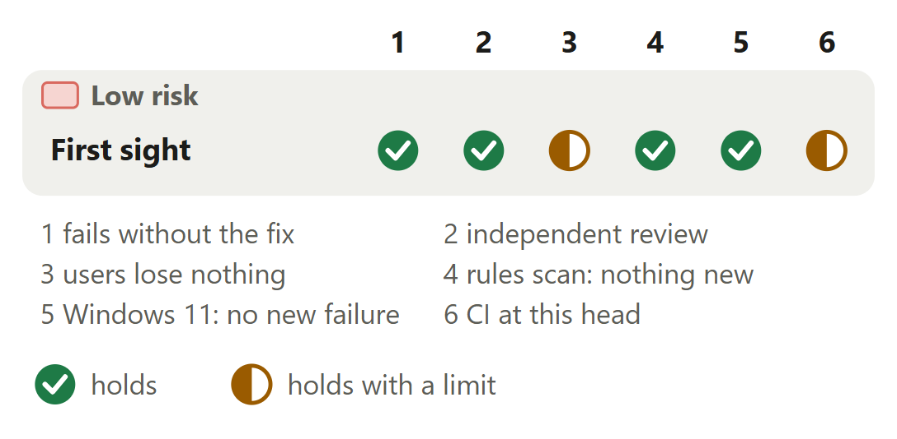

# A session's hooks stop waiting on Git for each new worktree's files

For [pull request #1074](https://github.com/neralabs/rerail/pull/1074), head bbcde8b92c. [report.html](report.html) is the same report as one page: download it and open it.

## 1. The decision

**May a session take a first-seen worktree's file that Git names as holding HEAD's text for Git's own, without reading its blob?**

**We recommend:** approve it: a new worktree whose HEAD last moved by a checkout, not a commit, stops costing each session Git processes in its queue, and a file the session's command wrote there is still recorded.

| Size | Risk and review | Waits on | Not verified |
|---|---|---|---|
| 942 lines in 7 files: 307 ship, 635 are tests and text | Careful. It decides which first-seen files a session asks Git about. | Nothing. CI has not run at this head. | 4 |

## 2. Intent, and the gap

| Change | Intended | Found | Now |
|---|---|---|---|
| New worktree, first sight | A new worktree is a baseline _(code comment)_ | Every file read against Git _(issue's steps, both systems)_ | Closes the gap. |

Found 22 November 2026 measuring removed worktrees: hooks waited 9 to 25 s as worktrees appeared on Windows 11, 3 to 16 s after 0.2.1.

Sources at main, and causes

| Change | Where main states the intent | The cause, and what was measured |
|---|---|---|
| New worktree, first sight | `src/engine/code-rule/code-rule-bridge.ts` at be0def9c35: `#firstSightPaths` (the comment quoted) takes every file stamped since the session opened; `#takeWorktreeWalk` then sends each, inside `#enqueue`, to `#applyWalk` > `#separateOwnWrites` > `#gitVerdicts` > `readGitView`. | `git worktree add` writes every file of the worktree after the session opened, so all of them pass `#firstSightPaths`, and each session reads their blobs, `HEAD`'s moves and line endings in its queue, while that session's shell result, tool calls and prompts wait behind them. |

## 3. Where to look

1. **Read first**, 4 min: `code-rule-bridge.ts`: `#worktreeTake`, `takeFirstSightListings`, `#separateOwnWrites`, `#firstSightVerdicts`, `listedUnchanged`. Can a file Git names as holding HEAD's text hold other text, or a written file escape that name?
2. 3 min: `worktree-walks.ts` and `git.ts`: `firstSeenIn`, `listedFor`, `listChanged`, `gitFirstSightListing`.

**Then skim**, 3 min: Cases in `code-rule-bridge.test.ts`: no `cat-file` for a clean new worktree; a file the session's command added, staged, committed, marked or deleted there, or edited in a worktree added again, recorded.

## 4. Risk against verification

One change, low risk: a file Git does not name as holding HEAD's text is read as before; only those it names stop starting Git.

Each half mark's limit

| Change | Check | It holds with this limit |
|---|---|---|
| First sight | users lose nothing | A file the session's command added, staged, committed or changed in a new worktree before its first walk is recorded, as at `main`. A worktree whose HEAD last moved by a commit is read as at `main`. A write from the session's folder before the walk first reads a worktree is no one's, at `main` and here (#738's baseline). |
| First sight | CI at this head | The repository's CI has not run at this head. The commit hook's checks pass at each commit. |

## 5. The changes

**New worktrees judged by Git's listings**, low risk: Issue's steps, Windows 11, 51 worktrees: slowest hook `main` 15.8 s quiet, 29.5 s busy; here 2.3, 6.4 s busy.

<b>6. The decisions</b>

**Judge files Git names as at HEAD by listings, or read them outside the queue?**

**We chose** judge them by the listings: three Git processes more in the shared walk, none in the queue. **Would change our mind:** A checkout whose Git leaves out a file that differs from the index would need the blob read back.

| Option | What a user gets | Cost | What it breaks |
|---|---|---|---|
| Judge a file Git names as at HEAD by the listings **(chosen)** | No Git process in the queue for a clean new worktree. | Three Git processes per new worktree in the shared walk, which no hook waits for. | Nothing `main` does: a blob read gives the same verdict. |
| Read the verdicts before the queue | The same wait gone. | The same five Git processes per worktree and session. | The verdicts can be a step older than the queue's state. |
| Read them once in the shared walk | Fewer processes with many sessions. | The walk judges for sessions it does not know. | Which session's writes a file holds. |

**Evidence.** Git compares a file's content before it leaves it out of the listing when its stat differs from the index; a file a command wrote is untracked or modified, and listed; one it staged differs in the index from `HEAD`, and is listed too. The cases hold at both.

**Trust only names Git printed as at HEAD, or fold names by Git's settings?**

**We chose** only where Git printed its name as at HEAD: no Git process more, every other file read as at `main`. **Would change our mind:** A measure where renamed or decomposed names cost a first sight real time would favour folding by Git's settings too.

| Option | What a user gets | Cost | What it breaks |
|---|---|---|---|
| Only a name Git printed as at HEAD **(chosen)** | A file Git ignores, or in another case or normal form, read as at `main`. | None: `ls-files -v` prints the whole index already. | Nothing `main` does. |
| Fold names by core.ignorecase and core.precomposeunicode | The same where Git's folding matches the volume's. | A read of two settings per new worktree. | A volume that folds more than Git drops a written file. |
| List ignored files where the session reads them | Ignored files recorded. | A fifth Git process, and the repository's Follow .gitignore setting in the shared walk. | Names in another case or form still dropped. |

**Evidence.** At d85304ae5b an ignored source written with Follow `.gitignore` off, and a file renamed to another case where Git ignores case, were dropped as Git's text; both are recorded over `main`'s source and here.

<b>7. How it fits</b>

It has merged `main` 2a7a2b7766: #738's baseline, #997's walks, #985's let-go of removed worktrees and #1064's owner lookup stand beside its first sights. #997, merged, reads a new worktree's remote off the daemon's thread; this change ends the reads in each session's queue.

**Shared files and the merge.** Git stopped on two lines of the take in `code-rule-bridge.ts` and on five places in `worktree-walks.ts`; the merge keeps both sides' fields. Since #738 another writer's change before a worktree's first walk is recorded by no one, so the cases of such changes now have the session's own command make them, in the new worktree.

<b>8. What is not covered</b>: 4 not verified, 6 smaller gaps, 1 limit that stays

1. **Write before first read** a file the session's command writes from its folder into a worktree not yet read is in no session's record, at `main` and here: #738 made that first read the baseline.
2. **A commit in each** a worktree whose HEAD last moved by a commit has every file read in the session's queue, as at `main`.
3. **100,000 files** two sessions, a worktree of 100,000 files added: shell results up to 12.5 s on Linux x64, 37.7 s on Windows 11 (f920f72d92).
4. **macOS** never ran; by reading, a file a Mac hands back decomposed goes to Git's reading, as at `main`.

**Smaller gaps**

- **Shared walk.** The walk still reads each new worktree's `HEAD`, index, ignore files and listings once, about 13 Git processes; no hook waits for it.
- **Added again elsewhere.** Across a suspension, a worktree Git removed and added again at another commit, then checked out back, records a deletion Git made as the session's edit, as at `main`.
- **Huge index.** An index past about a million paths gets no shortcut: its new worktrees go to Git's reading, as at `main`.
- **Files stamped since.** A worktree holding a file stamped since the session opened, by anyone, gets the four Git processes at its first sight.
- **Quiet Windows run.** The Windows 11 figures here ran beside another test run.
- **A file put back.** A file put back to the index's text between the walk's read and its listing is taken as Git's.

**Limits that stay**

- A filter Git applies one way only could leave a changed file out of the listing; none is known in the repositories measured.

## 9. What we ask of you

We ask no ruling.

<b>10. Evidence</b>

The description on GitHub is the record: "How you tested it" holds the runs on `main` and here.

| Where | What ran | Result |
|---|---|---|
| Windows 11, 104 worktrees | A new session writes into a worktree added just before it opened, two other sessions open, nine tries a form; this change's first-sight code on an earlier Rerail base | Its first walk of the worktrees: index listed for every worktree 26 to 78 s, audit by the third turn's end 4 of 9; one listing a worktree 6 to 14 s, 9 of 9; listed only where a file is stamped since 4.6 to 8.3 s, 9 of 9 (a faster machine). |
| Linux x64, Windows 11 | The cost case at cdebe2093f and here | Fails at cdebe2093f on both (`{ moves: 1, staged: 1, marked: 1 }`); passes here. |
| Windows 11, one busy machine | The issue's steps (one session, 51 worktrees added at once), Rerail built from each commit, two rounds | 92fbff1ccf: slowest 11,238 ms (quiet), 30,430 (busy). `main` be0def9c35: 15,808 (quiet), 29,502 (busy). Here: 2,303 and 6,431, both busy. |
| Linux x64, one busy machine | The same steps | The hook after the first shell command: `main` 711 and 1,024 ms; here 411 and 329. |
| Linux x64, load 6 to 13 | The issue's steps with a commit in each new worktree, two rounds | The hook after the first shell command: `main` 620 and 642 ms; here 714 and 560. |
| Linux x64, Windows 11 | Our review's three cases at d85304ae5b, over `main`'s source and here | The ignored and the renamed file fail at d85304ae5b, pass at `main` and here; the mirror passes at all three. |
| Linux x64 | Each deciding line taken out in turn | 16 of 18 fail a case at the merge of be0def9c35, the other two the cases added after it. At 3e333207e9 10 of 12 fail a case; at 822960eb48, with a case for a kept read, 11 of 12: a deletion Git names as at HEAD does not. |
| Linux x64, Windows 11, 3e333207e9 | The two changed test files, 30 runs each system | At 3e333207e9: Linux x64 18 of 18, Windows 11 30 of 30. At 822960eb48: both test files 30 of 30 rounds on GitHub's Linux runner in our fork; the walks test file with the kept-read case 30 of 30 on Windows 11. |

**Sources.** The branch at 822960eb48 and its diff against `main` c57506aab6, read on 25 November 2026; runs on Linux x64 machines and Windows 11 machines.

