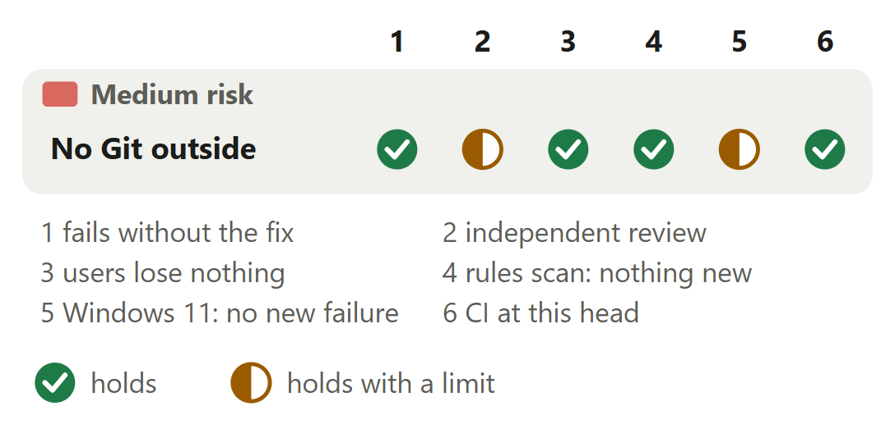

# Sessions outside a Git checkout start no Git process per hook event

For [pull request #739](https://github.com/neralabs/rerail/pull/739), head 729ed32c0. [report.html](report.html) is the same report as one page: download it and open it.

## 1. The decision

**Can a folder Git places in a repository now read as outside Git, where Rerail finds no `.git`, `HEAD` or `GIT_DIR` and skips Git?**

**We recommend:** approve it: in 45 folder shapes on Linux x64 and 50 on Windows 11 Rerail's answer equals Git's, and a nine-event session outside Git starts 0 Git processes where `main` starts 18.

| Size | Risk and review | Waits on | Not verified |
|---|---|---|---|
| 371 lines in 4 files: 69 ship, 302 are tests and text | Fast. The automated reviewer can approve. | Nothing. CI passed at this head; no pull request needs it. | 4 |

## 2. Intent, and the gap

| Change | Intended | Found | Now |
|---|---|---|---|
| Folder outside Git | A later `git init` is seen _(code comment)_ | 2 Git processes per hook event _(Git's own trace)_ | Closes the gap. |
| A plain folder's remote | No remote, no remote key _(code comment)_ | 59 Git processes a session _(Git's own trace)_ | Closes the gap. |

Found on 15 November 2026 with sessions in the home folder of a Windows 11 laptop. Counted that day on Linux x64 and Windows 11.

Sources at main, and causes

| Change | Where main states the intent | The cause, and what was measured |
|---|---|---|
| Folder outside Git | `src/engine/catalog/repository-registry.ts` lines 255 to 258 at `main`, on `createCheckoutResolver`: "each workspace's git location is read once (a folder outside git is located again, so a later `git init` is seen)". Line 273 keeps a location only when it is in Git. `src/engine/git.ts` line 356: `runGit` is `spawnSync`. | Every hook asks `GET /api/presentation`. Its handler (`src/api/operations.ts` lines 357 and 358) reads the start state and the checkout through two readers, and each calls `repositoryIdentityLocation`, which runs `git rev-parse --show-toplevel --path-format=absolute --git-common-dir --git-dir`. Outside Git that fails and nothing is kept, so the next event asks again. Counted from `GIT_TRACE2_EVENT` in the daemon's environment: 2 per event for every kind of event, on Linux x64 and Windows 11. |
| A plain folder's remote | `src/engine/catalog/repository-registry.ts` line 55 at `main`, on `remoteKeyOf`: "The normalised key of the checkout's `origin` or sole remote; undefined without one or without git." Line 171, on `adoptRemoteOnce`, says that no remote is not remembered, "so a remote added later is adopted". | `remoteKeyOf` at `main` takes the folder's path and runs `git ls-remote --get-url origin`, then `git remote`, whether or not the folder is in Git. A folder outside Git cannot have a remote, and since "no remote" is not remembered each session start asks again. The runtime's start watch also locates the folder twice per event. Counted on Linux x64 at e2f067440: 59 per nine-event session; 61 on Windows 11. |

## 3. Where to look

1. **Read first**, 6 min: `repository-identity.ts`: `outsideGit`, `noMarkerUpFrom`, `entryMayBeThere`, and the first line of `locateInGit`. Can Git find a repository with `GIT_DIR` unset and no `.git` or `HEAD` in the folder or above it?
2. 2 min: `repository-registry.ts`: `remoteKeyOf` takes the location and answers no remote outside Git.

**Then skim**, 4 min: `outside-git.test.ts` is new: 45 folder shapes, 50 on Windows, each compared with Git's own answer. Check each row's `asks` flag. The release note is one line.

## 4. Risk against verification

Two half marks: the second run read an earlier head with the same source lines, and so did the real-session count on Windows 11.

Each half mark's limit

| Change | Check | It holds with this limit |
|---|---|---|
| No Git outside | independent review | A second run from a separate checkout: 400 real Claude Code sessions per system, with 31 edge cases on Windows 11 and 26 on Linux x64, gave the same steer turn, stored events and repository at `main` and with the change. The limit: it read e190a1aeb, whose source lines are this head's, before the folder-shape test and two `main` merges. |
| No Git outside | Windows 11: no new failure | On Windows 11 at the head the change's test file passes 55 of 55, in the whole unit set and in CI's five Windows unit test jobs. The limit: the count through a real session ran at this head on Linux x64 only; on Windows 11 it ran at e190a1aeb, whose source lines are this head's: 0 against 18. |

## 5. The changes

**No Git start outside Git**, medium risk: A nine-event session outside Git: `main` starts 18 Git processes, this change 0, counted on Linux x64 from Git's trace.

<b>6. The decisions</b>

**How does the daemon know a folder is outside Git without starting Git?**

**We chose** a look on disk at every ask: nothing is kept, so a later `git init` is seen at once. **Would change our mind:** a repository Git finds with `GIT_DIR` unset and no `.git` or `HEAD` in the folder or above it: that shape then goes to Git.

| Option | What a user gets | Cost | What it breaks |
|---|---|---|---|
| Look on disk before each Git start **(chosen)** | 0 Git processes per hook event outside Git. Every folder with a `.git` or a `HEAD` in it or above it, and every folder when `GIT_DIR` is set, goes to Git as at `main`. | One real-path read and two `lstat` calls per folder level per ask: 21 microseconds an ask at 10 levels on Linux x64, against 746 to 836 with one Git start. | Nothing measured. It never answers "in Git" by itself, so it cannot misplace a checkout. |
| Keep "outside Git" per folder until a watcher or a timer drops it | No Git start after the first ask. | A watcher per folder level or a timer, and state per folder for the daemon's life. Not built. | A missed watch event or a time limit reads a new clone or a `git init` as outside Git until it drops. `GIT_DIR` changes nothing on disk. |
| The hook answers without the daemon, as #674 does in a stopped checkout | A shorter wait for that hook when the daemon is late. | The hook's own read of the database and the folders. | By a read of #674 at 6993ee854, not run: the hook still sends its request, and the daemon still starts Git twice for it. |
| One reader per request in place of two | 1 Git process per hook event in place of 2. | A few lines in the handler. | Still a Git start per event, which holds the daemon's thread. |

Before: At main a hook asks the daemon whether Rerail runs in its folder. The daemon starts Git twice to place the folder, Git answers that it is not a repository, nothing is kept, and the next event asks again: 18 Git processes for nine events. After: With this change the daemon first looks for a .git or HEAD entry in the folder and above it, and for GIT_DIR. With none found the folder is outside Git and no process starts: 0 Git processes for nine events. With one found, Git is asked as at main.

**Evidence.** The folder test compares Rerail's answer with `git rev-parse --show-toplevel` in the same environment: Git is not asked in 16 of 45 shapes on Linux x64 and 19 of 50 on Windows 11, and asked in the rest. Over `main`'s source the same test fails only on whether Git was asked. Each of nine fix lines taken out fails a test on Linux x64. The cost comes from a benchmark of two runs per commit on Linux x64.

<b>7. How it fits</b>

Nothing has to merge first: it holds `main` at e2f067440 and merges with today's `main`, f7835f9a0, without conflict. No open pull request needs it. #674 and #676 edit its two source files: with #674 it adds one conflict, an import line, and with #676 none.

**Related pull requests and issues.** Of the 14 other pull requests open on 17 November 2026, two edit a file this one edits. #674 (ours, draft, at 6993ee854) conflicts with `main` alone in three files; this change adds one hunk in `repository-identity.ts`, the import line from `checkout-control.js`: keep both names. #676 (ours, at cc6afc0b2) edits `repository-registry.ts` in other lines: no conflict. The 12 others share no file with it. #699 names #548 and #625 as related: this closes neither.

<b>8. What is not covered</b>: 4 not verified, 3 smaller gaps, 5 limits that stay

1. **The real-session count on Windows 11 at this head** was not made: the test machine was overloaded. It ran there at `main` (18 a session) and at e190a1aeb, whose source lines are this head's (0).
2. **Timing where process starts are slow** was not taken at this head. The 3.9 s without an answer at `main`, against 0.3 s, come from c89f068ed and e190a1aeb, on a slowed Windows 11 virtual machine.
3. **The fix lines taken out, on Windows 11** did not run at this head: each of nine fails a test on Linux x64. On Windows 11 eight of them failed a test at e190a1aeb.
4. **macOS** never ran.

**Smaller gaps**

- **Published 0.1.5.** Read in its code, not run: at the release's commit, 9cad73564, `locateInGit`, `createCheckoutResolver` and the presentation handler are as at e2f067440. 0.1.4 was run: by the issue's steps it starts 20 Git processes for 10 events.
- **A hung share or a slow disk.** The `lstat` walk has no time limit. `main`'s Git child makes the same reads inside `spawnSync` and cannot end while they block either. Read in the code, not run.
- **Above a mount point.** The walk reads every folder up to the root, where Git stops at a file-system boundary. On a home folder served by an automounter, an `lstat` of a parent's `.git` can cost one map lookup. Read in the code, not run.

**Limits that stay**

- A plain folder Rerail runs in still starts 8 Git processes a session: the source walk's own reads at the session start and at the stop, in code this does not edit.
- A started checkout still starts 23 Git processes in its first session, 25 on Windows 11, and a stopped one 2, as at `main`.
- With `GIT_DIR` set in the daemon's environment every folder asks Git, as at `main`.
- A folder below a `.git` that Git refuses (another owner's, past `GIT_CEILING_DIRECTORIES`, an empty `.git` folder) still asks Git on every event, as at `main`.
- Every other process the daemon starts still holds its thread until it ends: this removes the starts for folders outside Git only.

## 9. What we ask of you

We ask no ruling.

<b>10. Evidence</b>

The description on GitHub is the record. "How you tested it" holds the failing tests, the runs and the counts.

| Where | What ran | Result |
|---|---|---|
| CI on GitHub | The run at 729ed32c0, read on 17 November 2026 at 19:50 UTC | 32 checks passed, `CI result`, `Unit tests (1/2)` and `(2/2)`, `Unit tests (Windows, 1/5)` to `(Windows, 5/5)`, `Integration tests` and `Real Claude Code, Codex, and Cursor sessions` among them. 2 were skipped, both `Rust engine`. One duplicate label job was cancelled. None failed. |
| Linux x64 | A real Claude Code 2.1.326 session of nine events, a real daemon and the installed hooks, Git processes counted from Git's own trace, at `main` e2f067440 and at the head | Outside Git: 18 at `main`, 0 at the head. The home folder: 18 and 0. A plain folder Rerail runs in: 59 and 8. A started checkout: 23 at both. A stopped checkout: 2 at both. |
| Linux x64 | The issue's steps through the built hook entry: 10 `PreToolUse` events from a folder outside Git | 20 Git processes at `main`, 0 at the head. |
| Windows 11 | The same session count at `main` e2f067440, and at e190a1aeb, whose source lines are this head's | At e2f067440: 18, 18, 61, 25 and 2, in the order of the Linux row. At e190a1aeb: 0, 0, 8, 25 and 2. |
| Linux x64 | The change's test file over `main`'s source at e2f067440, then at the head 20 times in a row | Over `main`: 19 of 50 fail, each on whether Git was asked or on a count of Git starts, and every answer equals Git's. At the head: 50 of 50 in each of 20 runs. |
| Linux x64 | Nine fix lines taken out one at a time, at the head | Each fails at least one test: 19, 1, 2, 4, 23, 1, 1, 1 and 2 tests. |
| Linux x64 and Windows 11 | The 31 test files of the changed modules and their users on Linux x64, and the whole unit set on Windows 11, at the head | Linux x64: 585 passed, 5 skipped, 0 failed. Windows 11: the change's file 55 of 55; 8,565 passed and 144 skipped in all, and each of the 48 failures fails at `main`'s e2f067440 on that machine too. |
| Linux x64 | The rules scan as the automated reviewer runs it, at the head against `main` at e2f067440 | No new finding with the published 0.1.1 or with Rerail built from `main`. The highest complexity of a function added or edited is 5. |

**What this report adds to the description**

- **GitHub at 19:50 UTC on 17 November 2026.** #739 is an open draft at 729ed32c0: six commits, 363 lines added and 8 removed in 4 files, and GitHub reports no conflict with `main` at f7835f9a0. No person has commented on it or reviewed it. #699 is open with no comment.

**Sources.** Pull request #739, its checks and issue #699 on GitHub, read on 17 November 2026 at 19:50 UTC. Rerail at `main` (f7835f9a0) for each quoted intent. Each count names the commit it ran at. The 14 other open pull requests on GitHub for the related ones, each trial-merged with this head.

