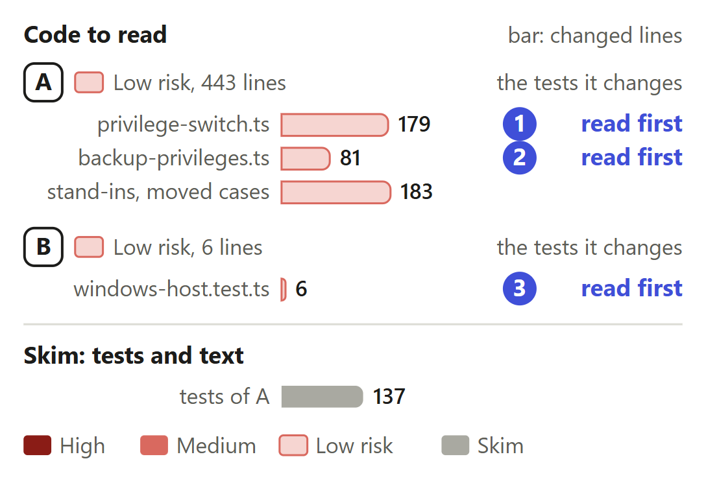
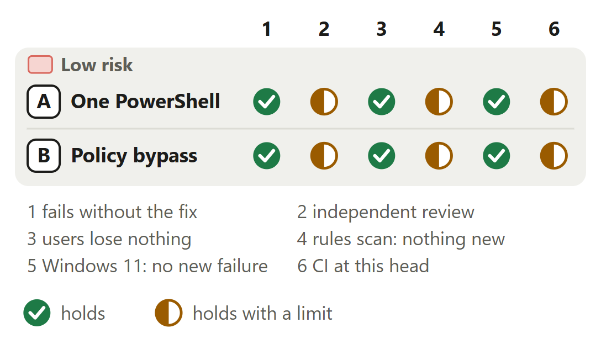

# Windows tests: one PowerShell start per file, and scripts allowed per process

For [pull request #1163](https://github.com/neralabs/rerail/pull/1163), head a7f6330935. [report.html](report.html) is the same report as one page: download it and open it.

## 1. The decision

**Should the privilege helper start PowerShell once per file, outside every case's limit, and the host steps' helper bypass the execution policy for its process?**

**We recommend:** approve it: no case that turns these privileges off holds a PowerShell start in its limit, and the host steps' three cases pass where nobody set PowerShell's execution policy.

| Size | Risk and review | Waits on | Not verified |
|---|---|---|---|
| 586 lines in 8 files: 0 ship, 449 are the tests it changes, 137 are other tests and text | Fast. Test files only; no high-risk path. | Nothing. It stands alone on `main` ef885f6e1c. | 4 |

## 2. Intent, and the gap

| Change | Intended | Found | Now |
|---|---|---|---|
| A. A case within limit | A case within its limit _(code comment)_ | PowerShell's first start in a case _(a CI job, #1141)_ | Closes the gap. |
| B. Windows tests run anywhere | Contributors run Windows tests themselves _(contributor guide)_ | Three cases need a script policy _(Windows 11 runs, #1148)_ | Closes the gap. |

Found on 26 November 2026, in a Windows unit job on GitHub's runner and in runs on a Windows 11 machine.

Sources at main, and causes

| Change | Where main states the intent | The cause, and what was measured |
|---|---|---|
| A. A case within limit | `vitest.config.ts` at `main` e29282a55f, the comment above `testTimeout: 30_000`; `withoutBackupPrivileges` in `test/support/platform/backup-privileges.ts` calls `setPrivileges`, an `execFileSync` of `powershell.exe -EncodedCommand`, before and after the body. | Each call started PowerShell twice, and each start compiled the C# type with `Add-Type`, inside the case's own limit. A new runner's first start prepares PowerShell's modules for first use, which the job's log showed at that case. |
| B. Windows tests run anywhere | `CONTRIBUTING.md` at `main` e29282a55f, "Developing on Windows", line 354. The same guide runs its own script with `powershell -NoProfile -ExecutionPolicy Bypass -File popups.ps1`, line 445. | `hostPowerShell` dot-sources `scripts/host/windows-host.ps1` from an encoded command and gave PowerShell no `-ExecutionPolicy`, so the machine's policy decided. With every scope `Undefined` it is `Restricted`, which loads no script file. |

## 3. Where to look

1. **Read first**, 10 min: `privilege-switch.ts`: `PrivilegeSwitch`, `powerShellWords`, `startPrivilegeSwitch`. Does every reply settle the request it answers, and does every way it ends leave no process?
2. **Read first**, 3 min: `backup-privileges.ts`: `backupPrivilegeSwitch`. Does each describe block start one switch in `beforeAll` and end it in `afterAll`?
3. **Read first**, 1 min: `windows-host.test.ts`: `hostPowerShell`. Does `-ExecutionPolicy Bypass` reach only the PowerShell this helper starts?
4. 4 min: `held-start.mjs`, `switch-holder.mjs`, `scrub-cli.test.ts`, `session-records-gitignore.test.ts`.

**Then skim**, 4 min: The new cases: a held start under a short limit, a body that throws, the privileges' states, a failed start, and no process left after three kinds of end.

## 4. Risk against verification

Two changes, both low risk, test code only: start at `PrivilegeSwitch`, the one long-lived process.

Each half mark's limit

| Change | Check | It holds with this limit |
|---|---|---|
| A. One PowerShell | independent review | Our own runs found two defects, both fixed here with a case: a start that failed left PowerShell waiting on its input, so the set-up ran to its 120 s bound (129 s, Windows 11); and no case made the real script fail. No independent review ran. |
| A. One PowerShell | rules scan: nothing new | The rule pack's review against `main`, Rerail built from `main`, found nothing new; every added or edited function counts 3 or less. Rerail as published could not run the pack. |
| B. Policy bypass | independent review | No independent review ran: one argument and its comment in a test helper. |
| B. Policy bypass | rules scan: nothing new | The rule pack's review did not run for this change: one argument in a test file, which adds no function. |
| A and B | CI at this head | CI on GitHub runs once the pull request opens. |

<b>5. The changes</b>

**A. One kept PowerShell per file**, low risk. The two scrub cases' medians on Windows 11: 1,386 ms at `main`, 389 ms here.

- **Problem:** A Windows unit job fails on a change that touches none of these cases: the first PowerShell start on a new runner took a case past its 30 s limit (32,767 ms) inside `withoutBackupPrivileges`.
- **Who meets it:** Contributors whose pull request runs the Windows unit tests on a new GitHub runner; it passes when run again (#1141).
- **What it does:** `backupPrivilegeSwitch` registers a `beforeAll` that starts one `PrivilegeSwitch` and waits for its `ready` line, and an `afterAll` that ends it. The switch reads requests through `$input` and answers each with the privileges that were on. The four cases move into a describe block of their own per file.
- **Risk:** Low. Test code only; the same C# type and token calls run in one PowerShell instead of two per case, and the cases' bodies are unchanged.
- **Check:** Does `PrivilegeSwitch` answer each request in order, and end on its input's end? Does a failed start fail the set-up once, in PowerShell's words, and leave no process? Do the moved cases run as before?
- **Picture:** On Windows 11, the sum of the medians of scrub-cli's two cases was 1,386 ms at main and 389 ms here; of the session records file's two cases, 1,918 ms at main and 964 ms here; 10 runs each.
- **Method:** The two test files ran 10 times at `main` and 10 times here, in turn, on one Windows 11 x64 machine; each case's time is vitest's own, and each figure is the sum of the two cases' medians.

**B. The host steps under any policy**, low risk. Windows 11 with no execution policy set: 3 of 4 cases failed before; 4 of 4 pass here.

- **Problem:** Three cases of `windows-host.test.ts` fail with "running scripts is disabled on this system" on a Windows 11 machine where nobody set PowerShell's execution policy, on `main` and on every branch.
- **Who meets it:** Contributors who run the unit tests on such a machine (#1148). GitHub's Windows runner sets a policy that runs local scripts, so CI does not show it.
- **What it does:** `hostPowerShell` passes `-ExecutionPolicy Bypass` to the one Windows PowerShell it starts, so that process may dot-source `scripts/host/windows-host.ps1`.
- **Risk:** Low. One argument in a test helper; it holds for that process alone and sets nothing on the machine. A policy set through group policy still outranks it.
- **Check:** Does the argument reach only the PowerShell that `hostPowerShell` starts, and do the three cases test the shared steps as before?
- **Picture:** On a Windows 11 machine whose execution policy is Undefined at every scope, 3 of the file's 4 cases failed at the commit before this change and none fail here.
- **Method:** The file once at the commit before it and once here, then 30 times here beside its CI shard neighbours, on one Windows 11 x64 machine whose execution policy is `Undefined` at every scope.

<b>6. The decisions</b>

**Where should the PowerShell start happen, so no helper case's limit holds it?**

**We chose** in the set-up of a describe block that holds only the cases that need it, one per file, kept open. **Would change our mind:** A vitest hook bound that cannot be set per hook, or a way to change a token's privileges from Node without a child process.

| Option | What a user gets | Cost | What it breaks |
|---|---|---|---|
| A `beforeAll` per file, PowerShell kept open **(chosen)** | No start and no compile in the limit of any case that uses the helper; one wait, bounded once; a failed start fails once. | A process that lives as long as the block; it ends on its input's end. | Nothing found: the cases' bodies run as before. |
| Two starts per case, with a longer limit | The smallest change. | Two starts and two compiles per case: 624 to 972 ms per case on Windows 11. | The limit is a guess from one stall; the next new runner may pass it. |
| A file-scoped vitest fixture | No hook to place. | Nothing more than the hook. | vitest 5.1 sets a fixture up inside the first case that asks for it, under that case's limit. |

**Evidence.** The case with a held start fails at `main` and passes here on Windows 11; vitest 5.1's runner wraps a case's fixtures in its timeout, and fails a suite whose `beforeAll` throws once, skipping its cases.

<b>7. How it fits</b>

It stands alone on `main` ef885f6e1c, which Git merged into it with no conflict, and needs no other pull request. #1076, #1126 and #1143 share no file with it, and Git merges each with it alone.

The pull request stands on main at ef885f6e1c, which Git merged into it with no conflict; nothing else has to merge first, and nothing waits on it.

<b>8. What is not covered</b>: 4 not verified, 1 limit that stays

1. **macOS and Linux** both helpers' PowerShell cases run only on Windows; the four changed test files ran on Linux x64; macOS never ran.
2. **A first start past 120 s** fails the set-up once and skips the block's cases. A first start here took 425 to 456 ms; the bound rests on the 32.8 s seen on GitHub's runner.
3. **The privileges' states** the case that reads them skips where the token holds neither, as on the machine these runs used; it runs on GitHub's Windows runner.
4. **A policy set through group policy** outranks the process's own: where one sets `AllSigned` or `Restricted`, the host steps' three cases still fail. No machine here had one.

**Limits that stay**

- The issue's third case starts PowerShell for `Get-Acl` under its own 60 s limit; it never used this helper and is unchanged.

## 9. What we ask of you

We ask no ruling.

<b>10. Evidence</b>

The description on GitHub is the record: "How you tested it" holds the runs.

| Where | What ran | Result |
|---|---|---|
| Windows 11, Linux x64 | At this head, the merge of `main` ef885f6e1c: the four changed test files, 15 runs on each of two Windows machines, once on Linux | 30 of 30 on Windows 11, 36 passed and 8 skipped in each; 35 passed and 9 skipped on Linux x64. |
| Windows 11 | The held-start case over `main`'s helper with the program as a parameter, and here | Fails at `main`: `Test timed out in 2000ms`, at 4,542 ms. Passes here in 29 ms. |
| Windows 11 | The two files 10 times at `main` and 10 times here, in turn | 0 of 20 failed; the four cases' medians 624 to 972 ms at `main`, 125 to 504 ms here. |
| Windows 11, no execution policy set | `windows-host.test.ts` at the commit before its change, and here | 3 failed and 1 passed before, with "running scripts is disabled on this system"; 4 passed here. |
| Windows 11 | Each changed or added file 30 times beside the files next to it in its CI shard | 30 of 30 for each of the four files. |
| Linux x64 | The two files at `main`; the three files of #1141 before the merge | 31 passed at `main`; 34 passed and 6 skipped before the merge, the six cases that need Windows PowerShell. |

**Sources.** The branch at a7f6330935, Git's merge of `main` ef885f6e1c into cd0ac36bd1, and its diff against that `main`, read on 26 November 2026; runs on Windows 11 x64 machines and one Linux x64 machine; vitest 5.1's runner and pool code.

