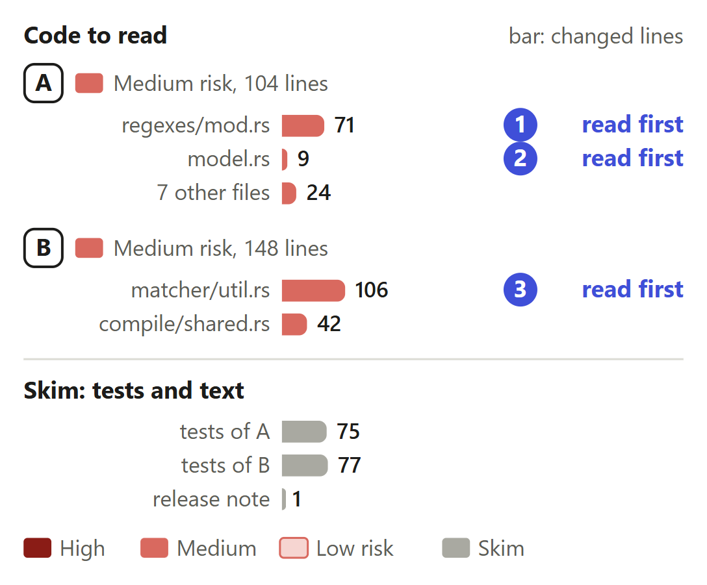
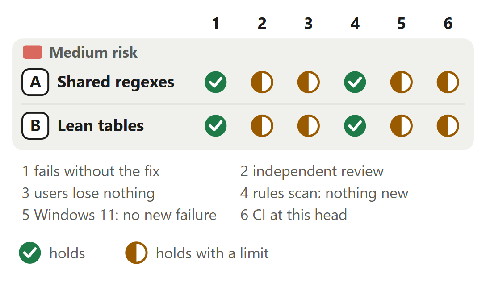

# Engine: the node-builtins rule holds 87 MiB, not 500 MiB

For [pull request #529](https://github.com/neralabs/rerail/pull/529), head 85e5f33e. [report.html](report.html) is the same report as one page: download it and open it.

## 1. The decision

**Is one process-wide table of compiled regexes, swept when a compilation ends and when a rule drops, the right owner of a rule's regexes?**

**We recommend:** approve it once the automated reviewer has read the eight commits since its review, CI is green, and you accept the regex table, after reading the [three places marked read first](#3-where-to-look).

| Size | Lane | Waits on | Not verified |
|---|---|---|---|
| 405 lines in 13 files: 252 ship, 153 are tests and text | Fast. No high-risk path; the automated reviewer can approve. | #634, a re-review. `Dependency audit` is red; the review predates eight commits. | 5 |

## 2. Intent, and the gap

| Change | Intended | Found | Now |
|---|---|---|---|
| A. Regex terms | One compiled regex per pattern _(our reading)_ | 108 tables, a regex per term _(release builds)_ | Closes the gap. |
| B. Utility tables | A shared table fills what queries reach _(code comment)_ | Room for all 3,053 utilities per table _(release builds)_ | Closes the gap. |

Release builds of main on a 32-core Linux machine. Issue #637 has the reproduction.

Sources at main, and causes

| Change | Where main states the intent | The cause, and what was measured |
|---|---|---|
| A. Regex terms | `native/src/code_rule_dsl/compile/shared.rs` lines 6 and 7, the module's comment: "so they compile once per document, grammar and \`languageOptions\`, into one table its queries share". Nothing at main says who owns a compiled regex: each term calls `Regex::new` (`compile/ast_rule.rs` line 465, `compile/parse.rs` line 425). | The rule's 932 clauses reach its 3,053 utilities under 36 `languageOptions` in three grammars, so it has 108 shared tables. Each table called `Regex::new` for every `regex` and `value.regex` term it compiled. One regex per pattern took the rule from 500 to 153 MiB: medians of three release-build runs at main's merge base and at 75525064. |
| B. Utility tables | `native/src/code_rule_dsl/matcher/util.rs` lines 105 and 106, the comment on `UtilTable`: "a document's shared table the ones its queries reach, as they reach them (\`compile::shared\`)." Lines 139 to 142 make four cells for every utility, and `compile/shared.rs` line 178 copies every name for each table. | `UtilTable::new` made a scope, a memo identity, a rule and a draft cell for every utility of the define, about 250 bytes in all, in each of the 108 tables: about 80 MiB by that count. Measured: commit 2ea7b4b4 took the rule from 153 to 87 MiB, medians of three release-build runs, each row's runs within 0.2 MiB. |

## 3. Where to look

1. **Read first**, 5 min: `regexes/mod.rs`: `Regex::new`, `sweep`. Can `sweep` drop a regex that a compiled rule still holds?
2. **Read first**, 2 min: `model.rs`: `Drop for CompiledCodeRule`. A review found a leak here. Can a rule drop on a thread holding the table's lock?
3. **Read first**, 8 min: `matcher/util.rs`: `slot`, `slot_or_new`, `with_target`, `summary_key`. Does a utility no query has compiled or read answer as at main?
4. 3 min: A: `code_rule_dsl/mod.rs`, `violations.rs`.
5. 4 min: B: `compile/shared.rs`.
6. 2 min: A: `compile/ast_rule.rs`, `compile/parse.rs`, `matcher/anchors.rs`, `matcher/mod.rs`, `value/text_regex.rs`.

**Then skim**, 5 min: No existing test changes. `regexes/tests.rs` is new; two memory tests end `compile/shared.rs`, left out on Windows.

## 4. Risk against verification

Start at A. No outside review has read either final design.

Each half mark's limit

| Change | Check | It holds with this limit |
|---|---|---|
| A. Shared regexes | independent review | The automated review read 2ea7b4b4, where regexes were shared per document, and traced the witness regexes. Our reviews of the process-wide table found regexes left after a rule drops; 34596066 fixed it with a test. No review outside ours has read the process-wide table, the sweep on drop or the `Regex` type. |
| A. Shared regexes | users lose nothing | The engine's output is byte for byte main's: 281 rules over 99 files at this head, and 15,174 outputs by sha256 at 1e3c8127. After the rules drop, 3.80 MB stay allocated against 3.69 MB at main. Matching time was last measured at 1e3c8127, and the sweep is not timed on its own. |
| A. Shared regexes | Windows 11: no new failure | The three `regexes` tests pass. One anchors test fails in 4 of 10 runs here and in 4 of 10 at main, at the same assertion; `matcher/anchors.rs` changes by one import line. The lib tests build on Windows only with a one-line `#[cfg(unix)]` that is not committed, at main too. |
| B. Lean tables | independent review | The automated review read the slots at 2ea7b4b4: `rule`, `with_target` and `summary_key` keep main's answers. The record of only the utilities compiled (11d64327), its `AddedByIndex` type (bd4e7cfa) and the `UtilTable::new` and `sharing` pair (e6baebd6) came after, and no review outside ours has read them. Our review found that the memory tests counted the input they free; 4573e0a3 fixed the count. |
| B. Lean tables | users lose nothing | The engine's output is byte for byte main's: 281 rules over 99 files at this head. Matching 109 rules over 656 files took a median of 14.8 s at main and 14.4 s at 1e3c8127, not measured at this head: `matcher/util.rs` differs from that commit only in its two constructors. |
| B. Lean tables | Windows 11: no new failure | The two memory tests read jemalloc's counters and are left out on Windows. The other lib tests of `compile` and `matcher` pass there, apart from the anchors test that fails as often at main. |
| A and B | CI at this head | 27 of 31 checks pass at 85e5f33e, the three Rust engine jobs and Conformance 1/8 to 8/8 among them. `Dependency audit` and the `CI result` that sums up fail until #634 merges; this pull request changes no dependency. 2 are skipped: they run on an approved commit. |

<b>5. The changes</b>

**A. One regex per pattern**, medium risk. The rule: 500 MiB at main, 153 MiB with shared regexes.

- **Problem:** With the Node.js pack on, the engine holds 500 MiB for one rule once compiled, and takes 2.6 s to compile it. Most of it is the same few hundred regexes, built again for every term in every table.
- **Who meets it:** Every process that compiles the Node.js pack, each time, for as long as its rules stay loaded. The five packs' 109 on-by-default rules hold 760 MiB at main and 149 MiB here (release builds, the median of three runs).
- **What it does:** `Regex::new` in `regexes` returns a pattern's one compiled regex, from a process-wide table behind a read-write lock. Five files import that type, not the `regex` crate's; `anchors/semantic.rs`, outside the diff, takes it through `use super::*`. `sweep` drops each regex nothing outside the table holds: `CodeRuleDslRuntime::compile` calls it as a compilation ends, and `Drop for CompiledCodeRule` as a rule drops.
- **Risk:** Medium. Engine code that every rule's regex terms go through, with new process-wide state behind a lock. The table is read at compile time, never at match time, and a regex is immutable.
- **Check:** Only `Regex::new` hands a regex out of the table, under its lock; a clone of a held `Regex` (`matcher/anchors.rs` line 378) takes no lock: its holder already counts. Can `sweep` drop one in flight? `CompiledCodeRule` derives `Clone`, and a workspace copies a rule it places (`Arc::make_mut` in `workspace/api.rs`), so each copy sweeps as it drops. Does anything but a rule's clauses hold a `Regex` and drop after the rule? `violations.rs` compares witness regexes by address: through `Deref`, the shared regex's.
- **Picture:** Memory held once compiled. The node-builtins rule: 500 MiB at main, 153 MiB with one regex per pattern alone. All 281 rules of five packs: 940 MiB at main, 201 MiB with both changes.
- **Method:** release builds on a 32-core Linux machine, one fresh Node 24 process per run, three runs a row, the median; held is jemalloc's allocated bytes after compiling. 153 MiB is the rule at 75525064, the first commit, which shared regexes per document. One regex per process then took the 281 rules from 212 to 201 MiB.

**B. Lean utility tables**, medium risk. The rule: 153 MiB before, 87 MiB after.

- **Problem:** Each shared table of a define makes room for every utility of the define and copies every name, though its queries reach a few dozen to a few hundred utilities.
- **Who meets it:** The same processes as A. The cost grows with a define's utilities times its tables: this rule has 3,053 utilities in 108 tables.
- **What it does:** `UtilTable` keeps one slot per utility and makes the utility's state when a query first compiles or reads it. A language's tables share one copy of the names, parameter flags and origins through `UtilTable::sharing`. `AddedByIndex` records only the utilities a table compiled.
- **Risk:** Medium. Every utility lookup of every rule goes through a slot, behind one more pointer. A wrong answer for a utility not yet filled would change what a rule matches.
- **Check:** Do `rule`, `with_target` and `summary_key` answer for a utility with no slot as main does for an empty cell? `scope` and `memo_term` make the slot on first read. `fill` and `draft` still panic past the table's utilities. `names` and `framed` come from `utils` in key order, the order `defs` has. `AddedByIndex` gives `None` for a utility not compiled, and its mutable index inserts an entry.
- **Picture:** A test document of 72 tables with no regex term: it holds 33.6 MB at main and 2.7 MB with this change, and its compile peaks 46.6 MB and 8.5 MB above where the thread began.
- **Method:** the table memory test's document, a lib test build on Linux, jemalloc's per-thread counters, the same bytes in three runs; 1 MB is 10^6 bytes. For the rule, 153 and 87 MiB are release builds at 75525064 and at 2ea7b4b4, three fresh Node 24 processes each, the median, each row's runs within 0.2 MiB.

<b>6. The decisions</b>

**One regex per pattern: per process, or per document?** (ask 1)

**We chose** the process: sharing per document hung on a hidden thread-local scope. **Would change our mind:** a profile of matching threads waiting on a shared regex's cache pool.

| Option | What a user gets | Cost | What it breaks |
|---|---|---|---|
| One per pattern, per process **(chosen)** | One regex for each of the 1,688 distinct patterns that the five packs' 281 rules write | A global table behind a read-write lock, read at compile time and never at match time. Threads that match one pattern share its cache pool | Nothing measured. Two terms that write one pattern count as one witness regex, and read the same named groups from the same node |
| One per pattern, per document, as the first commit had it | 2,584 regexes, since each rule keeps its own: 268 patterns appear in more than one rule | A thread-local scope that `compile_document` opened. Code that compiled outside it got regexes that were not shared. A table passed as a parameter instead would edit each long compile function | Nothing. The 281 rules hold 11.5 MiB more |
| Change the rule: one `languageOptions` for all its clauses | Fewer tables for this one rule | A pack data change and release, with its conformance data checked again | Other rules keep the cost per term: the four other packs' on-by-default rules add 199 MiB at main and 49 MiB here |

Before: At main a shared table compiles a utility its queries reach, each regex term calls Regex::new, and the rule ends with a new regex per term in each of its 108 tables. After: With this change each regex term asks the process-wide table. A known pattern gives the shared regex. A new pattern is compiled once and kept for every later term.

**Evidence.** The two-rules test fails with one regex per document. Per process against per document saved 11.5 MiB for all 281 rules: 212.4 to 200.9 MiB, release builds, the median of three fresh processes. Matching 109 rules over 656 files took a median of 14.8 s at main and 14.4 s at 1e3c8127, six interleaved runs each, with one output digest on every run. `calls::names` at main is a process-wide table of the same shape.

**When does the table let a regex go?**

**We chose** a sweep as each compilation ends and each rule drops. **Would change our mind:** a profile that shows the scan when many rules drop at once.

| Option | What a user gets | Cost | What it breaks |
|---|---|---|---|
| Sweep as a compilation ends and as a rule drops **(chosen)** | A process that drops its last rule holds no regex, as at main | Each compilation and each rule drop takes the write lock and scans the table: about 1,700 entries with the five packs loaded. Not timed on its own | Nothing. A drop on another thread can sweep a regex that a compiling document validated; its terms compile it again |
| Sweep only as the next document compiles, as an earlier commit had it | Less sweeping | Memory stays held after the rules drop, until the process compiles again | A daemon whose last checkout closed kept that checkout's regexes: 54.0 MB left against 7.9 MB at main |
| Weak entries, or a sweep when the table doubles as `calls::names` does | No scan at each drop | A regex can go between a document's validation and its terms, so its patterns compile twice | Nothing known. Not built |

Before: At main a rule that drops lets go of its clauses, and each term drops the regex it owns. After: With this change a rule that drops lets go of its clauses first, then sweeps the table under its write lock. A regex nothing else holds goes. A regex another rule holds stays.

**Evidence.** The two-rules test drops both rules with no compilation after: with the sweep only at the next compilation it fails at its last assertion. After all 281 rules are compiled, evaluated on 99 files and dropped, 3.69 MB stay allocated at main and 3.80 MB here: a lib-test probe on Linux, jemalloc, the same bytes in three runs.

**The shared type: named `Regex`, or a refactor first?** (ask 2)

**We chose** the name: the long functions keep main's text, and the review's findings clear. **Would change our mind:** a maintainer who wants those functions under the ceiling first.

| Option | What a user gets | Cost | What it breaks |
|---|---|---|---|
| A type named `Regex`, swapped in by import **(chosen)** | 0 new findings. `ast_rule.rs`, `parse.rs` and `anchors.rs` differ from main by one import line | In six files `Regex` is the shared type, not the crate's: five by import and `anchors/semantic.rs` through `use super::*`. A doc comment on the module, on `AstMatcher::Regex` and on `TextRegex::Plain` says so | Nothing: the same 631 tests pass with the same output |
| Refactor the seven functions under the ceiling here | The findings clear, and the functions get shorter | About 1,250 lines moved inside a memory fix | `CONTRIBUTING.md` line 398: "keep refactoring and behavior changes in separate pull requests" |
| Call a function of another name inside each long function | The call site says the regex is shared | An edit inside each of six functions over the ceiling at main | The rules scan reports an edited function over the ceiling as new: 6 of the 7 findings at bd4e7cfa, and the review stays at "request changes" |

**Evidence.** The rules scan, run as the automated reviewer runs it, rules from main, against the merge base: 9 new findings at the reviewed head, 7 at bd4e7cfa, 0 at e6baebd6. The rule matches the whole text of a function over the ceiling, so an edit inside one makes its finding new though no count moved. The same 631 lib tests pass, by name, at bd4e7cfa and at this head.

<b>7. How it fits</b>

It stands on main alone; no pull request needs it. The team's draft #508 changes 10 of its 13 files at 29de931d; a trial merge conflicts in four.

Pull request #529 is based on main alone, with a clean trial merge. Its CI waits for #634. It fixes issue #637, and no pull request stands on it. In a trial merge at 29de931d it shares 10 files with the team's draft #508, of which 4 conflict, and it shares no file with our five other open pull requests, which merge clean.

**Shared files, issues, the tracking issue.** Whichever of this and #508 lands second resolves four files. `code_rule_dsl/mod.rs`: the `mod` list and the `compile_document` call, which must keep the sweep. `matcher/mod.rs` and `value/text_regex.rs`: the `use` lines, where the shared `Regex` import must stay, and a doc comment. `matcher/util.rs`: the `UtilTable` fields and `rule`. It shares no file with #503, #530, #635, #636 or #638, and a trial merge with each one's head is clean. It fixes #637 and is part of #548, which stays open. [Tracking issue #632](https://github.com/neralabs/rerail/issues/632) lists it among our open pull requests.

<b>8. What is not covered</b>: 5 not verified, 6 smaller gaps, 7 limits that stay

1. **The automated reviewer has not read the eight commits since its review.** Its change request stands.
2. **CI is not green** until #634 merges.
3. **The sweep alone is not timed:** it scans about 1,700 entries under the write lock.
4. **Matching time is not measured at this head,** only at 1e3c8127.
5. **Windows:** only the five touched modules' lib tests ran. macOS never ran.

**Smaller gaps**

- **What the review has not read.** The process-wide table, the sweep as a rule drops, the `Regex` type, `AddedByIndex` and the `UtilTable::new` and `sharing` pair all came after the automated review of 2ea7b4b4.
- **The follow-up thread.** Our reply to the review's one inline finding is posted, and the thread is still open. Nobody has asked for a second review since the push: we ask for it once CI is green.
- **A running daemon.** Every figure comes from fresh Node 24 processes that load the engine and compile the rules, not from a daemon's own memory.
- **Backreference patterns.** They run on another regex engine and are not shared. What they hold was not measured.
- **Our own whole-suite runs.** They date from bd4e7cfa for the Rust workspace and from 2ea7b4b4 for the vitest suite, both without the pack test data. CI ran both with the data at this head, and they passed.
- **The trial merge with #508.** It is a draft that still moves: the count is that of its head 29de931d, read on 13 November 2026.

**Limits that stay**

- Regexes built elsewhere keep the `regex` crate's type and are not shared: a clause's regex query over file content or path, transforms, suppression comments, the module graph.
- A rule dropped on another thread while a document compiles can sweep a regex that document validated. Its terms compile it again: a second compile, not a wrong regex.
- The table's key is the pattern alone. A term that needs its own regex options cannot use it.
- Threads that match one pattern share its cache pool. The engine matches on 4 worker threads, as at main.
- A table that fills every utility, as a query's own table does, reads each utility's state behind one more pointer.
- The define check's validation tables keep copies of their own, as at main, and drop them when the check ends.
- The 1.4 s of compile time left is work per clause.

## 9. What we ask of you

1. **Is a process-wide regex table, swept at each compilation's end and each rule drop, an owner you accept?** We recommend yes: `calls::names` is such a table.
2. **May the shared type keep the name `Regex`?** We recommend yes: another name edits six long functions.
3. **Should the long compile functions come under the ceiling in their own pull request?** We recommend yes; we can open it.

<b>10. Evidence</b>

The description is the record: "How you tested it" holds the tests, runs and measurements.

| Where | What ran | Result |
|---|---|---|
| CI on GitHub | The run at 85e5f33e, read on 13 November 2026 | 27 checks passed, among them the three Rust engine jobs, both unit test jobs, the integration tests and Conformance 1/8 to 8/8: 941 of 941 shipped rules, `node/eslint-plugin-n` 37 of 37. 2 failed: `Dependency audit` and the `CI result` that sums up. 2 were skipped: they run on an approved commit. |
| Linux, Rust 1.95.0 | Lib tests of `regexes`, `compile`, `matcher`, `value` and `violations`, at e6baebd6, the code at this head | 631 passed, 0 failed, 2 benchmarks ignored: the same test names as at bd4e7cfa. |
| Linux, Rust 1.95.0 | `cargo fmt --all --check`, clippy over the workspace with warnings denied, and clippy with the profile feature | Exit 0, all three. |
| Windows 11, MSVC | The same five module filters, 10 runs here and 10 at main's merge base in alternating order, each with a one-line `#[cfg(unix)]` on an ignored benchmark that is not committed | 629 passed and 0 failed in 6 runs; 628 passed and 1 failed in 4. The one failure, an anchors test, fails in 4 of 10 runs at main too, at the same assertion. The two jemalloc memory tests are left out on Windows. |
| Linux, 32 cores | Release builds of main's merge base and of e6baebd6: each rule set compiled in a fresh Node 24 process, three runs a row, the two builds in alternating order | The rule: 500 MiB and 2.6 s at main, 87 MiB and 1.4 s here. All 281 rules of five packs: 940 and 201 MiB. Medians; a row's runs lie within 0.4 MiB and 0.3 s. |
| Linux | All 281 rules evaluated in report mode on 99 of the repository's files, at main, at bd4e7cfa and at this head | The output, 6,479,886 bytes with 10,655 violations, is byte for byte the same at all three. |
| Linux | The rules scan as the automated reviewer runs it, rules from main, against the merge base | 0 new findings and 44 existing at e6baebd6. 9 new at 2ea7b4b4, the review's own. |
| Trial merges | This head with main and with the heads of open pull requests | Main clean. #508, a draft, at 29de931d: 10 files shared, 4 conflict (`code_rule_dsl/mod.rs`, `matcher/mod.rs`, `matcher/util.rs`, `value/text_regex.rs`). #503, #530, #635, #636 and #638: clean, no shared file. |

**What this report adds to the description**

- **Brought into the description.** Writing this report found five things the description did not say: that CI has run at this head, which design the automated review read, that a compiled rule is copied and each copy sweeps, the two files the diff does not show at work, and that #508 had moved. The description now says each.
- **The state of the review on GitHub.** The change request on 2ea7b4b4 stands, with 8 blockers and 1 follow-up, all functions over the complexity ceiling at main. Our comment of 13 November answers each, the follow-up's thread is open, and issue #637 has no reply yet.

**Sources.** The pull request, its diff, its conversation, its reviews and its CI on GitHub, read on 13 November 2026. Rerail at main (feef6b5f) for each quoted intent. Issue #637 for the reproduction. Our run records and review records, and [tracking issue #632](https://github.com/neralabs/rerail/issues/632).

