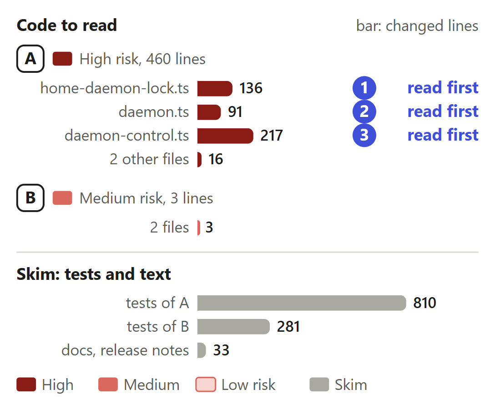
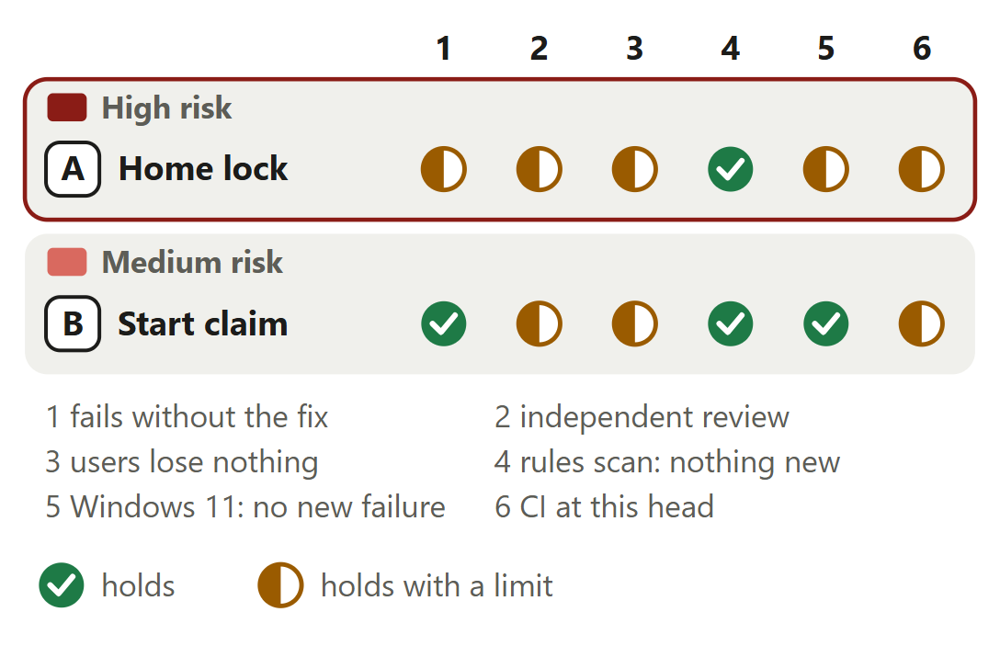

# A Rerail home runs one daemon, however many processes start it

For [pull request #657](https://github.com/neralabs/rerail/pull/657), head cf986a055. [report.html](report.html) is the same report as one page: download it and open it.

## 1. The decision

**Does one Rerail home end up with exactly one daemon, named in `daemon.json`, whatever starts, stops or dies, with nothing on `main` slower or broken?**

1. Every build's daemon locks its home, in `locks/`; a second exits. **Changes the intent.**
2. A lock holder that never writes `daemon.json` fails every start after 15 s.

**We recommend:** rule first on the two design questions open on #626, since this pull request builds the lock per home, then review it as built.

| Size | Lane | Waits on | Not verified |
|---|---|---|---|
| 1,587 lines in 19 files: 463 ship, 1,124 are tests and text | Careful. A code owner approves. | #626's two answers. No maintainer has answered. | 5 |

## 2. Intent, and the gap

| Change | Intended | Found | Now |
|---|---|---|---|
| A. One daemon per home | Only the installed daemon takes a lock _(code comment)_ | A checkout's second daemon on Windows _(Windows 11, at main)_ | **CHANGES THE INTENT: ANSWER 1.** A lock per home, in `locks/`. A maintainer must agree. |
| A. Finding the daemon | A start reuses the running daemon _(docs)_ | An unrecorded daemon blocks every start _(#626)_ | Closes the gap, changes answer 2. |
| B. Autostart | One start attempt per process _(code comment)_ | 20 hooks, 20 starts _(real processes, at main)_ | Closes the gap. |

#626, 12 November 2026.

Sources at main, and causes

| Change | Where main states the intent | The cause, and what was measured |
|---|---|---|
| A. One daemon per home | `src/daemon/daemon.ts` lines 852 and 853, a code comment: "the main daemon is the machine's one main instance, and a second one stops here naming the first. A checkout's daemon is a dev build with its own content store and takes no lock." `docs/how-setup-works.md` line 537: "Development builds never take the lock and never open that store." ae6d9d08f rewords both: a checkout's daemon skips the machine's lock and takes the home's. | An installed daemon's machine lock refuses a second one (#626); a checkout's daemon has only its engine pipe. By our reading, `engineHoldsCapability` (`src/runtime/engine-proof.ts` line 109) gives the pipe's holder 2,000 ms to prove it is this home's. A daemon busy for longer does not answer, so the second listens on the fallback pipe and writes `daemon.json`. At main on Windows 11, beside a daemon held busy 8 s, the second was still running 7 s later. |
| A. Finding the daemon | `docs/reference.md` line 616: "\`rerail daemon start\` reuses a running daemon and says where; stale state from a crash or reboot is cleared." `src/daemon/daemon.ts` line 93, the comment on `stateFile`: "Written once the server is listening and removed on close." Nothing at main says what a start does beside a daemon that has not written the file: it launches another. | `startDaemon` and `stopDaemon` find a daemon only through `daemon.json` (`lookupDaemon`, `src/runtime/daemon-control.ts` lines 724 and 1147). With the file gone or wrong, a start launches a daemon that exits with "is in use by a running daemon" (`src/runtime/engine-service.ts` line 512), or on the machine lock when installed (#626), and a stop says none runs. By #626's steps, 0.1.4 and 0.1.3 do the same. Of the first head's 15 tests, 7 fail at main on Linux x64 and 8 on Windows 11. |
| B. Autostart | `src/runtime/daemon-control.ts` lines 1047 and 1048, the comment on `autostartDaemon`: "Bring the daemon up from inside a host session so the browser view is live without anyone running \`rerail daemon start\`. One attempt per process". Lines 1063 and 1064: "the one daemon serves every repository". | `autostartAttempted` (line 1044) is a flag in one process, and every hook is a process of its own, so each one that finds the daemon down launches a start. In a mix of 6 hooks, 4 `rerail daemon start` and 4 daemon processes at once, main launched 10 starts and on Windows 11 left 5 daemons running in 1 of 2 runs. Seen once in use, on a Windows 11 machine: 52 start processes, none of which became the daemon. |

## 3. Where to look

1. **Read first**, 6 min: `home-daemon-lock.ts`: `holdHomeDaemonLock`, `homeDaemonLockHeld`. Can a daemon exit, or run unlocked, where it should not?
2. **Read first**, 5 min: `daemon.ts`: `runHomeDaemon`, `#record`, `#restoreRecord`, `close`. Can a rewrite land after `close` removed the file?
3. **Read first**, 9 min: `daemon-control.ts`: `lookupHomeDaemon`, `homeDaemonRuns`, `homeHolderMayRun`. Can a start wait, or a stop load the engine, with no daemon?
4. 9 min: B, about 130 lines of `daemon-control.ts`: `claimAutostart`, `claimHolds`, `endOwnClaim`; `setup-cli.ts`, `index.ts`. A: `engine-pipe.ts`, `daemon-entry.ts`.

**Then skim**, 8 min: `daemon-control.test.ts`: main's previous-package test starts an older build's daemon, with twice the time limit. No assertion is removed.

## 4. Risk against verification

Start at A. No person has reviewed; CI passed on a rerun.

Each half mark's limit

| Change | Check | It holds with this limit |
|---|---|---|
| A. Home lock | fails without the fix | The first head's 15 tests with real daemons (f8240d5ba) fail 7 of 15 at main on Linux x64 and 8 of 15 on Windows 11. At 2cb75efa0 on Linux x64 each fix line taken out turns its test red. The limit: d100d92f8, which stops removing the holder record before it is replaced, has no test of its own. |
| A. Home lock | independent review | A second set of runs, from a separate checkout with its own probes, found at f8240d5ba that a stop and an uninstall on Windows 11 loaded the native engine: fixed in a33140fbb. The automated reviewer requested changes at f8240d5ba and approves 2cb75efa0 with no finding. It reviewed neither main's merge nor the four commits since. No person has reviewed. |
| A. Home lock | users lose nothing | Tests with real processes hold main's answers: a killed daemon gives way to the next start in under 10 s, a stop and a start at the same moment leave at most one daemon, an older build's daemon is used and stopped. The limits: answer 2 differs from main by design, and the record check costs idle CPU (part 6). |
| A. Home lock | Windows 11: no new failure | The 9 test files that take the home's lock or start the built daemon pass at 2cb75efa0, in two runs from two checkouts: 179 passed, 14 skipped, 0 failed each time. The 78 files that changed or import a changed module ran at d100d92f8, not at the head: 1,672 passed, 36 skipped, 0 failed. |
| B. Start claim | independent review | The automated reviewer found at f8240d5ba that a start removed the claim even when it never got the start lock. 66e1c2b66 fixes it, with a test (f329ff54c), and its review of 2cb75efa0 has no finding. A second set of runs from a separate checkout took the fix out and saw that test fail. No person has reviewed. |
| B. Start claim | users lose nothing | A process that left the start to another launches at its next call once that launch has ended without a daemon: a test holds it. The held-claim check takes 5.4 to 5.6 µs on Linux x64 and 24.4 to 25.9 µs on Windows 11, the median of 2,000 calls, three rounds. The limit: measured at f8240d5ba, not at the head. |
| A and B | CI at this head | The checks GitHub lists at cf986a055, read on 14 November 2026: 28 pass, 1 is skipped. The limit: `Unit tests (2/2)` passed on CI run 43564453448's second attempt. On the first, one test of main failed in its own clean-up (`kill ESRCH`). In 3,600 repeats on Linux x64 it failed 2 times at main (c89f068ed) and 0 at cf986a055. |

<b>5. The changes</b>

**A. The home's lock and record check**, high risk. Real-daemon tests at f8240d5ba: 7 of 15 fail at main on Linux x64, none here.

- **Problem:** A running daemon that `daemon.json` no longer names blocks every start, and `rerail daemon stop` says none runs. Nothing is recorded or steered until someone ends it by hand. On Windows a checkout's busy daemon gets a second beside it.
- **Who meets it:** Every home whose `daemon.json` goes while its daemon runs: #626's four steps fail every time at main. How often the file goes is not known. Seen once, on a busy Windows 11 machine: 52 start processes, no daemon.
- **What it does:** `runHomeDaemon` takes an OS lock on `locks/daemon.lock` before the daemon opens a store or binds anything, and holds it until the process ends. `#record` and `#restoreRecord` read `daemon.json` every second and write it again when it differs. `lookupHomeDaemon` makes a start or a stop wait for that record while `homeDaemonRuns` says the lock is held.
- **Risk:** High. It decides which daemon a home runs and whether a start waits, uses it or launches one. A fault leaves a home where nothing is recorded. Where the lock cannot be asked or taken, main's behaviour stays.
- **Check:** Can `homeDaemonRuns` answer yes where no daemon of this home runs? On Windows `homeHolderMayRun` asks the lock only while this home's engine pipe is listed. `holdHomeDaemonLock` returns no lease on any failure of its first try. A restart at the heap ceiling launches the next daemon before the old process exits: does the old one always let go within the second the next one waits? `#restoreRecord` writes the capabilities to `daemon.json` alone, mode 0600, and logs only a process id.
- **Picture:** Of the first head's 15 tests with real daemons, 7 fail at main and none at f8240d5ba on Linux x64. On Windows 11, 8 fail at main and none at f8240d5ba.
- **Method:** `test/runtime/daemon-home.test.ts` as it stood at f8240d5ba: 15 tests that start real daemons, hooks and `rerail daemon start` processes. One run at main with that file added and one at f8240d5ba, on a 32-thread Linux x64 machine and on Windows 11 x64, Node 24.21.0. The file holds more tests now, and all pass at 2cb75efa0 on both systems.

**B. The shared start claim**, medium risk. 20 hooks, no daemon: 20 starts at main, 1 at 2cb75efa0.

- **Problem:** Every process that finds the daemon down launches its own `rerail daemon start`. After a daemon stops, every hook in flight does so at the same moment: 52 start processes were seen once on a Windows 11 machine.
- **Who meets it:** Every machine with several sessions when the daemon goes down. At main, on Linux x64 and Windows 11, 2, 5 and 20 hooks launch 2, 5 and 20 starts. A comment on #626 names it as that issue's second cause.
- **What it does:** `claimAutostart` creates `autostart.claim` in the Rerail home exclusively: the process that made it launches, and `handOverClaim` writes the launcher's process id into it. `claimHolds` lets the others leave the start to that launcher while it runs, 30 s at most. `startUnderLock` ends the claim through `endOwnClaim` when the start ends, only if the claim names this process.
- **Risk:** Medium. A claim that held too long would keep every session from starting the daemon. It holds only while its launcher runs, and 30 s at most. A start still takes the start lock, and the daemon the home's lock.
- **Check:** Its code is in `daemon-control.ts`, which the map counts under A. Can a claim outlive its launcher? `claimHolds` needs a live process id and a file time within 30 s of now, either way. Two processes that replace a stale claim at the same moment can both launch: the start lock still lets one start a daemon. A launcher that hands its start to the active version's CLI leaves the claim to end at its own exit.
- **Picture:** Start processes launched when hooks find no daemon at the same moment: 2, 5 and 20 at main for 2, 5 and 20 hooks, and 1 at 2cb75efa0 for each.
- **Method:** tests with real processes. Each hook is a process of its own that looks for the daemon and, finding none, runs the real autostart. The count is of `rerail daemon start` processes launched, at main and at 2cb75efa0, on a 32-thread Linux x64 machine and on Windows 11 x64. Each run at 2cb75efa0 left 1 daemon.

<b>6. The decisions</b>

**One daemon per home: a lock, or the socket alone?** (ask 1)

**We chose** the lock: the socket cannot find a daemon once `daemon.json` is gone. **Would change our mind:** a ruling on #626 for the socket alone.

| Option | What a user gets | Cost | What it breaks |
|---|---|---|---|
| A lock per home, held for the daemon's life **(chosen)** | One daemon per home whatever the socket or pipe does. A start and a stop can tell that a daemon runs when `daemon.json` is gone. | A 136-line module, two files in `locks/`, and a second OS lock on an installed daemon, beside the machine's. A start or a stop loads the native engine to ask it, on Windows only while this home's pipe is listed. | Where the engine does not load or the lock file does not open there is no lock, only main's socket or pipe check. An older build's daemon takes none. |
| The socket or pipe alone, with the Windows fallback corrected | No second daemon on Windows. | Small. | A daemon whose `daemon.json` went missing still blocks every start, in 0.1.4 too. |
| A process-id file with no OS lock | The same record with no native call. | Small. | A process id the system reuses, or a file left by a crash, blocks a start. |
| Main's machine lock for installed daemons, nothing for a checkout's | Nothing new to build, no files in `locks/`, and no engine load in a start or a stop. | Nothing. | #626's first part, for every build: start and stop never ask the machine's lock, whose record names no home. On Windows a second daemon whenever a checkout's build is one of the two. Read in the code, not built. |

Before: At main, beside a checkout's busy daemon A whose daemon.json is gone, a start launches daemon B. On Linux B exits on the engine socket and the start fails. On Windows B runs beside A on a fallback pipe and writes daemon.json. After: With this change daemon A holds the home's lock, finds daemon.json gone and writes it back within a second. A start finds the lock held and waits for the record. When it is back the start uses A. When none comes in 15 s the start fails, naming A.

**Evidence.** At main, with a checkout's build, a start after `daemon.json` is removed fails with "engine socket ... is in use by a running daemon" on Linux x64, and on Windows 11 a daemon started beside a busy one still ran 7 s later. At 2cb75efa0 on Linux x64, with the daemon given a lease that holds nothing, the test of a storm of starters fails. With the lock, 2, 5 and 20 daemons started at once leave 1 on both systems.

**Keeping `daemon.json`: a read every second, or a folder watch?**

**We chose** the read. More CPU per 10 idle minutes: 0.14 to 0.38 s, Windows 11; 0.13 to 0.17 s, Linux x64. **Would change our mind:** the watch, measured and not built, losing no event in a real daemon.

| Option | What a user gets | Cost | What it breaks |
|---|---|---|---|
| Read every second, write when it differs **(chosen)** | A gone or wrong record is back within about a second. | Over 10 idle minutes a daemon with the check used 203 to 391 ms of CPU on Windows 11, against 16 to 63 ms without it, and 240 to 270 ms on Linux x64, against 100 to 120 ms. | Nothing: only the holder writes the file. |
| A folder watch, with a read every 30 s behind it | The record back in milliseconds. | About a twentieth of the read's idle CPU, and about 25 lines. In idle Node processes on Windows 11 it cost 15 ms of CPU more than no check over 10 minutes. | A platform that drops a change event restores only at the slow read. Not measured inside a real daemon, and not on macOS. |
| No check | Nothing. | Nothing. | Nothing finds a daemon whose `daemon.json` went: with the check off, the busy-daemon test and the three spoiled-record tests fail (Linux x64, 50705c972). |

**Evidence.** Real daemons, 10 idle minutes, with the check against without. At f8240d5ba's tree: 240 ms against 100 ms on Linux x64, 203 ms against 62.5 ms on Windows 11. At 50705c972: 250 to 270 ms against 100 to 120 ms, and 375 to 391 ms against 16 to 47 ms with other test runs on the Windows machine. `daemon.json` removed 200 times from a real daemon at 50705c972: restored every time on both systems, within 1,029 ms.

<b>7. How it fits</b>

Nothing has to merge first. Our #672 conflicts in two source files.

Pull request #657 is based on main at a9101752c, which this head has merged. It needs no other change, and none needs it. In trial merges it conflicts with #672 in two source files, with #648 in one source file and with #678, #673 and #652 in one test file, and merges clean with main at c89f068ed and with #677.

**Open pull requests that share a file.** Trial merges of cf986a055, 14 November 2026. Main (c89f068ed) and #677 (cf1a78a78) merge clean. #672 (e3e22bd70) conflicts in `src/cli/daemon-entry.ts` and `src/daemon/daemon.ts`: the second to merge makes the daemon's entry hold the lock once and serve both starts; a trial composition of earlier heads, 01138399c with 50705c972, passed `tsc` and 97 daemon tests. #648 (e322936d3) conflicts in `src/daemon/daemon.ts`; #678, #673 and #652 in `test/runtime/daemon-control.test.ts` only. The lock alone fixes #626's two reproductions. If a maintainer prefers, the claim becomes its own pull request. The description's "How it fits" has every row.

<b>8. What is not covered</b>: 5 not verified, 6 smaller gaps, 8 limits that stay

1. **macOS** never ran.
2. **No test ran** at a merge with main.
3. **Left as main intends:** a `daemon.json` naming a live process that is no daemon refuses every start.
4. **Windows, as on main:** beside a busy daemon, a program holding the lock file open lets a second daemon start. A retry, not built, would close it.
5. **In no known setup:** a start that cannot ask the lock fails beside a busy daemon after about 1.5 s. Main fails it on Linux and starts a second on Windows.

**Smaller gaps**

- **That Windows case, in full.** The busy daemon's `daemon.json` is gone, and the program holds the lock file open twice: when a start asks the lock, and when the new daemon first tries it. A failed first try means no lock, as on main. Read from the code, not run.
- **That last case, in full.** The start cannot ask the lock, the daemon can, and the busy daemon's `daemon.json` is gone. Linux x64, d100d92f8, the start's question made to fail: it fails after 1,513 ms. With 6a2140fa8's line reverted, as at 50705c972, it waited 8,059 ms and used it.
- **A restart at the heap ceiling.** The next daemon is launched before the old process exits, and tries for the lock for one second. No test of this branch restarts a real daemon that way.
- **One fix has no test of its own:** d100d92f8 stops removing the holder record before it is replaced. The gap it closes is microseconds wide, and the tests of the atomic replace it relies on are main's.
- **The folder watch** was measured in idle Node processes: restored 200 of 200 times within 1 s on both systems. It was not measured inside a real daemon, and not on macOS.
- **One timing test on Linux.** Of the 78 files at 2cb75efa0 on Linux x64, 1,703 tests passed, 5 were skipped and 1 failed: a `code-rule-runtime-lifecycle` timing test outside this change, beside another job at load 15. Alone it failed 0 of 10 runs.

**Limits that stay**

- The Rerail home gains `locks/daemon.lock`, `locks/daemon.json` and `autostart.claim`. Against 0.1.4 it gains `locks/`, which main already makes. Rerail 0.1.4 sharing the home is not locked out and leaves the lock intact (measured at f8240d5ba).
- Where the engine does not load or the lock file does not open there is no lock: a start or a stop goes on at once, and the engine socket or pipe keeps the daemon to one, as on main.
- An older build's daemon takes no lock. On Windows it can still run beside a busy daemon of this build, on the fallback pipe. The holder keeps `daemon.json` naming itself, so hooks reach it.
- A hook that finds no `daemon.json` in the second before it is written back drops its event. A hook still looks once and never waits: ask 2 is about that.
- On Windows a holder that hangs before it binds its engine pipe is not waited for: a start launches a daemon that exits after about a second, naming it.
- A daemon started in-process, as `RerailDaemon.start` and the tests do, takes no lock and writes `daemon.json` once: only the entry point takes the lock.
- Two processes that replace a stale claim at the same moment can both launch a start. The start lock still lets one of them start a daemon.
- The record check costs an idle daemon one read of `daemon.json` a second: the calls of one check take 46 µs on Linux x64 and 75 µs on Windows 11, the median of 2,000, three times.

## 9. What we ask of you

Ask 1 rules on answer 1.

1. **On [#626](https://github.com/neralabs/rerail/issues/626#issuecomment-6870426095): a lock per home, taken by every build, or the socket alone?** We recommend the lock.
2. **On #626: should a hook wait a second for `daemon.json` while the lock is held?** We recommend yes, as its own change.

Answer 2 asks no ruling. By design: main starts another (the description's "Decision 3").

<b>10. Evidence</b>

The description is the record: "How you tested it" and "The decisions".

| Where | What ran | Result |
|---|---|---|
| CI on GitHub | The checks GitHub lists at cf986a055, 14 November 2026. Four commits after 2cb75efa0 change nothing that runs: ae6d9d08f a comment and a docs sentence, 1076b71d3 the release notes, f53b774d3 a troubleshooting entry and one note's wording, cf986a055 one reference phrase | 29 checks: 28 pass, 1 skipped. 28 are CI run 43564453448's, on its second attempt. On the first, `Unit tests (2/2)` failed on a test of main, unchanged here: `test/runtime/daemon-control.test.ts` "stops an unresponsive live daemon pid and clears its state file", `kill ESRCH` in its clean-up. In 3,600 repeats on Linux x64 it failed 2 times at main and 0 at cf986a055. Outside CI no other test ran after 2cb75efa0. |
| Linux x64, 32 threads | The 9 test files that take the home's lock or start the built daemon, at 2cb75efa0 | 193 passed, 0 failed. |
| Linux x64, 32 threads | The 78 test files that changed or import a changed module, at 2cb75efa0 | 1,703 passed, 5 skipped, 1 failed: `code-rule-runtime-lifecycle` "starts a session before its evaluator opens, and answers a tool call at once without code rules", a timing test outside this change, beside another job at load 15. Alone it failed 0 of 10 runs at 2cb75efa0. |
| Windows 11 x64 | The same 9 files at 2cb75efa0, two runs from two checkouts | 179 passed, 14 skipped, 0 failed, each time, and no failure outside main's results on that machine. |
| Windows 11 x64 | The 78 files at d100d92f8, which differs from 2cb75efa0 in the lock's first try, its test and one doc sentence | 1,672 passed, 36 skipped, 0 failed. |
| Linux x64 | Each fix line taken out of 2cb75efa0, one at a time | Each turns its test red: the lock question that counts a failure as held (its stop then waits 15,106 ms and names an unrelated process), a lock file that does not open, the start claim of another launcher, the holder record of another daemon, the Windows pipe rule, and the storm of starters with a lease that holds nothing. |
| Linux x64, Windows 11 | The three busy-daemon tests: 50 runs in a row at 2cb75efa0 on Linux x64; 20 runs at 50705c972 and 20 at d100d92f8 on Windows 11 | Linux x64: 50 of 50 passed. Windows 11: 2 of 20 failed at 50705c972, 0 of 20 at d100d92f8. CI at 50705c972 failed on the same tests' own handshake, which read a file the test was still writing: fixed in a33502144. |
| Linux x64 | The automated reviewer's rules scan (Rerail 0.1.1, the complexity pack and the repository's own pack) over the 7 changed source files, 2cb75efa0 against a9101752c | Complexity: 17 over the ceiling at the base and 17 at the head, none new. The repository's pack: 1 and 1, none new. |

**What this report adds to the description**

- **A restart at the heap ceiling has no test with real processes.** A read of the diff. `daemonExit` closes the daemon, launches the next one and exits. The home's lock goes at that exit, and the next daemon tries for it for one second. `test/daemon/daemon-exit.test.ts`, main's, holds the order with stand-ins. No test of this branch restarts a real daemon that way, and the description does not name the restart.
- **The uninstall meets answer 2 too.** A read of the diff, not run. `rerail install --remove` stops the daemon through `stopDaemon`, which now waits and then fails beside a lock holder that never writes `daemon.json`. At main that stop answers that no daemon runs, and the uninstall goes on. The description says "a start or a stop" and does not name the uninstall.
- **Two processes can replace one stale claim.** A read of the diff. The comment on `claimAutostart` says two processes that replace a claim at the same moment can both launch, and the stale-claim test accepts one launcher or more. The start lock still lets one start a daemon, and the test ends with 1 daemon. The description does not name this case.
- **The lines of each change.** `daemon-control.ts` holds both changes, and this report counts its 217 lines under A. By the hunks of the diff at 2cb75efa0, about 130 of them are the claim's. The split of the tests, 810 lines for A and 281 for B, is a count by hunk too. The description gives the totals only.

**Sources.** The pull request, its checks, its reviews and issue #626 on GitHub, read on 14 November 2026, about 07:10 UTC. Rerail at main (c89f068ed) for each quoted intent. The diff of cf986a055 against its merge base a9101752c for the sizes and the read-first places. Our run records for the runs, each with its commit. `git merge-tree` for every trial merge.

