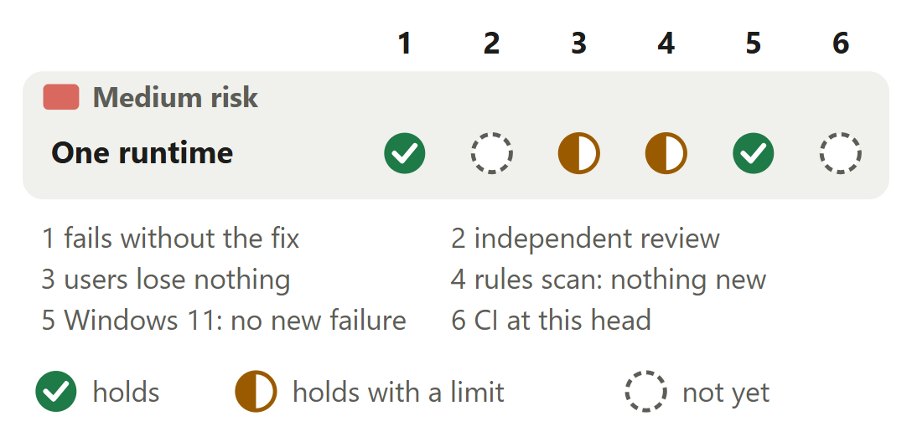

# A session keeps one runtime when its hooks name another model folder

For [pull request #1206](https://github.com/neralabs/rerail/pull/1206), head 57002aaef3. [report.html](report.html) is the same report as one page: download it and open it.

## 1. The decision

**Should a session keep the model folder and storage root it opened with while the daemon holds it, when a later hook names others?**

1. A session's later hooks naming another model folder or storage root reach its runtime.

**We recommend:** approve it: every event of the session is recorded and checked, the fix sits in the daemon alone so events left by 0.2.2's hooks are covered, and a changed folder waits for the next start.

| Size | Risk and review | Waits on | Not verified |
|---|---|---|---|
| 513 lines in 5 files: 38 ship, 475 are tests and text | Reviewer approval. REVIEW.md lists no high-risk path among the files that ship. | Nothing. It stands alone on `main` cce09e3c36. | 5 |

## 2. Intent, and the gap

| Change | Intended | Found | Now |
|---|---|---|---|
| Late event after update | Late events checked as any _(docs)_ | Every later event refused _(the issue's runs)_ | Closes the gap. |
| Model folder mid-session | Each hook resolves its model _(docs)_ | Resume refused, then every hook _(the issue's runs)_ | Closes the gap, changes answer 1. |

Filed on 27 November 2026 at `main` cce09e3c36, on Linux x64 and Windows 11 x64, through the built CLI and a real daemon.

Sources at main, and causes

| Change | Where main states the intent | The cause, and what was measured |
|---|---|---|
| Late event after update | `docs/troubleshooting.md`, on a daemon that runs but does not answer: "As soon as the daemon reads again it checks those events as it checks any event, in the order their hooks met them and before any later event". | `resolveRuntimeRoute` keyed a runtime by storage root, model folder, database and checkout. The late event names the old version's `model/`, the next hooks the new one's: two runtimes for one session, and `registerOwner` refuses the second's claim while the first holds it. |
| Model folder mid-session | `docs/reference.md`, "Session storage": "`RERAIL_STORAGE_ROOT` and `RERAIL_MODEL_PATH` replace them ... Hooks, `rerail events`, OMP and Pi ... and the daemon itself all resolve them this way." Nothing at `main` says what a change during a session does. | The same key: a hook that names another model folder or storage root for a session the daemon holds opened a second runtime, whose claim was refused. |

## 3. Where to look

1. **Read first**, 5 min: `engine-service.ts`: `resolveRuntimeRoute`, `checkoutRoute`, `sameCheckout`. Should a runtime that holds the session win over the model folder and storage root its event names?

**Then skim**, 4 min: The integration case updates Rerail with an event left untaken and checks each later hook; the engine-service case pins what stays: another database, another checkout, an end.

## 4. Risk against verification

One change. Start at `checkoutRoute` in `engine-service.ts`.

Each limit, and each check that does not hold yet

| Change | Check | Its limit, or why it does not hold yet |
|---|---|---|
| One runtime | independent review | No reader outside the author has read this head yet. |
| One runtime | users lose nothing | A session keeps the model folder and storage root it opened with until it ends, the daemon stops, or the idle close lets it go; a changed `RERAIL_MODEL_PATH` waits for that. |
| One runtime | rules scan: nothing new | Rules scan at this head against `main` cce09e3c36 with Rerail built from `main`: no new finding; `checkoutRoute` 4, `sameCheckout` 2, `resolveRuntimeRoute` 3 as at `main`. The published 0.1.1 cannot load `main`'s pack: no verdict there. |
| One runtime | CI at this head | No CI run at this head on GitHub yet: the branch is not pushed. |

## 5. The changes

**One session, one runtime**, medium risk: After an update with one event left: at `main` 3 of 3 later hooks refused; here 3 of 3 recorded.

<b>6. The decisions</b>

**Where should one session's two model folders be reconciled?**

**We chose** the daemon's routing: events of a session it holds go to the runtime holding it, covering 0.2.2's untaken events. **Would change our mind:** A maintainer who wants each hook to name a model folder only where a person set one.

| Option | What a user gets | Cost | What it breaks |
|---|---|---|---|
| Route a held session to its runtime, in the daemon **(chosen)** | Every event of the session recorded, whatever hook version or variable wrote it, events 0.2.2's hooks left included. | The session keeps its first model folder and storage root until it ends or the daemon lets it go. | Nothing found. |
| Hooks send no model folder unless a person set one | The daemon's own model for every event that names none. | A request schema change (`modelPath` is required) and every sender changed; `RERAIL_MODEL_PATH` mid-session still splits a session. | Events 0.2.2's hooks leave, at the first update after the fix; an older daemon taking a fixed hook's event. |
| Leave it to the idle close | No change. | Every event of the session refused, for up to a day when it waits on a tool call. | The session's checks and records. |

**Evidence.** Weighed against the code: `ConfigurationSchema` requires `modelPath`, and the hooks, the event stream, OMP and Pi each send one. At this head the update case and the resume case pass on Linux x64 and Windows 11 and fail over `main`'s source.

**Where does a quiet session the idle close let go open again?**

**We chose** where its next event names, as at `main`: its suspension carries its claim, and that folder exists. **Would change our mind:** A maintainer who wants a session's model folder fixed until it ends, whatever the quiet.

| Option | What a user gets | Cost | What it breaks |
|---|---|---|---|
| Where its next event names **(chosen)** | No refusal: the suspension's claim moves with the session; the folder the hook just named exists. | A session changes model folder after 30 minutes quiet, or a day while it waits on a tool call. | Nothing found. |
| Back in the runtime and model it opened with | One model folder per session until it ends. | A runtime made again over an old version's folder, and a second record of which runtime held the session. | A session whose first folder was removed meanwhile: its reopen fails. |

**Evidence.** `closeIdleSessions` releases the session's runtime key; the next runtime takes its suspension and claim (`takeSuspended`, `holdsOwner`). A case pins it; the issue's prompt runs were taken again from 31.6 minutes.

<b>7. How it fits</b>

It stands alone on `main` cce09e3c36. #1076 and #1194 edit `startEngineService` in the same file, #1201 another paragraph of `docs/reference.md`; each merges cleanly.

<b>8. What is not covered</b>: 5 not verified, 2 limits that stay

1. **Another checkout** an event of a session that names another checkout over the same database is still refused, as at `main`.
2. **Refusals stay quiet** a refused event writes no `daemon.log` line and its hook answers `{}` with exit code 0, as at `main`; only `rerail status` says so.
3. **macOS** never ran.
4. **Windows in CI** the integration cases run in CI's Linux integration job only; on Windows they ran in our runs.
5. **Published 0.2.2** not installed: the case uses two copies of this build that differ only in their version number.

**Limits that stay**

- A session keeps the model folder and storage root it opened with until it ends, the daemon stops, or the idle close lets it go.
- Mutants ran on Linux x64 only: the Windows runner takes commits, and a mutant here is a patch.

## 9. What we ask of you

Ask 1 rules on answer 1.

1. **May a session keep the model folder and storage root it opened with while the daemon holds it?** We recommend yes: its events are recorded; its next start takes the new one.

<b>10. Evidence</b>

The description on GitHub is the record: "How you tested it" holds the runs at this head.

| Where | What ran | Result |
|---|---|---|
| Linux x64 | At 57002aaef3: the two changed test files; the same over `main`'s `engine-service.ts` | 9 of 9 pass; over `main`'s source the 5 cases that send one session's events under two folders fail on #1203's refusal, the 4 others pass. |
| Linux x64 | #1203's two probes through the built CLI, the registered hooks and a real daemon, 32 runs a side | Over `main`'s source every run that splits a session fails: 0 of 22, each later hook refused; here 32 of 32 pass, no hook refused. |
| Linux x64 | 4 mutants of the deciding lines; the importers at this head and over `main`'s source | 3 mutants fail a case, the fourth is equivalent; 503 passed, 0 failed here; over `main`'s source only the 3 two-folder cases fail. |
| Windows 11 | At 57002aaef3: the two changed test files; the same over `main`'s source | 9 of 9 pass; over `main`'s source the same 5 cases fail, the 4 others pass. |
| Windows 11 | At this head and at `main`: the test files that import the changed module, and three integration files that run this build's daemon | 499 and 492 passed, 16 skipped on each, no failure. |
| Windows 11 | 30 runs of each changed test file, the engine-service file beside its CI shard neighbours | 30 of 30 runs of each, no failed round. |

**Sources.** The branch at 57002aaef3, three commits on `main` cce09e3c36, read on 27 November 2026; runs on Linux x64 and Windows 11 x64 machines.

