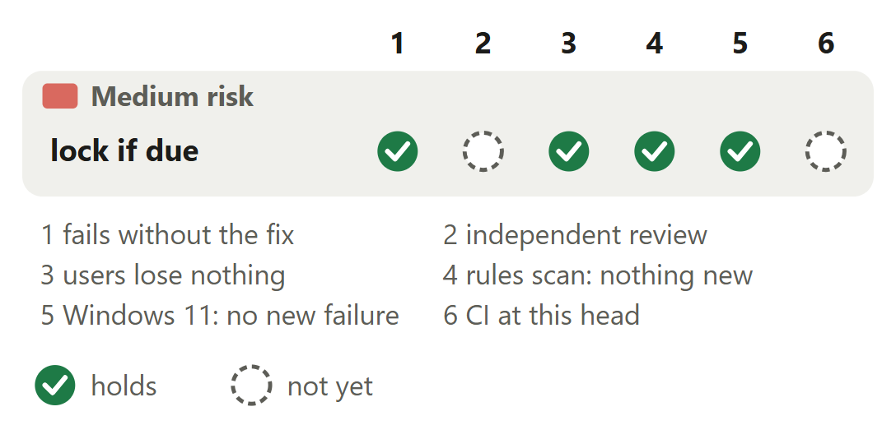

# Opening a database already at this build's shape only reads it

For [pull request #1126](https://github.com/neralabs/rerail/pull/1126), head b2067a240. [report.html](report.html) is the same report as one page: download it and open it.

## 1. The decision

**May a writable open of a Rerail database already at this build's shape read it without the write lock, with refusals, adoption and steps unchanged?**

**We recommend:** approve it: `rerail daemon start` beside another process's 8 s write lock failed 10 of 10 runs at `main` on Linux and Windows and starts in all 10 here; the baseline cases pass unchanged.

| Size | Risk and review | Waits on | Not verified |
|---|---|---|---|
| 200 lines in 4 files: 68 ship, 132 are tests and text | Careful. A person reviews: storage is a high-risk path. | A person's review. No CI run at this head yet: not pushed. | 3 |

## 2. Intent, and the gap

| Change | Intended | Found | Now |
|---|---|---|---|
| Writable open | Steps and DDL under one lock _(code comment)_ | Every open took it; starts failed _(built CLI, both systems)_ | Closes the gap. |

Met on 26 November 2026 on a Windows 11 laptop after an install, then run through the built CLI on Linux x64 and Windows 11.

Sources at main, and causes

| Change | Where main states the intent | The cause, and what was measured |
|---|---|---|
| Writable open | `applySchema` in `src/engine/storage/database.ts` at `main`: "Migration steps, DDL and stamp run under one write lock, so concurrent openers agree on the file's shape", and its first line runs `BEGIN IMMEDIATE` for every writable open. | `openChecked` calls `applySchema` for every writable open; it runs `BEGIN IMMEDIATE`, then all 73 statements of `RERAIL_SCHEMA_STATEMENTS` and `COMMIT`, which change nothing on a current file. `busy_timeout` is 5,000 ms, so a lock held longer fails the open. The read-only open's `upgradeBeforeReading` already told a current file apart without the lock. |

## 3. Where to look

1. **Read first**, 10 min: `database.ts`: `applySchema`, `shapeChange`, `upgradeBeforeReading`, `checkedStamp`. Does every file that needs a change still reach `BEGIN IMMEDIATE`, and is the stamp read again under it?

**Then skim**, 5 min: One new case file of three cases; the baseline files are unchanged. One docs sentence, one release note.

## 4. Risk against verification

Start with `applySchema`: the snapshot read decides only whether to take the lock; under the lock nothing changed.

Each limit, and each check that does not hold yet

| Change | Check | Its limit, or why it does not hold yet |
|---|---|---|
| lock if due | independent review | No review by another reader yet: our own reading against the repository's review points only. |
| lock if due | CI at this head | No CI run at this head yet. |

## 5. The changes

**Lock only for a change**, medium risk: `rerail daemon start` beside an 8 s lock: 0 of 10 started at `main`, 10 of 10 here, each system.

<b>6. The decisions</b>

**How should an open of a current file avoid the write lock?**

**We chose** read the shape without the lock, as the read-only open did, and again under it when a change is due. **Would change our mind:** a writer of another build that removes a table or index of this build's schema from a file.

| Option | What a user gets | Cost | What it breaks |
|---|---|---|---|
| Read the shape, lock only for a change **(chosen)** | An open of a current file never waits for or fails on another writer. | 11 statements prepared on each writable open, against 85 at `main`. | Nothing pinned: the baseline cases pass unchanged. |
| A shorter busy wait on the open | A failure sooner. | None at run time. | The daemon start still fails beside a long write. |
| `PRAGMA user_version` alone marks a current file | One read on each open. | None. | A step that keeps the floor leaves it as it was, so a file one such step behind would read as current and miss the step. |

Before: At main a writable open reads the stamp, sets up the writer, then always takes the write lock, waiting up to 5 s for another writer and failing past that, before it runs the steps and 73 statements and commits. After: With this change the open reads the file's shape in one snapshot after setting up the writer. A current file returns at once with no lock. A file that needs a step, adoption or its schema takes the lock and runs them as on main.

**Evidence.** Beside an 8 s lock, `rerail daemon start` failed 10 of 10 runs at `main` and started in 10 of 10 here, on Linux x64 and Windows 11. Over `main`'s source the new open case fails; the two openers of a stale file run its step once on both.

<b>7. How it fits</b>

It stands on `main` alone. No open pull request touches its files; Git merges it with #1076, #1103, #1110, #1113, #1117 and #1118.

<b>8. What is not covered</b>: 3 not verified, 2 limits that stay

1. **A session's start beside the lock** still answers `{}` after 5 s, at its owner claim, at `main` and here alike.
2. **Other commands** than `rerail status` and `rerail daemon start` did not run beside the lock.
3. **macOS** never ran.

**Limits that stay**

- A file that needs a step still waits for the lock and fails past 5 s, as on `main`: the step must run under it.
- A daemon start with 20 checkouts, lock free: 715 against 713 ms on Linux, 1,083 against 1,259 ms on Windows, spreads overlapping.

## 9. What we ask of you

We ask no ruling.

<b>10. Evidence</b>

The description on GitHub is the record. "How you tested it" holds the runs at `main` and at this head.

| Where | What ran | Result |
|---|---|---|
| Linux x64, Windows 11 | `rerail daemon start` beside another process's 8 s lock, built CLI, 10 runs each | `main`: 0 of 10 started on each, exit 1 after 5.7 s and 6.7 s. Here: 10 of 10 in 0.6 s and 1.1 s. |
| Linux x64, Windows 11 | A session's start through the built hook beside the lock, 10 runs each | Both builds: `{}` after 5.1 to 5.9 s; here the first start in a checkout fails at the claim, not the open. |
| Linux x64, Windows 11 | 40 opens of a current file | `main`: 85 statements, 1.61 and 3.96 ms medians. Here: 11 statements, 1.17 and 2.27 ms. |
| Windows 11 | The new case file, 30 runs beside its shard neighbours | 30 of 30. |
| Windows 11 | 67 files that open the database, and six integration files | Nothing new at this head; one `main` timeout passed here. |
| Linux x64 | The same 67 files on a loaded machine; the seven with failures again on another | Every failure a 5 s timeout, on both builds; the seven files then passed whole at `main` and here. |

**Sources.** The pull request and its diff, read on 26 November 2026. Rerail at `main` c10a645a1c for the quoted intent.

