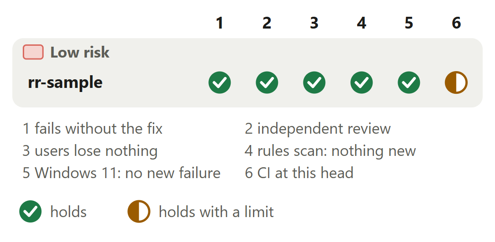

# The steer's pack-title case passes within its limit on Linux

For [pull request #1017](https://github.com/neralabs/rerail/pull/1017), head b453b5d8c1. [report.html](report.html) is the same report as one page: download it and open it.

## 1. The decision

**May the steer's pack-title case install the fixture pack rr-sample, whose three rules the engine reads quickly, instead of the Django pack?**

**We recommend:** approve it: on Linux x64 `main` failed the case in 30 of 30 runs and this head passed every run, in under 0.9 s; it still fails when the steer drops the pack's title.

| Size | Risk and review | Waits on | Not verified |
|---|---|---|---|
| 27 lines in 1 file: 0 ship, 27 are the tests it changes, 0 are other tests and text | Fast. One test case, no product code. | Nothing. No CI run on GitHub yet: not pushed. | 1 |

## 2. Intent, and the gap

| Change | Intended | Found | Now |
|---|---|---|---|
| A pack's listed title | The title its pack lists _(test name)_ | 27 rules read in the case _(CPU profile)_ | Closes the gap. |

Found on 23 November 2026: the case failed Linux unit tests on pull requests that do not touch it.

Sources at main, and causes

| Change | Where main states the intent | The cause, and what was measured |
|---|---|---|
| A pack's listed title | `test/engine/rr/rr-edit-runs.test.ts` at `main` d52a0fb2c, from #930. | A test run starts with an empty rule image store, so the engine builds every rule's images on that first read: 4.0 s of CPU. |

## 3. Where to look

1. **Read first**, 3 min: `rr-edit-runs.test.ts`: the pack-title case and the file's imports. Does the case still read the title from `pack.json` through the installed catalog, and leave the home as it was?

**Then skim**, 1 min: Nothing else changes.

## 4. Risk against verification

One change, low risk: a test's fixture pack; the steer, the catalog and the engine are as they were.

Each half mark's limit

| Change | Check | It holds with this limit |
|---|---|---|
| rr-sample | CI at this head | No CI run at this head on GitHub yet: the branch is not pushed. |

## 5. The changes

**The case reads the fixture pack**, low risk: Linux x64: `main` timed out in every run; here the case passes in under 0.9 s.

<b>6. The decisions</b>

**Which pack does the case install?**

**We chose** the fixture pack rr-sample, whose rules the file's other cases already name. **Would change our mind:** A maintainer who wants this case to cover one of the published packs, at the cost of its time.

| Option | What a user gets | Cost | What it breaks |
|---|---|---|---|
| The fixture pack rr-sample **(chosen)** | The case in 0.62 to 0.89 s on Linux x64, the title read through the installed catalog. | 16 added and 11 removed lines in one test file. | This case no longer reads a published pack; the pack tests still validate Django's. |
| Django, read in a `beforeAll` hook | The same case. | The same 5.6 s per run. | Moves the time under the hook's 10 s limit. |
| A longer time limit | Nothing faster. | One number. | Hides 5 s of engine work in every Linux run of the file. |

**Evidence.** On a 16-core Linux x64 machine `main` d52a0fb2c failed the case in 30 of 30 runs and this head passed 30 of 30; the first reading of rr-sample's rules took 0.76 s where Django's took 5.6 s.

<b>7. How it fits</b>

Nothing has to merge first: it is two commits on `main` d52a0fb2c. No other open pull request of ours edits the test file; they overlap nowhere.

<b>8. What is not covered</b>: 1 not verified, 1 limit that stays

1. **macOS** never ran.

**Limits that stay**

- Rerail's first reading of a pack the size of Django's, with no rule images kept for the engine's build, takes seconds wherever the packs are first read, as at the daemon's start. Not changed here.

## 9. What we ask of you

We ask no ruling.

<b>10. Evidence</b>

The description on GitHub is the record: "How you tested it" holds the runs on `main` and here.

| Where | What ran | Result |
|---|---|---|
| Linux x64 | The test file 30 times at `main` d52a0fb2c and 30 times here, on one 16-core machine | `main`: the case timed out in 30 of 30 runs, 5.1 to 7.2 s. Here: 30 of 30 passed, 0.62 to 0.89 s. |
| Windows 11 | The test file 30 times at `main` d52a0fb2c and 30 times here, on one machine with 8 CPUs | `main`: 30 of 30 passed under the 30 s limit, the case in 4.2 to 4.7 s. Here: 30 of 30 passed, 1.10 to 1.21 s after the first run. |
| Linux x64 | The case here with `steerTitle`'s pack lookup made to return nothing | Failed on the missing title: the case checks the product's lookup. |
| Linux x64, Windows 11 | CI's lint and type-check and integration tests jobs on Linux x64, and `integration/` on Windows 11 beside `main` | Lint passed; integration passed but for one updater case that also fails at `main`; on Windows the same 12 failures at both, 93 passed each. |
| Linux x64 | The automated reviewer's rules at `main` d52a0fb2c over the diff | No new finding, with the published 0.1.5 and with Rerail built from `main`. |

**Sources.** The branch at b453b5d8c1 and its diff against `main` d52a0fb2c, read on 23 November 2026; runs at b453b5d8c1 and at `main` d52a0fb2c on a Linux x64 machine and a Windows 11 machine.

