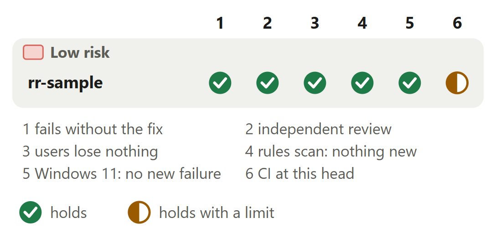

# The pack validation cases pass again at 0.2.1

For [pull request #1039](https://github.com/neralabs/rerail/pull/1039), head 62e23983f3. [report.html](report.html) is the same report as one page: download it and open it.

## 1. The decision

**May the `rr-sample` fixture's core range start at 0.2.1, and the check 5 case pass core's version in on each side of it?**

**We recommend:** approve it: since the 0.2.1 release commit, 15 cases of `main`'s unit tests fail in each pull request whose unit jobs run that file, and this changes one fixture line and one test case.

| Size | Risk and review | Waits on | Not verified |
|---|---|---|---|
| 26 lines in 2 files: 0 ship, 26 are the tests it changes, 0 are other tests and text | Fast. One test fixture and one test case, no product code. | Nothing. CI on GitHub runs at this head. | 2 |

## 2. Intent, and the gap

| Change | Intended | Found | Now |
|---|---|---|---|
| The fixture's core range | The fixture passes validation _(test name)_ | 15 cases fail since the release _(CI runs)_ | Closes the gap. |

Found on 24 November 2026: the unit jobs of three open pull requests failed the same 15 cases, none of which they touch.

Sources at main, and causes

| Change | Where main states the intent | The cause, and what was measured |
|---|---|---|
| The fixture's core range | `test/engine/catalog/packs.test.ts` and `conformance/pack-validation.ts:553` at `main` 977061ebd. | The check turns on once core's own version reaches 0.2.1, and the cases read the fixture at the repository's version. |

## 3. Where to look

1. **Read first**, 3 min: `packs.test.ts`: the check 5 case. Does the case hold the check off below 0.2.1 and on from it, with the version passed in?
2. 1 min: `fixtures/packs/rr-sample/package.json`: the core range.

**Then skim**, 1 min: Nothing else changes.

## 4. Risk against verification

One change, low risk: a test fixture's range and one test case; the validation and the release scripts are as they were.

Each half mark's limit

| Change | Check | It holds with this limit |
|---|---|---|
| rr-sample | CI at this head | CI on GitHub runs at this head; the 15 cases it fixes fail on `main` in every other pull request. |

## 5. The changes

**The fixture's range starts at 0.2.1**, low risk: `main` fails 15 cases since the release commit; here the block passes on Linux x64 and Windows 11.

<b>6. The decisions</b>

**How do the cases stop depending on the version the repository is at?**

**We chose** the fixture names the first release that reads its rules, and the check's own case passes the version in. **Would change our mind:** A maintainer who wants the Release pull request to raise fixtures' ranges with the packs'.

| Option | What a user gets | Cost | What it breaks |
|---|---|---|---|
| The fixture's range at `>=0.2.1-0`, the check's case with the version passed in **(chosen)** | The 15 cases pass at 0.2.1 and at any later version; the check is held on both sides of 0.2.1. | 19 added and 7 removed lines in one fixture and one test file. | Nothing: the fixture's rules already needed 0.2.1 to be read. |
| A fixed core version passed to every case of the block | The same 15 cases pass. | Every case of the block changes. | The fixture keeps a range that the check it exercises refuses. |
| The Release pull request raises the fixtures' ranges with the packs' | A release keeps fixtures in step by itself. | A release script that edits test inputs, with tests of its own. | A design call for the release's owners; named under what is not covered. |

**Evidence.** At `main` 977061ebd the block fails 15 cases and passes 5; at the commit before the release it passes 20; here it passes 24, and five mutants of the check and of the range each fail their rows.

<b>7. How it fits</b>

Nothing has to merge first: it is one commit on `main` 977061ebd. No other open pull request of ours edits either file; once it is on `main`, other pull requests' CI stops failing these 15 cases.

<b>8. What is not covered</b>: 2 not verified, 1 limit that stays

1. **macOS** never ran.
2. **The whole file's 30 runs** 15 rounds ended on Windows 11 with the block green; the Linux rounds were still running when this was written, after 24 single runs with the block green.

**Limits that stay**

- The Release pull request raises the core range of the shipped packs only, never a fixture's. A fixture that ships what a later release is the first to read would turn `main` red at that release again. Not changed here.

## 9. What we ask of you

We ask no ruling.

<b>10. Evidence</b>

The description on GitHub is the record: "How you tested it" holds the runs on `main` and here.

| Where | What ran | Result |
|---|---|---|
| Linux x64 | The block "rules written in .rerail" with CI's unit environment, at `main` 977061ebd and at 39e5b4998, the commit before the release | `main`: 15 failed, 5 passed. Before the release: 20 passed. |
| Windows 11 | The whole file at `main` 977061ebd | The same 15 cases failed, beside 12 licence cases that fail on any machine without the pack test data. |
| Linux x64, Windows 11 | The block here | 24 passed on Linux x64; on Windows 11 the block passed in each of 15 rounds of the whole file. |
| Linux x64 | Five mutants: the check on at any version, never on, on only at 0.2.1; the fixture's range at `>=0.1.0-0` and at `>=0.2.0-0` | Each fails its rows: 1, 2, 1, 17 and 17 cases. |
| Linux x64 | The type check, and the six test files that read pack validation | The type check passed; the block passed; 12 licence cases failed for lack of the pack test data, as at `main`. |

**Sources.** The branch at 62e23983f3 and its diff against `main` 977061ebd, read on 24 November 2026; runs at both on Linux x64 machines and Windows 11 machines.

