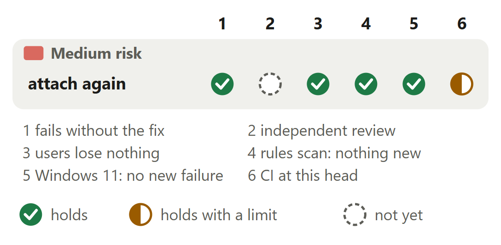

# Pi tries a failed attach again and counts what it drops

For [pull request #1161](https://github.com/neralabs/rerail/pull/1161), head 7daa9db4f9. [report.html](report.html) is the same report as one page: download it and open it.

## 1. The decision

**May Pi's extension try a failed attach again in the same session, through one module it shares with OMP's extension?**

1. After a failed start, Pi tries again after 1 s, doubling up to 30 s.
2. A prompt that waited on a failed try still shows that failure, as in OMP.

**We recommend:** approve it once you agree to answers 1 and 2: after a failed daemon start every prompt failed at `main`, and here the next prompt after the retry is recorded; OMP's cases pass unchanged.

| Size | Risk and review | Waits on | Not verified |
|---|---|---|---|
| 554 lines in 9 files: 404 ship, 150 are tests and text | Standard. The automated reviewer can approve. | Nothing. It stands alone on `main` ef885f6e1c. | 2 |

## 2. Intent, and the gap

| Change | Intended | Found | Now |
|---|---|---|---|
| A failed start | Dropped events recorded as a gap _(docs)_ | Prompts failed; nothing counted _(real daemon, Linux x64)_ | Closes the gap, changes answer 1. |
| A prompt mid-try | A racing event reports the failure _(a test's name)_ | Reported, never counted, in Pi _(one reading)_ | Closes the gap, changes answer 2. |

Found on 26 November 2026 through Pi 1.5.2's resource loader and a real daemon on Linux x64.

Sources at main, and causes

| Change | Where main states the intent | The cause, and what was measured |
|---|---|---|
| A failed start | `docs/in-session-surfaces.md` at `main`: "Events the OMP or Pi extension cannot hand to the daemon are recorded as a gap, not lost silently." `initializeNow` in `src/hosts/pi/pi-extension.ts` attaches once per session event, and nothing schedules another. | The gap count lives in `NativeSessionClient`, which only a successful attach creates. After a failed start the `input` handler finds no session and throws, and the other handlers return with nothing counted. OMP keeps a failed attach going with `attachBackoffMs`; Pi had no such retry. |
| A prompt mid-try | `test/hosts/omp/session-lifecycle.test.ts` at `main`, for both OMP and Pi: "reports startup failure to racing events, steers no later delta of the failed attach, and attaches on retry". | Pi's `sessionFor` waits on the attach in flight and rethrows its failure; OMP's `ingestEvent` counts the event first, then rethrows. |

## 3. Where to look

1. **Read first**, 8 min: `pi-host-adapter.ts`: `liveSession`, `sessionOrDrop`, the `input` handler. Is every Pi event either handed to the session Pi is in, or counted while it fails to attach?
2. 8 min: `attach-retry.ts`, OMP's `extension.ts` and `pi-extension.ts`.

**Then skim**, 5 min: Five new cases and one added check in a Pi case; OMP's cases unchanged. One docs sentence, one release note.

## 4. Risk against verification

Start with `sessionOrDrop`: it decides, for every Pi event, between the session and the count.

Each limit, and each check that does not hold yet

| Change | Check | Its limit, or why it does not hold yet |
|---|---|---|
| attach again | independent review | No review by another reader yet: our own reading against the repository's review points only. |
| attach again | CI at this head | CI on GitHub runs once the pull request opens. |

## 5. The changes

**Pi attaches again after failing**, medium risk: Three prompts after a failed start: all three failed at `main`; here each is taken and counted.

**6. The decisions:** we made no choice here that a maintainer could have made differently.

<b>7. How it fits</b>

It stands alone on `main` ef885f6e1c, which Git merged into it with no conflict, and needs no other pull request. `docs/in-session-surfaces.md`, which #1150 and #1142 changed on other lines, was read at the merge: both hold. #1076, #1126 and #1143 share no file.

<b>8. What is not covered</b>: 2 not verified, 2 limits that stay

1. **Pi's own agent loop** and a model were not run: the handlers were called as Pi 1.5.2's runner calls them.
2. **macOS** never ran.

**Limits that stay**

- A prompt typed during a try that then fails shows that try's failure once, as in OMP.
- An attached session whose daemon goes away stays with the daemon client's own breaker, unchanged.

## 9. What we ask of you

Asks 1 and 2 rule on answers 1 and 2.

1. **May Pi's extension retry a failed attach as OMP's does, through one module both use?** We recommend yes: at `main` Pi stayed off for the session.
2. **May a Pi prompt that waited on a failed try show that failure, as in OMP?** We recommend yes: the shared lifecycle case says so for both.

<b>10. Evidence</b>

The description on GitHub is the record. "How you tested it" holds the runs at `main` and at this head.

| Where | What ran | Result |
|---|---|---|
| Linux x64 | At this head, the merge of `main` ef885f6e1c: Pi 1.5.2's loader, a real daemon whose first start fails, 5 runs each | `main`: 5 of 5, all three prompts failed. Here: 5 of 5 took them; the retry attached and recorded the gap. |
| Windows 11 | At this head: the three changed test files, 15 runs on each of two machines | 30 of 30 passed, 45 cases in each run. |
| Windows 11, Linux x64 | The new cases over `main`'s source, then here | `main`: 6 of 42 fail, the first with the issue's error. Here: 42 of 42. |
| Windows 11, Linux x64 | Eleven mutants, one deciding line each | Each fails a case on both systems. |
| Windows 11 | Every test file that imports a changed module, before the merge | `main`: 140 passed, 1 skipped. Here: 145 passed, the same skip. |
| Linux x64 | The same files, at this head | `main`: 141 passed. Here: 146 passed. |

**Sources.** The pull request and its diff, read on 26 November 2026. Rerail at `main` e29282a55f for the quoted intent; the issue's runs at `main` 8d62b17476.

